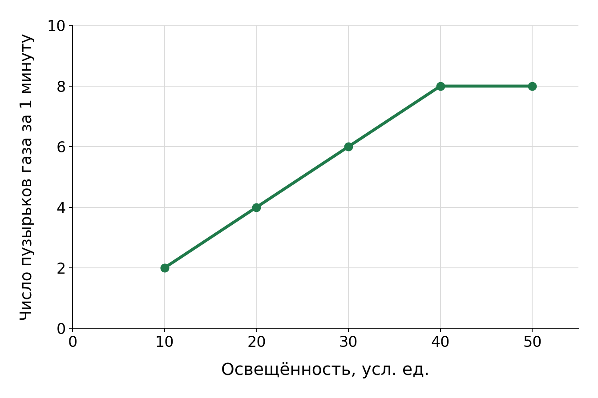

# Входная диагностика: основы биологии

28 заданий · 40 минут · «ХимБио просто»

Имя: ____________________  Класс: ____________________  Контакт: ____________________

Работа поможет выбрать стартовую практику. Если не знаешь ответ, пропусти задание и вернись к нему позже.

## Перед началом

- Работай самостоятельно, без учебника, поисковика и калькулятора. Можно использовать черновик.
- «Один ответ» — одна буква. «Несколько ответов» — все верные буквы; их не менее двух. В соответствии запиши четыре пары, например `1–А, 2–Б, 3–В, 4–Г`; каждая буква используется один раз.
- На инструкцию и финальную проверку оставь 4 минуты. Блоки занимают примерно 4 + 6 + 5 + 8 + 5 + 8 = 36 минут. Через 40 минут остановись.
- Каждое задание даёт максимум **1 балл**, всего **28**. Один ответ: 1, если выбрана ровно одна верная буква; иначе 0. Несколько ответов: 1 за полный верный набор; 0,5 за непустую часть верного набора без неверных вариантов; иначе 0. Соответствие: по 0,25 за каждую верную пару; две буквы для одной строки дают 0 за эту пару. Пустой ответ — 0.

## Блок 1. Математика для биологии — 4 задания, около 4 минут

### 1. Один ответ

Из 80 семян проросло 15 %. Сколько семян проросло?

- А. 8
- Б. 12
- В. 15
- Г. 68

### 2. Один ответ

На участке 25 растений с белыми и красными цветками. Число растений с белыми цветками относится к числу растений с красными как 2 : 3. Сколько растений с белыми цветками?

- А. 5
- Б. 15
- В. 12,5
- Г. 10

### 3. Один ответ

Длина клетки равна 0,012 мм. Вырази её в микрометрах: 1 мм = 1000 мкм.

- А. 0,12 мкм
- Б. 1,2 мкм
- В. 12 мкм
- Г. 120 мкм

### 4. Соответствие

Соотнеси длину в миллиметрах и ту же длину в микрометрах. **Каждая буква используется один раз.**

| № | Длина в мм | Буква | Длина в мкм |
|---|---|---|---|
| 1 | 0,2 мм | А | 45 мкм |
| 2 | 0,045 мм | Б | 1500 мкм |
| 3 | 1,5 мм | В | 8 мкм |
| 4 | 0,008 мм | Г | 200 мкм |

## Блок 2. Клетка — 5 заданий, около 6 минут

### 5. Один ответ

Что отличает бактериальную клетку от клетки мякоти зелёного листа?

- А. В бактериальной клетке нет ДНК.
- Б. В бактериальной клетке нет ядра, окружённого оболочкой.
- В. В бактериальной клетке нет клеточной мембраны.
- Г. В бактериальной клетке нет рибосом.

### 6. Один ответ

Какую функцию выполняет клеточная мембрана?

- А. Синтезирует белки.
- Б. Хранит основную часть ДНК клетки человека.
- В. Служит жёсткой клеточной стенкой.
- Г. Регулирует переход веществ между клеткой и средой.

### 7. Несколько ответов

Сравни клетку мякоти зелёного листа и живую клетку кожи человека. Какие структуры есть у обеих?

- А. Клеточная мембрана
- Б. Хлоропласты
- В. Митохондрии
- Г. Рибосомы

### 8. Один ответ

В клетке есть мембрана, ядро, митохондрии и хлоропласты. Какая это клетка?

- А. Клетка кожи человека
- Б. Клетка бактерии
- В. Клетка мякоти зелёного листа
- Г. Клетка грибницы шляпочного гриба

### 9. Соответствие

Соотнеси структуру клетки и её роль. **Каждая буква используется один раз.**

| № | Структура | Буква | Роль |
|---|---|---|---|
| 1 | Рибосома | А | Поддерживает форму растительной клетки; лежит снаружи мембраны |
| 2 | Митохондрия | Б | Синтезирует белки |
| 3 | Хлоропласт | В | Участвует в клеточном дыхании; помогает обеспечивать клетку энергией |
| 4 | Клеточная стенка | Г | Осуществляет фотосинтез |

## Блок 3. Вещества клетки — 4 задания, около 5 минут

### 10. Один ответ

Какая роль воды в клетке указана верно?

- А. Растворяет многие вещества и создаёт среду для реакций.
- Б. Хранит наследственную информацию.
- В. Образует основу клеточной стенки растений.
- Г. Служит основным запасом энергии.

### 11. Несколько ответов

Какие утверждения о веществах клетки верны?

- А. Глюкоза — углевод; клетка может использовать её как источник энергии.
- Б. Жиры могут служить запасом энергии.
- В. Все белки хранят наследственную информацию.
- Г. Фосфолипиды входят в состав клеточных мембран.

### 12. Один ответ

Какое вещество хранит наследственную информацию в клетке?

- А. Крахмал
- Б. Жир
- В. Вода
- Г. ДНК

### 13. Соответствие

Соотнеси вещество и его роль. **Каждая буква используется один раз.**

| № | Вещество | Буква | Роль |
|---|---|---|---|
| 1 | Углевод: крахмал | А | Входит в основу клеточных мембран |
| 2 | Липиды: фосфолипиды | Б | Хранит наследственную информацию |
| 3 | Белок: амилаза | В | Служит запасом питательных веществ у растений |
| 4 | Нуклеиновая кислота: ДНК | Г | Ускоряет расщепление крахмала |

## Блок 4. Питание — 5 заданий · 8 минут

### 14. Один ответ

Что служит источником энергии для фотосинтеза зелёного растения?

- А. Минеральные соли почвы
- Б. Свет
- В. Углекислый газ
- Г. Вода

### 15. Один ответ

Где у человека начинается расщепление крахмала под действием фермента слюны?

- А. В пищеводе
- Б. В желудке
- В. В ротовой полости
- Г. В толстой кишке

### 16. Несколько ответов

Выбери верные утверждения о питании зелёного растения.

- А. Углерод для образования органических веществ при фотосинтезе поступает из CO₂.
- Б. Корень поглощает из почвы готовую глюкозу как основной источник питания растения.
- В. Корень поглощает из почвы воду и растворённые минеральные вещества.
- Г. Свет поставляет растению атомы углерода для образования органических веществ.

### 17. Несколько ответов

Выбери верные утверждения о пищеварении человека.

- А. Белки пищи всасываются в основном целыми молекулами, без расщепления.
- Б. Пищеварительные ферменты помогают расщеплять крупные молекулы питательных веществ.
- В. Механическая обработка пищи происходит только в желудке.
- Г. В тонкой кишке продукты пищеварения всасываются в кровь или лимфу.

### 18. Соответствие

Соотнеси орган и его функцию. **Каждая буква используется один раз.**

| № | Орган | Буква | Функция |
|---|---|---|---|
| 1 | Корень растения | А | Перемещение пищи из глотки в желудок |
| 2 | Лист зелёного растения | Б | Фотосинтез и газообмен с воздухом |
| 3 | Пищевод человека | В | Начало расщепления белков в кислой среде |
| 4 | Желудок человека | Г | Поглощение воды и минеральных веществ из почвы |

## Блок 5. Дыхание и транспорт — 5 заданий · 5 минут

### 19. Один ответ

В каком направлении кислород проходит при газообмене в лёгких здорового человека?

- А. Из воздуха в альвеолах в кровь
- Б. Из крови в воздух в альвеолах
- В. Из желудка в альвеолы
- Г. Из крови в просвет бронхов

### 20. Несколько ответов

Выбери верные утверждения.

- А. Живые клетки растения дышат и днём, и ночью.
- Б. Все артерии человека несут кровь, богатую кислородом.
- В. Флоэма переносит органические вещества только вниз, от листьев к корням.
- Г. Ксилема переносит воду и растворённые минеральные вещества от корней к надземным частям растения.

### 21. Один ответ

Какое утверждение о флоэме верно?

- А. Она переносит только воду и минеральные вещества.
- Б. В ней органические вещества всегда движутся от корней к листьям.
- В. Она доставляет воздух из листьев к корням.
- Г. Она переносит органические вещества от мест их образования или запаса к местам потребления.

### 22. Один ответ

Какой признак отличает артерию от вены у человека?

- А. Любая артерия несёт кровь, богатую кислородом.
- Б. По артерии кровь движется от сердца.
- В. Артерии есть только в большом круге кровообращения.
- Г. По артерии кровь движется к сердцу.

### 23. Соответствие

Соотнеси компонент крови и его функцию. **Каждая буква используется один раз.**

| № | Компонент крови | Буква | Функция |
|---|---|---|---|
| 1 | Эритроциты | А | Участие в свёртывании крови |
| 2 | Лейкоциты | Б | Жидкая среда для переноса растворённых веществ |
| 3 | Тромбоциты | В | Перенос кислорода с помощью гемоглобина |
| 4 | Плазма | Г | Защита от возбудителей инфекций |

## Блок 6. Схемы и график — 5 заданий · 8 минут

### 24. Один ответ

В схеме уровни организации тела человека расположены от простого к сложному:

**клетка → ткань → X → система органов → организм**

Что обозначено буквой X?

- А. Молекула
- Б. Органелла
- В. Популяция
- Г. Орган

### График для заданий 25–27

Ученик наблюдает водное растение при разной освещённости. Он считает пузырьки газа, выделившиеся за 1 мин. Все остальные условия одинаковы.

### 25. Один ответ

Сколько пузырьков газа за 1 мин выделилось при освещённости 30 условных единиц?

- А. 3
- Б. 8
- В. 6
- Г. 30

### 26. Несколько ответов

Какие выводы подтверждает график?

- А. При освещённости 10 условных единиц пузырьков больше, чем при 40.
- Б. При увеличении освещённости с 10 до 40 условных единиц число пузырьков за 1 мин увеличилось.
- В. При освещённости 40 и 50 условных единиц число пузырьков за 1 мин одинаково.
- Г. При освещённости 100 условных единиц растение выделит 16 пузырьков за 1 мин.

### 27. Один ответ

Как проверить влияние освещённости на число пузырьков газа за 1 мин?

- А. Менять только освещённость, сохраняя температуру и остальные условия одинаковыми.
- Б. Вместе с освещённостью каждый раз повышать температуру воды.
- В. При каждом уровне освещённости считать пузырьки за разное время.
- Г. Для каждого уровня освещённости брать растение другого вида.

### 28. Соответствие

Соотнеси часть растения и её роль на пути воды из почвы к листу. **Каждая буква используется один раз.**

| № | Часть растения | Буква | Роль |
|---|---|---|---|
| 1 | Корневой волосок | А | Проведение воды по стеблю к листьям |
| 2 | Сосуды корня | Б | Испарение воды через устьица |
| 3 | Сосуды стебля | В | Поглощение воды из почвы |
| 4 | Лист | Г | Проведение воды внутри корня |
