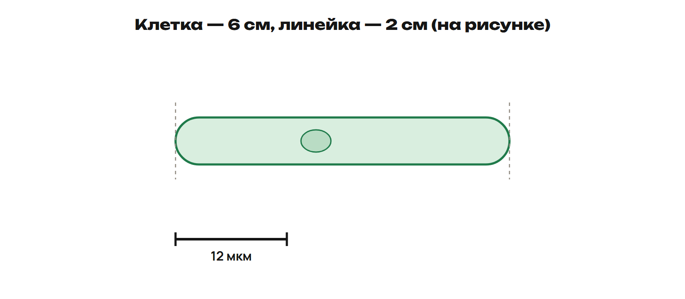
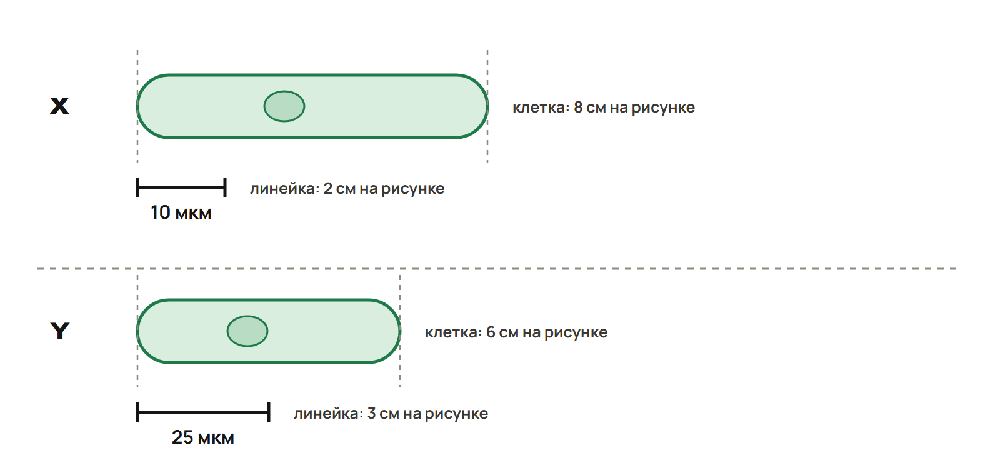

Образец строки в Telegram: `Общее: 1В 2Б 3АВД 4: А2 Б4 …`. Это образец записи, а не ключ. В соответствии G4 запиши все четыре пары. Для варианта начни с его буквы: `B: 1Г 2А …`.

В тесте номер — число после буквы ID. Ответ на G5 запиши как `5В`. После соответствия поставь точку с запятой. Фото решений подпиши номерами 9 и 10; ответ на «Найди ошибку» пришли отдельно с номером 11.

> [!rule] Размер и единица
> 1 мм = 1000 мкм. Из мм в мкм умножай на 1000; обратно дели на 1000.
> Размер клетки = длина клетки на рисунке / длина линейки на рисунке × подпись линейки.
> Обе длины на рисунке измеряй в одной единице. Запиши действия и единицу результата.

## Когда работать

Всю общую часть выполни **после урока 1, до урока 2: 35 минут**. Тест — 12 минут, тетрадь — 18, «Найди ошибку» — 5. Принеси свои ответы и вопросы на урок 2.

После урока 2 выполни **один вариант за 30 минут**: тест — 12 минут, тетрадь — 14, «Найди ошибку» — 4. Вариант выбери с преподавателем: A — углубление, B — закрепление, C — поддержка.

Вся самостоятельная работа недели — **150 минут**: конспект 25 + закрепление P1–P6 20 + общая часть 35 + один вариант 30 + исправления 25 + повторение 15. Если не успел, сообщи время и ID, на котором остановился. Срок сдачи назначит преподаватель.

## Общее. Часть 1 — тест, 12 минут

Пришли G1–G8 одной строкой с меткой «Общее». Один ответ — одна буква; несколько ответов — все выбранные буквы; соответствие — четыре пары. G1–G2 закрепляют перевод единиц и чтение масштаба; G3 проверяет факты недели.

**G1. Один ответ · строка теста.** Переведи **0,025 мм** в мкм.

- А) 0,025 мкм.
- Б) 2,5 мкм.
- В) 25 мкм.
- Г) 250 мкм.

**G2. Один ответ · строка теста.** На рисунке объект втрое длиннее масштабной линейки с подписью **20 мкм**. Какова реальная длина объекта?

- А) 20 мкм.
- Б) 60 мкм.
- В) 6 мкм.
- Г) 600 мкм.

**G3. Несколько ответов · формат ЕНТ · строка теста.** Выбери все верные утверждения о фактах недели. В задании шесть вариантов, верных от двух до трёх.

- А) Р. Гук в 1665 году ввёл термин «клетка», изучая срез пробки.
- Б) А. ван Левенгук в 1892 году открыл вирусы табачной мозаики.
- В) ДНК есть в митохондриях и пластидах.
- Г) Р. Вирхов в 1665 году ввёл термин «клетка».
- Д) Д. И. Ивановский в 1892 году открыл вирусы при исследовании табачной мозаики.
- Е) ДНК эукариотической клетки хранится в вакуоли.

**G4. Соответствие · строка теста.** Сопоставь структуру и основную функцию. Каждую функцию используй один раз.

- А) Рибосома.
- Б) Митохондрия.
- В) Аппарат Гольджи.
- Г) Эндоплазматическая сеть, ЭПС.

Функции: **1 — модификация, сортировка и упаковка веществ; 2 — синтез белка; 3 — клеточное дыхание и образование АТФ; 4 — синтез и перемещение веществ**.

**G5. Один ответ · строка теста.** В клетке бактерии есть ДНК и рибосомы, но нет оформленного ядра. Какой вывод верен?

- А) Это эукариотическая клетка без наследственной информации.
- Б) Это вирус, потому что ядра нет.
- В) Это прокариотическая клетка; наследственная информация есть.
- Г) Это животная клетка; ДНК находится в хлоропластах.

**G6. Несколько ответов · строка теста.** Выбери структуры, общие для клетки мякоти зелёного листа и живой клетки кожи человека.

- А) Клеточная мембрана.
- Б) Хлоропласты.
- В) Рибосомы.
- Г) Клеточная стенка.

**G7. Один ответ · строка теста.** С какой ролью связана высокая теплоёмкость воды?

- А) Вода хранит наследственную информацию.
- Б) Вода снижает быстрые колебания температуры организма.
- В) Вода служит запасом энергии.
- Г) Вода образует жёсткую клеточную стенку.

**G8. Один ответ · строка теста.** Какой элемент входит в состав хлорофилла?

- А) Железо.
- Б) Кальций.
- В) Натрий.
- Г) Магний.

## Общее. Часть 2 — тетрадь, 18 минут

Реши G9 и G10. Пришли читаемое фото с номерами, действиями и объяснениями.

**G9. Решение в тетради · фото.** Длина клетки на рисунке — **6 см**, длина масштабной линейки — **2 см**; подпись линейки — **12 мкм**. Запиши отношение длин, найди реальный размер клетки в мкм и мм. Объясни, почему экранная длина клетки без масштабной линейки не даёт её реального размера. Используй данные условия, а не размер картинки на твоём экране.

**G10. Решение в тетради · фото.** R — клетка мякоти зелёного листа: есть ядро, стенка, хлоропласты и крупная центральная вакуоль. S — клетка мышцы человека: есть ядро, мембрана и митохондрии.

Назови тип каждой клетки: прокариотическая или эукариотическая, растительная или животная. Назови две общие структуры. Объясни функции клеточной стенки и митохондрии.

## Общее. Найди ошибку — 5 минут

**G11. Найди ошибку · 1–2 фразы или голосовое.** Ученик сказал: «У бактерии нет оформленного ядра, поэтому у неё нет ДНК. Вирус — такая же клетка без ядра». Исправь оба вывода и пришли объяснение в Telegram.

## Вариант A. Углубление

Выполни после урока 2, если выбрали этот вариант с преподавателем.

### Часть 1 — тест, 12 минут

Пришли A1–A8 одной строкой с меткой «A». Один ответ — одна буква; несколько ответов — все выбранные буквы; соответствие — четыре пары. A1 проверяет факт недели; A2–A3 закрепляют перевод единиц и чтение масштаба.

**A1. Один ответ · строка теста.** Кто первым увидел бактерии и простейших?

- А) Р. Гук.
- Б) А. ван Левенгук.
- В) Д. И. Ивановский.
- Г) К. Гольджи.

**A2. Один ответ · строка теста.** На рисунке длина объекта — **7,5 см**, линейки — **2,5 см**. Линейка обозначает **5 мкм**. Какова реальная длина объекта?

- А) 3 мкм.
- Б) 37,5 мкм.
- В) 15 мкм.
- Г) 0,015 мкм.

**A3. Несколько ответов · строка теста.** Выбери все верные равенства.

- А) 0,002 мм = 2 мкм.
- Б) 0,6 мм = 6 мкм.
- В) 75 мкм = 0,075 мм.
- Г) 1000 мкм = 0,01 мм.

**A4. Соответствие · строка теста.** Сопоставь структуру и функцию. Каждую функцию используй один раз.

- А) Аппарат Гольджи.
- Б) Крупная центральная вакуоль зрелой растительной клетки.
- В) Шероховатая ЭПС с рибосомами.
- Г) Цитоплазма.

Функции: **1 — содержит клеточный сок, помогает поддерживать тургор; 2 — синтез и перемещение белков; 3 — внутренняя среда многих клеточных процессов; 4 — модификация, сортировка и упаковка веществ**.

**A5. Один ответ · строка теста.** В клетке корня растения есть ядро и клеточная стенка, но хлоропластов нет. Какой вывод верен?

- А) Клетка стала животной, потому что не имеет хлоропластов.
- Б) Это бактерия, потому что есть стенка.
- В) ДНК у этой клетки отсутствует.
- Г) Это растительная эукариотическая клетка; хлоропласты есть не во всех клетках растения.

**A6. Несколько ответов · строка теста.** Выбери все верные утверждения.

- А) У бактерии могут быть ДНК и рибосомы без оформленного ядра.
- Б) Растительная клетка не нуждается в митохондриях.
- В) Вирус — эукариотическая клетка без ядра.
- Г) Клеточная стенка растительной клетки находится снаружи мембраны.

**A7. Один ответ · строка теста.** Пот испаряется с поверхности кожи. Какая связка объясняет охлаждение?

- А) Вода запасает энергию → температура кожи снижается.
- Б) Испарение воды отводит тепло → поверхность охлаждается.
- В) Вода превращается в ДНК → расходуется тепло.
- Г) Растворённые соли превращаются в клеточную стенку → кожа охлаждается.

**A8. Один ответ · строка теста.** Какой объект относится к уровню органа?

- А) Клетка почки.
- Б) Эпителиальная ткань.
- В) Почка.
- Г) Мочевыделительная система.

### Часть 2 — тетрадь, 14 минут

Пришли фото решений A9 и A10 с номерами, вычислениями и объяснениями.

**A9. Решение в тетради · фото.** На рисунке X клетка имеет длину **8 см**, линейка — **2 см** с подписью **10 мкм**. На рисунке Y клетка имеет длину **6 см**, линейка — **3 см** с подписью **25 мкм**.

Найди реальную длину каждой клетки в мкм и мм. Какая клетка крупнее? Объясни, почему сравнение только длин 8 см и 6 см привело бы к неверному ответу. Используй данные условия.

**A10. Решение в тетради · фото.** У R есть ядро, клеточная стенка и крупная центральная вакуоль, хлоропластов нет. У S есть ДНК, рибосомы и мембрана, но нет оформленного ядра. Известно, что одна клетка взята из корня растения, другая — бактерия.

Определи R и S, обоснуй каждый выбор. Объясни, почему отсутствие хлоропластов не делает R животной клеткой, а отсутствие оформленного ядра не лишает S наследственной информации.

### Найди ошибку — 4 минуты

**A11. Найди ошибку · 1–2 фразы или голосовое.** Ученик сказал: «Вода растворяет абсолютно все вещества. Поэтому она служит главным запасом энергии клетки». Исправь обе части высказывания и пришли объяснение.

## Вариант B. Закрепление

Выполни после урока 2, если выбрали этот вариант с преподавателем.

### Часть 1 — тест, 12 минут

Пришли B1–B8 одной строкой с меткой «B». Один ответ — одна буква; несколько ответов — все выбранные буквы; соответствие — четыре пары. B1 проверяет факт недели; B2–B3 закрепляют перевод единиц и чтение масштаба.

**B1. Один ответ · строка теста.** По имени какого учёного назван органоид, который модифицирует, сортирует и упаковывает вещества?

- А) Р. Вирхов.
- Б) М. Шлейден.
- В) Т. Шванн.
- Г) К. Гольджи.

**B2. Один ответ · строка теста.** Клетка на рисунке втрое длиннее линейки с подписью **8 мкм**. Найди реальную длину клетки.

- А) 24 мкм.
- Б) 8 мкм.
- В) 3 мкм.
- Г) 240 мкм.

**B3. Несколько ответов · строка теста.** Выбери все верные равенства.

- А) 0,08 мм = 8 мкм.
- Б) 600 мкм = 0,6 мм.
- В) 40 мкм = 0,4 мм.
- Г) 0,009 мм = 9 мкм.

**B4. Соответствие · строка теста.** Сопоставь структуру и функцию. Каждую функцию используй один раз.

- А) Клеточная мембрана.
- Б) Хлоропласт.
- В) Ядро эукариотической клетки.
- Г) Крупная центральная вакуоль зрелой растительной клетки.

Функции: **1 — хранение основной части ДНК клетки; 2 — регулирование обмена между клеткой и средой; 3 — фотосинтез; 4 — содержание клеточного сока и поддержание тургора**.

**B5. Один ответ · строка теста.** Какой объект — неклеточная форма?

- А) Клетка кожи человека.
- Б) Бактерия.
- В) Клетка мякоти зелёного листа.
- Г) Вирус.

**B6. Несколько ответов · строка теста.** Выбери все верные утверждения о клетке мякоти зелёного листа.

- А) У этой клетки есть митохондрии.
- Б) У этой клетки есть хлоропласты.
- В) У этой клетки нет ДНК.
- Г) У этой клетки нет рибосом.

**B7. Один ответ · строка теста.** Вода растворяет многие соли. Как это помогает организму?

- А) Вода хранит последовательность наследственной информации.
- Б) Все вещества обязательно растворяются в воде.
- В) Растворённые вещества могут перемещаться и участвовать в реакциях в водной среде.
- Г) Вода заменяет все минеральные вещества.

**B8. Один ответ · строка теста.** Какой элемент входит в минеральную основу костей и зубов?

- А) Кальций.
- Б) Магний.
- В) Железо.
- Г) Азот.

### Часть 2 — тетрадь, 14 минут

Пришли фото решений B9 и B10 с номерами, действиями и объяснениями.

**B9. Решение в тетради · фото.** Переведи **35 мкм** в мм и покажи действие. На другом рисунке клетка занимает четыре длины линейки с подписью **10 мкм**. Найди её реальную длину в мкм и мм, покажи оба действия.

**B10. Решение в тетради · фото.** Запиши две связки «структура → функция»: для мембраны и для стенки растительной клетки. Объясни, где находится стенка относительно мембраны и почему эти структуры нельзя заменять друг другом в ответе.

### Найди ошибку — 4 минуты

**B11. Найди ошибку · 1–2 фразы или голосовое.** Ученик сказал: «Растительные клетки только фотосинтезируют. Митохондрий у них нет». Исправь вывод о митохондриях и назови их функцию.

## Вариант C. Поддержка

Выполни после урока 2, если выбрали этот вариант с преподавателем. Можно пользоваться конспектом. В каждом расчёте сначала назови исходную единицу и нужное действие.

### Часть 1 — тест, 12 минут

Пришли C1–C8 одной строкой с меткой «C». Один ответ — одна буква; несколько ответов — все выбранные буквы; соответствие — четыре пары. C1 проверяет факт недели; C2–C3 закрепляют перевод единиц и чтение масштаба.

**C1. Один ответ · строка теста.** С чьим именем связана фраза «Всякая клетка — от клетки»?

- А) Р. Гук.
- Б) Д. И. Ивановский.
- В) А. ван Левенгук.
- Г) Р. Вирхов.

**C2. Один ответ · строка теста.** Клетка занимает две длины масштабной линейки. Подпись линейки — **7 мкм**. Умножь число длин линейки на её подпись.

- А) 7 мкм.
- Б) 14 мкм.
- В) 2 мкм.
- Г) 140 мкм.

**C3. Несколько ответов · строка теста.** Выбери все верные равенства. Проверь каждое через 1 мм = 1000 мкм.

- А) 0,01 мм = 10 мкм.
- Б) 0,03 мм = 3 мкм.
- В) 20 мкм = 0,02 мм.
- Г) 500 мкм = 5 мм.

**C4. Соответствие · строка теста.** Сопоставь структуру и функцию. Каждую функцию используй один раз.

- А) Клеточная мембрана.
- Б) Ядро эукариотической клетки.
- В) Рибосома.
- Г) Хлоропласт.

Функции: **1 — фотосинтез; 2 — хранение основной части ДНК клетки; 3 — синтез белка; 4 — регулирование обмена между клеткой и средой**.

**C5. Один ответ · строка теста.** У бактерии нет оформленного ядра. Что верно?

- А) ДНК у бактерии есть; клетка прокариотическая.
- Б) ДНК у бактерии отсутствует.
- В) Бактерия — вирус.
- Г) Бактерия — клетка человека.

**C6. Несколько ответов · строка теста.** Выбери все верные утверждения о клетке мякоти зелёного листа.

- А) Мембрана есть только у животных клеток.
- Б) У этой растительной клетки есть стенка.
- В) У этой растительной клетки есть митохондрии.
- Г) Хлоропласты есть и у клеток кожи человека.

**C7. Один ответ · строка теста.** Какая роль воды связана с её испарением?

- А) Хранение ДНК.
- Б) Синтез белка на рибосоме.
- В) Создание запаса энергии.
- Г) Отведение тепла и охлаждение поверхности.

**C8. Один ответ · строка теста.** Какой элемент входит в состав гемоглобина?

- А) Кальций.
- Б) Железо.
- В) Магний.
- Г) Натрий.

### Часть 2 — тетрадь, 14 минут

Пришли фото решений C9 и C10 с номерами, действиями и объяснениями.

**C9. Решение в тетради · фото.** Сделай два расчёта.

1. Переведи **0,014 мм** в мкм: запиши `0,014 × 1000` и вычисли.
2. Клетка занимает три длины линейки с подписью **5 мкм**: запиши `3 × 5` и вычисли. Переведи полученный размер в мм делением на 1000.

**C10. Решение в тетради · фото.** Запиши две связки «структура → функция»: для мембраны и для рибосомы. Затем объясни, чем бактерия отличается от живой клетки кожи человека по оформленному ядру. Есть ли ДНК у обеих клеток? Начни с фразы «У бактерии…, а у живой клетки кожи…».

### Найди ошибку — 4 минуты

**C11. Найди ошибку · 1–2 фразы или голосовое.** Ученик поставил уровни так: «клетка → орган → ткань → система органов → организм». Найди переставленные уровни и пришли правильную цепочку.
