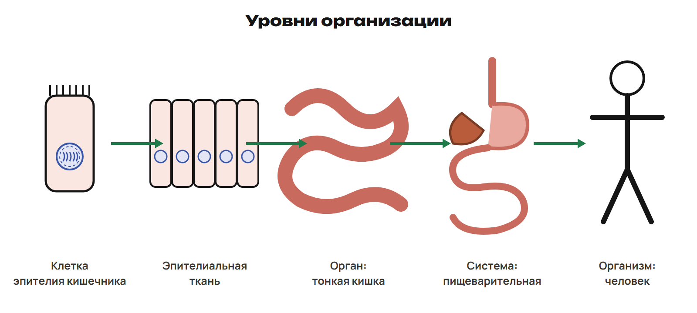
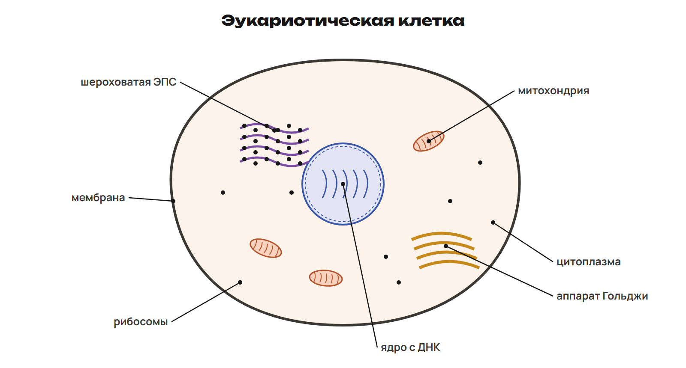
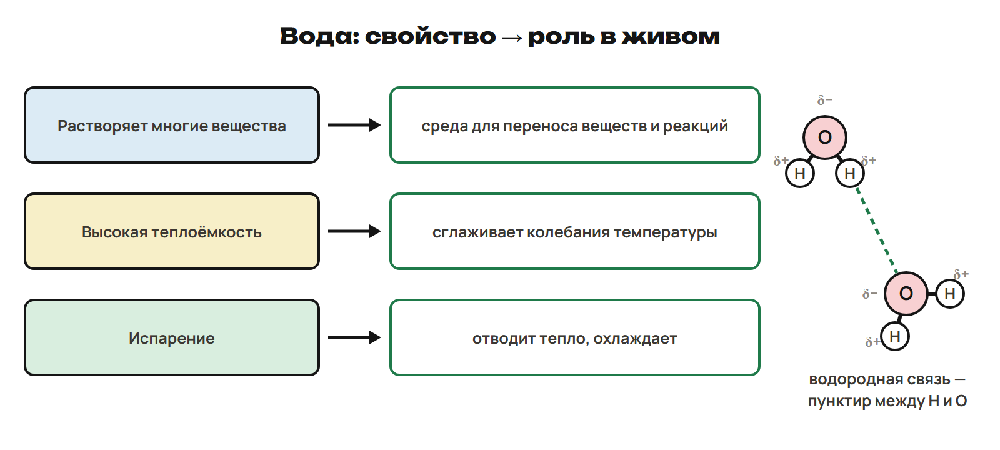

# От клетки к организму
? Чем клетка отличается от органа?
↳ Начнём с того, как устроен организм, и найдём место клетки.
> 0–12 минут. Объяснение с нуля: 2 минуты на цель, 6 на уровни, 4 на L1 и разбор. Предварительного чтения не требуется.

## Понятие: Клетка — основа клеточного организма
- **Клетка** — единица строения и жизнедеятельности клеточных организмов.
- Организм бывает одноклеточным или многоклеточным.
- Новые клетки возникают из уже существующих клеток.
- В многоклеточном организме клетки работают вместе.
> Назвать бактерию примером одноклеточного организма, человека — многоклеточного. Слово «вирус» разобрать при сравнении типов клеток.

## Схема: Пять уровней
Клетка
Клетка — отдельная живая единица
Ткань — клетки и межклеточное вещество, связанные строением и функцией
Орган — несколько тканей, выполняющих общую работу
Система органов — органы, работающие вместе
Организм — целое живое существо
> На примере человека пройти цепочку снизу вверх. Органелла — часть клетки; орган — часть многоклеточного организма.

## Пример: От клетки кишечника к человеку
1. Клетка эпителия кишечника входит в эпителиальную ткань.
2. Эпителиальная и другие ткани входят в тонкую кишку.
3. Тонкая кишка — орган пищеварительной системы.
4. Пищеварительная система — часть организма человека.
> Рисунок показывает уровни, а не путь пищи. Уточнить, что орган образован несколькими тканями.

## Понятие: Уровни на одном примере

> Сначала попросить назвать каждую подпись, затем пройти стрелки. Не ставить органеллу между тканью и органом.

## Ловушка: Орган и органелла
- **Органелла** — структура внутри клетки: например, митохондрия.
- **Орган** — часть организма: например, тонкая кишка.
- Ткань находится между клеткой и органом.

## Практика: L1 · 2 минуты
L1. Расставь от меньшего уровня к большему: человек; эпителиальная ткань; тонкая кишка; клетка эпителия кишечника; пищеварительная система.
Ответы:
L1. Клетка эпителия кишечника → эпителиальная ткань → тонкая кишка → пищеварительная система → человек.
> 2 минуты на свою цепочку, 2 на разбор. Просить объяснить место ткани, а не только прочитать ответ.

# Что делает каждая структура
? Как клетка обменивается веществами и выполняет свою работу?
↳ Нашли место клетки. Теперь рассмотрим её части и функции.
> 12–35 минут. 16 минут на объяснение и примеры, 3 на L2, 2 на разбор, 2 на итог. Каждой структуре дать одну основную функцию.

## Понятие: Граница и внутренняя среда
- **Мембрана** окружает клетку и регулирует обмен веществ с окружающей средой.
- **Цитоплазма** — внутренняя среда клетки с расположенными в ней структурами.
- В цитоплазме идут многие реакции.
- **ДНК** хранит наследственную информацию клетки.
- **Ядро** эукариотической клетки содержит основную часть её ДНК.
> Не называть мембрану жёсткой стенкой. Уточнить: ДНК может быть и вне ядра; отсутствие ядра не означает отсутствие ДНК.

## Понятие: Белок и энергия
- **Рибосомы** синтезируют белки.
- **Митохондрии** участвуют в клеточном дыхании и образовании АТФ.
- **АТФ** — переносчик энергии для работы клетки.
- В живых растительных клетках тоже есть митохондрии.
> Здесь нужны функция и место, без подробной цепочки реакций. Рибосомы есть и у бактерий.

## Понятие: Перемещение и упаковка веществ
- **ЭПС** — эндоплазматическая сеть: синтез и перемещение веществ в клетке.
- На шероховатой ЭПС есть рибосомы, синтезирующие белки.
- **Аппарат Гольджи** модифицирует, сортирует и упаковывает вещества.
> Показать ЭПС рядом с ядром и аппарат Гольджи как отдельную структуру. Не превращать объяснение в подробную схему пути белка.

## Схема: Найдём функцию
Клетка
Мембрана — регулирует обмен
Рибосома — синтезирует белок
Митохондрия — клеточное дыхание и образование АТФ
Аппарат Гольджи — модификация, сортировка и упаковка веществ

## Понятие: Основные структуры эукариотической клетки

> Найти структуры по подписи. Затем закрыть одну подпись и попросить назвать функцию.

## Пример: Найдём структуру по работе
1. Обмен с окружающей средой регулирует мембрана.
2. Белок собирают рибосомы; часть из них находится на шероховатой ЭПС.
3. Модификацией, сортировкой и упаковкой веществ занимается аппарат Гольджи.
4. Клеточное дыхание и образование АТФ связаны с митохондриями.

## Ловушка: Информация и энергия
- ДНК хранит наследственную информацию.
- АТФ переносит энергию для работы клетки.
- Ядро и митохондрия выполняют разные функции.

## Практика: L2 · 3 минуты
L2. Соотнеси: 1 мембрана, 2 рибосома, 3 митохондрия, 4 аппарат Гольджи.
А — синтез белка; Б — модификация, сортировка и упаковка веществ.
В — регулируемый обмен с окружающей средой; Г — клеточное дыхание и образование АТФ.
Ответы:
L2. 1В 2А 3Г 4Б.
> Открыть ключ после 3 минут. При ошибке попросить назвать работу структуры одним глаголом.

## Итог: Сначала функция, затем название
- Граница и обмен — мембрана.
- Наследственная информация — ДНК; основная её часть у эукариот находится в ядре.
- Синтез белка — рибосомы; синтез и перемещение веществ — ЭПС.
- Сортировка и упаковка — аппарат Гольджи.
- Клеточное дыхание и образование АТФ — митохондрии.

# Какие клетки бывают
? Можно ли определить тип клетки по одному отсутствующему признаку?
↳ Общие структуры знакомы. Сравним клетки и проверим различия.
> 35–50 минут. 10 минут на сравнение, 3 на L3, 2 на разбор. Все измеримые признаки задания даны словами.

## Понятие: Прокариотическая и эукариотическая клетка
- У **прокариотической клетки** нет оформленного ядра.
- Бактерия имеет ДНК, мембрану, цитоплазму и рибосомы.
- У большинства бактерий есть клеточная стенка.
- У типичной **эукариотической клетки** есть оформленное ядро.
- Клетки растений, животных и грибов — эукариотические.
> Сравнить наличие ядра, а не наличие наследственной информации. Стенку бактерии не называть растительной.

## Понятие: Клетка растения
- **Стенка** снаружи мембраны поддерживает форму и даёт опору.
- **Хлоропласт** выполняет фотосинтез.
- У зрелой растительной клетки часто есть крупная центральная **вакуоль** с клеточным соком.
- Вакуоль помогает поддерживать тургор — внутреннее давление, которое сохраняет упругость клетки.
- В клетке мякоти зелёного листа есть хлоропласты; во многих живых клетках корня их нет.
> Не приписывать хлоропласты любой растительной клетке. В клетке листа есть и митохондрии.

## Схема: Главные отличия
Признаки
Бактерия — ДНК есть, оформленного ядра нет
Клетка зелёного листа — ядро, стенка и хлоропласты
Живая клетка кожи человека — ядро есть, стенки и хлоропластов нет

## Понятие: Три клетки рядом

> В растительной клетке показать мембрану внутри стенки. У живой клетки кожи человека показать ядро, митохондрии и рибосомы; стенки и хлоропластов нет.

## Пример: Лист и кожа человека
1. Обе клетки имеют мембрану, цитоплазму, ядро, рибосомы и митохондрии.
2. У клетки мякоти зелёного листа есть стенка, хлоропласты и крупная центральная вакуоль.
3. У живой клетки кожи человека нет клеточной стенки и хлоропластов.
> Не утверждать, что в животных клетках вообще отсутствуют малые пузырьки или вакуоли. Сравниваются конкретные живые клетки.

## Ловушка: Нет ядра — не значит нет ДНК
- Бактерия — клеточный организм с ДНК, но без оформленного ядра.
- Вирус — **неклеточная форма**; у него нет клеточного устройства и собственных рибосом.
- Вирус использует клетку хозяина для воспроизведения.
- Отсутствие хлоропластов само по себе не делает клетку животной.

## Практика: L3 · 3 минуты
L3. В клетке К есть ДНК, мембрана и рибосомы; оформленного ядра нет.
В М есть ядро, стенка и хлоропласты. В Н есть ядро и митохондрии; стенки нет.
Назови тип К; выбери М или Н как клетку мякоти зелёного листа и живую клетку кожи человека.
Вирус относят к клеткам или неклеточным формам?
Ответы:
L3. К — прокариотическая; М — клетка мякоти зелёного листа; Н — живая клетка кожи человека; вирус — неклеточная форма.
> Попросить назвать признак для каждого выбора. Отсутствие оформленного ядра у К согласовать с наличием ДНК.

# Как узнать размер клетки
? Можно ли измерить клетку по сантиметрам на экране?
↳ Тип клетки определили. Теперь читаем размер по единице и масштабной линейке.
> 50–66 минут. 9 минут на перевод и отношение длин, 4 на L4, 3 на разбор. Размер на экране меняется при увеличении изображения, отношение к линейке сохраняется.

## Понятие: Масштабная линейка
- Подпись линейки показывает её действительную длину.
- Сравни длину объекта с длиной линейки **на том же изображении**.
- Длина объекта = отношение длин × подпись линейки.
- Увеличение **×400** не является длиной клетки.
> Отношение бывает дробным. Для размера используем подписанную линейку, а не сантиметры экрана.

## Схема: Миллиметр и микрометр
1 мм = 1000 мкм
мм → мкм — умножить на 1000
мкм → мм — разделить на 1000
Единица — обязательная часть ответа

## Пример: Перевод туда и обратно
1. 0,032 мм × 1000 = 32 мкм.
2. 75 мкм ÷ 1000 = 0,075 мм.
3. Проверка: 0,075 мм × 1000 = 75 мкм.
> Объяснить, почему число в более мелких единицах больше. Не сдвигать запятую без названия единицы.

## Пример: Полторы линейки
1. Линейка соответствует 20 мкм; клетка занимает 1,5 длины линейки.
2. Длина клетки: 1,5 × 20 мкм = 30 мкм.
3. В миллиметрах: 30 ÷ 1000 = 0,030 мм.
> Сначала найти отношение, потом умножить на подписанный размер. Изменение масштаба экрана не меняет ответ.

## Ловушка: Перепутать направление
- 0,032 мм — это **32 мкм**, а не 0,000032 мкм.
- В меньших единицах численное значение больше.
- Сам размер клетки при переводе не меняется.

## Понятие: Три длины линейки

> Рисунок иллюстрирует вторую часть L4. Все данные задания произнести и оставить на слайде с условием.

## Практика: L4 · 4 минуты
L4. а) Переведи 0,024 мм в мкм.
б) Длина клетки равна трём длинам масштабной линейки; линейка соответствует 12 мкм. Найди длину клетки.
Ответы:
L4. а) 0,024 × 1000 = 24 мкм. б) 3 × 12 мкм = 36 мкм.
> Попросить подписать единицу и показать одно действие в каждой части. При верном способе и ошибке в счёте дать пересчитать.

# Вода и минеральные вещества
? Почему вода помогает клетке работать и защищает от быстрого перегрева?
↳ Клетка имеет структуры и размер. Разберём вещества, которые нужны для её работы.
> 66–82 минуты. 2 минуты на качественную опору, 4 на свойства воды, 3 на минералы; 4 на L5, 3 на разбор. Сначала объяснить все свойства и три примера элементов.

## Понятие: Вода и ионы
- Формула воды — **H₂O**.
- Заряд внутри молекулы распределён неравномерно: у O сторона частично отрицательная, у H — частично положительная.
- Между молекулами воды возникает притяжение — **водородные связи**.
- **Ион** — заряженная частица; многие растворённые соли дают ионы.
> Молекула воды в целом нейтральна. Качественную модель использовать для объяснения свойств; подробный разбор связей не требуется.

## Понятие: Свойство воды → роль
- Вода растворяет многие вещества: они могут перемещаться и реагировать в водной среде.
- Вода служит средой для многих реакций клетки.
- Высокая теплоёмкость: при одинаковом подводе или отводе тепла вода медленнее меняет температуру, сглаживая её колебания.
- Испарение требует тепла и отводит его от тела.
> Притяжение между молекулами помогает объяснить высокую теплоёмкость и затраты тепла на испарение. Вода растворяет многие вещества, но не все.

## Схема: Свойство объясняет роль
Вода
Растворяет многие вещества — водная среда реакций и перемещения веществ
Высокая теплоёмкость — сглаживает колебания температуры
Испарение — отводит тепло

## Понятие: Три свойства воды

## Понятие: Минеральные элементы
- **Железо** входит в гемоглобин, связанный с переносом кислорода.
- **Магний** входит в хлорофилл — пигмент фотосинтеза.
- **Кальций** входит в минеральную основу костей и зубов.
- Минеральные элементы бывают в составе молекул, соединений и растворённых ионов.
> Не сводить все минеральные вещества к свободным ионам. Достаточно связать три элемента с указанными примерами.

## Пример: Свяжем свойство и действие
1. Соль растворилась в воде: растворённые вещества могут перемещаться вместе с водной средой.
2. Вода обладает высокой теплоёмкостью: температура водной среды меняется медленнее.
3. Пот испаряется: на испарение уходит тепло, поверхность тела охлаждается.
> Испарение воды и высокая теплоёмкость — разные свойства. Не подменять одно другим в объяснении потоотделения.

## Ловушка: Вода не запасает питательную энергию
- Вода — среда и растворитель многих веществ.
- Вода не является запасом питательной энергии клетки.
- Испарение отводит тепло; высокая теплоёмкость сглаживает колебания температуры.

## Практика: L5 · 4 минуты
L5. Почему испарение пота охлаждает тело?
Почему вода помогает переносить растворённые соли?
Соотнеси железо, магний и кальций с гемоглобином, хлорофиллом и минеральной основой костей.
Ответы:
L5. Испарение отводит тепло. Растворённые вещества перемещаются в водной среде.
Железо — гемоглобин; магний — хлорофилл; кальций — минеральная основа костей.
> Принять короткое причинное объяснение. Фразу «вода холодная» уточнить вопросом, что происходит при испарении.

# Проверим главные опоры
? Какие четыре ответа ты можешь объяснить без подсказки?
↳ Применим изученное самостоятельно и назначим закрепление до следующей встречи.
> 82–90 минут. L6: 4 минуты самостоятельно, 2 на ключ; последние 2 минуты — итог и домашняя работа.

## Практика: L6 · 4 минуты
L6. 1) Есть ли ДНК у бактерии без оформленного ядра?
2) Какая структура сортирует и упаковывает вещества?
3) Переведи 0,009 мм в мкм.
4) Как высокая теплоёмкость воды влияет на быстрые колебания температуры?
Ответы:
L6. 1) Да. 2) Аппарат Гольджи. 3) 0,009 × 1000 = 9 мкм.
4) Сглаживает колебания: вода нагревается и остывает медленнее.
> Ключ открыть после всех четырёх ответов. Отметить отдельно ошибки «ядро/ДНК», «структура/функция», «перевод» и «свойство/роль».

## Итог: Что ты теперь умеешь
- Ставить клетку, ткань, орган, систему органов и организм в порядок.
- Связывать основные структуры клетки с их работой.
- Различать бактерию, эукариотическую клетку и неклеточный вирус.
- Переводить мм и мкм; находить размер по масштабной линейке.
- Объяснять роль воды и связывать железо, магний и кальций с примерами.

## Дома: После урока 1
- Конспект — перечитай и отметь вопросы · 25 минут.
- Закрепление P1–P6 · 20 минут.
- Вся общая часть G1–G11 · 35 минут.
- Тестовые ответы — строкой в Telegram; G9–G10 — фото решения; G11 — текстом или голосовым.
- Запиши два вопроса для встречи 6 ноября.
> Между уроками 80 минут самостоятельной работы. Один вариант A/B/C назначить после урока 2.
