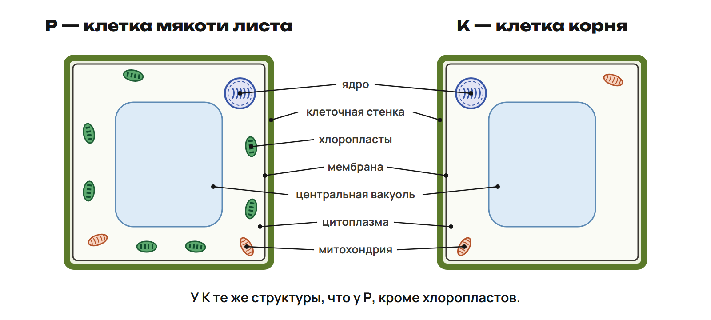
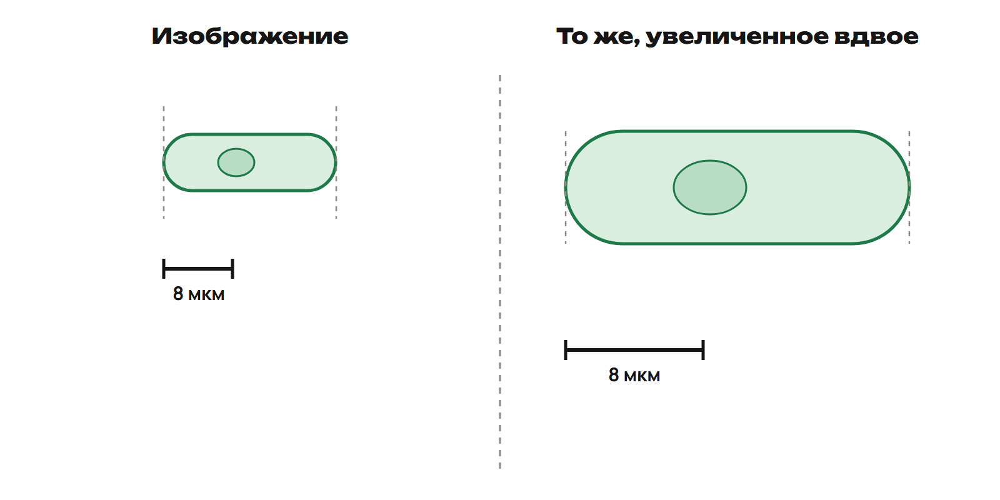

# Вспоминаем ход решения
? Чем ты подтвердил свой ответ?
↳ После урока 1 ты закрепил тему. Начнём с вопросов и проверим основные шаги.
> 0–20 минут. В 0–5 собрать вопросы. L7 — 5–12, L8 — 12–20; ответы показывать после каждой самостоятельной попытки.

## Понятие: Сначала признак, затем вывод
- Тип клетки — по строению
- Структура — по функции
- Размер — по отношению к линейке
- Свойство воды — через его роль
> Попросить назвать трудный шаг в P или G. Два вопроса разобрать коротко; остальные связать с практикой.

## Практика: L7. Кто выполняет работу? · 3 минуты
1. Структуры: 1 мембрана; 2 рибосома; 3 ЭПС; 4 аппарат Гольджи
2. А — модификация, сортировка и упаковка веществ
3. Б — регулируемый обмен между клеткой и средой
4. В — синтез и перемещение веществ
5. Г — синтез белка; каждую букву используй один раз
Ответы:
1. 1Б 2Г 3В 4А
2. Мембрана регулирует обмен; рибосома синтезирует белок
3. ЭПС участвует в синтезе и перемещении; Гольджи изменяет, сортирует и упаковывает
> 5–8 попытка, 8–12 разбор. У шероховатой ЭПС есть рибосомы; функции структур связаны, но отличаются.

## Практика: L8. От клетки к организму · 3 минуты
1. Расставь от меньшего уровня к большему
2. 1 клетка гладкой мышцы бронха в лёгком; 2 лёгкое; 3 человек
3. 4 дыхательная система; 5 гладкая мышечная ткань
4. Митохондрия — орган или органелла?
Ответы:
1. 1 → 5 → 2 → 4 → 3
2. Клетка → ткань → орган → система органов → организм
3. Митохондрия — органелла внутри клетки
> 12–15 попытка, 15–19 разбор, 19–20 формулировка правила. Орган состоит из тканей; органелла находится внутри клетки.

# Разбираем домашнюю работу
? Почему правильная единица ещё не гарантирует правильный размер?
↳ Вспомнили основные шаги. Теперь найдём причину ошибок в своих решениях.
> 20–40 минут: 3 сравнение своих ходов, 7 G9, 6 G11, 4 повторение исправленного шага с закрытым ключом.

## Понятие: G9. Размер по линейке
- Длина клетки на рисунке — 6 см
- Длина линейки на рисунке — 2 см
- Подпись линейки — 12 мкм
- Найди отношение длин и размер в мкм и мм
- Почему длины на экране без линейки недостаточно?
> Дать рассмотреть исходное решение перед разбором. Сантиметры здесь описывают рисунок, а не клетку.

## Пример: G9. Сначала отношение
1. На рисунке клетка занимает 6 / 2 = 3 длины линейки
2. Размер клетки: 3 × 12 = 36 мкм
3. Перевод: 36 / 1000 = 0,036 мм
4. При растягивании рисунка обе длины меняются вместе; отношение остаётся 3
> Не заменять реальные микрометры сантиметрами рисунка. Попросить назвать, какие две величины сравнили.

## Ловушка: G11. Ядро, ДНК и вирус
- «У бактерии нет оформленного ядра, поэтому у неё нет ДНК»
- «Вирус — такая же клетка без ядра»
- Исправь оба вывода
> Сначала дать ученикам устно исправить два утверждения. Затем открыть следующий слайд; не смешивать два вывода.

## Понятие: G11. Два отдельных ответа
- Бактерия имеет ДНК вне оформленного ядра
- Бактерия — прокариотическая клетка
- Вирус — неклеточная форма
> В 36–40 закрыть ключи. Каждый вновь выполняет ошибочный шаг G9 или объясняет оба вывода G11.

# Сравниваем клетки
? Может ли растительная клетка не иметь хлоропластов?
↳ Проверили ДНК и ядро. Для сравнения клеток посмотрим на весь набор признаков.
> 40–58 минут. L9 — 40–49, L10 — 49–58.

## Понятие: Две зрелые живые клетки фасоли

- Р — мякоть зелёного листа; есть ядро, стенка, хлоропласты, крупная центральная вакуоль
- К — корень; есть ядро, стенка, крупная центральная вакуоль; хлоропластов нет
> Все исходные признаки даны словами. Вопрос о хлоропластах обсудить после самостоятельной попытки L9.

## Практика: L9. Тип и общие признаки · 4 минуты
1. Обе клетки — прокариотические или эукариотические? Почему?
2. Обе — растительные или животные?
3. Назови две общие структуры, кроме ядра
4. Почему отсутствие хлоропластов не делает К животной клеткой?
Ответы:
1. Эукариотические: есть оформленное ядро; обе растительные
2. Общие: любые две — мембрана, цитоплазма, стенка, рибосомы, митохондрии, ЭПС, Гольджи, крупная центральная вакуоль
3. У К есть стенка и крупная центральная вакуоль; не все растительные клетки имеют хлоропласты
> 40–44 попытка с предыдущим слайдом, 44–49 объяснение. Сопоставить вывод с заданным происхождением обеих клеток.

## Ловушка: Один отсутствующий признак
- Нет хлоропластов — ещё не значит «животная клетка»
- В живых клетках корня есть митохондрии
- Наличие хлоропластов не отменяет клеточного дыхания
> Вернуться к вопросу части. Попросить связать каждую фразу с клеткой из условия L9.

## Практика: L10. Структура и функция · 3 минуты
1. 1 стенка; 2 крупная центральная вакуоль; 3 митохондрия
2. А — клеточное дыхание и образование АТФ
3. Б — опора и поддержание формы снаружи мембраны
4. В — клеточный сок и участие в поддержании тургора
Ответы:
1. 1Б 2В 3А
2. Стенка — опора; вакуоль — клеточный сок и тургор
3. Митохондрия — клеточное дыхание и АТФ, переносчик энергии
> 49–52 попытка, 52–58 разбор. Регулируемый обмен связан с мембраной; фотосинтез — с хлоропластом.

# Масштаб, вода и минералы
? Что останется прежним, если увеличить весь рисунок?
↳ Структуры распознали. Теперь измерим клетку и проверим связи свойств с функциями.
> 58–78 минут. L11 — 58–68; L12а — 68–73; L12б — 73–78.

## Понятие: L11. Две версии одной схемы

- Клетка занимает 2,5 длины линейки
- Подпись линейки — 8 мкм
- Второй рисунок вместе с линейкой увеличен вдвое
> Числовые данные прочитать вместе. Измерять экран в сантиметрах для решения не требуется.

## Практика: L11. Реальный размер · 4 минуты
1. Найди длину клетки в мкм и мм
2. Как изменится ответ при увеличении всей схемы вдвое?
3. Проверь перевод обратным действием
Ответы:
1. 2,5 × 8 = 20 мкм; 20 / 1000 = 0,020 мм
2. Ответ не меняется: отношение длин остаётся 2,5
3. 0,020 × 1000 = 20 мкм
> 58–62 попытка, 62–66 разбор, 66–68 обратная проверка. При переходе к более крупной единице числовое значение уменьшается.

## Схема: Проверяем единицы
1 мм = 1000 мкм
мм → мкм — умножаем на 1000
мкм → мм — делим на 1000
> Попросить назвать направление перевода прежде, чем выполнять действие.

## Практика: L12а. Свойство и роль · 3 минуты
1. Выбери одну верную связь свойства воды с функцией
2. А) Высокая теплоёмкость — хранение наследственной информации
3. Б) Испарение — отвод тепла от тела
4. В) Растворение солей — запасание энергии в воде
5. Г) Высокая теплоёмкость — образование клеточной стенки
Ответы:
1. Б: испарение пота отводит тепло от тела
2. Высокая теплоёмкость помогает сглаживать быстрые колебания температуры
> 68–71 попытка, 71–73 разбор. Спросить, какое действие воды соответствует выбранной роли.

## Практика: L12б. Элементы в организме · 2 минуты
1. А железо; Б магний; В кальций
2. 1 — гемоглобин
3. 2 — минеральная основа костей и зубов
4. 3 — хлорофилл
5. Сопоставь; каждый номер используй один раз
Ответы:
1. А1 Б3 В2
2. Железо — гемоглобин; магний — хлорофилл; кальций — минеральная основа костей и зубов
> 73–75 попытка, 75–78 разбор. Каждую пару повторить без подсказки.

# Проверяем себя
? Получится ли применить правило к новому условию?
↳ Обсудили решения. Теперь поработай самостоятельно, без общего ключа.
> 78–88 минут. Выдать только ученическую часть контроля Q1–Q5; ключ отделён. До сдачи не переходить к ответам.

## Практика: Контроль Q1–Q5 · 10 минут
1. Работай самостоятельно в тетради
2. Запиши номера Q1–Q5 и ответы; в Q4 покажи вычисления
3. Там, где просят объяснение, назови признак или правило
4. Передай фото ответов преподавателю
> Условия — в ученическом листе контроля. Проверить читаемость фото; подсказки и ответы во время попытки не давать.

# Итог и следующий шаг
? Какой шаг поможет тебе проверить себя дома?
↳ Самостоятельная попытка показала, что повторить. Назови свой следующий шаг.
> 88–90 минут. Назначить каждому один вариант A/B/C с учётом диагностики, G и контроля.

## Итог: Четыре проверки
- Тип клетки подтверждаю признаком
- Структуру связываю с её функцией
- Размер нахожу по линейке и проверяю единицу
- Свойство воды связываю с его ролью
> Каждый выбирает один шаг самопроверки. Ключ контроля обсудить после сдачи.

## Дома: После урока 2
- Один вариант A/B/C — 30 минут
- Исправление выбранных ошибок — 25 минут
- Повторение по памятке — 15 минут
- A — углубление; B — закрепление; C — поддержка
> Не складывать варианты. Коррекционные задания входят в 25 минут исправлений.
