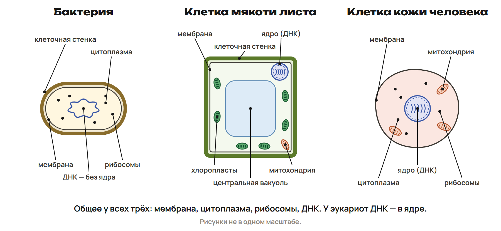
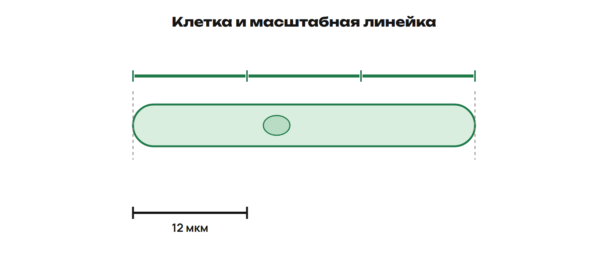

# Клетка, её размер и вещества

Почему клетка важна для всего курса? Из клеток построены организмы, а внутри клеток идут процессы жизни. На уроке ты учился узнавать структуры, связывать их с функцией и читать размер по шкале. Здесь повторим эти шаги.

## От клетки к организму

**Клетка** — основная единица строения и жизнедеятельности клеточных организмов. Новые клетки возникают при делении уже существующих. В многоклеточном организме клетки работают вместе.

> [!rule] Уровни организации
> **Клетка → ткань → орган → система органов → организм.**
> Ткань — группа клеток и межклеточного вещества с общим строением и функциями. Орган состоит из нескольких тканей.

Чтобы восстановить порядок, начни с одной клетки. Затем найди ткань, орган из нескольких тканей и систему, в которую этот орган входит.

> [!example] Разберём на человеке
> Клетка нервной ткани → нервная ткань → головной мозг → нервная система → человек.
> Мозг — орган. Он содержит разные ткани, а нервная система включает несколько органов.

> [!trap] Ловушка
> Митохондрия — структура внутри клетки, а не орган человека. Похожее слово не определяет уровень организации.

## Что делает каждая структура

Клетке нужны граница, рабочая среда и структуры для разных процессов. Сначала назови структуру, затем объясни её действие одним глаголом: **регулирует, хранит, синтезирует, упаковывает**.

- **Мембрана** отделяет клетку от среды и регулирует поступление и выход веществ.
- **Цитоплазма** — содержимое клетки вне ядра; в ней расположены структуры и протекают многие реакции.
- **Ядро** хранит основную часть ДНК эукариотической клетки. ДНК содержит наследственную информацию.
- **Рибосомы** синтезируют белки.
- **Митохондрии** участвуют в клеточном дыхании и образовании АТФ. АТФ переносит энергию для работы клетки.
- **Эндоплазматическая сеть, ЭПС** участвует в синтезе и перемещении веществ. На шероховатой ЭПС находятся рибосомы.
- **Аппарат Гольджи** изменяет, сортирует и упаковывает вещества.
- **Клеточная стенка** расположена снаружи мембраны, поддерживает форму и служит опорой.
- **Хлоропласты** проводят фотосинтез: с помощью энергии света образуются органические вещества.
- **Крупная центральная вакуоль** зрелой растительной клетки содержит клеточный сок и помогает поддерживать тургор — давление содержимого клетки на стенку.

> [!example] Различим две функции
> Рибосома синтезирует белок. Аппарат Гольджи изменяет и упаковывает вещества.
> Мембрана регулирует обмен со средой. Стенка поддерживает форму снаружи мембраны.

> [!trap] Ловушка
> Митохондрия и хлоропласт выполняют разные функции. Клеточное дыхание связано с митохондрией, фотосинтез — с хлоропластом. Живая клетка зелёного листа использует обе структуры.

## Как узнать тип клетки

На типичных учебных схемах начни с **оформленного ядра**: оно отделено от цитоплазмы оболочкой. У типичной эукариотической клетки такое ядро есть; у прокариотической его нет. Затем ищи признаки растительной или животной клетки.

**Бактерия** — прокариот. У неё есть мембрана, цитоплазма, рибосомы и ДНК. Оформленного ядра нет. У большинства бактерий есть клеточная стенка.

**Клетка мякоти зелёного листа** — эукариотическая растительная клетка. Кроме мембраны, цитоплазмы, ядра, рибосом, митохондрий, ЭПС и аппарата Гольджи, у неё есть стенка, хлоропласты и крупная центральная вакуоль.

**Живая клетка кожи человека** — эукариотическая животная клетка. У неё есть мембрана, цитоплазма, ядро, рибосомы, митохондрии, ЭПС и аппарат Гольджи. Клеточной стенки и хлоропластов нет.

> [!rule] Сравниваем типичные учебные схемы
> 1. Найди общие структуры.
> 2. Выдели отличительные признаки.
> 3. Назови тип клетки и объясни выбор.

> [!example] Разберём клетку корня
> У живой клетки корня есть ядро и клеточная стенка. Это растительная эукариотическая клетка.
> У многих клеток подземного корня нет хлоропластов. Отсутствие хлоропласта само по себе не делает клетку животной.

> [!trap] Ловушка
> **Нет ядра ≠ нет ДНК.** У бактерии наследственная информация есть.
> Вирус — неклеточная форма. Его нельзя называть «бактерией» или «клеткой без ядра».

## Размер: миллиметры, микрометры и шкала

Рисунок можно увеличить на экране. Клетка от этого не становится больше. Настоящий размер находи по масштабной линейке рядом с рисунком.

> [!rule] Перевод единиц
> **1 мм = 1000 мкм.**
> мм → мкм: умножь на 1000. мкм → мм: раздели на 1000.
> В более мелких единицах число больше, а длина остаётся той же.

> [!example] Два перевода
> **0,024 мм × 1000 = 24 мкм.**
> **42 мкм ÷ 1000 = 0,042 мм.**
> Обратный перевод возвращает исходное число.

Чтобы прочитать размер по шкале, выполни три шага:

1. Прочитай, какой реальной длине соответствует масштабная линейка.
2. Найди, сколько длин этой линейки занимает клетка на том же рисунке.
3. Умножь реальную длину линейки на это число.

> [!example] Размер по шкале
> Масштабная линейка соответствует **12 мкм**. Клетка на рисунке занимает **три длины** этой линейки.
> Длина клетки: **3 × 12 = 36 мкм**.
> При увеличении рисунка клетка и линейка увеличиваются вместе; отношение остаётся прежним.

Клетка может занимать и дробное число длин линейки. Например, **1,5 длины** при шкале **20 мкм** дают **1,5 × 20 = 30 мкм**.

> [!trap] Ловушка
> **×400** — увеличение, а не длина клетки. Не приписывай к нему мм или мкм.
> Не принимай длину рисунка на экране за реальный размер клетки.

## Вода и минеральные вещества

Для жизни важны не только структуры клетки, но и вещества. Связывай свойство воды с его результатом: **какое свойство → чему оно помогает**.

Молекула воды — **H₂O**. Электрический заряд в ней распределён неравномерно. Между соседними молекулами воды возникают **водородные связи**. Они помогают объяснить, почему на нагревание и испарение воды требуется много тепла.

- Вода растворяет многие вещества, в том числе многие соли. В водной среде вещества могут перемещаться и участвовать в реакциях.
- Вода имеет высокую теплоёмкость: для изменения её температуры требуется много тепла. Это уменьшает быстрые колебания температуры организма.
- При испарении воды расходуется тепло. Поэтому испарение пота помогает охлаждать тело.

> [!example] Свойство и роль
> Соль растворилась в воде → её частицы могут перемещаться в растворе.
> Пот испарился → часть тепла ушла на испарение → тело охлаждается.

**Ион** — заряженная частица. Многие соли при растворении дают ионы: например, ион натрия **Na⁺**. Они могут перемещаться в водном растворе.

**Минеральные элементы** встречаются и в составе других веществ. Запомни три связи: **железо — гемоглобин**, **магний — хлорофилл**, **кальций — минеральная основа костей и зубов**. Железо в составе гемоглобина связано с переносом кислорода, а хлорофилл с магнием участвует в поглощении света.

> [!trap] Ловушка
> Вода растворяет многие вещества, но не все. Она не служит энергетическим запасом.
> Железо, магний и кальций нельзя менять местами: связь определяется конкретным веществом и его функцией.

## Перед уроком 2

> [!try] Отметь для себя
> Рядом с каждым умением поставь: **понимаю / нужна практика / нужен разбор**.
> 1. Расставляю уровни от клетки до организма.
> 2. Различаю прокариотическую и эукариотическую, растительную и животную клетку.
> 3. Связываю структуру клетки с её функцией.
> 4. Перевожу мм и мкм, читаю размер по масштабной линейке.
> 5. Объясняю роль воды и трёх минеральных элементов.

Теперь выполни [закрепление P1–P6](pre-work.md) и [общую часть G](homework.md). Запиши два вопроса: с них начнётся урок 2.
