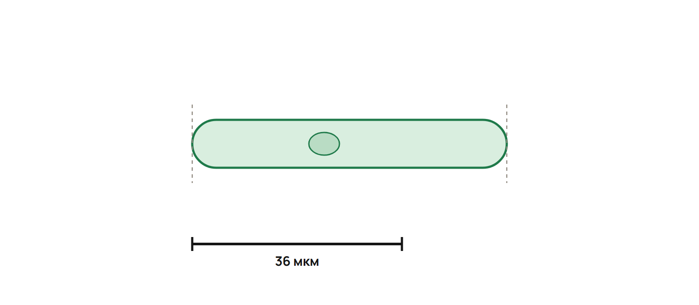

Запиши ответы Q1–Q6 в тетради и передай фото преподавателю. Работай без конспекта и подсказок. В Q4 покажи вычисления с единицами. Максимум — 12 баллов.

## Q1 — 2 балла

Ученик написал: «Бактерия — эукариот, ведь у неё есть ДНК. Вирус — прокариот, ведь у него нет ядра».

Исправь оба вывода. В каждом случае объясни, какой признак нужно учитывать.

## Q2 — 2 балла

Соотнеси структуры с функциями. Каждую букву используй один раз. Ответ запиши так: `1… 2… 3… 4…`.

- 1 — рибосома.
- 2 — митохондрия.
- 3 — крупная центральная вакуоль зрелой растительной клетки.
- 4 — аппарат Гольджи.

Функции:

- А — клеточный сок и участие в поддержании тургора.
- Б — синтез белка.
- В — модификация, сортировка и упаковка веществ.
- Г — клеточное дыхание и образование АТФ.

## Q3 — 2 балла

Исследуют две клетки: зрелую живую клетку корня моркови и клетку гладкой мышцы человека. В клетке Z обнаружены оформленное ядро, стенка, митохондрии и крупная центральная вакуоль. Хлоропластов в ней нет.

Какая из двух клеток — Z? Приведи признак. Клетка Z прокариотическая или эукариотическая? Обоснуй ответ.

## Q4 — 2 балла

На рисунке клетка занимает 1,5 длины масштабной линейки. Подпись линейки — 36 мкм. Найди реальную длину клетки в мкм и мм. Соотношение: 1 мм = 1000 мкм.

## Q5 — 2 балла

Какое свойство воды помогает сглаживать быстрые колебания температуры в организме? Объясни связь свойства с этой ролью. Назови элемент, входящий в минеральную основу костей и зубов.

## Q6 — 2 балла

Соотнеси учёных с их вкладом. Для каждого пункта выбери один из четырёх вариантов. Ответ запиши так: `А… Б…`.

- А — Т. Шванн и М. Шлейден.
- Б — Д. И. Ивановский.

Варианты:

1. Впервые применил название «клетка» в 1665 году.
2. Открытие вирусов.
3. Создание клеточной теории.
4. Описание органоида, который накапливает и упаковывает вещества клетки.

---

## Только преподавателю — отдельный ключ

Отделить этот ключ от ученического листа. Контроль занимает 76–88 минуты урока 2. Ориентир на самостоятельную попытку: Q1 — 1,5 минуты; Q2 — 2; Q3 — 2; Q4 — 2; Q5 — 2,5; Q6 — 2; всего 12 минут.

| ID | Ответ и решение | Критерии, максимум 2 балла | Типичная ошибка |
|---|---|---|---|
| Q1 | **Бактерия — прокариотическая клетка:** ДНК есть, но оформленного ядра нет. **Вирус — неклеточная форма:** деление на прокариотические и эукариотические клетки к нему не относится. | По 1 за каждый исправленный вывод с объяснением. За верное название без объяснения — 0,5 в соответствующей части. | Наличие ДНК принять за наличие ядра; отсутствие ядра — за достаточное доказательство клеточного строения. |
| Q2 | **1Б 2Г 3А 4В.** Рибосома синтезирует белок; митохондрия участвует в клеточном дыхании и образовании АТФ; вакуоль содержит клеточный сок и участвует в поддержании тургора; Гольджи изменяет, сортирует и упаковывает вещества. | По 0,5 за каждую верную пару. Две неразличённые буквы в одной паре дают 0 за эту пару. Повторённую букву проверять по каждой паре. | Синтез белка спутать с упаковкой; образование АТФ — с поддержанием тургора. |
| Q3 | **Z — клетка корня моркови:** у неё есть стенка и крупная центральная вакуоль. **Эукариотическая:** имеет оформленное ядро. Хлоропласты есть не во всех растительных клетках; отсутствие хлоропластов не отменяет растительное происхождение Z. | 0,5 за выбор корня; 0,5 за стенку или крупную центральную вакуоль как признак в заданном сравнении. 0,5 за эукариотическую; 0,5 за оформленное ядро как основание. | Отсутствие хлоропластов принять за признак животной клетки; выбрать растительную только по наличию ядра. |
| Q4 | Длина = 1,5 × 36 = **54 мкм**. Перевод: 54 / 1000 = **0,054 мм**. Проверка: 0,054 × 1000 = 54 мкм. | 0,5 за умножение 1,5 × 36; 0,5 за 54 мкм. 0,5 за деление размера в мкм на 1000; 0,5 за 0,054 мм. При арифметической ошибке первого шага засчитать последующий верный перевод своего размера с единицей, но не правильность исходного размера. | Использовать подпись линейки без множителя 1,5; умножать на 1000 при переводе в мм. |
| Q5 | **Высокая теплоёмкость:** вода принимает или отдаёт много тепла при сравнительно небольшом изменении собственной температуры, поэтому помогает сглаживать быстрые температурные колебания. Элемент — **кальций**. | 0,5 за высокую теплоёмкость; 0,5 за связь с медленным нагреванием/охлаждением или малым изменением температуры при теплообмене; 1 за кальций. | Вместо теплоёмкости назвать растворимость; вместо кальция выбрать железо или магний. |
| Q6 | **А3 Б2.** Т. Шванн и М. Шлейден создали клеточную теорию (Биология 10 ЕМН, ч. 1, § 25, с. 114). Открытие вирусов принадлежит Д. И. Ивановскому (Биология 7, Мектеп, § 66, с. 251). Вариант 1 — Р. Гук (Биология 7, § 13, с. 57); вариант 4 — о комплексе Гольджи, к пунктам А и Б не относится. | Соответствие в формате ЕНТ: оба пункта верны — 2; один — 1; ни одного — 0. Для каждого пункта принимается один номер; несколько неразличённых номеров дают 0 за этот пункт. Пустой пункт — 0. Проверять пункты независимо. | Название «клетка» (Гук) спутать с клеточной теорией (Шванн и Шлейден). |

Пустая часть ответа — 0. Противоречащее своему же верному ответу объяснение не даёт балл за объяснение. Не вычитать баллы за скорость и не учитывать одну арифметическую ошибку дважды. Максимум: 6 × 2 = **12 баллов**.

Внутренний ориентир освоения клеточной темы — **не менее 8 из 10 за Q1–Q5**, верное различение бактерии и вируса в Q1 и верное направление перевода мкм → мм в Q4. Q6 оценить отдельно: при ошибке вернуть в повторение соответствующую пару «учёный → вклад». Сумма сама по себе не отменяет смысловую ошибку. Этот ориентир помогает выбрать ближайшую практику и не переводится в балл ЕНТ.

Если критерий не выполнен, выбрать до двух причин ошибки: клеточный тип, функции структур, масштаб или связь свойства с ролью. Включить разбор и повторную попытку в 25 минут исправлений после урока. Маршрут A/B/C уточнять по диагностике, общей части ДЗ, контролю и объяснению ученика; одна сумма не заменяет эти наблюдения.
