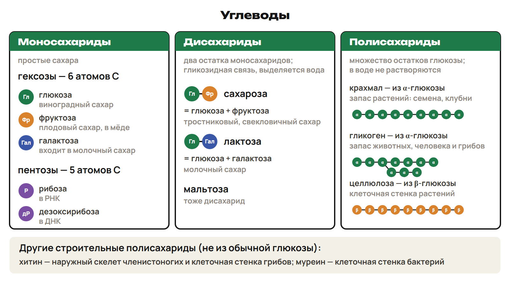
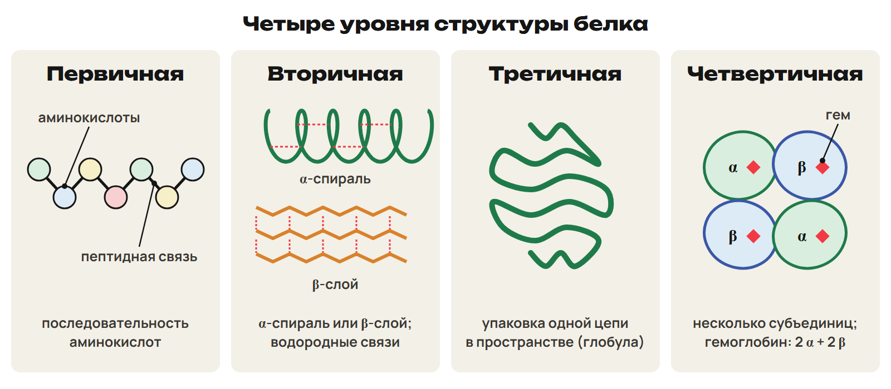
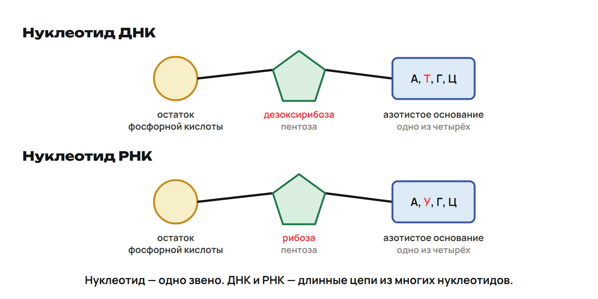
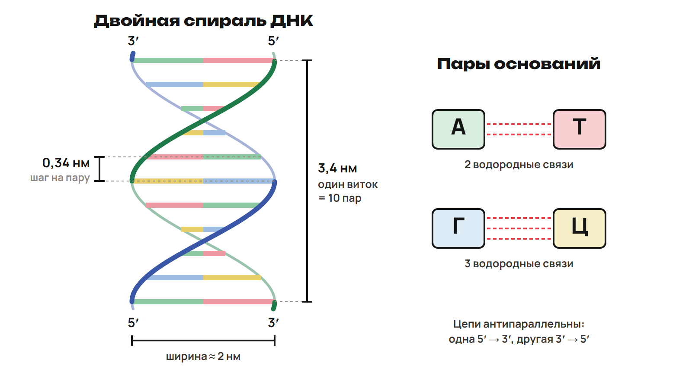

# Из звеньев — в молекулу
? Чем мономер отличается от полимера?
↳ На прошлой встрече рассмотрели клетку. Теперь разберём её органические вещества.
> 0–8 минут. 5 минут на понятия, 1 на L1, 2 на разбор. Тему объяснять с нуля, без предварительного чтения.

## Понятие: Четыре группы
- Углеводы, липиды, белки и нуклеиновые кислоты — органические вещества клетки.
- В их составе есть C, H, O.
- Белки обязательно содержат N; нуклеиновые кислоты — N и P.
- Белок состоит из аминокислот; нуклеиновая кислота — из нуклеотидов.

## Схема: Мономеры и полимеры
Звенья
Мономер — отдельное звено
Полимер — длинная цепь звеньев
Регулярный полимер — одинаковые или повторяющиеся звенья
Нерегулярный полимер — последовательность разных звеньев

## Пример: Модель бус
1. Повторяющиеся остатки в крахмале образуют регулярный полимер.
2. Последовательность аминокислот белка образует нерегулярный полимер.
3. При пищеварении полимеры расщепляются до мономеров.
4. В клетке из мономеров синтезируются собственные полимеры.

## Ловушка: Жир не обычный полимер
- Липиды не являются обычными цепями повторяющихся мономеров.
- Аминокислота — мономер белка, нуклеотид — мономер нуклеиновой кислоты.

## Практика: L1 · 1 минута
L1. Соотнеси А — крахмал, Б — белок с характеристикой.
1 — регулярный полимер; 2 — нерегулярный полимер; 3 — аминокислота; 4 — нуклеотид.
Ответы:
А1 Б2: крахмал содержит повторяющиеся остатки; последовательность аминокислот белка нерегулярна.
> Ключ открыть после попытки. При выборе мономера вместо полимера вернуть модель звена и цепи.

# Углеводы: класс, состав, работа
? Почему крахмал запасает, а целлюлоза строит стенку?
↳ Различаем цепь и звено. Сравним углеводы по числу остатков и функции.
> 8–24 минуты. 11 минут на компактную карту, свойства и пробы, 3 на L2, 2 на разбор. Названия и функции связывать попарно.

## Понятие: Простые сахара
- Моносахариды: глюкоза, фруктоза, галактоза.
- Глюкоза — виноградный сахар; фруктоза — плодовый, есть в мёде; галактоза входит в молочный сахар.
- Пентозы имеют 5 атомов C: рибоза в РНК, дезоксирибоза в ДНК.
- Гексозы имеют 6 атомов C: глюкоза, фруктоза, галактоза.
- Cₙ(H₂O)ₙ — соотношение для многих моносахаридов; пример C₆H₁₂O₆.
- Моносахариды хорошо растворимы, сладкие и служат источником энергии.

## Понятие: Два остатка
- Дисахарид содержит два остатка моносахаридов, соединённые гликозидной связью.
- При образовании связи выделяется вода.
- Сахароза = глюкоза + фруктоза; тростниковый, свекловичный сахар.
- Лактоза = глюкоза + галактоза; молочный сахар.
- Мальтоза — дисахарид.

## Схема: Полисахариды и роли
Много остатков
Крахмал — запас растений, семена и клубни
Гликоген — запас животных и грибов; печень и мышцы человека
Целлюлоза — стенка растительной клетки
Хитин — наружный скелет членистоногих и стенка грибов
Муреин — компонент стенки бактерий

## Понятие: Карта углеводов

> Не представлять хитин и муреин простой цепью глюкозы. Полисахарид — много остатков моносахаридов; растворимость не одинакова у всех.

## Понятие: Все группы функций углеводов
- Энергетическая: 1 г углеводов даёт 17,6 кДж.
- Запасающая: крахмал и гликоген.
- Строительная: целлюлоза и хитин.
- Защитная: камеди; также рецепторная функция.
- Метаболическая: рибоза и дезоксирибоза входят в нуклеотиды.
- Рибулозодифосфат принимает CO₂ в темновой фазе фотосинтеза.
> Последнюю функцию назвать одной связкой. Подробные реакции фотосинтеза разбираются при изучении обмена.

## Понятие: Глюкоза и целлюлоза
- Глюкоза C₆H₁₂O₆ образуется при фотосинтезе; её содержание в крови — около 0,12 %.
- Полное окисление: C₆H₁₂O₆ + 6O₂ → 6CO₂ + 6H₂O.
- В крахмале и гликогене — остатки α-глюкозы; гликоген называют животным крахмалом.
- В целлюлозе — β-глюкоза и β-1,4-гликозидные связи.
- Ферменты человека не разрывают эти связи; клетчатка стимулирует перистальтику.
- Раствор сахарозы переносится по ситовидным трубкам растения.

## Пример: Качественные пробы
1. Крахмал с йодом даёт синее окрашивание.
2. Глюкоза, фруктоза и мальтоза дают положительные пробы Бенедикта и Фелинга.
3. Сахароза эти положительные пробы не даёт.
> Здесь сравнивают результаты описаний. Цвета проб Бенедикта и Фелинга не добавлять к условию.

## Ловушка: Форма и число остатков
- Галактоза — моносахарид; сахароза — дисахарид.
- Целлюлоза — β-глюкоза; крахмал и гликоген — α-глюкоза.
- Cₙ(H₂O)ₙ не является универсальным определением любого углевода.

## Практика: L2 · 3 минуты
L2. Галактоза, сахароза, гликоген: назови группу каждого углевода.
Какие остатки составляют сахарозу?
Остатки какой формы глюкозы входят в крахмал и в целлюлозу?
Ответы:
Галактоза — моносахарид; сахароза — дисахарид; гликоген — полисахарид.
Сахароза — глюкоза + фруктоза.
Крахмал — α-глюкоза; целлюлоза — β-глюкоза.
> Все ответы открыть после общей попытки. Просить сначала число остатков, затем α/β.

# Липиды: запас и мембрана
? Почему жир подходит для запаса энергии и теплоизоляции?
↳ Углеводы сравнили. Теперь рассмотрим гидрофобные вещества.
> 24–36 минут. 8 минут на состав, функции и группы, 2 на L3, 2 на разбор. Все примеры связывать с указанным свойством.

## Понятие: Из чего образован жир
- Компоненты жира: 1 молекула глицерина и 3 молекулы жирных кислот.
- Глицерин — трёхатомный спирт.
- Жиры гидрофобны: не растворяются в воде.
- Плохо проводят тепло.
- Жидкие растительные жиры — масла; животные жиры в основном твёрдые.

## Схема: Энергия и защита
Липиды
Энергетическая функция — около 39,1 кДж на 1 г жира
Запасающая — запас энергии
Теплоизоляция — слой жира у китов и тюленей
Защитная — прослойка вокруг органов
Источник воды — вода образуется при окислении жира

## Понятие: Ещё три роли
- Образование воды связано с запасом жира у медведя в спячке и в горбе верблюда.
- Липиды участвуют в транспорте витаминов A, D, E, K и синтезе гормонов.
- Воски водоотталкивающие: соты пчёл, налёт на листьях.
- Фосфолипиды — основа клеточных мембран.
- В рассматриваемой модели фосфолипида одна жирная кислота заменена остатком фосфорной кислоты.

## Понятие: Насыщенные и ненасыщенные
- Насыщенные жиры: молочные продукты, сало, мясо.
- Ненасыщенные: рыба, орехи, растительные масла.
- На 1 г жир даёт больше энергии, чем углеводы: 39,1 кДж против 17,6 кДж.

## Ловушка: Липид и полимер
- Состав жира — глицерин и жирные кислоты.
- Не называй жир регулярной цепью одинаковых мономеров.
- Фосфолипиды связывай с мембраной, а не только с запасом.

## Практика: L3 · 2 минуты
L3. Почему слой жира уменьшает потерю тепла?
Какая группа липидов составляет основу клеточных мембран?
Из каких компонентов образован жир?
Ответы:
Жир плохо проводит тепло. Основа мембран — фосфолипиды.
Компоненты жира — 1 молекула глицерина и 3 молекулы жирных кислот.
> При ответе «жир тёплый» вернуть свойство теплопроводности. Проверить число компонентов.

# Белки: последовательность и форма
? Почему изменение формы может нарушить работу белка?
↳ Липиды рассмотрели. У белка функция зависит от последовательности и пространственной структуры.
> 36–54 минуты. 13 минут на состав, уровни, функции и пробы, 3 на L4, 2 на разбор. Функции дать картой, по короткому примеру.

## Понятие: Аминокислоты и связь
- Белки — биополимеры из аминокислот; в белки входят 20 видов аминокислот.
- Порядок аминокислот записан в ДНК.
- Пептидная связь образуется между аминогруппой одной аминокислоты и карбоксильной группой другой.
- При образовании связи выделяется вода: конденсация.

## Схема: Четыре уровня
Белок
Первичная — последовательность аминокислот, пептидные связи
Вторичная — α-спираль или β-слой, водородные связи
Третичная — пространственная упаковка одной цепи
Четвертичная — объединение нескольких субъединиц, есть не у всех
Гемоглобин — четыре субъединицы

## Понятие: Пространственная структура

- Третичную структуру поддерживают водородные, ионные, гидрофобные взаимодействия и дисульфидные связи.
- Гем с Fe²⁺ входит в состав каждой субъединицы гемоглобина.

## Понятие: Форма и состав
- Фибриллярные — нитевидные, нерастворимые: коллаген, кератин, эластин, фиброин.
- Глобулярные — компактные, часто растворимы.
- По составу белки бывают простыми и сложными.
- Примеры сложных: гемоглобин, родопсин, казеин, гликопротеины, липопротеины.

## Понятие: Строение, реакции, защита
- Строительная функция: коллаген, кератин, эластин.
- Механическая: оссеин в кости, коллаген в сухожилиях.
- Ферментативная: пепсин расщепляет белки; ферменты специфичны.
- Защитная: антитела; фибриноген и тромбин связаны со свёртыванием.
- Запасная: казеин молока, белок яйца, белки семян.

## Понятие: Регуляция и движение
- Регуляторная: инсулин, глюкагон и гормон роста.
- Инсулин и глюкагон связаны с уровнем глюкозы.
- Сократительная: актин и миозин.
- Транспортная: гемоглобин переносит O₂ и CO₂.
- Пигментная: родопсин; также энергетическая, рецепторная и сигнальная функции.

## Понятие: Денатурация
- Денатурация — утрата природной пространственной структуры.
- В рассматриваемой модели первичная структура и пептидные связи сохраняются.
- Факторы: нагревание, излучение, концентрированные кислоты и щёлочи, соли тяжёлых металлов, спирт.
- Ренатурация — восстановление природной структуры, возможна у некоторых белков.
- Необратимый пример — изменение белка при варке яйца.
> Температура и порядок изменений зависят от белка и условий. Не объявлять один порог универсальным.

## Пример: Узнаем белок по пробе
1. Биуретовая реакция: фиолетовое окрашивание связано с пептидными связями.
2. Ксантопротеиновая: жёлтое окрашивание связано с ароматическими аминокислотами.
> Использовать только описания результатов. Форма белка и пептидные связи — разные признаки.

## Ловушка: Изменение формы не равно разрыву цепи
- Денатурация сохраняет последовательность аминокислот в нашей модели.
- α-спираль и β-слой — два вида вторичной структуры.
- Четвертичная структура есть не у всех белков.
- Меланин — пигмент, но не белок; пример белкового пигмента — родопсин.

## Практика: L4 · 3 минуты
L4. Под действием спирта белок потерял природную пространственную структуру, последовательность аминокислот сохранилась.
Назови процесс и сохранившийся уровень структуры. Разрушились ли пептидные связи?
К какому уровню относятся α-спираль и β-слой?
Ответы:
Денатурация; сохранилась первичная структура и пептидные связи.
α-спираль и β-слой относятся к вторичной структуре.
> Ответы раскрыть после попытки. При смешении уровней вернуть различие последовательности и пространственной формы.

# ДНК и РНК: состав и расчёты
? Что нужно считать для длины ДНК — нуклеотиды или пары?
↳ Состав белка хранится в наследственной информации. Рассмотрим её носители и базовые модели.
> 54–78 минут. 4 минуты на состав/сравнение, 3 на историю/репликацию, 3 на РНК, 6 на расчёты, 5 на L5, 3 на ключ. Доли всегда задавать для обеих цепей.

## Понятие: Нуклеотид
- Нуклеотид = азотистое основание + пентоза + остаток фосфорной кислоты.
- В ДНК сахар — дезоксирибоза; основания А, Т, Г, Ц.
- Аденин А и гуанин Г — пуриновые.
- Тимин Т и цитозин Ц — пиримидиновые.
- В РНК сахар — рибоза; основания А, У, Г, Ц.

## Понятие: Три части одного звена

## Понятие: Функция и место
- ДНК хранит и передаёт наследственную информацию.
- В типичной эукариотической клетке ДНК в основном в ядре, также в митохондриях и пластидах.
- ДНК и РНК встречаются в ядре, митохондриях и пластидах.
- Бактерия имеет ДНК, хотя оформленного ядра нет.
- Рибосомы синтезируют белок; в их составе есть рРНК.
> Вернуть две опоры недели 1: ДНК бактерии и функцию рибосомы. Не связывать отсутствие ядра с отсутствием информации.

## Понятие: История модели
- Ф. Мишер открыл нуклеиновые кислоты в 1869 году.
- О. Эвери доказал роль ДНК в передаче информации в 1944 году.
- Дж. Уотсон и Ф. Крик — модель двойной спирали, 1953 год; Нобелевская премия — 1962.
- Правила Чаргаффа — 1949–1951 годы.
- Мезелсон и Сталь — подтверждение полуконсервативной репликации.

## Схема: Две цепи
ДНК
А–Т — две водородные связи
Г–Ц — три водородные связи
Направления — 5′→3′ и 3′→5′, антипараллельно
Цепи — комплементарны

## Пример: Комплементарная цепь
1. Исходная цепь: 5′–А Т Г Ц–3′.
2. Напротив А ставим Т, напротив Г — Ц.
3. В том же выравнивании: 3′–Т А Ц Г–5′.
> Сначала сохранить расположение букв, затем поставить противоположные концы. Не переписывать вторую цепь автоматически в том же направлении.

## Понятие: РНК и три её вида
- В стандартной сравниваемой модели РНК — одна цепь; рибоза и урацил вместо дезоксирибозы и тимина.
- иРНК, или мРНК, переносит информацию от ДНК к рибосомам.
- тРНК доставляет аминокислоты; форма листа клевера; самые маленькие из трёх рассматриваемых типов.
- рРНК входит в рибосомы; у эукариот основные рРНК синтезируются в ядрышке.
- Кодон иРНК и антикодон тРНК содержат по три нуклеотида.
- Антикодон узнаёт кодон.
> Здесь нужны состав, роль и два термина. Механизм синтеза белка подробно изучается позже.

## Понятие: Репликация
- Репликация — удвоение ДНК.
- Полуконсервативная: каждая новая молекула имеет одну старую и одну новую цепь.
- Хеликаза разделяет цепи, разрывая водородные связи между ними.
- ДНК-полимераза строит новую цепь по матрице.

## Схема: Чаргафф для обеих цепей
Доли
Область — все нуклеотиды обеих цепей двуцепочечной ДНК
Пары — А = Т; Г = Ц
Сумма — А + Т + Г + Ц = 100 %
Пурины и пиримидины — А + Г = Т + Ц
> Одна отдельная цепь не обязана иметь А = Т. Перед расчётом назвать область процентов.

## Пример: Если А составляет 30 %
1. В двуцепочечной ДНК А = 30 % среди всех нуклеотидов обеих цепей.
2. Т = 30 %.
3. На Г + Ц осталось 100 − 30 − 30 = 40 %.
4. Г = Ц = 40 ÷ 2 = 20 %.

## Схема: Размер двойной спирали
Пары
Шаг — 0,34 нм между соседними парами
Виток — 10 пар, 3,4 нм
Ширина — около 2 нм
Всего нуклеотидов — число пар × 2
Длина — число пар × 0,34 нм

## Понятие: Размеры и направления

## Пример: Фрагмент из 70 пар
1. Двуцепочечная ДНК содержит 70 пар нуклеотидов.
2. Обе цепи вместе: 70 × 2 = 140 нуклеотидов.
3. Длина: 70 × 0,34 = 23,8 нм.
4. Витков: 70 ÷ 10 = 7.
5. Обратно: 140 нуклеотидов обеих цепей ÷ 2 = 70 пар.

## Понятие: Заданные модели массы
- Если средний расчётный вклад нуклеотидного звена задан 345 г/моль, для 30 звеньев: 30 × 345 = 10 350 г/моль.
- Если вклад аминокислотного звена задан 120 г/моль, для 15 звеньев: 15 × 120 = 1800 г/моль.
- Это расчёт по усреднённым вкладам звеньев; он не определяет точную массу реальной цепи.
> Число расчётных звеньев и средний вклад заданы отдельно. Массу не подменять длиной и не связывать ДНК с числом аминокислот без дополнительных данных.

## Ловушка: Не удваиваем длину
- 0,34 нм относится к шагу между парами.
- Все нуклеотиды обеих цепей сначала делим на 2, чтобы получить пары.
- А = Т и Г = Ц применяем к двуцепочечной ДНК целиком.
- В стандартной модели Т выбираем для ДНК, У — для РНК.

## Практика: L5 · 5 минут
L5. а) В двуцепочечной ДНК А составляет 28 % среди ВСЕХ нуклеотидов обеих цепей. Найди доли Т, Г и Ц.
б) Другой фрагмент двуцепочечной ДНК содержит 160 пар. Найди число нуклеотидов обеих цепей, длину при 0,34 нм на пару и число витков при 10 парах на виток.
в) К цепи 5′–А Ц Г Т–3′ запиши комплементарную цепь в том же выравнивании.
Ответы:
а) Т = 28 %; Г = Ц = (100 − 56) ÷ 2 = 22 %.
б) 160 × 2 = 320 нуклеотидов; 160 × 0,34 = 54,4 нм; 160 ÷ 10 = 16 витков.
в) 3′–Т Г Ц А–5′.
> Открыть единый ключ после всех трёх пунктов. При ошибке спросить, дано число пар или число всех нуклеотидов.

# Проверка, закрепление и углубление
? Какие опоры ты можешь объяснить без подсказки?
↳ Состав и функции связали. Проверим базу и выберем ближайшее закрепление.
> 78–82 минуты — L6; 82–84 — ключ. 84–88 — повторение ошибок либо четыре дополнительных блока углубления, если база усвоена. 88–90 — Дома; дополнительные блоки расположены после него.

## Практика: L6 · 4 минуты
L6. 1) Какой сахар входит в РНК?
2) Сколько водородных связей между Г и Ц?
3) Двуцепочечная ДНК содержит 60 пар: сколько нуклеотидов в обеих цепях?
4) Как называется удвоение ДНК, после которого в каждой новой молекуле одна старая и одна новая цепь?
Ответы:
1) Рибоза. 2) Три. 3) 60 × 2 = 120 нуклеотидов. 4) Полуконсервативная репликация.
> Ключ показать после четырёх ответов. Отметить отдельно ошибку состава, связей, счёта или модели удвоения.

## Итог: Главные опоры
- Углеводы: число остатков, α/β и запас или строение.
- Липиды: глицерин/кислоты, энергия и мембрана.
- Белки: аминокислоты, четыре уровня и связь формы с функцией.
- ДНК/РНК: нуклеотиды, сахар, основания и роль.
- Чаргафф — обе цепи; длина — число пар × 0,34 нм.

## Дома: После урока 3
- Конспект · 25 минут.
- Закрепление P1–P6 · 20 минут.
- Вся общая часть G1–G11 · 35 минут.
- G1–G8 — строкой в Telegram; G9–G10 — фото; G11 — текстом или голосовым.
- Запиши два вопроса для урока 4, 13 ноября.
> До следующей встречи 80 минут самостоятельной работы. Один вариант A/B/C назначить после урока 4.

## Понятие: Углубление — углеводы и доли
- Триозы — 3 атома C, тетрозы — 4, пентозы — 5, гексозы — 6; ксилоза — пентоза растений.
- Гомополисахариды — один вид моносахарида; гетерополисахариды — разные.
- Инулин образован остатками фруктозы; пектины образуют студни.
- Крахмал: в пшенице до 75 %, в рисе 80 %, в клубнях картофеля 25 %.
- Гликоген: в печени 2–10 %, в мышцах 0,2–2 %.
- При сахарозе 100 % относительной сладости: фруктоза 173 %, лактоза 16 %.
> Опционально 84–85 минуты. При затруднениях базы этот блок пропустить и повторить ошибку L2. Проценты здесь описывают заданное содержание или относительную сладость.

## Понятие: Углубление — липиды
- Пальмитиновая кислота — C16, стеариновая — C18; насыщенные.
- Олеиновая — распространённая ненасыщенная; линолевая и линоленовая незаменимы для животных.
- Цис-форма мешает плотной упаковке, а не усиливает её.
- Простые липиды — два компонента; сложные — три и более, например фосфолипиды и гликолипиды.
> Опционально 85–86 минуты. Использовать после усвоения состава жира; иначе повторить L3. Цис-форму объяснить как препятствие плотной упаковке.

## Понятие: Углубление — белки
- Учебный состав: C 50–54 %, O 21–23 %, H 6,5–7,3 %, N в среднем 16 %, S до 0,5 %.
- α-спираль — 3,6 аминокислотного остатка на виток.
- Коллаген богат глицином и пролином, кератин — цистеином.
- Гемоглобин: две α- и две β-субъединицы; у каждой свой гем.
- Сложные белки: металло-, хромо-, фосфо-, липо- и гликопротеины.
- Примеры: гемоглобин/родопсин — хромопротеины; казеин — фосфопротеин.
> Опционально 86–87 минуты. Уточнить одну выбранную связь состава и структуры; иначе повторить L4.

## Понятие: Углубление — нуклеиновые кислоты
- Р. Фёльген установил локализацию ДНК в 1924 году; ДНК с гистонами образует ДНП.
- Мезелсон и Сталь сравнивали ¹⁵N и ¹⁴N у бактерий *E. coli*.
- тРНК обычно содержит 76 нуклеотидов; в клетке около 40 видов; иРНК — до 5 % всех РНК.
> Опционально 87–88 минут. Если база требует поддержки, повторить расчёт пар вместо этого блока. На 88-й минуте вернуться к Дома.
