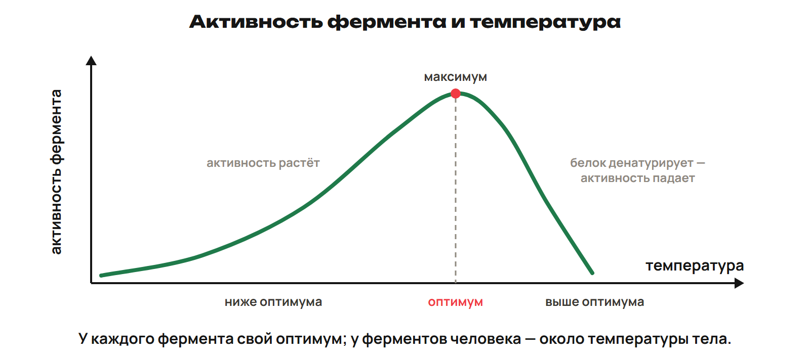
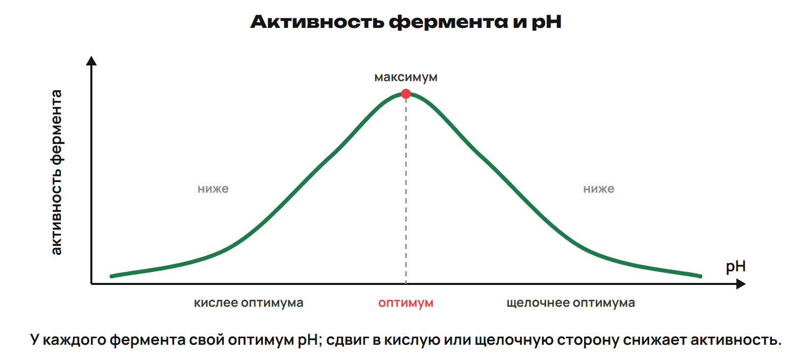

# Вопросы и повторение
? Какие опоры уже известны?
↳ Начнём с вопросов и возврата клеточной базы.
> 0–20 минут. Попытка до ключа; спрашивать об основании вывода.

## Практика: L7 · 3 минуты
Сравни мембрану/стенку растения и мономеры белка/ДНК.
Ответы:
Мембрана — фосфолипиды/белки; стенка — целлюлоза. Белок — аминокислоты; ДНК — нуклеотиды.
> Ошибка: Смешать состав и мономеры. Повторить изменённое условие без опоры.

## Практика: L8 · 3 минуты
Сопоставь А — Фишер; Б — Кошланд: 1 индуцированное соответствие; 2 осмос; 3 «ключ — замок»; 4 фагоцитоз. Назови числа насоса.
Ответы:
А3 Б1; 3 Na⁺ наружу, 2 K⁺ внутрь.
> Ошибка: Смешать учёных или числа. Повторить изменённое условие без опоры.

# Разбор общей части
? Где в решении указано направление?
↳ Опоры вспомнили. Исправим два домашних объяснения.
> 20–40 минут. Попытка до ключа; спрашивать об основании вывода.

## Практика: G9 — клетка в растворе
Начало: снаружи больше концентрация соли, давление одинаково.
Мембрана пропускает воду, соль не проходит.
Назови направление воды и изменение протопласта.
Ответы:
Вода наружу, протопласт отходит от стенки — плазмолиз.
> Сначала проверить воду и градиент, затем термин.

## Практика: G10 — температурная кривая
Качественный график: ниже оптимума рост, в оптимуме максимум, выше спад.
Назови оси, оптимум, объясни падение при сильном нагревании.
Ответы:
X температура, Y активность; вершина — оптимум; сильный нагрев может нарушить структуру белка.
> Вывод только об указанном ферменте; числовой оптимум не задан.

# Транспорт в новых условиях
? Одно вещество всегда идёт одним путём?
↳ Исправили ДЗ. Сравним клетки и смену среды.
> 40–58 минут. Попытка до ключа; спрашивать об основании вывода.

## Практика: L9 · 4 минуты
Глюкоза входит в эритроцит по градиенту с глют-1; в кишечнике входит вместе с Na⁺ против своего градиента. Сравни пути.
Ответы:
Эритроцит — облегчённая диффузия; кишечник — вторично-активный симпорт, энергия градиента Na⁺.
> Ошибка: Приписать одному веществу только один путь. Повторить изменённое условие без опоры.

## Практика: L10 · 4 минуты
Клетка лука перенесена из более концентрированного раствора соли в воду. Начало: давление одинаково, вода проходит, соль нет. Куда вода и как изменится протопласт?
Ответы:
Вода внутрь; протопласт возвращается к стенке — деплазмолиз. Стенка создаёт противодавление по мере поступления воды.
> Ошибка: Перенести вывод первого раствора на второй. Повторить изменённое условие без опоры.

# Температурный график
? Какой вывод поддержан кривой?
↳ Направление переноса определили. Прочитаем активность.
> 58–68 минут. Попытка до ключа; спрашивать об основании вывода.

## Практика: L11 · 4 минуты
Кривая активности конкретного фермента от температуры: слева от оптимума ниже максимума, справа падает. Назови оси, оптимум и причину падения при сильном нагреве. Можно ли считать остывший фермент обязательно восстановленным?
Ответы:
X — температура, Y — активность; вершина — оптимум. При сильном нагреве возможна денатурация. Остывание не гарантирует восстановление структуры/активности.
> Ошибка: Считать любой спад обратимым без данных. Повторить изменённое условие без опоры.

## Понятие: Кривая температуры

# pH и ингибирование
? Что знаем о месте связывания?
↳ Прочитали один график; сменим фактор.
> 68–78 минут. Попытка до ключа; спрашивать об основании вывода.

## Практика: L12 · 4 минуты
Кривая от pH ниже вершины по обе стороны оптимума. Конкурентный ингибитор занял активный центр; другой связался вне активного центра в модели. Сравни график и виды ингибирования.
Ответы:
Оптимум — максимум; обе стороны ниже, числовой pH не задан. Первый конкурентный, второй неконкурентный. Положение равновесия фермент не меняет.
> Ошибка: Делать вывод о неизвестном числе pH или изменении равновесия. Повторить изменённое условие без опоры.

## Понятие: Кривая pH

# Мини-рубеж по клетке
? Можешь обосновать направление и вывод?
↳ Решали вместе; теперь самостоятельная попытка.
> 78–90 минут. Попытка до ключа; спрашивать об основании вывода.

## Практика: Контроль Q1–Q6 · 10 минут
Работай по ученическому листу без подсказок.
Сдай фото, ключ после сдачи.

## Дома: Один вариант
A углубление, B закрепление, C поддержка.
Один вариант 30, исправления 25, повторение 15 минут.
За неделю 165 минут с контекст-треком.
