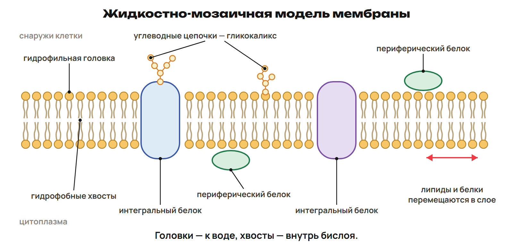
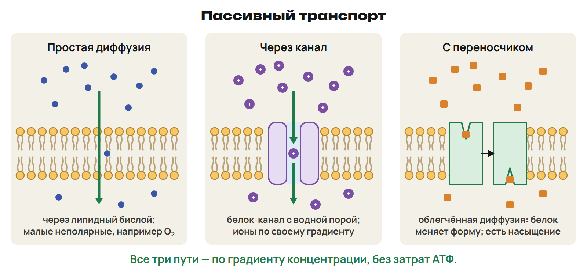
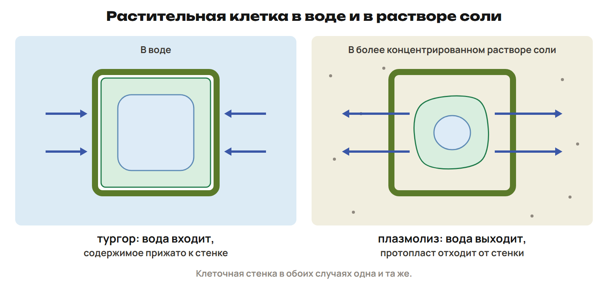
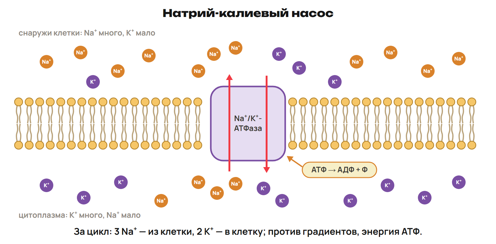
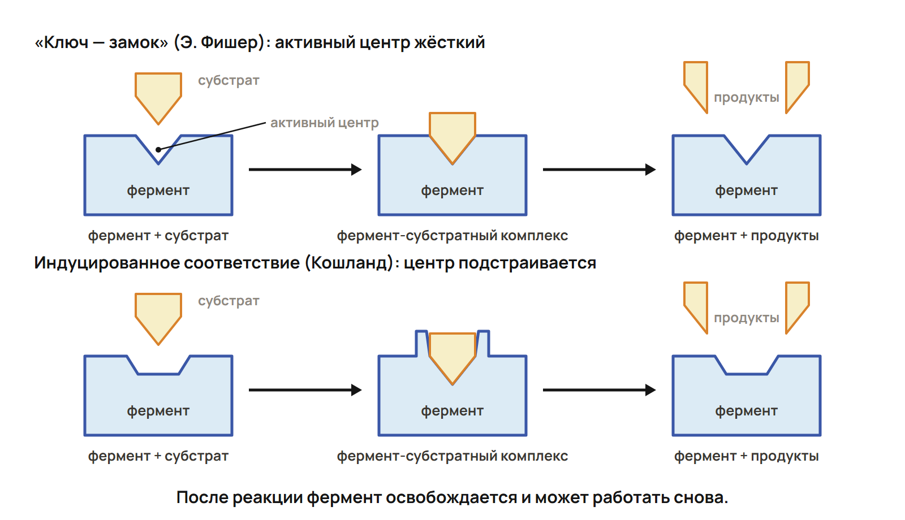

Мембрана отделяет клетку от среды, но клетке нужен обмен. Сначала спроси, что переносится и в какую сторону. Затем — нужен ли белок и откуда энергия.

## Мембрана — подвижная мозаика

Основа — фосфолипидный бислой: гидрофильные головы обращены к воде по обе стороны, гидрофобные хвосты — внутрь слоя. Толщина в учебном описании около 7,5 нм. Липиды образуют сплошной слой, белки — подвижную мозаику. Жидкостно-мозаичная модель — Сингер и Николсон, 1972. Фосфолипиды быстро перемещаются вдоль слоя.

Интегральные белки погружены в бислой или пронизывают его; периферические связаны с поверхностью. Наружная и внутренняя стороны отличаются. Гликопротеины и гликолипиды несут углеводные цепочки снаружи; у животных поверхностный белково-полисахаридный слой — гликокаликс. Он тонкий, эластичный, в световой микроскоп не виден.

Липиды мембран — фосфолипиды, гликолипиды, стеролы. В животных мембранах характерен холестерол; у растений — ситостерол и стигмастерол. Холестерол стабилизирует мембрану, повышает устойчивость и препятствует затвердеванию на холоде. Ненасыщенные жирные кислоты имеют изломы: упаковка рыхлее, мембрана жиднее.

В разных мембранах по массе липидов 25–60 %, белков 40–75 %, углеводов 2–10 %. Это диапазоны разных мембран: их верхние границы не складывают как состав одной. Живая клетка поддерживает ионные градиенты и заряд мембраны; после гибели это поддержание нарушается.

## Функции мембраны

Барьерная и избирательная проницаемость зависят от размера, заряда, химических свойств частиц. Транспортная — поступление питательных веществ, удаление продуктов обмена, секреция, поддержание ионных градиентов, pH и концентрации ионов.

Матричная функция задаёт взаимное расположение белков; механическая связывает мембрану со стенкой растения или межклеточным веществом животных. Энергетическая связана с мембранами митохондрий и хлоропластов. Рецепторная: сигнал действует на клетку-мишень с подходящим рецептором. Ферментативная: на мембране могут находиться ферменты. Гликопротеины маркируют клетки для узнавания друг друга и чужеродных антигенов.

## Пассивный транспорт

> [!rule] Градиент и энергия
> Пассивный транспорт идёт по градиенту концентрации или электрохимическому градиенту без непосредственной затраты энергии.
> При диффузии частицы хаотически движутся; суммарный перенос идёт из области большей концентрации в меньшую.

Простая диффузия — через бислой. Легко проходят малые неполярные молекулы, например O₂, и жирорастворимые вещества, например стероидные гормоны. Также могут проходить малые незаряженные CO₂, NH₃, вода, этанол, мочевина. Скорость связана с размером и растворимостью в липидах. Заряженным частицам нужны белки.

При равных концентрациях исчезает суммарный поток, но частицы продолжают двигаться. Если градиент меняется, меняется суммарное направление: CO₂ входит в эритроцит в тканях и выходит в лёгких.

Каналы образуют заполненные водой поры. Есть неселективные поры, например порин наружной мембраны митохондрий, и селективные ионные каналы, открывающиеся по сигналу. Канал пропускает по электрохимическому градиенту.

Облегчённая диффузия — по градиенту с белком-переносчиком (транслоказой), который меняет конформацию. Есть насыщение: когда переносчики заняты, скорость больше не растёт при увеличении концентрации. Глюкоза входит в эритроцит через глют-1, поступает из крови в мозг облегчённой диффузией.

Унипорт переносит одно вещество; симпорт — два в одном направлении, антипорт — в противоположных. Эти слова описывают число и направление, а не сами по себе затраты энергии.

> [!trap] Белок не равен затратам энергии
> Канал не насос. Облегчённая диффузия использует белок, но остаётся пассивной. Для иона учитывай электрохимический градиент, а не только концентрацию.

## Осмос и растительная клетка

Осмос — односторонняя диффузия молекул растворителя через полупроницаемую мембрану в сторону большей концентрации растворённого вещества. Суммарно вода идёт туда, где её концентрация ниже; отдельные молекулы могут проходить в обе стороны.

В наших простых задачах: сравнивается начало опыта, давление одинаково, мембрана пропускает воду и задерживает заданное растворённое вещество; с обеих сторон сравнивают одно вещество. Если снаружи раствор менее концентрирован, вода входит. Если более концентрирован — выходит.

В вакуоли растворены сахара, органические кислоты, соли; тонопласт и плазмалемма — полупроницаемые мембраны. При поступлении воды внутреннее содержимое прижимает мембрану к стенке; стенка даёт противодавление и препятствует разрыву. Такое давление содержимого на стенку описывает тургор.

Плазмолиз — протопласт отходит от клеточной стенки, когда клетка теряет воду в более концентрированном растворе. При возвращении клетки лука в воду вода поступает, протопласт возвращается к стенке — деплазмолиз. В состоянии самого начального плазмолиза давление раствора примерно соответствует осмотическому давлению клеточного сока; в учебном описании такой раствор назван изотоническим.

> [!trap] Вода, а не соль
> При осмосе переносится растворитель. Направление в простом случае определяй по указанным концентрациям и проницаемости; после поступления воды учитывай противодавление стенки.

## Активный транспорт

Активный транспорт переносит вещества против градиента с затратой энергии и поддерживает разницу концентраций. Первично-активный использует энергию АТФ напрямую; вторично-активный — градиент другого вещества, созданный насосом.

Na⁺/K⁺-АТФаза — интегральный белок. За цикл выводит 3 Na⁺ и вводит 2 K⁺. Снаружи обычно больше Na⁺, внутри — K⁺: насос идёт против этих градиентов. За цикл наружу уходит больше положительных зарядов, что вносит вклад в отрицательный заряд внутри относительно снаружи. Насос нужен для осморегуляции, электрической активности клеток и сопряжённого транспорта сахаров/аминокислот.

При Na⁺/глюкозном симпорте Na⁺ идёт внутрь по своему градиенту, помогая вводить глюкозу против её градиента. Так происходит всасывание глюкозы в кишечнике и обратное всасывание в почках; сходно переносятся аминокислоты. Симпорт описан и для йода в клетки щитовидной железы. Na⁺/Ca²⁺-обменник клеток сердца — антипорт: 3 Na⁺ внутрь, 1 Ca²⁺ наружу.

Эндоцитоз вводит материал в клетку, экзоцитоз выводит с участием мембранных пузырьков; оба требуют энергии. Фагоцитоз — захват крупных частиц выпячиваниями/ложноножками у амёб и лейкоцитов. Пиноцитоз — впячивание мембраны и захват жидкости. В сравнении учебника фагоцитоз наиболее энергозатратен. На ионный транспорт и поддержание заряда приходится около 30 % АТФ клетки, в нейронах на активный перенос ионов — около 70 %.

> [!trap] Глюкоза не имеет одного универсального пути
> В эритроцит — облегчённая диффузия; в кишечнике с Na⁺ — вторично-активный симпорт. Сначала прочитай, какой переносчик и какая клетка указаны.

## Фермент и субстрат

Катализатор ускоряет реакцию и не расходуется в ней; катализ — ускорение реакции в присутствии катализатора. Изучаемые ферменты — биологические катализаторы белковой природы, специфичные и высокоэффективные. Они снижают энергию активации, ускоряют наступление равновесия и не смещают его.

Фермент взаимодействует с субстратом, после образования продукта освобождается и может работать вновь. В учебной схеме А + Ф →АФ; АФ + В →АВ + Ф. Для его работы характерны условия организма, зависимость от кислотности среды и других веществ.

Активный центр — участок взаимодействия с субстратом. Модель «ключ — замок» Э. Фишера: жёсткий центр подходит субстрату. Индуцированное соответствие Кошланда: центр гибкий и подстраивается. В активном центре различают субстратный и каталитический участки; аллостерический (регуляторный) центр удалён от активного.

Многие ферменты — сложные белки, нуждающиеся в кофакторах: ионах металлов (Cu, Zn, Co, Fe), остатках кислот, производных витаминов. Белковая часть — апофермент; без необходимого кофактора она неактивна. Прочно связанная небелковая часть — простетическая группа.

## Условия активности и график

У каждого изучаемого фермента свой температурный оптимум и оптимум pH. У ферментов человека максимум часто в области температуры тела. При сильном нагревании возможна денатурация и потеря активности. У описанных в учебнике ферментов нагревание до 60–80 °C снижает активность; кипячёная амилаза слюны не расщепляет крахмал. Это не универсальный порог для всех ферментов.

При сдвиге pH от оптимума в кислую или щелочную сторону активность падает. При росте концентрации субстрата скорость сначала увеличивается, затем достигает насыщения: активные центры заняты.

Читай график:① назови оси; ② найди максимум; ③ сравни участки слева/справа; ④ сформулируй вывод только для этого фермента и данных условий. Без шкалы нельзя назвать числовой оптимум.

> [!trap] Максимум не общий для всех
> По графику одного фермента нельзя назначить тот же оптимум другим. Падение при сильном нагревании связано с нарушением структуры белка; увеличение субстрата не снимает насыщение при фиксированном количестве фермента.

## Активаторы и ингибиторы

Активаторы ускоряют, ингибиторы тормозят. В изученном примере Na⁺ и Cl⁻ стимулируют амилазу слюны, Cu²⁺ тормозит.

Обратимое ингибирование может прекращаться при удалении ингибитора; в учебном описании связано со слабыми нековалентными связями. Необратимое сохраняется из-за прочного изменения/связывания фермента; пример — аспирин необратимо ингибирует циклооксигеназу, уменьшая образование простагландинов — медиаторов воспаления. Ионы тяжёлых металлов Hg²⁺, Ag⁺, As³⁺ приведены как примеры торможения ферментов.

В модели конкурентный ингибитор — аналог субстрата, занимает активный центр (пример: сульфаниламидные препараты). Неконкурентный связывается вне активного центра и меняет конформацию. Это различие места связывания, а не направление транспорта через мембрану.

> [!rule] Факты ЕНТ недели
> - Сингер и Николсон, 1972: жидкостно-мозаичная модель; толщина около 7,5 нм.
> - Гликокаликс характерен для животных клеток; мембрана — фосфолипидный бислой.
> - Na⁺/K⁺-насос: 3 Na⁺ наружу, 2 K⁺ внутрь за цикл.
> - Осмос — перенос растворителя через полупроницаемую мембрану.
> - Фагоцитоз: амёбы и лейкоциты.
> - Фишер: «ключ — замок»; Кошланд: индуцированное соответствие.
> - Кирхгоф, 1814: превращение крахмала в сахар под действием вещества проросших зёрен ячменя; фермент/энзим — синонимы.
> - Аспирин — необратимый ингибитор циклооксигеназы; фермент не смещает равновесие.

> [!try] Перед уроком 6
> Выполни P1–P6 и всю G. Запиши два вопроса: направление транспорта и вывод графика. Конспект 25, P20, G35 — всего 80 минут.
