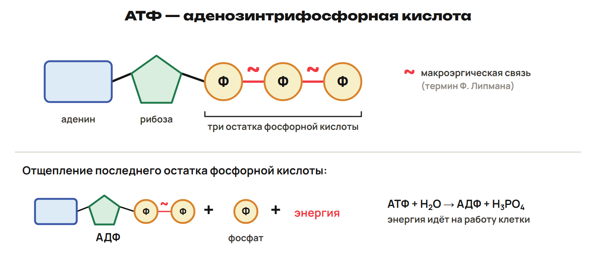
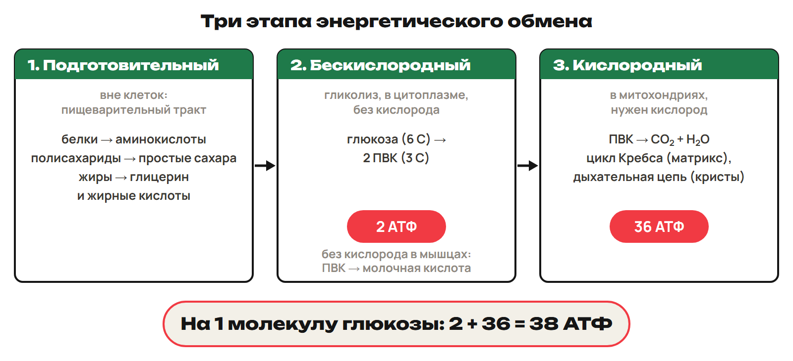
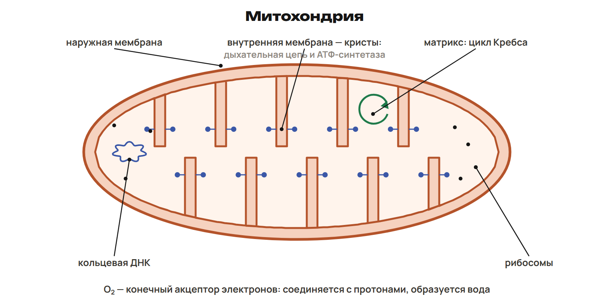
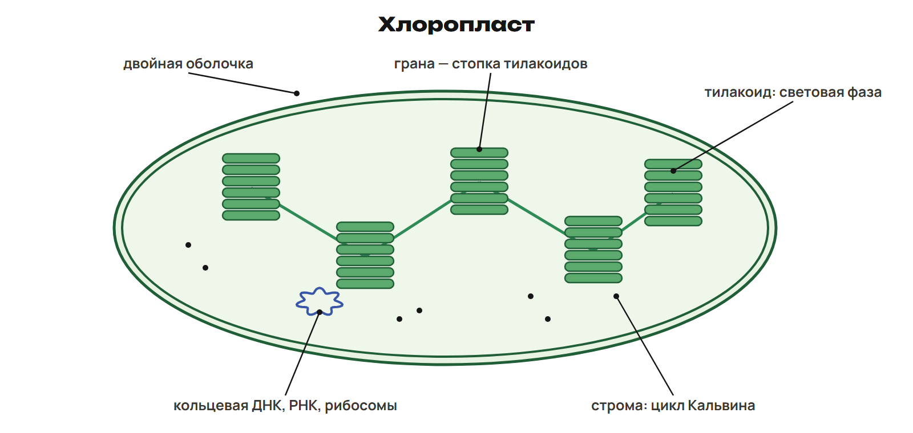
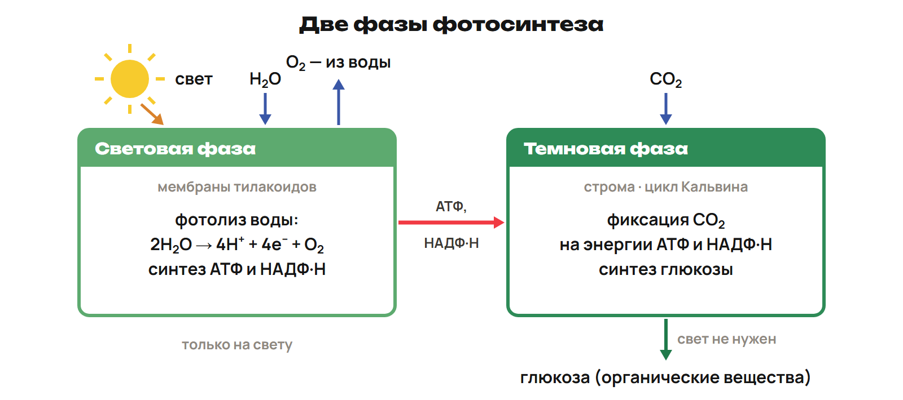
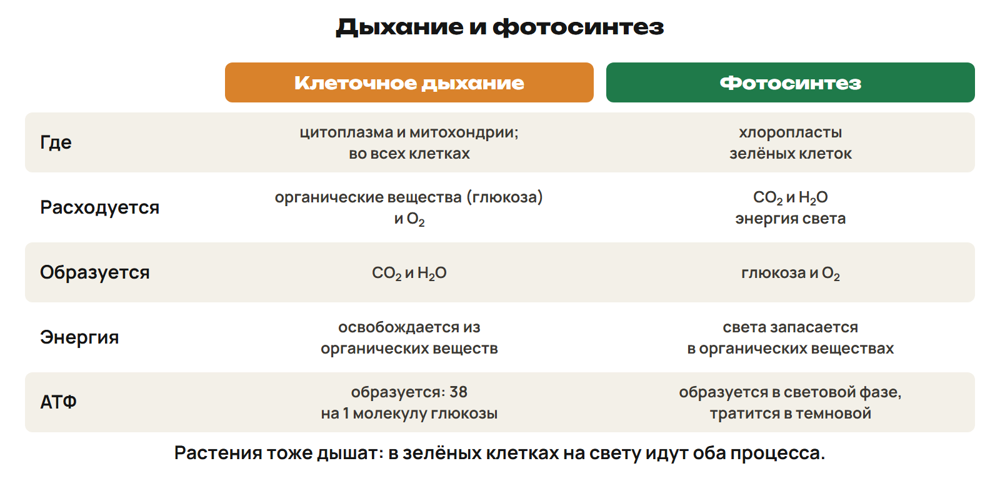

# Обмен и энергия
? Как связаны место процесса и его результат?
↳ Продолжим путь от вещества к энергии и работе клетки.
> 0–10 минут. Последние минуты основной части—попытка и ключ.

## Понятие: Две стороны обмена · 1
Метаболизм — обмен веществ и энергии, постоянно идущий в клетках. Анаболизм — реакции синтеза, пластический обмен; синтез требует энергии. Катаболизм — расщепление сложных молекул на простые, энергетический обмен, или диссимиляция; часть энергии запасается в АТФ, часть рассеивается как тепло.
> Объяснить смысл, попросить назвать место и вход/выход.

## Понятие: Две стороны обмена · 2
Примеры синтеза: липиды — в ЭПС, белки — на рибосомах, полисахариды — в комплексе Гольджи, углеводы — в пластидах растений. Обе стороны обмена связаны. Гомеостаз — сохранение относительного постоянства внутренних параметров организма.
> Объяснить смысл, попросить назвать место и вход/выход.

## Понятие: Две стороны обмена · 3
Анаболизм строит и требует энергии; катаболизм расщепляет и позволяет запасать энергию. Не меняй названия местами.
> Объяснить смысл, попросить назвать место и вход/выход.

## Практика: L1
Сопоставь синтез/расщепление с анаболизмом/катаболизмом.
Ответы:
Анаболизм синтез с затратой энергии; катаболизм расщепление с запасанием части энергии в АТФ.
> Ключ после попытки. При ошибке назвать процесс, этап и единицу.

# АТФ и работа
? Как связаны место процесса и его результат?
↳ Продолжим путь от вещества к энергии и работе клетки.
> 10–24 минут. Последние минуты основной части—попытка и ключ.

## Понятие: АТФ — энергия для работы · 1
АТФ — аденозинтрифосфорная кислота, нуклеотид: аденин, рибоза, три остатка фосфорной кислоты. Связи между фосфатными остатками называют макроэргическими; термин ввёл Ф. Липман, знак «~».
> Объяснить смысл, попросить назвать место и вход/выход.

## Понятие: АТФ — энергия для работы · 2

> Объяснить смысл, попросить назвать место и вход/выход.

## Понятие: АТФ — энергия для работы · 3
Гидролиз: АТФ + H₂O → АДФ + H₃PO₄. При дальнейшем отщеплении фосфата получается АМФ. Для учебных расчётов энергия гидролиза — около 30,6 кДж/моль; при синтезе АТФ из АДФ и фосфата энергия поглощается. Энергия высвобождается в результате всей реакции гидролиза, а не просто разрыва одной связи.
> Объяснить смысл, попросить назвать место и вход/выход.

## Понятие: АТФ — энергия для работы · 4
АТФ обеспечивает движение, синтез, транспорт через мембрану, работу сердца и передачу нервных импульсов. Она постоянно расходуется и восстанавливается: АТФ ↔ АДФ. В учебном описании её около 0,04 % сырой массы клетки; в мышце запас соответствует 20–30 сокращениям. Синтез идёт в цитоплазме и главным образом в митохондриях; в фотосинтезирующей клетке АТФ образуется также на тилакоидах.
> Объяснить смысл, попросить назвать место и вход/выход.

## Практика: L2
Назови части АТФ и результат отщепления одного фосфата.
Ответы:
Аденин, рибоза,3 фосфата; АТФ+вода→АДФ+фосфат.
> Ключ после попытки. При ошибке назвать процесс, этап и единицу.

# Этапы дыхания
? Как связаны место процесса и его результат?
↳ Продолжим путь от вещества к энергии и работе клетки.
> 24–50 минут. Последние минуты основной части—попытка и ключ.

## Понятие: Три этапа энергетического обмена · 1
Энергетический обмен — ферментативное расщепление органических соединений с образованием богатых энергией соединений. При биологическом окислении органические вещества отдают электроны; акцепторами могут быть O₂, НАД⁺, НАДФ⁺. Процесс ступенчатый, без вспышки как при горении.
> Объяснить смысл, попросить назвать место и вход/выход.

## Понятие: Три этапа энергетического обмена · 2
В расчётах этой недели используй учебную модель выхода АТФ на одну молекулу глюкозы: 2 + 36 = 38. Числа относятся к разным этапам.
> Объяснить смысл, попросить назвать место и вход/выход.

## Понятие: Три этапа энергетического обмена · 3
Этап; Место; Участие O₂; Продукты; Учёт АТФ
Подготовительный в описанном примере; Вне клеток, пищеварительный тракт; Расщепление ферментами, O₂ в схеме не участвует; Белки → аминокислоты; полисахариды → простые сахара; жиры → глицерин и жирные кислоты; В модели 2 + 36 его вклад не подсчитывается
Бескислородный, гликолиз; Цитоплазма; Не нужен; Глюкоза, 6 C → две ПВК по 3 C; 2 НАД·H; 2 АТФ, чистый выход
Кислородный; Митохондрии; Нужен; конечный акцептор электронов; CO₂ и H₂O; 36 АТФ
> Объяснить смысл, попросить назвать место и вход/выход.

## Понятие: Три этапа энергетического обмена · 4

> Объяснить смысл, попросить назвать место и вход/выход.

## Понятие: Три этапа энергетического обмена · 5
Без кислорода ПВК в мышцах превращается в молочную кислоту; у молочнокислых бактерий — сходное брожение (кефир, простокваша, силос). У дрожжей спиртовое брожение даёт этиловый спирт и CO₂, например при получении кваса. Брожение поддерживает бескислородный путь; не добавляй к нему 36 АТФ кислородного этапа.
> Объяснить смысл, попросить назвать место и вход/выход.

## Понятие: Три этапа энергетического обмена · 6
Для расщепления глюкозы у аэробов сначала проходит гликолиз. Бескислородные процессы возникли раньше; накопление O₂ связано с фотосинтезом цианобактерий. Аэробные организмы сейчас составляют большинство в учебном описании.
> Объяснить смысл, попросить назвать место и вход/выход.

## Понятие: Три этапа энергетического обмена · 7
Митохондрия имеет две мембраны. Кристы — складки внутренней мембраны с дыхательной цепью и АТФ-синтетазой. Матрикс содержит ферменты цикла Кребса, кольцевую ДНК и рибосомы. Кислородный этап объединяет цикл Кребса в матриксе и дыхательную цепь на внутренней мембране. O₂ принимает электроны и с протонами образует воду; синтез АТФ, связанный с этим переносом, — окислительное фосфорилирование.
> Объяснить смысл, попросить назвать место и вход/выход.

## Понятие: Три этапа энергетического обмена · 8

> Объяснить смысл, попросить назвать место и вход/выход.

## Понятие: Три этапа энергетического обмена · 9
36 — кислородный этап. 38 — весь путь, включая 2 АТФ гликолиза. Гликолиз заканчивается ПВК; молочная кислота образуется при последующем превращении ПВК без кислорода.
> Объяснить смысл, попросить назвать место и вход/выход.

## Понятие: Три этапа энергетического обмена · 10
Полностью расщепились 3 молекулы глюкозы. По заданной модели: 3 × 38 = 114 молекул АТФ.
Только гликолиз тех же 3 молекул: 3 × 2 = 6 АТФ.
Кислородный этап: 3 × 36 = 108 АТФ; проверка 6 + 108 = 114.
> Объяснить смысл, попросить назвать место и вход/выход.

## Понятие: Утомление мышц · 1
При интенсивной работе поступление кислорода может не успевать за потребностью; усиливается бескислородный путь и накапливается молочная кислота, возникает кислородная задолженность. В учебном описании утомления рассматриваются нехватка кислорода/накопление молочной кислоты, нагрузка на сухожилия и нервные центры.
> Объяснить смысл, попросить назвать место и вход/выход.

## Понятие: Утомление мышц · 2
Короткие мощные нагрузки — спринт, штанга, толкание ядра; более продолжительные — плавание, бег, велоспорт, футбол. При любых нагрузках участвуют оба пути, меняется их вклад. После нагрузки молочная кислота частично окисляется, частично используется для синтеза глюкозы и гликогена. Причину поздней мышечной боли из этого описания не выводим.
> Объяснить смысл, попросить назвать место и вход/выход.

## Практика: L3
Полностью расщепились 6 глюкоз. Модель 2+36=38. Найди АТФ двух этапов и итог.
Ответы:
6×2=12; 6×36=216; 12+216=228=6×38 АТФ.
> Ключ после попытки. При ошибке назвать процесс, этап и единицу.

# Фотосинтез
? Как связаны место процесса и его результат?
↳ Продолжим путь от вещества к энергии и работе клетки.
> 50–67 минут. Последние минуты основной части—попытка и ключ.

## Понятие: Фотосинтез · 1
Углекислый газ + вода → при свете и хлорофилле → глюкоза + кислород. Нужны свет, вода, CO₂ и хлорофилл в хлоропластах. В описанном опыте лист пеларгонии на свету накапливает крахмал, обнаруживаемый йодом; в темноте такого результата нет. Длительная нехватка света может нарушить образование хлорофилла.
> Объяснить смысл, попросить назвать место и вход/выход.

## Понятие: Фотосинтез · 2
Хлоропласт — зелёная пластида с оболочкой из двух мембран. Тилакоиды собраны в граны; жидкое содержимое — строма. В строме ДНК, РНК и рибосомы; хлоропласт полуавтономен, его происхождение связано с цианобактериями и эндосимбиозом.
> Объяснить смысл, попросить назвать место и вход/выход.

## Понятие: Фотосинтез · 3

> Объяснить смысл, попросить назвать место и вход/выход.

## Понятие: Фотосинтез · 4
Хлорофилл поглощает красные и синие лучи, зелёные отражает. У высших растений a и b, главный — a; в центре молекулы магний. Жёлтые/оранжевые каротиноиды (каротин, ксантофилл) передают энергию хлорофиллу и защищают его от разрушения светом.
> Объяснить смысл, попросить назвать место и вход/выход.

## Понятие: Фотосинтез · 5
Световая фаза идёт на свету на мембранах тилакоидов. Хлорофилл поглощает свет; фотолиз воды: 2H₂O → 4H⁺ + 4e⁻ + O₂. Образуются АТФ, НАДФ·H и выделяется O₂. АТФ и НАДФ·H используются в следующей фазе.
> Объяснить смысл, попросить назвать место и вход/выход.

## Понятие: Фотосинтез · 6
Темновая фаза, цикл Кальвина, — в строме. Она не использует свет непосредственно, но зависит от продуктов световой фазы; название не означает «только ночью». Акцептор CO₂ — рибулозодифосфат, 5 C; фермент — РиБФ-карбоксилаза. Образуются трёхуглеродные соединения, для синтеза органики расходуются АТФ и НАДФ·H. М. Кальвин получил Нобелевскую премию в 1961 году.
> Объяснить смысл, попросить назвать место и вход/выход.

## Понятие: Фотосинтез · 7

> Объяснить смысл, попросить назвать место и вход/выход.

## Понятие: Фотосинтез · 8
O₂ фотосинтеза — из воды, не из CO₂. CO₂ даёт углерод органическому веществу. Световая фаза — тилакоиды, темновая — строма.
> Объяснить смысл, попросить назвать место и вход/выход.

## Практика: L4
Назови места двух фаз фотосинтеза, источник O₂ и связь через АТФ/НАДФ·H.
Ответы:
Тилакоиды/строма; O₂ из воды; АТФ/НАДФ·H световой используются в темновой.
> Ключ после попытки. При ошибке назвать процесс, этап и единицу.

# Сравнение и факторы
? Как связаны место процесса и его результат?
↳ Продолжим путь от вещества к энергии и работе клетки.
> 67–80 минут. Последние минуты основной части—попытка и ключ.

## Понятие: Сравнение двух процессов · 1
Признак; Клеточное дыхание; Фотосинтез
Место изученного пути; Гликолиз в цитоплазме, кислородный этап в митохондрии; Световая фаза на тилакоидах, темновая в строме хлоропласта
Расходуется; Глюкоза; при полном аэробном пути O₂; CO₂, вода; для световой фазы свет
Образуется; CO₂, H₂O, АТФ; Органическое вещество, O₂
Источник энергии; Химическая энергия органического вещества; Свет
Роль АТФ; Запасание части энергии и обеспечение работы клетки; Синтез в световой фазе, расход в темновой
> Объяснить смысл, попросить назвать место и вход/выход.

## Понятие: Сравнение двух процессов · 2

> Объяснить смысл, попросить назвать место и вход/выход.

## Понятие: Факторы и хемосинтез · 1
Факторы фотосинтеза: свет, CO₂, температура, вода, минеральное питание P/Mg/K. Скорость ограничивает фактор в минимуме; при его росте скорость увеличивается до плато, затем ограничивает другой фактор. Компенсационная точка — освещённость, при которой фотосинтез и дыхание уравновешены. По В. Н. Любименко различают светолюбивые, теневыносливые и тенелюбивые растения.
> Объяснить смысл, попросить назвать место и вход/выход.

## Понятие: Факторы и хемосинтез · 2
При слабом свете влияние температуры мало; при сильном роль температурно-зависимых темновых реакций возрастает. Дефицит воды закрывает устьица и уменьшает поступление CO₂. Значение концентрации CO₂ для задачи бери из условия: учебные данные относятся к описанному примеру, не к измерению сегодняшнего воздуха.
> Объяснить смысл, попросить назвать место и вход/выход.

## Понятие: Факторы и хемосинтез · 3
Хемосинтез — автотрофное питание за счёт энергии окисления неорганических веществ, без света. Открыт С. Н. Виноградским. В изученных группах бактерий/архей энергия запасается в АТФ, затем идёт на синтез органики. Примеры: нитрифицирующие бактерии окисляют аммиак; железобактерии Fe²⁺ → Fe³⁺; серобактерии H₂S → S → H₂SO₄. Круговорот азота подробно изучается отдельно.
> Объяснить смысл, попросить назвать место и вход/выход.

## Понятие: Факторы и хемосинтез · 4
- АТФ: аденин, рибоза, три фосфатных остатка; макроэргические связи — Липман.
- Учебная энергия гидролиза АТФ около 30,6 кДж/моль.
- Гликолиз: цитоплазма, 2 АТФ на глюкозу в модели.
- Кислородный этап: митохондрия, 36 АТФ; весь путь 38.
- Дрожжи: спирт и CO₂; мышцы без O₂: молочная кислота из ПВК.
- Хлорофилл содержит Mg; световая фаза — тилакоиды, темновая — строма.
> Объяснить смысл, попросить назвать место и вход/выход.

## Понятие: Факторы и хемосинтез · 4
- O₂ фотосинтеза из воды; акцептор CO₂ цикла Кальвина — рибулозодифосфат.
- Хемосинтез: Виноградский, автотрофия без света.
> Объяснить смысл, попросить назвать место и вход/выход.

## Практика: L5
Сравни дыхание/фотосинтез по источнику энергии. Хемосинтез — какой тип питания?
Ответы:
Химическая энергия органики/свет; хемосинтез автотрофный от окисления неорганических веществ.
> Ключ после попытки. При ошибке назвать процесс, этап и единицу.

# Проверка и углубление
? Как связаны место процесса и его результат?
↳ Продолжим путь от вещества к энергии и работе клетки.
> 80–90 минут. Последние минуты основной части—попытка и ключ.

## Практика: L6
Почему 36 не полный итог? Где гликолиз/Кребс/цепь?
Ответы:
Есть 2 гликолиза: 38 полный. Цитоплазма/матрикс/внутренняя мембрана.
> Ключ после попытки. При ошибке назвать процесс, этап и единицу.

## Дома: После урока 7
Конспект 25, P20, вся G35 минут.
Два вопроса к уроку 8.
> 80–82 L6,82–84 ключ; 84–88 повторение либо 4 опциональных блока; 88–90 Дома.

## Понятие: Углубление — гликолиз и цикл
Гликолиз: около 10 реакций,2 АТФ тратятся,4 образуются, чистый 2.
Кребс: Г.Кребс,1937; ПВК→ацетил-КоА2C с CO₂.
Ацетил-КоА2C+щавелевоуксусная 4C→лимонная 6C.
За оборот 1 АТФ,2 CO₂,4 пары H; на глюкозу 2 оборота.
Главный выход—восстановленные переносчики для цепи.
> Опционально 84–88 вместо повторения; если база требует поддержки, пропустить. Затем вернуться к Дома.

## Понятие: Углубление — цепь и митохондрия
Цитохромы на внутренней мембране; H⁺ выкачиваются в межмембранное пространство.
При разности потенциалов около 200 мВ H⁺ проходят АТФ-синтетазу.
2 АТФ гликолиз+2 цикл+34 цепь=38.
Липман,1941:энергия сначала запасается в АТФ, затем работа.
Учебные характеристики митохондрий: 1,5–10 мкм, около 2000 в описанной клетке, до 25 % объёма; порин снаружи.
Симбиотическое происхождение митохондрий.
> Опционально 84–88 вместо повторения; если база требует поддержки, пропустить. Затем вернуться к Дома.

## Понятие: Углубление — пигменты
Пелетье/Кавенту,1818:выделение хлорофилла; М.С.Цвет—хроматография.
Rf=путь пигмента/путь растворителя.
a сине-зелёный, b жёлто-зелёный; a примерно втрое больше в описании.
Хлорофилл не растворим в воде, растворим в органических растворителях.
Тимирязев: сходство хлорофилла(Mg)/гема(Fe); фикобилины у цианобактерий/красных водорослей.
> Опционально 84–88 вместо повторения; если база требует поддержки, пропустить. Затем вернуться к Дома.

## Понятие: Углубление — фотосистемы и C₄
Нециклическое: вода→ФС II→ФС I→НАДФ⁺; Арнон,1957.
Циклическое—только АТФ, без НАДФ·H; на глюкозу 6 оборотов Кальвина.
Хэтч/Слэк,1966:C₄; кукуруза, сахарный тростник, сорго, просо.
Акцептор CO₂—ФЕП, ферментФЕП-карбоксилаза; кранц-анатомия.
В учебном сравнении C₄ фотодыхание значительно подавлено.
Т.Б.Дарканбаев изучал фотосинтез пшеницы.
> Опционально 84–88 вместо повторения; если база требует поддержки, пропустить. Затем вернуться к Дома.
