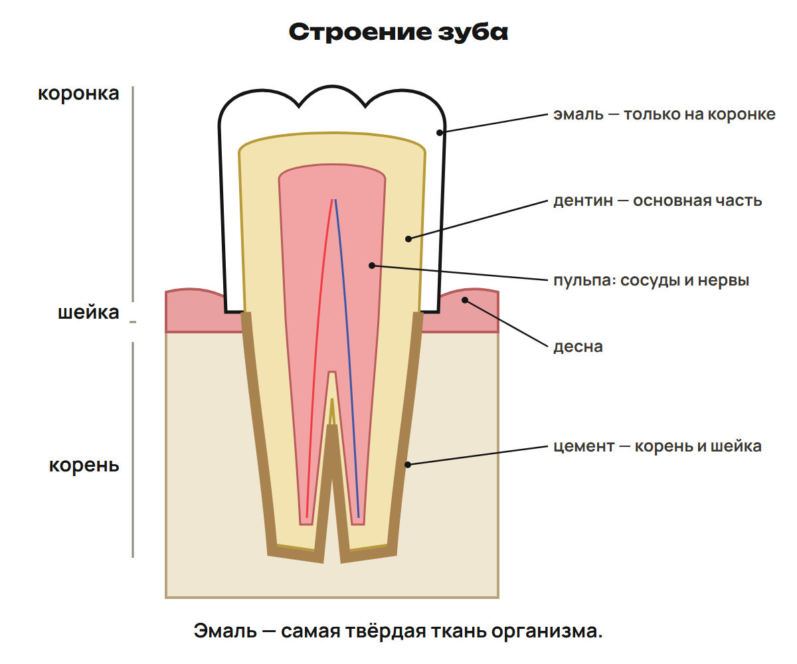

# Вопросы и повторение
? Как обосновать ответ по пути пищи или таблице?
↳ Перейдём от повторения к новым признакам и самостоятельному рубежу.
> 0–20 минут. Дать попытку до ключа.

## Практика: L7
Назови мономер белка и сахар стандартной РНК/ДНК.
Ответы:
Аминокислота; рибоза/дезоксирибоза.
> Ключ после попытки. При ошибке спросить место, вещество и действие.

## Практика: L8
Жир в модели образуется из глицерина и жирных кислот; сколько каждого? Объясни, почему фермент при денатурации может потерять функцию.
Ответы:
Один глицерин/три жирные кислоты; изменение пространственной формы может нарушить работу активного центра.
> Ключ после попытки. При ошибке спросить место, вещество и действие.

# Разбор G
? Как обосновать ответ по пути пищи или таблице?
↳ Перейдём от повторения к новым признакам и самостоятельному рубежу.
> 20–40 минут. Дать попытку до ключа.

## Практика: G9
Проследи крахмал от рта до всасывания: назови действие амилазы, дальнейшее превращение мальтозы и путь всасывания конечного сахара.
Ответы:
Амилаза начинает расщепление крахмала до мальтозы; мальтаза превращает мальтозу в глюкозу; конечное переваривание/всасывание в тонком кишечнике, глюкоза поступает в кровь.
> Сопоставить свой ответ, затем открыть ключ.

## Практика: G10
Для жирной пищи объясни образование/накопление желчи, эмульгирование, фермент и роль ворсинок.
Ответы:
Желчь образуется печенью, накапливается в пузыре; делит жир на мелкие капли; липаза действует на жиры при участии желчи; ворсинки увеличивают поверхность всасывания. Основной путь продуктов жиров в школьной схеме — лимфа.
> Сопоставить свой ответ, затем открыть ключ.

# Зубы и гигиена
? Как обосновать ответ по пути пищи или таблице?
↳ Перейдём от повторения к новым признакам и самостоятельному рубежу.
> 40–54 минут. Дать попытку до ключа.

## Понятие: 5. Зубы и гигиена — после урока 10 · 1
Функции зубов: захват, удержание, измельчение пищи, участие в речи. Коронка над десной, шейка в области десны, корень в ячейке. Эмаль покрывает коронку и является самой твёрдой тканью; дентин составляет большую часть зуба, это отдельная ткань, не кость. Пульпа внутри содержит сосуды и нервы; корень покрыт цементом.
> Объяснить смысл и проверить один вывод по схеме.

## Понятие: 5. Зубы и гигиена — после урока 10 · 2
Полная формула постоянных зубов: 8 резцов, 4 клыка, 8 малых и 12 больших коренных — 32. Молочных 20. Возрастные сроки в описании приблизительные: появление молочных 6–9 месяцев, полный набор около 3 лет, смена с 6–7 лет; зубы мудрости часто в молодом взрослом возрасте, сроки индивидуальны.
> Объяснить смысл и проверить один вывод по схеме.

## Понятие: 5. Зубы и гигиена — после урока 10 · 3
Кариес повреждает твёрдые ткани зуба; при прогрессировании затрагивается дентин, возможно воспаление пульпы. Х. Досмухамедов писал о гигиене зубов. У грызунов клыков нет в изученном сравнении.
> Объяснить смысл и проверить один вывод по схеме.

## Понятие: 5. Зубы и гигиена — после урока 10 · 4

> Объяснить смысл и проверить один вывод по схеме.

## Понятие: 5. Зубы и гигиена — после урока 10 · 5
Кишечные инфекции: дизентерия, брюшной тиф, холера; заражение может быть связано с загрязнённой водой/пищей, переносчиками — мухами, тараканами, грызунами. Ботулинический токсин может образоваться в бескислородной среде испорченных консервов и поражает нервную систему. Это учебные признаки, а не схема лечения.
> Объяснить смысл и проверить один вывод по схеме.

## Практика: L9
Назови части и слои зуба; из чего состоит полный постоянный набор?
Ответы:
Коронка/шейка/корень; эмаль/дентин/пульпа, цемент корня. 8 резцов+4 клыка+8 малых+12 больших коренных=32.
> Ключ после попытки. При ошибке спросить место, вещество и действие.

# Витамины
? Как обосновать ответ по пути пищи или таблице?
↳ Перейдём от повторения к новым признакам и самостоятельному рубежу.
> 54–70 минут. Дать попытку до ключа.

## Понятие: 6. Витамины — после урока 10 · 1
Витамины — органические вещества, необходимые для жизни. Большинство поступает с пищей; некоторые образуются в организме. В школьной истории Н. И. Лунин, 1880; термин «витамины» появился в 1912 году.
> Объяснить смысл и проверить один вывод по схеме.

## Понятие: 6. Витамины — после урока 10 · 2
Водорастворимые: C, PP, группа B. Жирорастворимые: A, D, E, K («КЕДА»). В школьных определениях гиповитаминоз — недостаток, авитаминоз — отсутствие, гипервитаминоз — избыток, способный вызвать отравление. Это не основание самостоятельно назначать препараты.
> Объяснить смысл и проверить один вывод по схеме.

## Понятие: 6. Витамины — после урока 10 · 3
Витамин; Роль; Недостаток в изученных примерах; Источники
C, аскорбиновая кислота; Эпителий, прочность костей/зубов, сопротивляемость инфекциям; Цинга; Шиповник, смородина, цитрусовые, перец, капуста
B₁, тиамин; Нервная система, углеводный обмен; Бери-бери; Отруби, шпинат, яйца
A, ретинол; Рост, эпителий, сумеречное зрение; Куриная слепота; Печень, масло, рыбий жир; каротин как провитамин в моркови/облепихе/тыкве
D, кальциферол; Всасывание Ca/P; Рахит у детей; Рыбий жир, печень трески; образуется в коже при УФ
B₂, рибофлавин; Нервная система, обмен, кроветворение; Поражения кожи, слизистых, зрения; Дрожжи, отруби, мясо, молоко
> Объяснить смысл и проверить один вывод по схеме.

## Понятие: 6. Витамины — после урока 10 · 3
B₆, пиридоксин; Белковый обмен, созревание эритроцитов; Анемия, дерматит, судороги; В описании синтез кишечной микрофлорой
B₁₂, цианокобаламин; Кроветворение; Анемия; Печень, почки, рыба, яйца
PP, никотиновая кислота; Работа желудка/кишечника; Пеллагра; Мясо, печень, яйца, арахис
E, токоферол; В описании связан с мышечной/репродуктивной функцией; Мышечная дистрофия; репродуктивные нарушения в описанных примерах; Растительные масла, проросшие злаки
K, филлохинон; Свёртывание крови; Нарушение свёртывания; Шпинат, капуста; синтез микрофлорой
> Объяснить смысл и проверить один вывод по схеме.

## Понятие: 6. Витамины — после урока 10 · 4
Каротин — провитамин A, не готовый ретинол. D образуется в коже при ультрафиолете — «солнечный витамин». C может разрушаться на воздухе; действие металлов зависит от условий, не любого металлического предмета одинаково.
> Объяснить смысл и проверить один вывод по схеме.

## Понятие: 6. Витамины — после урока 10 · 5
Не путай гипо-, а- и гипервитаминоз. Каротин отличается от готового A; жирорастворимые — A, D, E, K, а C и группа B водорастворимы.
> Объяснить смысл и проверить один вывод по схеме.

## Практика: L10
Сопоставь А — витамин A; Б — PP: 1 пеллагра; 2 цинга; 3 рахит; 4 куриная слепота. Какие витамины жирорастворимы?
Ответы:
А4 Б1; A, D, E, K жирорастворимы.
> Ключ после попытки. При ошибке спросить место, вещество и действие.

# Различия и применение
? Как обосновать ответ по пути пищи или таблице?
↳ Перейдём от повторения к новым признакам и самостоятельному рубежу.
> 70–78 минут. Дать попытку до ключа.

## Практика: L11
Сравни гипо-, а-, гипервитаминоз и каротин/ретинол в школьных терминах.
Ответы:
Недостаток/отсутствие/избыток; каротин провитамин A, ретинол готовый витамин.
> Ключ после попытки. При ошибке спросить место, вещество и действие.

## Практика: L12
В описании испорченных консервов яд образуется без кислорода и поражает нервную систему. Какой процесс/риск изучен? Почему это не вопрос о самостоятельном лечении?
Ответы:
Ботулинический токсин/ботулизм; учебное знание причины и действия не задаёт диагноз или лечение.
> Ключ после попытки. При ошибке спросить место, вещество и действие.

# Рубеж и маршрут
? Как обосновать ответ по пути пищи или таблице?
↳ Перейдём от повторения к новым признакам и самостоятельному рубежу.
> 78–90 минут. Дать попытку до ключа.

## Практика: Контроль Q1–Q6 · 10 минут
Работай без подсказок по ученическому листу.
Сдай фото; ключ после сдачи.

## Дома: Один вариант
A — углубление; B — закрепление; C — поддержка.
Один вариант 30, исправления 25, повторение 15 включает разделы 5–6.
Всего за неделю 165 минут с контекст-треком.
## Понятие: Углубление — желчь
Образование в печени непрерывно, накопление в пузыре между пищеварением.
В описании вода 97–98 %, желчные кислоты, билирубин, холестерин.
Эмульгирование увеличивает поверхность; желчь помогает всасыванию жиров/жирорастворимых витаминов.
Желчь, мыло, белок, щёлочь в сравнении — эмульгаторы; без процедуры опыта.
> Приложение только для A после основной части; чтение в его 30 минутах, не сверх 90 минут занятия.

## Понятие: Углубление — каротин и секреция
Каротин лучше усваивается при участии жиров, превращается в A в печени/стенке кишечника.
Избыток A может вызвать отравление; в учебном примере печень белого медведя.
Поджелудочная смешанной секреции: сок в кишку, инсулин/глюкагон в кровь.
Механизмы гормонов — последующие темы.
> Приложение только для A после основной части; чтение в его 30 минутах, не сверх 90 минут занятия.

## Понятие: Углубление — условные доли
Доли приёмов в учебной арифметической модели: 20 %, 30 %, 30 %, 20 %.
Сумма 100 %; каждое количество = данное общее × доля.
Это модель условия, не персональная рекомендация питания.
> Приложение только для A после основной части; чтение в его 30 минутах, не сверх 90 минут занятия.
