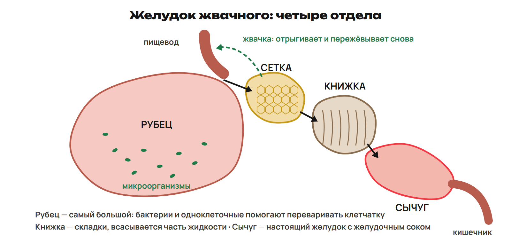
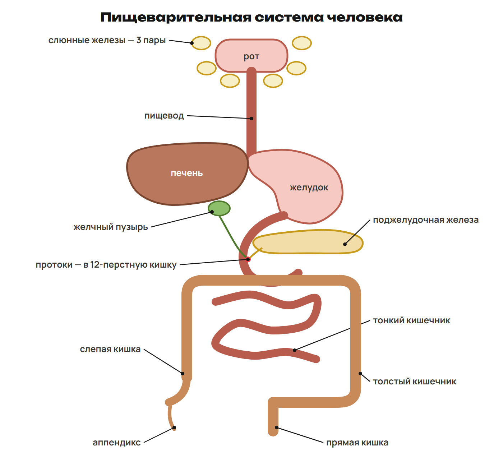
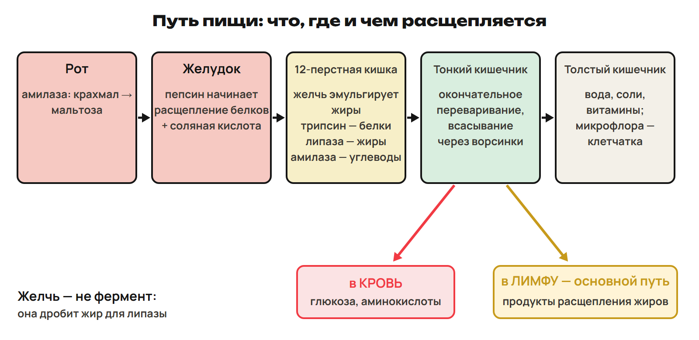
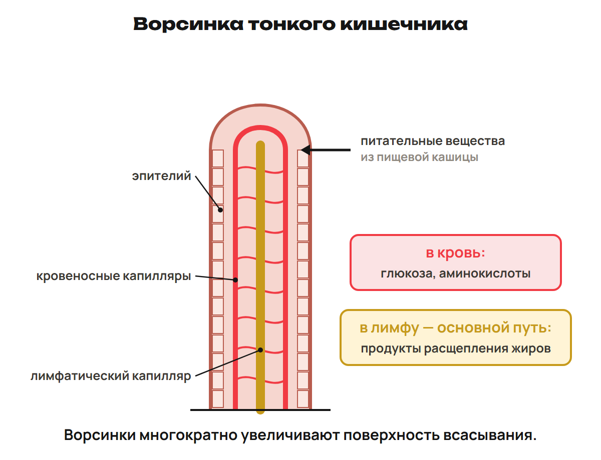

Организм получает вещества, расщепляет их и использует в клетках. Назови сначала способ получения органики, затем путь пищи, фермент и конечный компонент.

## 1. Типы питания

Автотрофы сами синтезируют органические вещества: растения используют свет, хемосинтезирующие организмы — энергию окисления неорганических веществ. Гетеротрофы используют готовую органику: животные и грибы; среди бактерий есть разные типы питания.

Грибы не глотают пищу: всасывают питательные вещества поверхностью тела. Хлоропластов нет, запас — гликоген. Среди грибов есть сапротрофы, питающиеся органическими остатками: мукор, пеницилл. У животных встречаются травоядные, хищники, паразиты и питание остатками.

У одноклеточных переваривание внутри клетки связано с лизосомами. У изучаемых многоклеточных животных есть пищеварительная система, осуществляющая переработку пищи.

> [!trap] Свет или готовая органика
> Гриб — гетеротроф, даже если растёт рядом с растением. Хемосинтез без света тоже автотрофный.

## 2. Минеральное питание растений

Наземное растение получает углерод из CO₂ воздуха, O₂ использует для дыхания. Воду и описанные минеральные вещества получает главным образом из почвы.

Макроэлементы: N, S, P, K, Ca, Mg. N и S входят в белки; N нужен для роста. P связан с оболочками/ядрами клеток и энергетическими процессами; K — ростом, распределением воды, опорой; Ca — развитием корней и распределением воды. Mg и N входят в хлорофилл.

Недостаток Mg, N или Fe может вызвать побледнение/пожелтение листьев. Микроэлементы нужны в малых количествах; примеры перечня: Fe, Cu, Mn, Zn, Mo, Co. Потребность в отдельных элементах зависит от вида и условий.

Минеральные удобрения — неорганические вещества химического производства. Органические — компост, навоз, птичий помёт, перегной, торф. В описанных случаях грамотное применение повышает урожай; размер эффекта зависит от условий, это не одинаковое число для любого растения.

## 3. Пищеварение животных

Переваривание расщепляет пищевые вещества до компонентов, доступных клеткам: конечные сахара, аминокислоты, компоненты жиров. Пищеварительная система включает канал и железы: слюнные дают слюну, печень — желчь, поджелудочная — панкреатический сок.

У дождевого червя: рот → глотка → пищевод → зоб → желудок → кишечник → анальное отверстие; есть слюнные железы. У червя пищеварение связано с переработкой органики почвы.

У коровы четыре отдела желудка: рубец → сетка → книжка → сычуг. Рубец самый большой, микроорганизмы помогают переработке клетчатки. В книжке много складок, всасывается часть жидкости. Сычуг — настоящий желудок с желудочным соком; в нём перевариваются белки, включая белки микроорганизмов. Пища отрыгивается и пережёвывается вновь — жвачка.

Человек имеет однокамерный желудок; у жвачного четыре отдела и более развитая слепая кишка. Человеческие ферменты клетчатку не расщепляют; микрофлора участвует в её переработке. Это не означает, что человек не усваивает никаких продуктов работы микрофлоры.

## 4. Пищеварение человека

Механическая обработка измельчает и перемешивает пищу. Химическая — расщепление пищеварительными соками и ферментами. Всасывание — переход продуктов через клетки кишечника в кровь и лимфу.

Путь: ротовая полость → глотка → пищевод → желудок → тонкий кишечник → толстый кишечник → выход. Перистальтика — волнообразные сокращения стенок, продвигающие пищу.

Три пары слюнных желёз: околоушные, подъязычные, подчелюстные. Язык перемешивает, помогает глотанию, воспринимает вкус растворённых веществ. Слюна содержит амилазу, лизоцим и слизь; в описании выделяется примерно 1,5–2 л в сутки. Амилаза начинает расщепление крахмала до мальтозы; мальтаза превращает мальтозу в глюкозу при дальнейшем пищеварении. Лизоцим участвует в защите от бактерий, слизь облегчает глотание.

Мышечный пищевод проталкивает пищу; надгортанник у входа в гортань помогает разделить пути пищи и воздуха. Желудок имеет три слоя гладких мышц. Желудочный сок: пепсин начинает расщепление белков до пептидов; HCl создаёт кислую среду и участвует в активации пепсина; слизь защищает стенку. В учебном описании сока до 2 л в сутки.

Двенадцатиперстная кишка — начало тонкого кишечника; туда открываются протоки печени и поджелудочной. Панкреатический сок содержит трипсин, амилазу и липазу. В опорной схеме липаза действует на жиры при участии желчи; желчь не является ферментом.

Печень — крупнейшая железа, около 1,5 кг в описании. Желчь образуется непрерывно и накапливается в пузыре вне пищеварения; в сутки указано 700–800 г. В составе преимущественно вода, желчные кислоты, пигменты и холестерин. Билирубин связан с переработкой гемоглобина разрушенных эритроцитов. Печень также обезвреживает поступающие вещества и запасает гликоген.

Желчь дробит крупные жировые капли на мелкие — эмульгирование. Поверхность для липазы увеличивается. Она помогает действию панкреатических ферментов и всасыванию жиров/жирорастворимых витаминов, способствует перистальтике и уменьшает гнилостные процессы. Желчь участвует в подщелачивании пищевой кашицы; не приписывай все процессы только одному соку.

| Отдел | Железа/сок | Фермент/действие | Вещество → результат | Дальнейший путь |
|---|---|---|---|---|
| Рот | Слюнные, слюна | Амилаза, измельчение | Крахмал → мальтоза в схеме | Через глотку/пищевод в желудок |
| Желудок | Желудочный сок, HCl, слизь | Пепсин начинает расщепление | Белки → более короткие пептиды | В тонкий кишечник, это ещё не окончательное переваривание |
| Двенадцатиперстная | Панкреатический сок | Трипсин и другие кишечные ферменты продолжают | Белки/пептиды → конечные аминокислоты | Всасывание в тонком кишечнике в кровь |
| Тонкий кишечник | Панкреатический/кишечный сок | Амилаза, мальтаза и дальнейшее расщепление | Крахмал/мальтоза → конечная глюкоза | В кровь |
| Тонкий кишечник | Желчь печени и панкреатический сок | Эмульгирование, липаза | Жиры → компоненты жиров | Основной путь продуктов жиров в школьной схеме — лимфа |
| Толстый кишечник | Микрофлора | Переработка клетчатки, формирование кала | Всасывание оставшейся воды, солей и некоторых витаминов | Выход непереваренных остатков |

Тонкий кишечник имеет ворсинки, увеличивающие поверхность всасывания. Глюкоза и аминокислоты поступают в кровь. Направление жиров на схеме к лимфе обозначает основной путь, не универсальное правило для каждой отдельной молекулы. Толстый кишечник начинается слепой кишкой с аппендиксом; микрофлора синтезирует некоторые витамины группы B и другие.

> [!trap] Желчь и фермент
> Желчь эмульгирует, липаза расщепляет жиры. Трипсин — белки. Пепсин в желудке только начинает расщепление белков; амилаза не превращает крахмал сразу в конечную глюкозу.

## 5. Зубы и гигиена — после урока 10

Функции зубов: захват, удержание, измельчение пищи, участие в речи. Коронка над десной, шейка в области десны, корень в ячейке. Эмаль покрывает коронку и является самой твёрдой тканью; дентин составляет большую часть зуба, это отдельная ткань, не кость. Пульпа внутри содержит сосуды и нервы; корень покрыт цементом.

Полная формула постоянных зубов: 8 резцов, 4 клыка, 8 малых и 12 больших коренных — 32. Молочных 20. Возрастные сроки в описании приблизительные: появление молочных 6–9 месяцев, полный набор около 3 лет, смена с 6–7 лет; зубы мудрости часто в молодом взрослом возрасте, сроки индивидуальны.

Кариес повреждает твёрдые ткани зуба; при прогрессировании затрагивается дентин, возможно воспаление пульпы. Х. Досмухамедов писал о гигиене зубов. У грызунов клыков нет в изученном сравнении.

Кишечные инфекции: дизентерия, брюшной тиф, холера; заражение может быть связано с загрязнённой водой/пищей, переносчиками — мухами, тараканами, грызунами. Ботулинический токсин может образоваться в бескислородной среде испорченных консервов и поражает нервную систему. Это учебные признаки, а не схема лечения.

## 6. Витамины — после урока 10

Витамины — органические вещества, необходимые для жизни. Большинство поступает с пищей; некоторые образуются в организме. В школьной истории Н. И. Лунин, 1880; термин «витамины» появился в 1912 году.

Водорастворимые: C, PP, группа B. Жирорастворимые: A, D, E, K («КЕДА»). В школьных определениях гиповитаминоз — недостаток, авитаминоз — отсутствие, гипервитаминоз — избыток, способный вызвать отравление. Это не основание самостоятельно назначать препараты.

| Витамин | Роль | Недостаток в изученных примерах | Источники |
|---|---|---|---|
| C, аскорбиновая кислота | Эпителий, прочность костей/зубов, сопротивляемость инфекциям | Цинга | Шиповник, смородина, цитрусовые, перец, капуста |
| B₁, тиамин | Нервная система, углеводный обмен | Бери-бери | Отруби, шпинат, яйца |
| A, ретинол | Рост, эпителий, сумеречное зрение | Куриная слепота | Печень, масло, рыбий жир; каротин как провитамин в моркови/облепихе/тыкве |
| D, кальциферол | Всасывание Ca/P | Рахит у детей | Рыбий жир, печень трески; образуется в коже при УФ |
| B₂, рибофлавин | Нервная система, обмен, кроветворение | Поражения кожи, слизистых, зрения | Дрожжи, отруби, мясо, молоко |
| B₆, пиридоксин | Белковый обмен, созревание эритроцитов | Анемия, дерматит, судороги | В описании синтез кишечной микрофлорой |
| B₁₂, цианокобаламин | Кроветворение | Анемия | Печень, почки, рыба, яйца |
| PP, никотиновая кислота | Работа желудка/кишечника | Пеллагра | Мясо, печень, яйца, арахис |
| E, токоферол | В описании связан с мышечной/репродуктивной функцией | Мышечная дистрофия; репродуктивные нарушения в описанных примерах | Растительные масла, проросшие злаки |
| K, филлохинон | Свёртывание крови | Нарушение свёртывания | Шпинат, капуста; синтез микрофлорой |

Каротин — провитамин A, не готовый ретинол. D образуется в коже при ультрафиолете — «солнечный витамин». C может разрушаться на воздухе; действие металлов зависит от условий, не любого металлического предмета одинаково.

> [!trap] Недостаток и избыток
> Не путай гипо-, а- и гипервитаминоз. Каротин отличается от готового A; жирорастворимые — A, D, E, K, а C и группа B водорастворимы.

> [!rule] Факты ЕНТ недели
> - Грибы — гетеротрофы, всасывают поверхностью; запасают гликоген.
> - N, S, P, K, Ca, Mg — макроэлементы растений; Mg/N входят в хлорофилл.
> - Рубец, сетка, книжка, сычуг; сычуг — настоящий желудок жвачного.
> - Три пары слюнных желёз; желчь образует печень, эмульгирование помогает липазе.
> - Полная постоянная формула 32 зуба, молочных 20; эмаль самая твёрдая ткань.
> - Лунин, 1880; жирорастворимые A, D, E, K; каротин — провитамин A.
> - C — цинга, B₁ — бери-бери, A — куриная слепота, D — рахит, PP — пеллагра.
> - Глюкоза/аминокислоты в кровь; основной путь продуктов жиров в схеме — лимфа.

После урока 9 прочитай разделы 1–4 за 25 минут, выполни P1–P6 — 20 минут и G1–G11 — 35 минут. Разделы 5–6 после урока 10 повтори в пределах 15 минут; один вариант 30, исправления 25. Всего 165 минут с контекст-треком.
