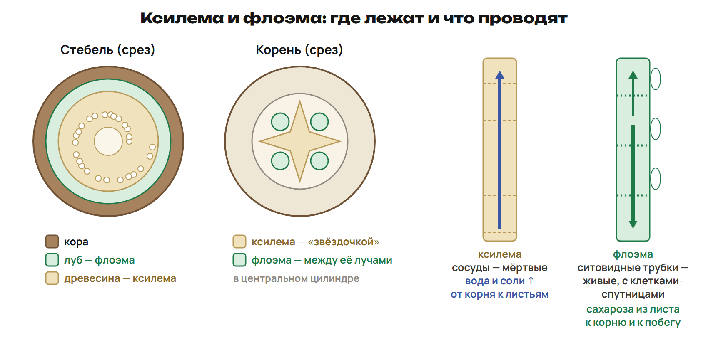
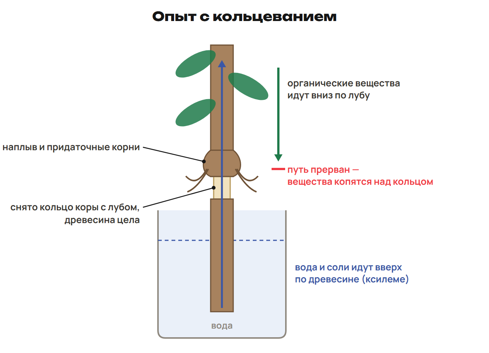
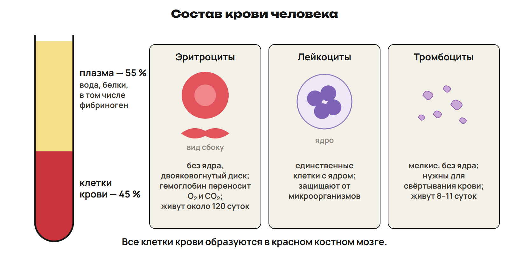

# Проводящие ткани
? Как связать вещество с проводящей тканью?
↳ Вернём клетку и её строение, затем соберём путь через растение.
> 0–12: объяснить ксилему/флоэму, строение и расположение; показать маршрут. 12–15: L1, 15–18: разбор.

## Понятие: Зачем нужен транспорт
Вода и минеральные соли поступают из почвы.
Органические вещества образуются в листьях при фотосинтезе.
Вещества нужны и удалённым органам растения.
Сначала назови вещество, затем проводящую ткань.
> Связать с минеральным питанием и фотосинтезом прежних недель.

## Понятие: Ксилема
Ксилема, древесина: вода и минеральные соли от корня вверх.
Зрелые сосуды и трахеиды — мёртвые проводящие элементы.
Сосуды — полые трубки с разрушенными поперечными перегородками.
В корне на учебной схеме — лучи центральной звезды.
> Воду поглощают корневые волоски зоны всасывания; затем она поступает в ксилему.

## Понятие: Флоэма
Флоэма, луб: органические вещества от источника к потребителю.
В примере лист → корень ток направлен вниз.
Ситовидные трубки живые, между члениками пластинки с порами.
Клетки-спутницы поддерживают их работу.
В стебле флоэма в лубе; в схеме корня — между лучами ксилемы.
> Не делать слово «нисходящий» запретом переноса к побегу выше листа.

## Схема: Ткани и направления

> Проследить две стрелки пальцем. Отличить мёртвые зрелые проводящие элементы от всей ткани целиком.

## Практика: L1
Выбери ткань для воды с солями от корня к листу и для органики от листа к корню.
Для каждой назови проводящие элементы и их состояние.
Ответы:
Вода и соли: ксилема, сосуды/трахеиды, зрелые проводящие элементы мёртвые.
Органика: флоэма, живые ситовидные элементы с клетками-спутницами.
> 12–15 попытка; 15–18 ключ. Проверить сначала вещество, затем клетки.

# Подъём воды и опыты
? Почему вода поднимается, а кольцевание меняет питание корня?
↳ Ткани различили. Проверим их работу опытом и условиями испарения.
> 18–26: корневое давление, транспирация, факторы, подкрашенная вода и кольцевание. 26–29: L2; 29–32: разбор.

## Понятие: Две причины подъёма
Корневое давление продвигает воду из корня.
Транспирация — испарение воды листьями, создающее сосущую силу.
Испарившаяся вода замещается новой; испарение охлаждает лист.
Устьице — щель между замыкающими клетками; открывание меняет потери.
Учебные примеры высоты: ель до 30 м, эвкалипт до 100 м.
> Устьица занимают около 1 % площади листа. Не объявлять транспирацию единственной причиной поступления воды.

## Понятие: Факторы транспирации
Сухой воздух обычно усиливает испарение, влажный ослабляет.
Повышение температуры усиливает испарение при достатке воды.
Движение воздуха усиливает; сильный ветер может закрыть устьица.
У большинства растений устьица открыты днём, но есть исключения.
Площадь листьев и число устьиц влияют на потери воды.
Кутикула, воск, волоски и скручивание листьев уменьшают потери.
> Сравнивать один фактор при равных остальных. В жару закрывание устьиц ограничивает простую зависимость.

## Пример: Окрашенная вода
Ветка поставлена в подкрашенную воду.
Краситель обнаружен в древесине.
Вывод: вода движется по ксилеме, а не по лубу.
> Это объяснение результата опыта; выполнять лабораторную работу на занятии не требуется.

## Схема: Кольцевание

> Показать, какой слой снят и какой сохранён; не делать вывод о моментальной гибели растения.

## Практика: L2
Снято кольцо коры, древесина не повреждена.
Почему листья сначала не завяли, а органические вещества накапливаются выше кольца?
Ответы:
Ксилема цела и проводит воду: немедленного увядания может не быть.
Флоэма перерезана: движение органических веществ ниже кольца нарушено.
Над кольцом возможны наплыв и придаточные корни.
> 26–29 попытка; 29–32 ключ. Попросить связать каждый признак с отдельной тканью.

# Внутренняя среда
? Как кровь связана с клетками и лимфой?
↳ У растения есть проводящие пути. У человека проследим связанные жидкие среды.
> 32–41: гомеостаз, кровь/тканевая жидкость/лимфа, функции и движение лимфы. 41–43: L3; 43–45: разбор.

## Понятие: Три среды
Кровь — жидкая соединительная ткань, у взрослого около 5 л.
Тканевая жидкость образуется из части компонентов плазмы.
Лимфа — тканевая жидкость, поступившая в лимфатические капилляры.
Гомеостаз — поддержание относительного постоянства показателей.
> К внутренней среде относятся и жидкости полостей; перечислить спинномозговую, суставную, плевральную и околосердечную.

## Схема: Путь к клетке
Плазма → тканевая жидкость → лимфатический капилляр → лимфа → кровь.
O₂ и питательные вещества: кровь → тканевая жидкость → клетка.
CO₂ и продукты обмена идут от клетки через тканевую жидкость к крови.
Слюна, пот, моча, желчь и желудочный сок — не внутренняя среда.
> Разделить путь жидкости и обмен веществами с клетками; это связанные, но разные стрелки.

## Понятие: Движение и функции лимфы
Тканевой жидкости в учебном описании 15–20 л.
Лимфы образуется около 1,5 л за сутки: это поток, не запас.
Лимфа возвращает жидкость в кровь; содержит лимфоциты, меньше белков, чем плазма.
Ей помогают движения мышц и условия давления в грудной полости.
Лимфоузлы задерживают чужеродные частицы; миндалины, селезёнка, аппендикс участвуют в защите.
Основной путь всасывания продуктов жиров связан с лимфатической системой.
> Лимфа прозрачная, желтоватая, свёртывается медленнее крови. Не сводить все продукты жиров к единственному пути для каждой молекулы.

## Практика: L3
Исправь цепочку: плазма → лимфа → тканевая жидкость.
Где между кровью и клеткой проходят питательные вещества?
Ответы:
Плазма → тканевая жидкость → лимфатический капилляр → лимфа.
Питательные вещества проходят из крови через тканевую жидкость к клетке.
> 41–43 попытка; 43–45 ключ. Проговорить границы сосудов.

# Плазма и форменные элементы
? Как разделить пробу крови на две части?
↳ Путь крови известен. Рассмотрим, что в ней переносится и из чего она состоит.
> 45–55: функции крови, доли, состав плазмы и связь с осмосом. 55–57: L4; 57–59: разбор.

## Понятие: Функции крови
Транспорт: газы, питательные вещества, продукты обмена, тепло.
Защита от возбудителей и чужеродных частиц.
Гуморальная связь: перенос гормонов.
Учебный ориентир количества крови — 6–8 % массы тела.
> Не подменять функции названием отдельного форменного элемента.

## Понятие: Плазма
В учебной модели плазма — 55 % объёма, форменные элементы — 45 %.
Плазма: около 90 % воды, 7–8 % белков, соли, глюкоза.
Альбумины участвуют в переносе; среди глобулинов есть антитела.
Фибриноген — растворимый белок, связанный со свёртыванием.
Раствор NaCl 0,9 % — модель физиологического раствора.
> Доли внутри плазмы и доля плазмы в крови имеют разные основания. Физиологический раствор связать с осмосом, без медицинских назначений.

## Схема: Две части крови

> Здесь выделить плазму; к типам форменных элементов вернуться в следующей части.

## Практика: L4
Учебная проба 120 мл крови: плазма 55 %, форменные элементы 45 %.
Вычисли объёмы и проверь сумму. Где растворён фибриноген?
Ответы:
120 × 0,55 = 66 мл плазмы; 120 × 0,45 = 54 мл элементов.
66 + 54 = 120 мл; фибриноген относится к плазме.
> 55–57 попытка; 57–59 ключ. Сначала перевести проценты в доли.

# Клетки крови
? Как строение помогает различить функции?
↳ Плазму отделили. Теперь сравним три вида форменных элементов.
> 59–68: эритроциты/лейкоциты/тромбоциты, образование, созревание и удаление; анемия как понятие. 68–71: L5; 71–75: разбор.

## Понятие: Эритроциты человека
Зрелый эритроцит — двояковогнутый диск без ядра.
Гемоглобин участвует в переносе газов и придаёт крови цвет.
В 1 мм³ около 4,5–5 млн эритроцитов; жизнь около 120 суток.
Анемия связана со снижением гемоглобина; причины различны.
> Ограничить безъядерность зрелыми эритроцитами человека, не всеми позвоночными; нормы и лечение не назначать.

## Понятие: Лейкоциты и тромбоциты
Лейкоциты имеют ядро, участвуют в защите, способны выходить из сосудов.
Их около 4–9 тыс. в 1 мм³; соотношение видов — лейкоцитарная формула.
Тромбоциты — безъядерные кровяные пластинки, фрагменты клеток.
Их около 180–400 тыс. в 1 мм³; жизнь 8–11 суток.
Тромбоциты нужны для свёртывания.
> Гной связан с погибшими лейкоцитами и микробами. Не объявлять все лейкоциты одинаковыми по функции.

## Понятие: Образование и удаление
Кроветворение связано с красным костным мозгом.
Иммунные клетки созревают также в иммунных органах.
Печень и селезёнка участвуют в удалении старых клеток.
Не у всех форменных элементов одинаковые сроки и места созревания.
> Подробное разделение Т/В вводится на уроке 12, до вариантов.

## Практика: L5
Сопоставь объект и функцию: диск с гемоглобином, клетка с ядром, кровяная пластинка.
Кто переносит газы, кто защищает, кто участвует в свёртывании?
Ответы:
Эритроцит — диск с гемоглобином, перенос газов.
Лейкоцит — клетка с ядром, защита.
Тромбоцит — пластинка, свёртывание.
> 68–71 попытка; 71–75 ключ. Проверить признак и функцию одновременно.

# Свёртывание и итог
? Что превращается в нити сгустка?
↳ Форменные элементы различили. Соединим их с белками плазмы.
> 75–82: фибриноген/фибрин, Ca²⁺, сгусток, гемофилия; возврат главных путей. 82–85: L6; 85–88: разбор и устный итог; 88–90: ДЗ.

## Понятие: Свёртывание
Тромбоциты и факторы плазмы участвуют в образовании сгустка.
Растворимый фибриноген → нерастворимые нити фибрина.
Сеть задерживает форменные элементы — возникает тромб.
В процессе нужны ионы Ca²⁺ наряду с другими участниками.
Учебный ориентир времени — 3–4 минуты.
> Не говорить, что клеточные пластинки превращаются в белковые нити.

## Ловушка: Гемофилия
Гемофилия — наследственное заболевание с очень медленным свёртыванием.
Причина — нехватка определённых факторов свёртывания.
Протромбин не отсутствует у всех больных гемофилией.
> Факторы VIII/IX оставить в предупреждении преподавателю; не расширять обязательное содержание.

## Практика: L6
Назови растворимый предшественник и нерастворимые нити сгустка.
Как связаны с процессом тромбоциты и Ca²⁺?
Ответы:
Фибриноген — растворимый предшественник, фибрин образует нерастворимые нити.
Тромбоциты и Ca²⁺ участвуют в свёртывании вместе с другими факторами.
> 82–85 попытка; 85–88 ключ. Затем без подсказки спросить ткани растений и происхождение лимфы.

## Дома: После урока 11
Конспект 1–3 — 25 минут; P1–P6 — 20; G — 35.
Перед уроком 12 пришли решения и два вопроса.
Иммунитет, ABO, сердце и круги объясняются на уроке 12.
После него один вариант 30 + исправления 25 + повторение 15.
Всего самостоятельная работа 150 минут.
> 88–90 минуты. Ключи после попытки; предварительного чтения перед уроком 11 не требовать.
