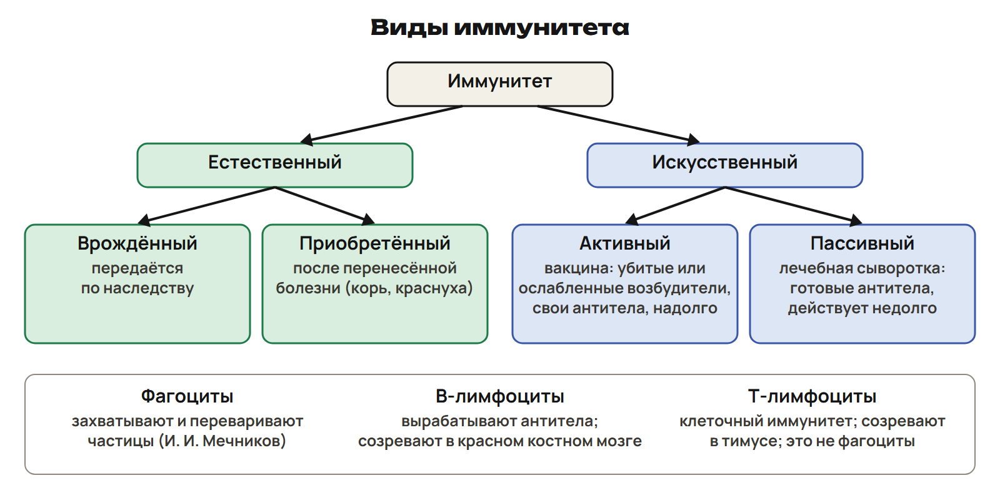
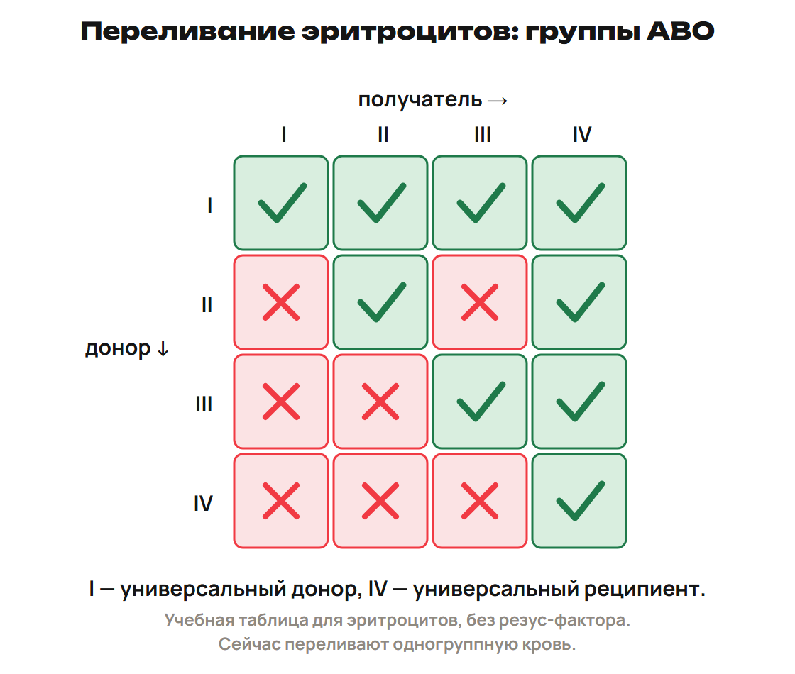
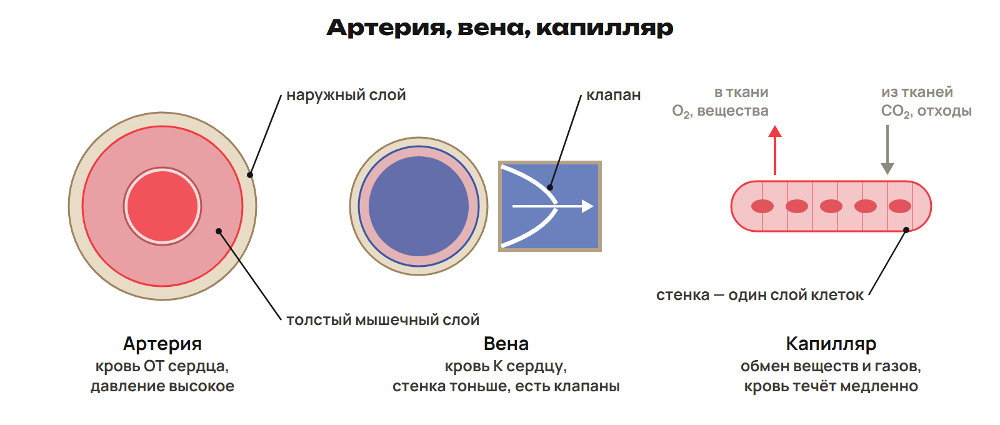
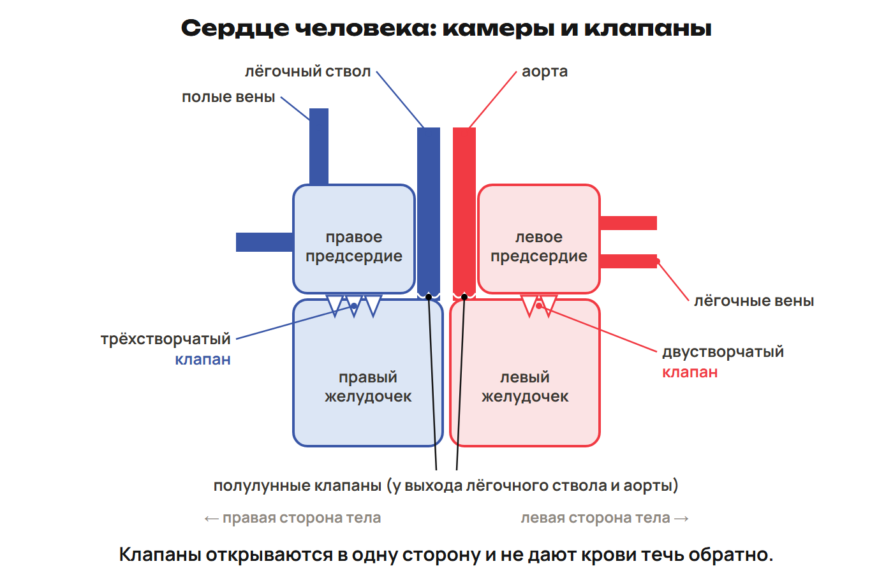
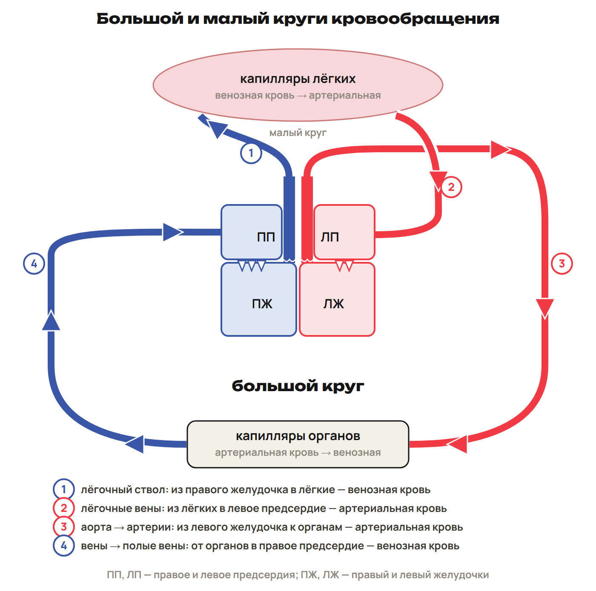

Клетке нужны вещества, а продукты обмена нужно уносить. У растения эту связь обеспечивают проводящие ткани. У человека — кровь, тканевая жидкость и лимфа. Сначала назови вещество, затем его путь и структуру, которая его переносит.

После урока 11 прочитай разделы 1–3 за 25 минут, выполни закрепление и G. После урока 12 повтори разделы 4–6 и факты за 15 минут. Таблицы используй как опору при решении.

## 1. Как вещества движутся у растений

Вода поступает из почвы через корневые волоски зоны всасывания. Далее вода с минеральными солями поднимается по ксилеме к стеблю и листьям. Органические вещества образуются при фотосинтезе и перемещаются по флоэме к органам, которым они нужны.

| Признак | Ксилема | Флоэма |
|---|---|---|
| Что переносит | Воду и минеральные соли | Органические вещества |
| Путь в примере «корень — лист» | От корня к листу | От листа к корню |
| Проводящие элементы | Сосуды и трахеиды | Ситовидные трубки с клетками-спутницами |
| Проводящие клетки в зрелом состоянии | Мёртвые; полые элементы проводят воду | Живые; зависят от клеток-спутниц |
| В стебле | Древесина | Луб, внутренняя часть коры |
| В схеме корня | В центре, лучами «звезды» | Между лучами ксилемы |

У сосудов разрушены поперечные перегородки. У ситовидных трубок между члениками остаются пластинки с порами. Не путай живую проводящую ткань с наличием ядра в каждой её клетке.

> [!trap] Флоэма не означает «только вниз»
> От листа к корню вещества идут вниз. Но направление зависит от того, где образовались вещества и где они расходуются. Не превращай этот пример в запрет транспорта к растущему побегу выше листа.

### Почему поднимается вода

Корневое давление продвигает воду из сосудов корня вверх. Транспирация — испарение воды листьями. Она создаёт сосущую силу: испарившаяся вода замещается новой. Испарение также охлаждает лист. Вода поступает и за счёт корневого давления, поэтому транспирация не единственный механизм подъёма.

Устьице — щель между двумя замыкающими клетками. Открывание и закрывание меняет потерю воды. Устьица занимают около 1 % площади листа. В школьных примерах вода поднимается у ели до 30 м, у эвкалипта до 100 м.

| Фактор | Как меняется транспирация |
|---|---|
| Температура выше, воды достаточно | Обычно усиливается |
| Воздух суше | Усиливается; влажный воздух ослабляет испарение |
| Движение воздуха | Обычно усиливает; сильный ветер может вызвать закрывание устьиц |
| Свет | У большинства растений днём устьица открыты; есть исключения |
| Площадь листьев и число устьиц | Влияют на суммарную потерю воды |
| Плотная кутикула, воск, волоски, скручивание листьев | Помогают уменьшить потерю воды |

> [!example] Что покажет опыт
> Ветка в подкрашенной воде: окрашивается древесина — вода движется по ксилеме.
> Кольцо коры снято, древесина сохранена: перерезана флоэма. Над кольцом накапливаются органические вещества, появляется наплыв; возможны придаточные корни.
> В первые часы листья могут не завянуть: ксилема продолжает проводить воду. Дальнейшее снабжение органов ниже кольца органическими веществами нарушено.

> [!trap] Температура и ветер — не безусловное правило
> Если устьица закрылись из-за жары или сильного ветра, нельзя продолжать ряд «чем больше, тем сильнее испарение» без оговорки.

## 2. Внутренняя среда и лимфа

Внутренняя среда — кровь, тканевая жидкость и лимфа. К ней относят и жидкости полостей: спинномозговую, околосердечную, суставную, плевральную. Слюна, желудочный сок, пот, моча и желчь к внутренней среде не относятся.

Гомеостаз — поддержание относительного постоянства показателей организма при изменении внешних условий. Это регулируемое состояние, а не полная неизменность.

Кровь — жидкая соединительная ткань. У взрослого её около 5 л. Тканевая жидкость образуется из плазмы при выходе части её компонентов через стенки капилляров. Она связывает кровь с клетками; её объём в школьном описании — 15–20 л.

> [!rule] Три связанные среды
> Плазма крови → тканевая жидкость → лимфатические капилляры → лимфа → возврат в кровь.
> Питательные вещества и O₂: кровь → тканевая жидкость → клетки.
> CO₂ и продукты обмена идут от клеток через тканевую жидкость к крови.

Лимфа — тканевая жидкость, поступившая в лимфатические капилляры. Она прозрачная, желтоватая; за сутки образуется около 1,5 л. Это суточный поток, а не объём всей лимфы, одновременно находящейся в организме. В лимфе меньше белков, чем в плазме, и много лимфоцитов; она свёртывается медленнее крови.

Движению лимфы помогают сокращения скелетных мышц и низкое давление в грудной полости. Лимфатические узлы задерживают чужеродные частицы и участвуют в защите. Лимфа возвращает жидкость в кровь; основной путь всасывания продуктов переваривания жиров связан с лимфатическими сосудами кишечника. Иммунные функции выполняют также миндалины, селезёнка и аппендикс.

> [!trap] Откуда появилась лимфа
> Не «плазма сразу превратилась в лимфу»: между ними тканевая жидкость. Основной лимфатический путь жиров не означает, что каждая отдельная молекула продуктов пищеварения обязательно идёт только в лимфу.

## 3. Состав крови и свёртывание

Кровь переносит газы, питательные вещества, продукты обмена, гормоны и тепло; участвует в защите. В школьной модели кровь составляет около 6–8 % массы тела, плазма — 55 % объёма крови, форменные элементы — 45 %.

Плазма содержит около 90 % воды, 7–8 % белков, соли и глюкозу. Альбумины участвуют в переносе веществ; к глобулинам относятся антитела; фибриноген нужен для свёртывания. Раствор NaCl 0,9 % используют как модель физиологического раствора: при подходящих условиях клетки сохраняют объём. Вспомни осмос, а не только число 0,9.

| Форменные элементы человека | Строение и количество в 1 мм³ | Функция и срок |
|---|---|---|
| Зрелые эритроциты | Без ядра, двояковогнутые диски; около 4,5–5 млн | Гемоглобин участвует в переносе газов; жизнь около 120 суток |
| Лейкоциты | Есть ядро; около 4–9 тыс.; способны выходить из сосудов | Иммунная защита; соотношение видов — лейкоцитарная формула |
| Тромбоциты | Безъядерные кровяные пластинки, фрагменты клеток; около 180–400 тыс. | Свёртывание; жизнь 8–11 суток |

Кроветворение связано с красным костным мозгом; созревание иммунных клеток связано и с иммунными органами. Печень и селезёнка участвуют в удалении старых клеток. Не делай из этого правило об одинаковом месте созревания и гибели всех видов.

Зрелый эритроцит человека не содержит ядра. Это не правило для эритроцитов всех позвоночных. Гемоглобин — белковый пигмент эритроцитов; уменьшение его количества связано с анемией. Анемия имеет разные причины.

### Как появляется сгусток

При повреждении сосуда тромбоциты и факторы свёртывания участвуют в образовании сгустка. Растворимый фибриноген превращается в нерастворимый фибрин. Нити фибрина образуют сеть, в которой задерживаются форменные элементы. Так появляется тромб. В процессе участвуют ионы кальция; учебный ориентир времени — 3–4 минуты.

> [!trap] Два белка
> Фибриноген — растворённый предшественник; фибрин — нерастворимые нити. Тромбоциты не превращаются в фибрин и не переносят кислород вместо эритроцитов.

Гемофилия — наследственное заболевание с очень медленным свёртыванием крови из-за нехватки определённых факторов свёртывания. Это не отсутствие всего протромбина.

После урока 11 выполни P1–P6 за 20 минут и G за 35 минут. Запиши два вопроса к следующему занятию.

## 4. Иммунитет и инфекции — после урока 12

Иммунитет — способность организма противостоять возбудителям и чужеродным частицам. И. И. Мечников связан с фагоцитозом и клеточной защитой; П. Эрлих — с антителами и гуморальной защитой. Их Нобелевская премия — 1908 год.

Фагоцит захватывает твёрдую частицу и переваривает её с участием лизосом. Нейтрофилы — микрофаги; моноциты дают начало тканевым макрофагам. Т-лимфоциты обеспечивают клеточный иммунитет, но не являются фагоцитами. В-лимфоциты и их потомки вырабатывают антитела — белки против определённых антигенов. Антитела помогают нейтрализовать чужеродные вещества и обеспечивают их распознавание защитной системой.

| Клетки | Что запомнить |
|---|---|
| Нейтрофилы | Активный фагоцитоз; примерно 50–70 % лейкоцитов |
| Моноциты | Около 4 %; связаны с образованием макрофагов в тканях |
| Лимфоциты | Около 24 %; клеточная и гуморальная защита |
| Эозинофилы | В учебной формуле 1,5–5 %; реакции на чужеродные белки |
| Базофилы | Около 0,5–1 %; участие в изменениях проницаемости сосудов и регуляции свёртывания |

Т-лимфоциты созревают в тимусе, В-лимфоциты — в красном костном мозге. Клетки памяти обеспечивают более быстрый ответ при повторной встрече с антигеном. ВИЧ поражает Т-лимфоциты; СПИД — синдром приобретённого иммунодефицита. ВИЧ может передаваться через кровь, половым путём и от матери ребёнку; через рукопожатие и воздушно-капельным путём не передаётся.

> [!trap] Т, В и фагоцит
> Антитела даёт В-линия. Т-клетки обеспечивают клеточный иммунитет, но не захватывают частицы как фагоциты. ВИЧ поражает Т-лимфоциты, а не эритроциты и не В-клетки в этой схеме.

### Виды защиты

В школьной схеме естественный иммунитет включает врождённую защиту и приобретённую после болезни. Врождённая защита имеет наследственную основу, но не означает наличие готовых антител «в генах». Стойкость приобретённой защиты зависит от возбудителя.

Искусственный активный иммунитет развивается после вакцинации: введённые антигены вызывают собственный ответ и формирование памяти. Примеры состава вакцин — ослабленные или убитые возбудители, обезвреженные токсины. Сыворотка содержит готовые антитела: это искусственный пассивный иммунитет, действующий быстро и обычно недолго.

> [!trap] Вакцина и сыворотка
> Вакцина запускает собственный ответ; сыворотка даёт готовые антитела. Слова «активный» и «пассивный» описывают способ получения защиты, а не тяжесть болезни.

### Возбудитель и путь передачи

| Пример | Возбудитель и связь |
|---|---|
| Амёбная дизентерия | Простейшее, дизентерийная амёба; толстый кишечник; заражённая вода и пища |
| Холера | Бактерия, холерный вибрион; тонкий кишечник |
| Дифтерия | Бактерия; воздушно-капельная передача, профилактика связана с вакцинацией |
| Лейшманиоз | Простейшее лейшмания; переносчик — москит, природный резервуар — песчанки |
| Герпес | Вирус |
| Фитофтороз | Паразитарная болезнь растений |

Лейшмания — одноклеточный организм, размножающийся делением, а не личинками.

## 5. Группы крови и резус-фактор

Группы ABO связаны с антигенами — агглютиногенами эритроцитов и антителами — агглютининами плазмы. При несовместимом сочетании возможна агглютинация, склеивание эритроцитов.

| Группа | Запись в школьной генетической схеме | Донор для групп | Получатель от групп |
|---|---|---|---|
| I | 00 | I, II, III, IV | I |
| II | AA или A0 | II, IV | I, II |
| III | BB или B0 | III, IV | I, III |
| IV | AB | IV | I, II, III, IV |

Здесь таблица описывает учебную совместимость эритроцитов по ABO без учёта Rh. В этой модели I — универсальный донор, IV — универсальный реципиент. Это не таблица переливания плазмы или цельной крови. В практическом подборе учитывают одногруппность, Rh и дополнительные проверки.

> [!example] Как читать стрелку
> Донор III → получатель IV допустим по таблице: III отдаёт III и IV.
> Обратная стрелка IV → III не подходит: IV отдаёт только IV.
> Сначала подпиши «донор» и «получатель», затем выбери строку.

Резус-фактор связан с антигеном эритроцитов: Rh⁺ — он есть, Rh⁻ — отсутствует. В приведённой учебником европейской выборке Rh⁺ около 85 %; это не доля всего человечества. Резус-конфликт возможен при сочетании мать Rh⁻, плод Rh⁺, если материнские антитела действуют на эритроциты плода. Само сочетание не означает неизбежного конфликта; номер беременности не заменяет это условие.

> [!trap] Две разные пары
> Для ABO проверь направление донор → получатель. Для резус-конфликта различай мать и плод: возможное сочетание Rh⁻ → Rh⁺, а не наоборот.

## 6. Сердце, сосуды и круги

Артерии несут кровь от сердца, вены — к сердцу. Название определяет направление, а не содержание кислорода.

| Сосуд | Строение | Что делает |
|---|---|---|
| Артерия | У крупных сосудов три слоя; развит мышечный слой | Проводит кровь от сердца; крупнейшая — аорта |
| Вена | Стенка тоньше; во многих венах есть клапаны | Возвращает кровь к сердцу; помогают мышцы и условия давления |
| Капилляр | Стенка из одного слоя клеток | Обмен между кровью и тканями; малая скорость потока |

Внутренний слой крупных сосудов — эндотелий, не слизистая оболочка. Средний слой содержит гладкие мышцы, наружный — соединительную ткань. Давление в артериальном русле выше, чем в венозном; скорость в капиллярной сети мала.

Сердце человека четырёхкамерное: два предсердия и два желудочка. Снаружи расположена околосердечная сумка — перикард с жидкостью. Миокард — сердечная поперечнополосатая мышца, эндокард выстилает полости. Перикард не называй внутренним слоем стенки. Стенки желудочков толще стенок предсердий.

Между левым предсердием и левым желудочком — двустворчатый клапан, справа — трёхстворчатый. У выхода в аорту и лёгочный ствол — полулунные клапаны. Клапаны препятствуют обратному току.

> [!rule] Два маршрута
> Большой круг: левый желудочек → аорта → артерии → капилляры органов → вены → полые вены → правое предсердие.
> Малый круг: правый желудочек → лёгочные артерии → капилляры лёгких → лёгочные вены → левое предсердие.

В капиллярах большого круга кровь отдаёт O₂ тканям, становится венозной. В капиллярах малого — получает O₂ и становится артериальной. Поэтому лёгочная артерия несёт венозную кровь, лёгочные вены — артериальную.

> [!trap] Как проверить схему
> Начало круга ищи в желудочке, конец — в предсердии. Не меняй названия лёгочных сосудов из-за типа крови. На схеме «слева» означает сторону тела человека, а не левый край рисунка.

В учебном примере цикл сердца: сокращение предсердий 0,1 с, желудочков 0,3 с, общее расслабление 0,4 с. Всего 0,8 с. Ориентир пульса в тексте — 60–80 в минуту; длительность цикла меняется с частотой. ЭКГ — запись электрической активности сердца.

### Сравнение животных

В изучаемом школьном ряду кровеносная система появляется у кольчатых червей: кровь движется по сосудам, пять кольцевых сосудов выполняют насосную роль. У ланцетника отдельного сердца нет, сокращается брюшной сосуд.

| Группа | Камеры сердца | Круги и особенность |
|---|---|---|
| Рыбы | 2: предсердие и желудочек | 1 круг |
| Земноводные | 3: два предсердия, желудочек | 2 круга; кровь в желудочке смешанная |
| Большинство пресмыкающихся | 3; в желудочке неполная перегородка | 2 круга |
| Крокодилы | 4 | 2 круга |
| Птицы и млекопитающие | 4: два предсердия и два желудочка | 2 круга; полная перегородка |

У кольчатых червей и позвоночных система замкнутая. У членистоногих и большинства моллюсков — незамкнутая; головоногие моллюски составляют исключение. В таблице моллюсков: у брюхоногих обычно два отдела основного сердца, у двустворчатых и головоногих — два предсердия и желудочек.

> [!trap] Камеры и круги — разные признаки
> У рыбы две камеры, но один круг. У земноводного три камеры и два круга. Не выводи одно число из другого.

### Что обозначают названия нарушений

Гипертония — повышенное давление, гипотония — пониженное; давление измеряют тонометром. Тахикардия — учащённое сердцебиение. Тромбоз — образование сгустка в сосуде. Атеросклероз связан с бляшками в артериях. Инфаркт миокарда — гибель участка мышцы при нарушении кровоснабжения. Инсульт — острое нарушение мозгового кровообращения, в том числе при кровоизлиянии. Эти определения не задают способ лечения.

> [!rule] Факты ЕНТ недели
> - Плазма — 55 %, форменные элементы — 45 % в школьной модели.
> - Зрелый эритроцит человека без ядра; срок жизни около 120 суток.
> - Тромбоциты и Ca²⁺ участвуют в свёртывании; фибриноген → фибрин.
> - Мечников — фагоцитоз, Эрлих — антитела; премия 1908 года.
> - Т-клетки созревают в тимусе; В-клетки — в красном костном мозге, В-линия даёт антитела.
> - В учебной таблице эритроцитов ABO: I — донор всем, IV — получатель от всех.
> - Рыбы — 2 камеры и 1 круг; земноводные — 3 камеры и 2 круга.
> - Двустворчатый клапан слева, трёхстворчатый справа; учебный цикл 0,8 с.

После урока 12 выполни один вариант A/B/C за 30 минут, исправления — за 25 минут. Вместе с чтением, закреплением, G и повторением получается 150 минут самостоятельной работы.
