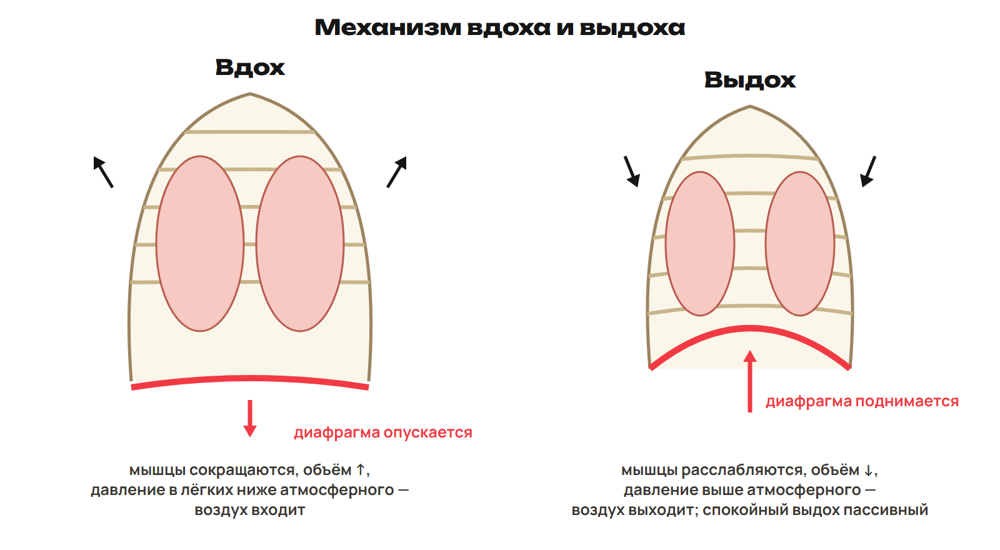
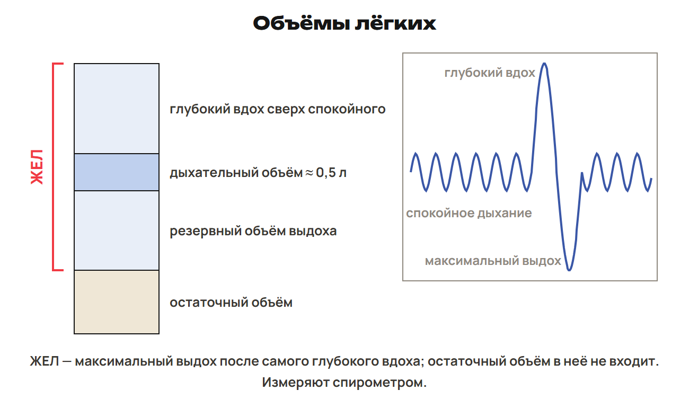

# Урок 14. Вентиляция, регуляция и объёмы лёгких

18 декабря 2026; 90 минут. Группы 18:00–19:30 и 19:30–21:00.

Причина → алгоритм → разные примеры → ловушка → самостоятельная попытка. Ключи L показывать после попытки. Предварительное чтение перед первым уроком не требуется.

## План на 90 минут

| Время | Действие |
|---|---|
| 0–20 | 0–5 вопросы; 5–8 L7, 8–12 разбор; 12–15 L8, 15–20 разбор. |
| 20–40 | 20–22 трудный шаг; 22–25 G9, 25–30 разбор; 30–33 G10, 33–38 разбор; 38–40 G11. |
| 40–55 | 40–49 объём/давление/мышцы, плевра, типы дыхания; 49–52 L9, 52–55 ключ. |
| 55–65 | 55–61 дыхательный центр, CO₂, нейрогуморальное влияние и защитные рефлексы; 61–63 L10, 63–65 ключ. |
| 65–78 | 65–70 определения/прибор/болезни; 70–72 L11, 72–74 ключ; 74–76 L12, 76–78 ключ. |
| 78–88 | Контроль без подсказок, отдельный ключ после сдачи. |
| 88–90 | Назначить один маршрут, приложение A не продлевает урок. |

## 1. Возврат и вопросы · 0–20 минут

**Вопрос:** Что надо вспомнить о крови и клетках?

**Связка:** Вернём транспорт и клеточное получение энергии.

### L7

Назови начало и конец малого круга, тип крови в лёгочной артерии и вене. Какой белок эритроцитов участвует в переносе газов?

**Ответ и решение:** Правый желудочек → левое предсердие через лёгкие. Артерия венозная, вены артериальные; белок гемоглобин.

**Типичная ошибка и новая проверка:** Определить тип крови по названию сосуда.

### L8

Где идёт гликолиз и с каким органоидом связаны кислородные этапы? Какова роль АТФ?

**Ответ и решение:** Гликолиз в цитоплазме, кислородные этапы связаны с митохондриями. АТФ связывает получение энергии с её расходом на клеточную работу.

**Типичная ошибка и новая проверка:** Поместить все этапы в одну структуру.

## 2. Разбор G · 20–40 минут

**Вопрос:** Где заканчивается поверхность и начинается перенос?

**Связка:** Старые навыки вернули. Проверим два домашних маршрута.

### G9

Сравни путь O₂ у обычного насекомого и обычной водной рыбы. Назови вход/орган, поверхность обмена и роль крови.

**Ответ и решение:** Насекомое: дыхальце → трахеи/конечные трубочки → ткани, обычно без основной роли крови. Рыба: вода → жаберные лепестки → кровь → ткани.

**Типичная ошибка и новая проверка:** Вставить малый круг человека в схему насекомого.

### G10

Проследи O₂ из альвеолы в клетку и CO₂ обратно. Отдели диффузию, перенос кровью и клеточные реакции.

**Ответ и решение:** O₂: альвеола → кровь → тканевая жидкость → клетка; CO₂ в обратном направлении. Переход через поверхность — диффузия, дальняя доставка — кровь. Клеточные реакции получения энергии не равны этим перемещениям.

**Типичная ошибка и новая проверка:** Назвать все перемещения одним энергетическим процессом.

## 3. Механизм вентиляции · 40–55 минут

**Вопрос:** Как сокращение диафрагмы заставляет воздух входить?

**Связка:** Газообмен разобран. Объясним обновление воздуха.

**Вдох и выдох.** 

Диафрагма разделяет грудную и брюшную полости; наружные межрёберные мышцы поднимают рёбра.

**Причинная цепь.** Сокращаются диафрагма и мышцы вдоха → грудной объём растёт. Давление в альвеолах при входящем потоке ниже атмосферного → воздух входит. Спокойный выдох: расслабление и эластический возврат → объём меньше, воздух выходит. Усиленный выдох может включать внутренние межрёберные и брюшные мышцы.

Спокойный выдох пассивен; частота сама по себе не означает обязательный форсированный выдох.

**Два давления и типы.** Плевральное давление при обычном спокойном дыхании ниже атмосферного. Поток воздуха определяется альвеолярным давлением относительно атмосферного. Грудной тип сильнее связан с межрёберными мышцами, брюшной — с диафрагмой. Это не жёсткое разделение людей по полу.

Не ссылаться на закон Паскаля как причину вдоха; не делать плевральное давление всегда отрицательным при любых усилиях.

### L9

Объясни вдох через диафрагму, объём, давление и направление воздуха. Что меняется при спокойном выдохе?

**Ответ и решение:** Сокращение/опускание диафрагмы → объём больше → давление ниже атмосферного → вход воздуха. При спокойном выдохе мышцы вдоха расслабляются, объём уменьшается и воздух выходит.

**Типичная ошибка и новая проверка:** Поменять знак давления, сохранив входящий поток.

## 4. Регуляция · 55–65 минут

**Вопрос:** Как состав крови меняет дыхательный ответ?

**Связка:** Мышцы выполняют работу. Добавим рецепторы и управляющий центр.

**Центр и стимул.** Основной дыхательный центр в продолговатом мозге. Рост CO₂ и связанных H⁺ обычно усиливает вентиляцию. Хеморецепторы связаны с крупными артериями и центральными структурами. Адреналин тоже может усиливать дыхательный ответ. Снижение O₂ тоже может влиять; «никогда не влияет» неверно.

Вегетативные влияния не сводить к единственной причине всего ритма; подробные пути обратной связи только A.

**Защитные рефлексы.** Раздражение рецепторов носа и воздухоносных путей может вызвать чихание или кашель. Чихание — резкий выдох через нос, кашель преимущественно через рот. Рефлекс и сознательная задержка дыхания — разные механизмы.

Различать защитный рефлекс и произвольное изменение ритма.

### L10

CO₂ крови увеличился. Какой обычный ответ и где расположен основной центр? Следует ли из этого, что недостаток O₂ никогда не действует?

**Ответ и решение:** Дыхательный ответ обычно усиливается; основной центр — продолговатый мозг. Нет: низкий O₂ тоже может стимулировать регуляцию.

**Типичная ошибка и новая проверка:** Превратить ведущий стимул в единственный возможный.

## 5. Объёмы и гигиена · 65–78 минут

**Вопрос:** Какое количество воздуха посчитано?

**Связка:** Механизм и регуляция известны. Измерим вентиляцию и различим объёмы.

**Объёмы лёгких.** 

Резерв после спокойного выдоха явно называть резервом выдоха. Числа брать из условия.

**Показатели.** ДО — спокойный вдох/выдох; учебный ориентир 500 см³ = 0,5 л. ЖЕЛ — максимальный выдох после максимального вдоха, измеряют спирометром. Остаточный воздух остаётся после максимального усилия и в ЖЕЛ не входит. Vмин = ДО × частота; 400 см³ × 20 = 8000 см³/мин = 8 л/мин. Весь вентилируемый воздух не равен поглощённому O₂.

Учебные средние 2,7/3,5 л и частоты 16–18/60 не индивидуальные нормы; клинических выводов не делать.

**Вредные факторы и болезни.** Дым повреждает эпителий и лёгочную ткань; никотин сужает сосуды, канцерогены повышают риск рака. Бронхит — воспаление бронхов, не любой его случай передаётся как инфекция. Астма — хроническое воспаление с изменением просвета/спазмом бронхов. Грипп — вирус; туберкулёз — палочка Коха. Курение важный, но не единственный фактор риска рака лёгких.

Не давать лечебные назначения; сроки выживания возбудителя и проценты без условий не проверяются.

### L11

ДО 0,5 л, частота 18 в минуту. Найди минутную вентиляцию.

**Ответ и решение:** 0,5 × 18 = 9 л/мин воздуха. Это не 9 л поглощённого O₂.

**Типичная ошибка и новая проверка:** Умножить на 60 ещё раз, хотя частота уже за минуту.

### L12

ЖЕЛ 3,5 л, ДО 0,5 л, остаточный объём 1 л в учебной записи. Какой показатель означает спокойный вдох и входит ли остаток в ЖЕЛ?

**Ответ и решение:** Спокойный вдох — ДО 0,5 л. Остаточный 1 л не входит в ЖЕЛ; ЖЕЛ — максимальный выдох после максимального вдоха.

**Типичная ошибка и новая проверка:** Сложить все числа и назвать сумму одним спокойным вдохом.

## 6. Контроль и маршрут · 78–90 минут

**Вопрос:** Какие связи ты объясняешь без таблицы?

**Связка:** Теперь проверь механизмы и измерения самостоятельно.

**Контроль Q1–Q6.** Работай по листу без подсказок. Q1–Q3 одна буква; Q4 все верные; Q5 две пары; Q6 решение. 10 минут, максимум 10 баллов.

Ключ после сдачи; на этом экране ответов нет.

После урока 13: конспект 1–4 — 25 минут, P — 20, G — 35. После урока 14: один A/B/C — 30, исправления — 25, повторение 5–6 и фактов — 15. Всего 150 минут.

Контроль 78–88 минуты, 10 баллов; ключ отделить до выдачи. A — уверенная база, B — отдельные ошибки, C — нужна таблица; учитывать также диагностику, G и объяснение ученика. Приложение только для A, чтение внутри его 30 минут. Реальный темп проверить на пробном занятии; сокращать повторные примеры, сохраняя попытки L/Q.
