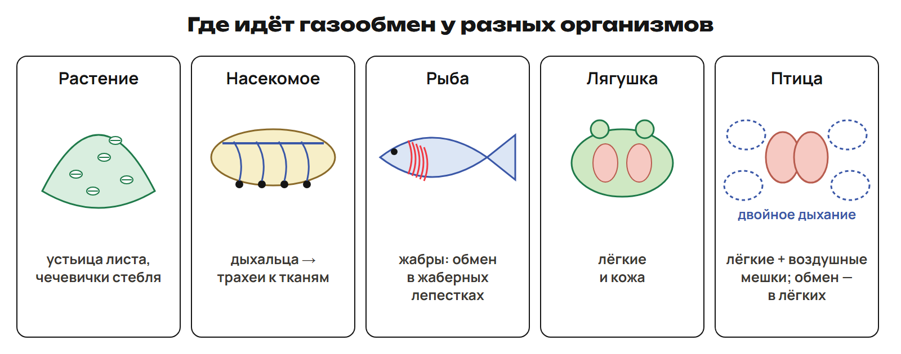
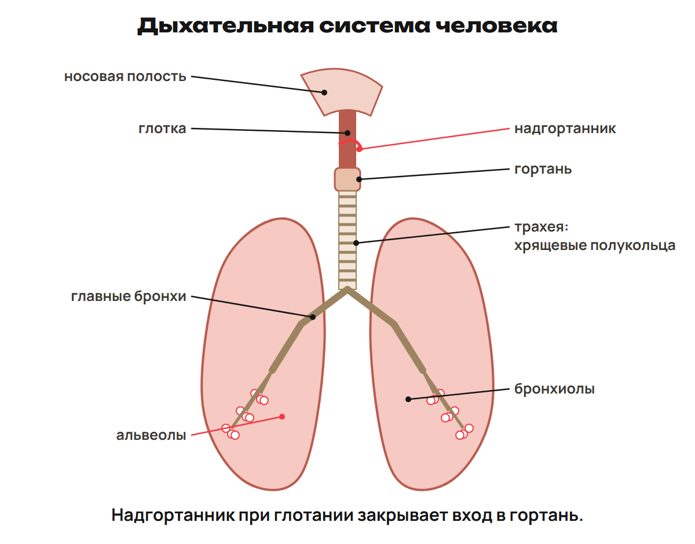
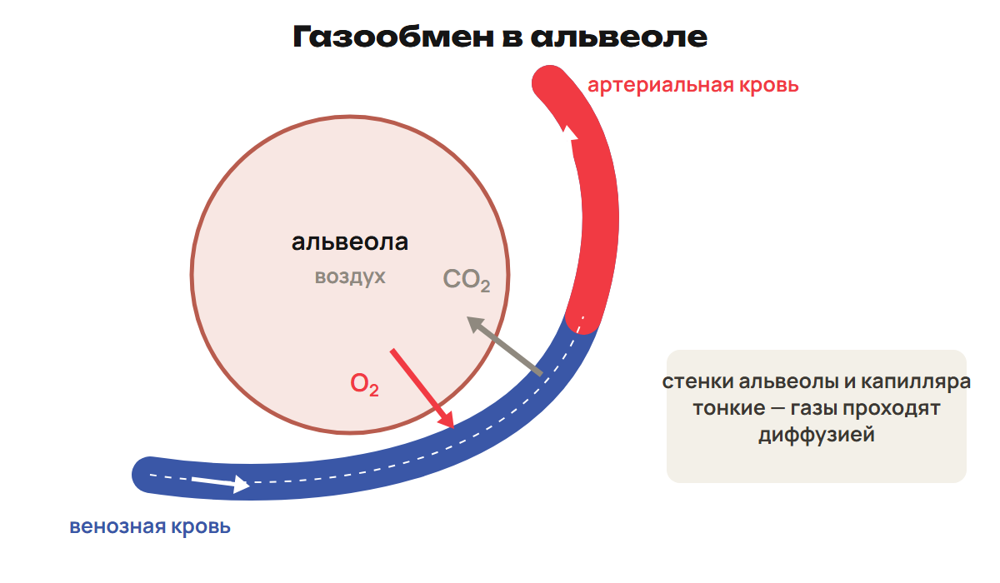
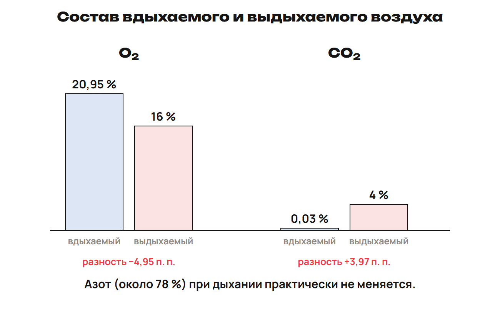

Воздух доходит до поверхности обмена, газы переходят через неё, кровь переносит их, а клетки используют кислород. Назови этап прежде, чем объяснять его механизм.

После урока 13 прочитай разделы 1–4 за 25 минут, выполни P и G. После урока 14 повтори разделы 5–6 и факты за 15 минут. Таблицы используй как опору.

## 1. Газообмен, клеточное дыхание и растения

Газообмен — поступление O₂ и удаление CO₂ через поверхность тела или органы. Клеточное дыхание — реакции преобразования органических веществ с получением доступной клетке энергии. Гликолиз идёт в цитоплазме; кислородные этапы у эукариот связаны с митохондриями.

Внешний, или лёгочный, газообмен связывает воздух и кровь. Тканевой газообмен связывает кровь, тканевую жидкость и клетки. Сам переход газа через мембрану не означает синтез АТФ.

> [!trap] Три разных действия
> Вдох/выдох обновляют воздух. Диффузия обеспечивает переход газов. Клеточные реакции преобразуют энергию веществ. Это связанные, но разные процессы.

Растения дышат и днём, и ночью: живые клетки используют O₂ и образуют CO₂. Фотосинтез требует света, расходует CO₂ и выделяет O₂. Поэтому суммарный газообмен зелёного листа зависит от освещения и соотношения этих процессов.

Устьица обеспечивают обмен газами и выход водяного пара. У многих наземных растений они преимущественно снизу листа, у плавающих листьев — сверху. Это не правило для всех водных и наземных растений. Чечевички и трещины в коре участвуют в газообмене стебля; чечевички хорошо видны у берёзы.

Корни тоже нуждаются в кислороде. У болотных растений встречаются дыхательные корни над поверхностью почвы. Воздушные корни-подпорки баньяна — иной пример строения корней, их название не делает их тождественными дыхательным корням.

> [!example] Прорастающие и сухие семена
> Прорастающие семена обычно дышат интенсивнее тех же семян в сухом состоянии покоя.
> При дыхании выделяются CO₂ и тепло. CO₂ вызывает помутнение известковой воды.
> Недостаток кислорода при длительном затоплении мешает нормальному прорастанию.

## 2. Поверхности газообмена животных

| Организм или группа | Орган/поверхность | Где газы переходят к клеткам или крови |
|---|---|---|
| Простейшие, кишечнополостные | Поверхность тела | Через поверхность клеток или тела |
| Дождевой червь | Влажные покровы | Через поверхность тела |
| Большинство насекомых | Дыхальца, трахеи и тонкие конечные трубочки | Трахейная система доставляет воздух непосредственно к тканям |
| Типичная водная рыба | Жабры | Жаберные лепестки с капиллярами |
| Лягушка | Кожа и лёгкие | Через влажную кожу и поверхность лёгких |
| Птица | Лёгкие и воздушные мешки | Газообмен в лёгких; мешки обеспечивают движение воздуха |
| Млекопитающее | Лёгкие | Через альвеолярно-капиллярную поверхность |

Насекомое получает воздух через дыхальца; ветвящиеся трахеи доходят к тканям. Кровь обычно не играет основную роль в переносе дыхательных газов. У некоторых пауков тоже есть трахеи; это не единственное устройство дыхания всех паукообразных.

Жабры рыбы имеют дуги, тычинки и лепестки. Основная поверхность газообмена — лепестки, а не опорные дуги и не тычинки. Двоякодышащие рыбы используют и лёгкие; их воздушное дыхание не следует описывать как простое дыхание обычным плавательным пузырём.

У птиц богатый O₂ воздух проходит через лёгкие и при вдохе, и при выдохе — школьное «двойное дыхание». Воздушные мешки связаны с бронхами, участвуют в вентиляции и теплообмене. Они не заменяют лёгкие как основное место газообмена. У летучей мыши лёгкие млекопитающего, не птичья система воздушных мешков.

> [!trap] Орган и место обмена
> У рыбы отвечай «жаберные лепестки», если спрашивают участок обмена. У птицы мешки перемещают воздух, а газы переходят в лёгких. У насекомого проследи путь трахей к тканям, не через малый круг человека.

## 3. Дыхательная система человека

Путь воздуха: носовая полость → носоглотка/глотка → гортань → трахея → бронхи → бронхиолы → альвеолы. Ротовая полость служит дополнительным входом. Воздухоносные пути доставляют, согревают и очищают воздух; газообмен связан с альвеолами.

Носовая полость имеет слизистую, капилляры и обонятельные рецепторы. Слизь и реснитчатый эпителий проводящих отделов помогают удалять частицы. Глотка — общий участок для воздуха и пищи.

Гортань образована хрящами, крупнейший — щитовидный. В ней находятся голосовые связки. Надгортанник помогает закрывать вход в гортань при глотании.

Трахея поддерживается хрящевыми полукольцами, лежит перед пищеводом и делится на два главных бронха. В бронхах тоже есть хрящевой каркас; по мере ветвления его устройство меняется, во внутрилёгочных бронхах это пластинки. Схема «все бронхи из полных колец» неточна для всего дерева. Бронхиолы — более тонкие ветви.

Лёгкие парные. Альвеолы — мелкие пузырьки, оплетённые капиллярами. Их множество увеличивает поверхность обмена, а тонкая стенка сокращает путь диффузии. Грудная клетка включает грудные позвонки, рёбра и грудину, защищает лёгкие и сердце.

> [!trap] Трахея, бронх и альвеола
> Хрящ поддерживает воздухоносный путь, но не образует стенку альвеолы. Трахейные полукольца и тонкая поверхность альвеолы выполняют разные задачи.

## 4. Газообмен в лёгких и тканях

Газы проходят через тонкую поверхность диффузией в направлении соответствующего градиента. В лёгких O₂ идёт из альвеол в кровь, CO₂ — из крови в альвеолы. Венозная кровь в лёгочных капиллярах становится артериальной.

В тканях O₂ переходит из крови через тканевую жидкость к клеткам, CO₂ — от клеток к крови. Кровь становится венозной. Гемоглобин участвует в переносе газов, но весь CO₂ крови не переносится непосредственно связанным с ним.

Кардиореспираторная система объединяет дыхание и кровообращение: первая система обеспечивает вентиляцию/обмен, вторая — перенос между лёгкими и тканями.

| Газ | Вдыхаемый воздух, учебные значения | Выдыхаемый воздух, учебные значения |
|---|---|---|
| O₂ | 20,95 % | Около 16 % |
| CO₂ | 0,03 % | Около 4 % |
| N₂ | Около 78,09 % | Доля примерно сохраняется; в обычном газообмене почти не используется |

0,03 % CO₂ — историческое учебное значение для расчётной таблицы, не измерение современного воздуха. Приведённые доли округлены, не составляют полное описание всех газов и водяного пара.

> [!rule] Разность долей
> O₂: 20,95 − 16 = 4,95 процентного пункта меньше.
> CO₂: 4 − 0,03 = 3,97 процентного пункта больше.
> Это не относительное уменьшение O₂ на 4,95 % от исходного количества.

После урока 13: P1–P6 — 20 минут, G — 35 минут. Запиши два вопроса.

## 5. Вдох, выдох и регуляция — после урока 14

Диафрагма — куполообразная мышца между грудной и брюшной полостями. При вдохе сокращаются диафрагма и наружные межрёберные мышцы. Диафрагма опускается, рёбра поднимаются: объём грудной полости растёт. Давление воздуха в альвеолах становится ниже атмосферного, воздух входит.

При спокойном выдохе мышцы вдоха расслабляются, диафрагма поднимается, объём уменьшается за счёт эластического возврата. Давление в альвеолах становится выше атмосферного, воздух выходит. Усиленный выдох может требовать внутренних межрёберных и брюшных мышц.

| Признак | Вдох | Спокойный выдох |
|---|---|---|
| Мышцы вдоха | Сокращаются | Расслабляются |
| Диафрагма | Опускается | Поднимается |
| Объём грудной полости | Растёт | Уменьшается |
| Давление в альвеолах при потоке | Ниже атмосферного | Выше атмосферного |
| Движение воздуха | В лёгкие | Из лёгких |
| Затраты работы мышц | Активная фаза | Обычно пассивная фаза |

> [!trap] Два давления
> Поток воздуха определяется разностью альвеолярного и атмосферного давлений. Плевральное давление при обычном спокойном дыхании ниже атмосферного и помогает сохранять лёгкие расправленными. Это другая величина, не основание считать, что воздух всегда входит.

В грудном типе заметнее работа межрёберных мышц, в брюшном — диафрагмы. Различия по полу в школьном описании не означают запрета другого типа у конкретного человека.

Основной дыхательный центр расположен в продолговатом мозге и управляет работой дыхательных мышц. Рост CO₂ и связанных с ним H⁺ усиливает дыхательный ответ. Хеморецепторы связаны с крупными артериями и центральными структурами. Адреналин тоже может усиливать дыхание; нервные и гуморальные механизмы работают совместно.

> [!trap] CO₂ и O₂
> В обычных условиях рост CO₂ — важный стимул усиления дыхания. Из этого не следует, что выраженное снижение O₂ никогда не влияет на дыхание.

Чихание и кашель — защитные рефлексы при раздражении рецепторов. Чихание связано с резким выдохом через нос, кашель — преимущественно через рот.

## 6. Объёмы, гигиена и болезни

| Показатель | Что означает |
|---|---|
| Дыхательный объём, ДО | Воздух спокойного вдоха/выдоха; учебный ориентир около 500 см³, 0,5 л |
| Резервный объём выдоха | Дополнительный выдох после спокойного выдоха; учебный ориентир 1–1,2 л |
| Остаточный объём | Остаётся после максимально возможного выдоха; ориентир около 1 л |
| Жизненная ёмкость лёгких, ЖЕЛ | Максимальный выдох после максимально глубокого вдоха; остаточный объём не входит |
| Минутный объём дыхания | ДО × частота дыхания; объём вентилируемого воздуха за минуту |

ЖЕЛ измеряют спирометром. В школьных примерах средние значения 2,7 л и 3,5 л, у тренированных могут быть выше. Это не индивидуальная норма: важны рост, возраст, пол, тренированность и метод измерения. Учебные ориентиры частоты в покое: взрослый 16–18 в минуту, новорождённый около 60. В задачах используй данные условия.

> [!example] Минутная вентиляция
> ДО 400 см³, частота 20 в минуту.
> 400 × 20 = 8000 см³/мин = 8 л/мин.
> Это весь обновляемый объём воздуха, а не 8 л поглощённого O₂.

> [!trap] ЖЕЛ и остаток
> Резерв «после спокойного выдоха» — резерв выдоха, не вдоха. Остаточный воздух не выдыхается максимальным усилием, но его молекулы не остаются в лёгких навсегда. ЖЕЛ не равна одному спокойному вдоху.

Табачный дым повреждает дыхательный эпителий и лёгочную ткань, может уменьшать эластичность и ЖЕЛ. Никотин сужает сосуды; канцерогенные компоненты повышают риск рака. Курение — важный, но не единственный фактор риска; обязательных «процентов заболевших» без описания выборки здесь нет.

| Название | Смысл |
|---|---|
| Бронхит | Воспаление бронхов; возможны инфекционные и другие причины |
| Бронхиальная астма | Хроническое воспаление с изменением просвета/спазмом бронхов; не тождественна заразной инфекции |
| Грипп | Вирусная инфекция, передаётся через дыхательные выделения |
| Туберкулёз | Бактериальная инфекция, возбудитель — палочка Коха |
| Рак лёгких | Злокачественная опухоль, риск связан в том числе с курением |

Названия болезней не определяют единственный способ передачи всех случаев бронхита.

> [!rule] Факты ЕНТ недели
> - Насекомые — трахеи; рыбы — жабры, газообмен в лепестках.
> - Лягушка — лёгкие и кожа; птицы — двойное дыхание с участием воздушных мешков.
> - Трахея — хрящевые полукольца; надгортанник закрывает вход в гортань при глотании.
> - Учебный воздух: O₂ 20,95 → 16 %; CO₂ 0,03 → 4 %.
> - Газообмен в альвеолах и тканях — диффузия.
> - Дыхательный центр — продолговатый мозг; рост CO₂ усиливает дыхание.
> - Вдох активный; спокойный выдох обычно пассивный.
> - ЖЕЛ измеряют спирометром; туберкулёз — палочка Коха.

После урока 14 выполни один A/B/C за 30 минут, исправления — за 25. С чтением, P, G и повторением — 165 минут с контекст-треком самостоятельной работы.
