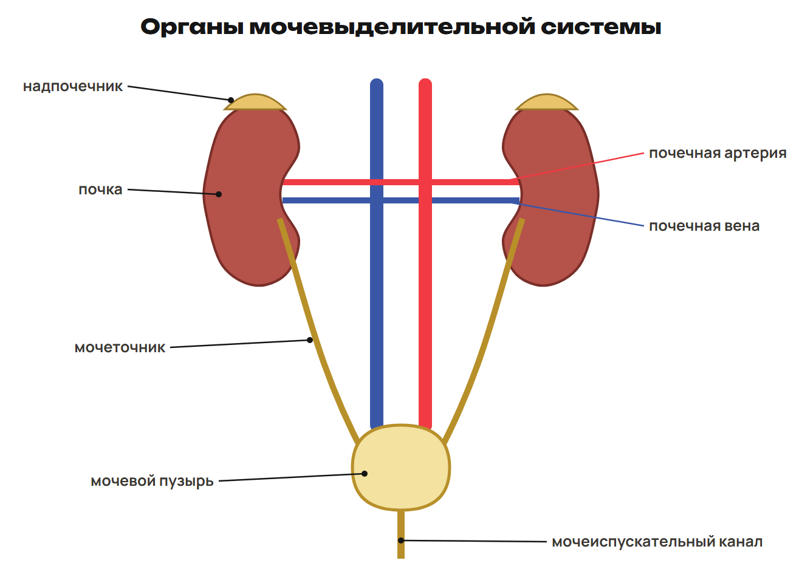
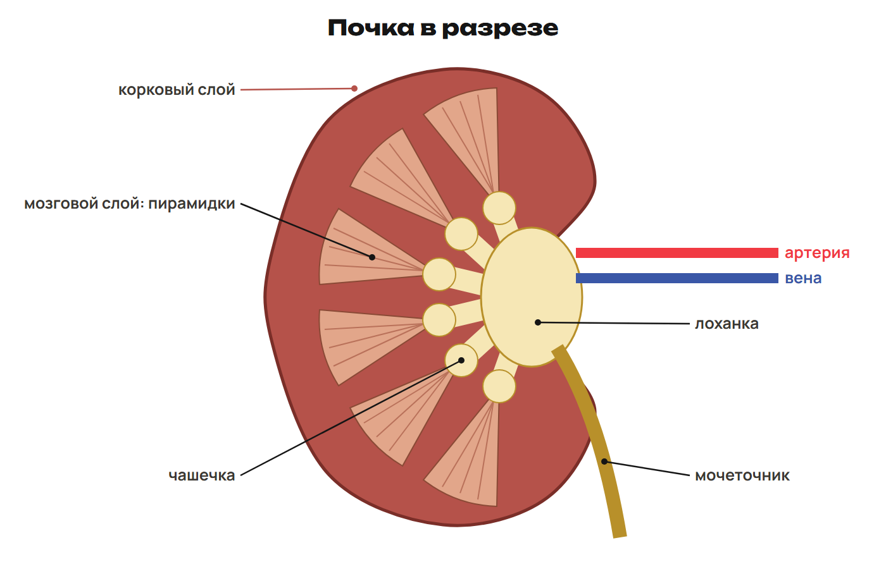
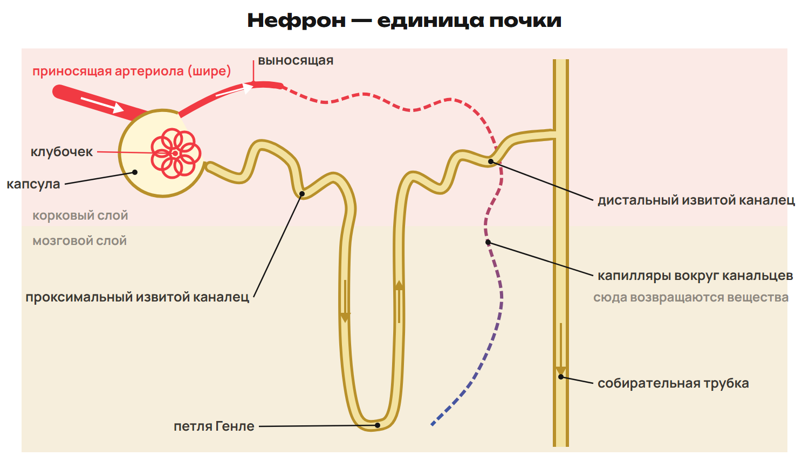
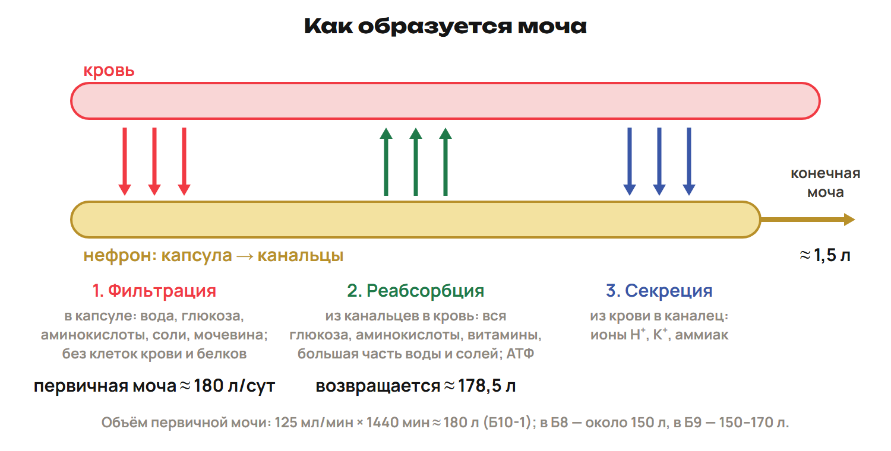

# Урок 15. Выделение, почка и образование мочи

22 декабря 2026; 90 минут. Группы 18:00–19:30 и 19:30–21:00.

Причина → алгоритм → разные примеры → ловушка → самостоятельная попытка. Ключи L показывать после попытки. Предварительное чтение перед первым уроком не требуется.

## План на 90 минут

| Время | Действие |
|---|---|
| 0–14 | 0–8 выделение/органы, 8–11 L1, 11–14 ключ. |
| 14–28 | 14–22 кора/мозговое/лоханка/пузырь, 22–25 L2, 25–28 ключ. |
| 28–45 | 28–39 части/два сосудистых участка, 39–42 L3, 42–45 ключ. |
| 45–60 | 45–54 фильтрация/состав, 54–57 L4, 57–60 ключ. |
| 60–76 | 60–70 реабсорбция/секреция/АТФ, 70–73 L5, 73–76 ключ. |
| 76–90 | 76–81 объём/концентрация, 81–84 L6, 84–88 ключ, 88–90 ДЗ. |

## 1. Выделение · 0–14 минут

**Вопрос:** Почему организму надо выводить вещества?

**Связка:** От дыхания и обмена перейдём к удалению продуктов.

**Что удаляется.** Почки выводят избыток воды, солей, азотистые и многие чужеродные вещества. Поддерживают водно-солевой и осмотический баланс. Лёгкие выводят CO₂ и водяной пар; кожа — вещества с потом. Моча — смесь, мочевина — одно из её веществ.

Не отождествлять выделение конечных продуктов и удаление непереваренной пищи.

**Мочевые пути.** 

Почки парные, поясничная область; надпочечники — отдельные органы.

### L1

Проследи мочу от почки до выхода. Чем выделение CO₂ отличается от вывода мочевины?

**Ответ и решение:** Почка → мочеточник → пузырь → мочеиспускательный канал. CO₂ удаляют лёгкие; главный путь мочевины — почки с мочой.

**Типичная ошибка и новая проверка:** Направить мочу в вену.

## 2. Почка в разрезе · 14–28 минут

**Вопрос:** Где начинается моча и где она собирается?

**Связка:** Органы нашли. Посмотрим внутренние отделы.

**Разрез.** 

Капсулы с клубочками в коре, канальцы проходят через оба слоя.

**Отделы.** Пирамидки мозгового слоя содержат канальцы и собирательные пути. Вершины обращены к чашечкам → лоханка → мочеточник. Гладкие мышцы полых мочевых органов помогают продвижению/выведению. Пузырь накапливает мочу; учебная вместимость около 500 мл. Центр мочеиспускания — крестцовый отдел спинного мозга, есть контроль коры.

Растяжение воспринимают рецепторы; средние объёмы не индивидуальная диагностическая норма.

### L2

Назови слой с клубочками и слой с пирамидками. Восстанови путь от чашечек до пузыря.

**Ответ и решение:** Клубочки в корковом, пирамидки в мозговом. Чашечки → лоханка → мочеточник → пузырь.

**Типичная ошибка и новая проверка:** Считать лоханку местом клубочковой фильтрации.

## 3. Нефрон и кровь · 28–45 минут

**Вопрос:** Как разделить путь крови и путь фильтрата?

**Связка:** От органа перейдём к его функциональной единице.

**Нефрон.** 

Нефрон — структурная и функциональная единица, около миллиона и более в почке; трубка принимает жидкость нескольких нефронов.

**Два маршрута.** Фильтрат: капсула → проксимальный → петля Генле → дистальный → собирательная трубка. Кровь: артерия → приносящая → клубочек → выносящая → капилляры канальцев → вена. Приносящая артериола обычно шире выносящей. Высокое давление клубочка поддерживает фильтрацию.

Стрелки разных цветов: фильтрат не проходит по выносящей артериоле.

### L3

Проследи кровь от почечной артерии до вены. Какие два сосудистых участка разделяет выносящая артериола?

**Ответ и решение:** Артерия → приносящая → клубочек → выносящая → капилляры канальцев → вена. Выносящая соединяет клубочек с капиллярами вокруг канальцев.

**Типичная ошибка и новая проверка:** Назвать выносящую артериолу веной или мочеточником.

## 4. Первичная моча · 45–60 минут

**Вопрос:** Почему фильтрат не равен цельной крови?

**Связка:** Маршруты разделены. Проверим проницаемость барьера.

**Фильтрация.** Давление: вода и малые молекулы из крови клубочка в капсулу. Проходят глюкоза, аминокислоты, мочевина, малые ионы. Клетки крови и крупные белки задерживаются. Первичная моча похожа на плазму без клеток и практически без белков. Сама плазма уже не содержит форменных элементов.

Термин «фильтрация» предпочтителен; не подменять неоднозначной «абсорбцией».

### L4

Сравни кровь, плазму и первичную мочу по эритроцитам, крупным белкам и глюкозе.

**Ответ и решение:** Цельная кровь: эритроциты; плазма: без клеток, есть белки и глюкоза. Первичная моча: без клеток и практически без белков, глюкоза проходит.

**Типичная ошибка и новая проверка:** Написать «клетки плазмы» или не допустить глюкозу в фильтрат.

## 5. Возврат и добавление · 60–76 минут

**Вопрос:** Как сохранить нужные вещества и удалить лишнее?

**Связка:** Одной фильтрации недостаточно: терялись бы вода и глюкоза.

**Реабсорбция и секреция.** Реабсорбция: из канальца в кровь возвращаются нужные вещества и большая часть воды. Глюкоза в норме реабсорбируется, в конечной моче её нет. Активный перенос требует АТФ; вода следует осмосом. Проксимальный каналец: большая поверхность, митохондрии, близкие капилляры. Секреция добавляет H⁺, K⁺, аммиак в просвет канальца.

Часть мочевины тоже возвращается; не называть её полностью невсасывающимся веществом.

### L5

Глюкоза перешла из просвета канальца в кровь, H⁺ — из крови в каналец. Назови процессы и сравни с фильтрацией.

**Ответ и решение:** Глюкоза — реабсорбция, H⁺ — секреция. Фильтрация идёт из клубочка в капсулу, а не в канальце.

**Типичная ошибка и новая проверка:** Назвать обратное всасывание выделением в каналец.

## 6. Объёмы и итог · 76–90 минут

**Вопрос:** Почему большой фильтрат даёт мало конечной мочи?

**Связка:** Сопоставим два объёма и их причины.

**Образование мочи.** 

Это упрощённая объёмная модель. В разных книгах первичный объём 150–180 л; считать по условию.

### L6

125 мл/мин за сутки; конечный объём 1,5 л. Найди первичный объём и долю возврата.

**Ответ и решение:** 125 × 1440 = 180 000 мл = 180 л. Вернулось 178,5 л; 178,5/180 × 100 % ≈ 99,17 %.

**Типичная ошибка и новая проверка:** Перенести 85 % на весь суточный возврат без проверки баланса.

После урока 15: конспект 1–2 — 25 минут, P — 20, G — 35. После урока 16: один A/B/C — 30, исправления — 25, повторение 3–6 и фактов — 15, контекст-трек — 15. Всего 165 минут.
