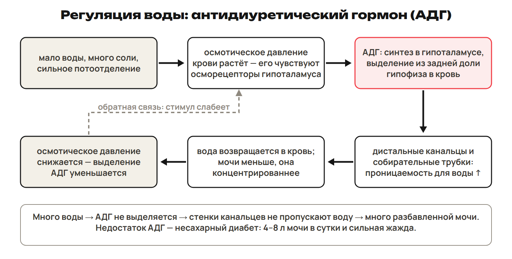
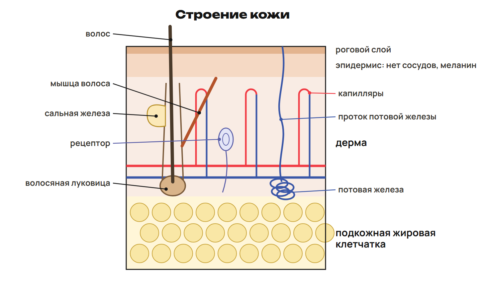
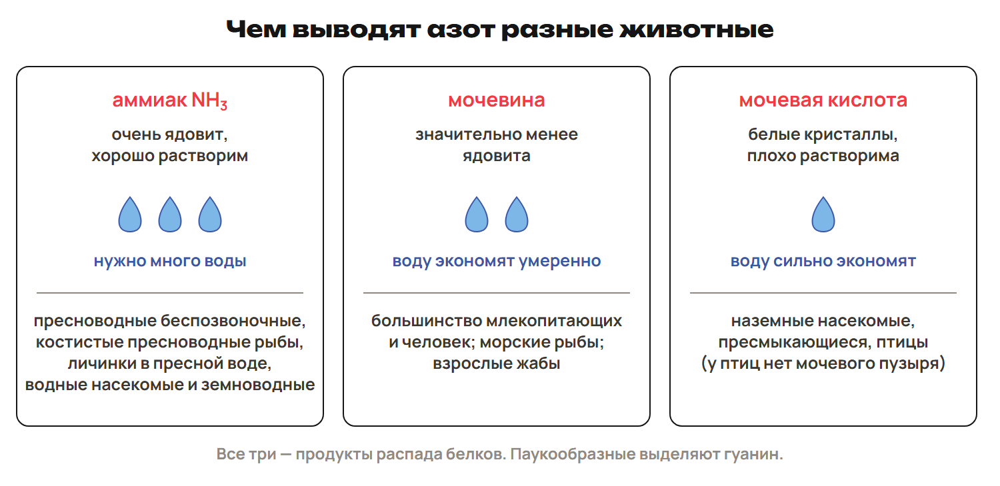
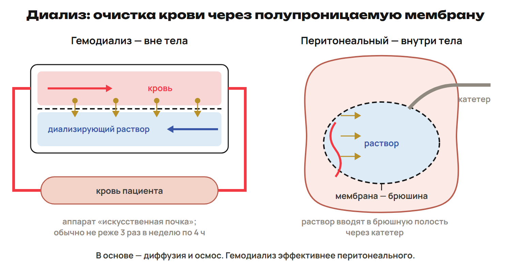

# Возврат
? Какие прежние свойства мембраны нужны почке?
↳ Вернём транспорт и состав крови.
> 0–5 вопросы, 5–8 L7, 8–12 ключ; 12–15 L8, 15–20 ключ.

## Практика: L7
Чем осмос отличается от диффузии растворённого вещества?
Какая молекула связывает получение энергии с её расходом?
Ответы:
Осмос — переход воды через избирательную мембрану.
Растворённое вещество диффундирует по своему градиенту; энергетическая связь — АТФ.
> Попытка до раскрытия ключа.

## Практика: L8
Из чего состоят белки и чем плазма отличается от цельной крови?
Что выводят лёгкие?
Ответы:
Белки состоят из аминокислот.
Плазма — жидкая часть без клеток; цельная кровь содержит и форменные элементы.
Лёгкие выводят CO₂ и водяной пар.
> Попытка до раскрытия ключа.

# Разбор G
? Что именно посчитано: объём или концентрация?
↳ Применим прежние навыки к двум домашним условиям.
> 20–22 вопросы, 22–25 G9, 25–28 ключ; 28–30 G10, 30–33 ключ; 33–35 G11.

## Практика: G9
110 мл/мин, конечной мочи 1,584 л/сут.
Найди первичный объём, возврат и процент.
Ответы:
110 × 1440/1000 = 158,4 л.
158,4 − 1,584 = 156,816 л; возврат 99 %.
> Обратиться к собственной попытке.

## Практика: G10
Концентрации 0,04 и 1,80 г на 100 мл.
Во сколько раз выросла концентрация и известно ли количество?
Ответы:
1,80/0,04 = 45 раз.
Без объёмов и учёта переноса нельзя вычислить оставшееся количество.
> 33–35 исправить G11: в пузыре конечная моча, возврат в кровь.

# АДГ и вода
? Как гормон уменьшает потери воды?
↳ Механизмы нефрона понятны. Добавим обратную связь.
> 35–45 баланс/АДГ/отклонения, 45–48 L9, 48–51 ключ.

## Схема: Петля АДГ

> Баланс модели 2500 мл: вход 1200 + 1000 + 300; выход 1400 + 600 + 300 + 200. Это не персональная норма.

## Понятие: Синтез, выделение, эффект
Вазопрессин = АДГ; синтез — гипоталамус, хранение/выделение — задний гипофиз.
Рост осмотической концентрации → осморецепторы → усиление выделения АДГ.
Конечные отделы нефрона более проницаемы для воды → больше возврата, меньше мочи.
Недостаток АДГ: несахарный диабет, много разбавленной мочи, жажда.
Избыток: синдром Пархона, задержка воды, возможно снижение Na⁺.
> Альдостерон связан с удержанием Na⁺ и вторично воды. АДГ действует через V₂ почки; через V₁ сосудов может вызывать сужение.

## Практика: L9
После потери воды осмотическая концентрация крови повысилась.
Дай цепочку АДГ и объёма мочи при чувствительной почке.
Ответы:
Осморецепторы/гипоталамус → выделение АДГ задним гипофизом.
Возврат воды растёт, мочи меньше и она концентрированнее.
После восстановления воды стимул ослабевает.
> Попытка до раскрытия ключа.

# Кожа и продукты
? Как строение покровов и среда связаны с выделением?
↳ Почки — главный путь воды, но не единственный.
> 51–59 слои/функции/продукты, 59–62 L10, 62–65 ключ.

## Схема: Слои кожи

> Площадь 1,5–2 м² — учебный ориентир; роговой слой мёртвый, глубже клетки делятся, волосы/ногти производные эпидермиса.

## Понятие: Функции покровов
Дерма: соединительная ткань, сосуды, рецепторы, железы, корни волос.
Подкожный жир: запас, теплоизоляция, амортизация.
Пот: 98 % воды, соли и небольшие количества азотистых веществ.
Меланин защищает от УФ; витамин D образуется под действием УФ из провитамина.
Лишай — грибы; чесотка — клещ; недостаток A может вызывать сухость кожи.
> Меланин не предшественник витамина D; загар не исключает ожог. Кожный газообмен человека очень мал.

## Схема: Азотистые продукты

> Аммиак токсичен и требует воды; мочевина экономит её умеренно, мочевая кислота малорастворима; паукообразные — гуанин.

## Практика: L10
Где капилляры кожи и как питается эпидермис?
Сравни продукты человека, пресноводной рыбы и птицы.
Ответы:
Капилляры в дерме; эпидермис получает вещества диффузией.
Человек — мочевина; типичная пресноводная костистая рыба — аммиак; птица — мочевая кислота.
> Попытка до раскрытия ключа.

# Болезни и диализ
? Как заменить часть утраченной функции почки?
↳ Рассмотрим нарушения и принцип мембранного очищения.
> 65–70 понятия/методы, 70–72 L11, 72–74 ключ; 74–76 L12, 76–78 ключ.

## Понятие: Нарушения
Пиелонефрит — инфекционное воспаление почки; цистит — воспаление пузыря.
Камни могут содержать оксалаты кальция.
Обезвоживание, инфекции, избыток соли и некоторые лекарства влияют на почки.
При хроническом нарушении функции накапливаются продукты обмена, возможна уремия.
Снижение выработки эритропоэтина может вести к анемии.
> Переохлаждение — фактор, не бактерия. Хроническое нарушение длится более трёх месяцев; диагноз/порог лечения не устанавливать по одному числу.

## Схема: Два диализа

> Малые вещества переходят по градиентам; перенос воды зависит от метода. Выбор метода индивидуален.

## Практика: L11
Сравни гемодиализ и перитонеальный: мембрана и место.
Смешивается ли кровь с диализатом?
Ответы:
Гемодиализ: мембрана аппарата вне тела.
Перитонеальный: брюшина внутри тела.
Кровь и диализат разделены, не смешиваются.
> Попытка до раскрытия ключа.

## Практика: L12
Зачем при трансплантации учитывать совместимость и подавлять иммунный ответ?
Чем донорская почка отличается от диализной мембраны?
Ответы:
Совместимость и иммуносупрессия уменьшают риск отторжения.
Донорская почка — живой орган с нефронами; диализ — перенос через мембрану.
> Попытка до раскрытия ключа.

# Контроль и маршрут
? Можешь ли ты проследить вещество без подсказки?
↳ Проверь пути, гормон и продукты самостоятельно.
> 78–88 Q1–Q6, 88–90 маршрут; четыре приложения только A.

## Практика: Контроль Q1–Q6
Отдельный лист, без таблиц.
Q1–Q3 одна буква; Q4 все верные; Q5 две пары; Q6 решение.
10 минут, 10 баллов.
> На этом экране не раскрывать ключи.

## Дома: Один вариант
Один A/B/C — 30 минут; исправления — 25; повторение 3–6 и фактов — 15.
Приложения ниже только A внутри 30 минут.
Всего самостоятельной: 25 + 20 + 35 + 30 + 25 + 15 + 15 (контекст-трек) = 165 минут.
После 25 декабря пауза до 11 января.
> Повторение на паузу внутри назначенного объёма, без новых заданий.

## Понятие: Углубление A — давление
Pэф = Pкрови − (Pонкотическое + Pфильтрата).
Учебный пример: 70 − (30 + 20) = 20 мм рт. ст.
Рост противодействующего давления уменьшает результат.
Это заданная модель, не индивидуальная диагностическая формула.
> Подписи рисунка 109 противоречат формуле; использовать только явно заданные величины.

## Понятие: Углубление A — аквапорин
АДГ связывается с V₂ → аквапорин-2 встраивается в мембрану собирательной трубки.
Аквапорин — белковый водный канал, не насос АТФ.
Активный перенос Na⁺ помогает создать условия для осмоса воды.
АДГ также меняет проницаемость трубки для мочевины.
> Центральный дефицит АДГ отличается от нефрогенного нарушения ответа; не все нефрогенные случаи имеют один тип наследования.

## Понятие: Углубление A — методы
Гемосорбция: сорбент связывает вещества из крови.
Плазмаферез: удаление плазмы с возвратом клеток.
Гемофильтрация: фильтрация через высокопроницаемую мембрану.
Диализатор: кровь и диализат разделены; встречное течение поддерживает градиенты.
> Методы сравнивать по механизму; объём диализата из противоречивых строк не задавать.

## Понятие: Углубление A — оборот и пересадка
Суточный фильтрат / объём плазмы = число объёмных эквивалентов.
Плазма циркулирует, большая часть фильтрата возвращается.
Пересадка требует ABO/тканевой совместимости и контроля отторжения.
Первая успешная пересадка почки — 1954; место установки может быть подвздошная область.
> Сроки хранения и режимы лечения не выдавать как практическую инструкцию; не сводить совместимость только к ABO.
