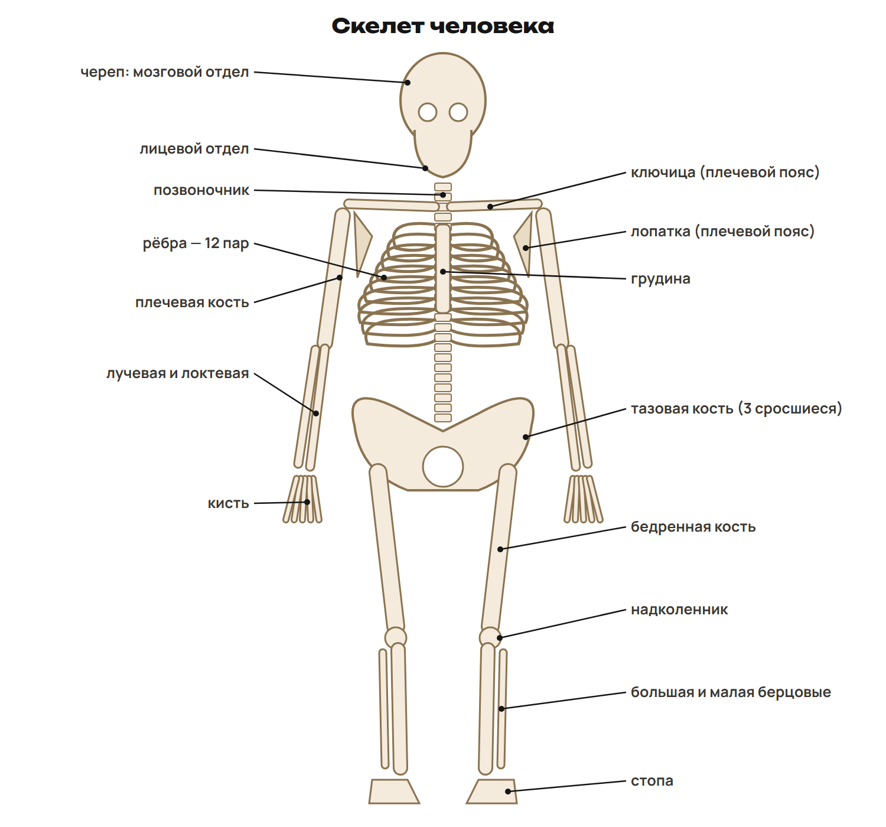
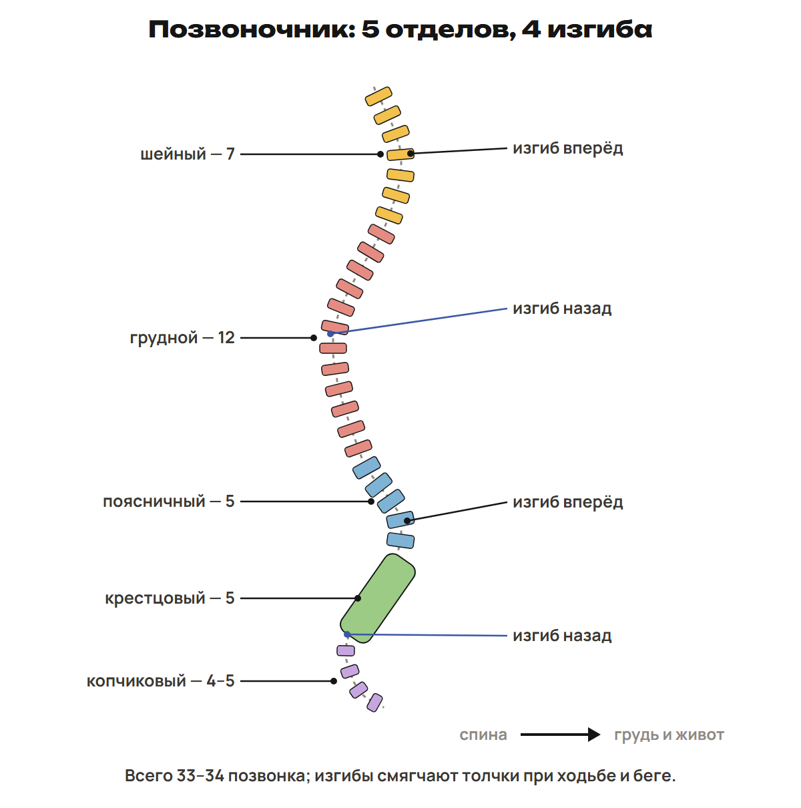
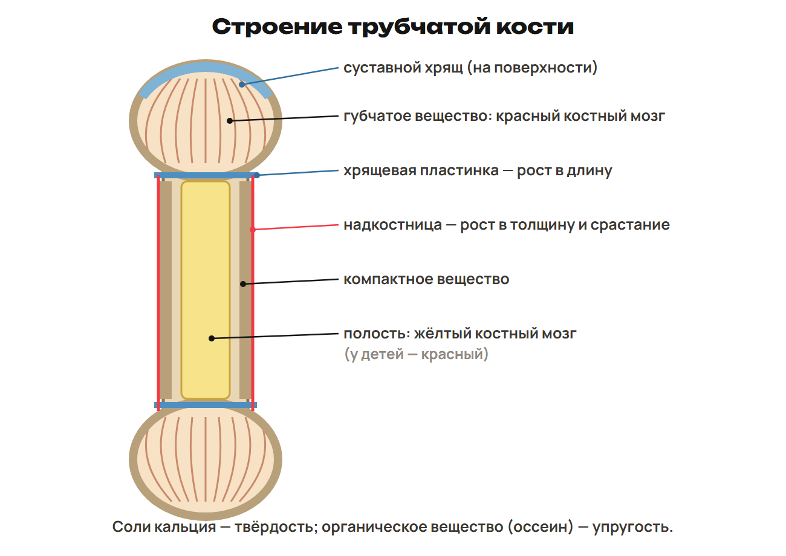
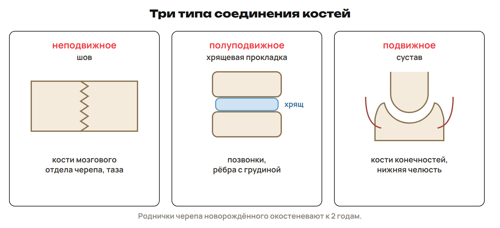
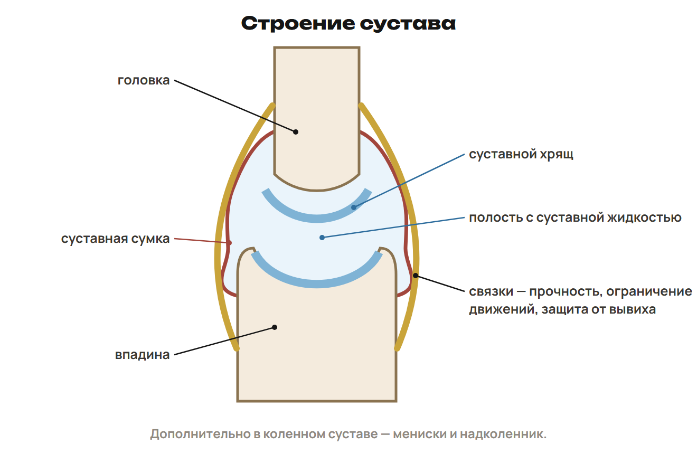

# Урок 17. Скелет, живая кость и суставы

12 января 2027; 90 минут. Группы 18:00–19:30 и 19:30–21:00.

Причина → алгоритм → разные примеры → ловушка → самостоятельная попытка. Ключи L показывать после попытки. Предварительное чтение перед первым уроком не требуется.

## План на 90 минут

| Время | Действие |
|---|---|
| 0–18 | 0–12 функции/отделы/кости, 12–15 L1, 15–18 ключ. |
| 18–32 | 18–26 позвоночник/рёбра/череп, 26–29 L2, 29–32 ключ. |
| 32–48 | 32–42 кость/клетки/состав, 42–45 L3, 45–48 ключ. |
| 48–61 | 48–55 три соединения/исключения, 55–58 L4, 58–61 ключ. |
| 61–76 | 61–70 сустав/части/оси, 70–73 L5, 73–76 ключ. |
| 76–90 | 76–81 интеграция, 81–84 L6, 84–88 ключ, 88–90 нагрузка. |

## 1. Отделы скелета · 0–18 минут

**Вопрос:** Что опирается на пояс, а что входит в свободную конечность?

**Связка:** После паузы вернём ткани и органы.

**Скелет.** 

По таблице раздела 1 назвать черепные кости, плечевую/лучевую/локтевую, бедренную/берцовые, кисть/стопу; большой палец кисти две фаланги.

**Опора и защита.** Кости — пассивная часть ОДС, скелетные мышцы — активная. Опора, защита органов, минеральный обмен Ca/P, кроветворение. Красный костный мозг образует клетки крови. Более 200 костей; плечевой пояс лопатки/ключицы, тазовый — тазовые кости. Каждая тазовая кость из подвздошной, седалищной и лобковой.

Плоские: лопатка/грудина; длинные трубчатые: плечевая/бедренная; короткие трубчатые: фаланги; смешанные: позвонки.

### L1

Сравни пояс и свободную конечность. Распредели лопатку, лучевую, тазовую и бедренную кости.

**Ответ и решение:** Лопатка — плечевой пояс; лучевая — свободная верхняя. Тазовая — тазовый пояс; бедренная — свободная нижняя.

**Типичная ошибка и новая проверка:** Назвать плечевую кость частью плечевого пояса.

## 2. Туловище · 18–32 минут

**Вопрос:** Почему число рёбер считают парами?

**Связка:** Конечности распределили. Проследим осевой скелет.

**Позвоночник.** 

Число позвонков не равно числу отдельных подвижных костей взрослого.

**Грудная клетка и череп.** Грудина, 12 пар рёбер, 12 грудных позвонков. 7 пар к грудине своими хрящами; 3 через вышележащие; 2 свободны спереди. Череп: мозговой отдел защищает мозг, лицевой включает челюсти/скуловые. Лобная/затылочная непарные, теменные/височные парные. Нижняя челюсть непарная и подвижная.

Не называть любое соединение черепа неподвижным.

### L2

Сколько позвонков при четырёх копчиковых и сколько отдельных рёбер? Какая кость нижней части лица подвижна?

**Ответ и решение:** 7 + 12 + 5 + 5 + 4 = 33; 12 × 2 = 24 ребра. Нижняя челюсть подвижна.

**Типичная ошибка и новая проверка:** Смешать число рёбер и пар.

## 3. Живая кость · 32–48 минут

**Вопрос:** Как одна ткань бывает твёрдой и упругой?

**Связка:** От формы перейдём к строению.

**Трубчатая кость.** 

Губчатые перекладины по нагрузке; остеон — пластинки вокруг канала с сосудами/нервами; коллаген есть в кости.

**Рост и перестройка.** Надкостница с сосудами/нервами: рост в толщину и восстановление. Рост в длину: ростковой хрящ, не поверхность сустава. Остеобласты создают, остеоциты поддерживают, остеокласты разрушают. Соли кальция: твёрдость; оссеин: упругость. У детей относительно больше органической основы, кости гибче.

20–25 лет — ориентир окостенения разных участков, не универсальная дата для каждого человека.

### L3

После удаления солей образец гнётся; после разрушения органики ломается. Какие компоненты объясняют оба результата?

**Ответ и решение:** Без солей сохраняется упругая органическая основа. Без органики минералы сохраняют твёрдость, но остаток хрупкий.

**Типичная ошибка и новая проверка:** Приписать упругость солям кальция.

## 4. Соединения · 48–61 минут

**Вопрос:** Как соединить защиту и движение?

**Связка:** Свойства кости известны. Сравним связи между костями.

**Три примера.** 

Срастание частей тазовой кости неподвижно; лобковое соединение — полусустав, не все тазовые соединения одинаковы.

**Подвижность.** Швы мозгового черепа — неподвижные. Между телами позвонков хрящевые диски, небольшая подвижность. Плечевой сустав — подвижный. Рёбра при дыхании движутся ограниченно через хрящи и суставы.

Не превращать функциональную школьную схему грудной клетки в утверждение об одном строении всех соединений рёбер.

### L4

Назови три типа по шву, межпозвоночному диску и плечу. Почему фраза «все кости черепа неподвижны» неверна?

**Ответ и решение:** Шов неподвижен, диск даёт ограниченную подвижность, плечевой сустав подвижен. Нижняя челюсть имеет подвижное соединение.

**Типичная ошибка и новая проверка:** Обобщить свойства мозгового черепа на челюсть.

## 5. Части сустава · 61–76 минут

**Вопрос:** Что уменьшает трение, а что ограничивает движение?

**Связка:** Найдём функции отдельных структур.

**Сустав.** 

Хрящ гладкий, жидкость смазывает, капсула ограничивает полость, связки укрепляют/направляют; не все дополнительные элементы есть у каждого сустава.

**Форма и оси.** Простой сустав: две кости; сложный: три и более. Межфаланговый — одноосный; лучезапястный — двухосный. Плечевой/тазобедренный — шаровидные трёхосные. Локтевой не шаровидный: сгибание/разгибание как в блоковидном сочленении. Полусустав: хрящевая прослойка со щелью, без обычной капсулы.

Не ставить коленный в тест как простой пример одной оси без уточнений сложного устройства.

### L5

Назови роли хряща, жидкости и связок. Приведи по примеру одно-, двух- и трёхосного сустава.

**Ответ и решение:** Хрящ — гладкий контакт, жидкость — смазка, связки — укрепление/ограничение. Межфаланговый, лучезапястный, плечевой соответственно.

**Типичная ошибка и новая проверка:** Назвать локтевой шаровидным.

## 6. Причина и проверка · 76–90 минут

**Вопрос:** Как отделить рост кости от движения в суставе?

**Связка:** Соединим свойства, рост и соединения.

### L6

Объясни рост в толщину и длину, назови клетки образования и разрушения. Отличи ростковой хрящ от суставного.

**Ответ и решение:** Толщина — надкостница; длина — ростковая хрящевая пластинка. Остеобласты образуют, остеокласты разрушают. Суставной хрящ обеспечивает гладкий контакт, не главный источник продольного роста.

**Типичная ошибка и новая проверка:** Поместить ростовую функцию в суставную поверхность.

После урока 17: конспект 1–3 — 25 минут, P — 20, G — 35. После урока 18: один A/B/C — 30, исправления — 25, повторение 4–6 и фактов — 15, контекст-трек — 15. Всего 165 минут.
