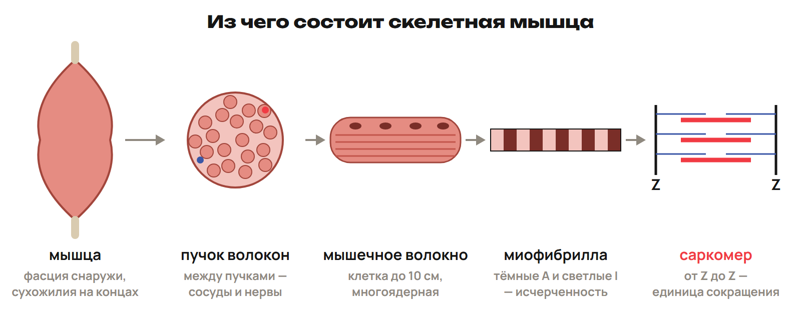
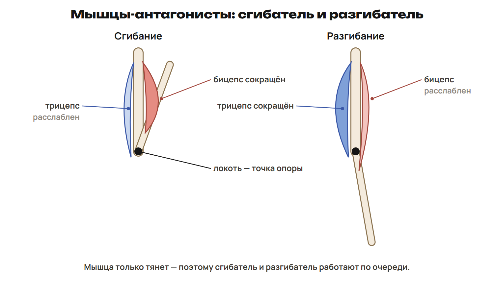
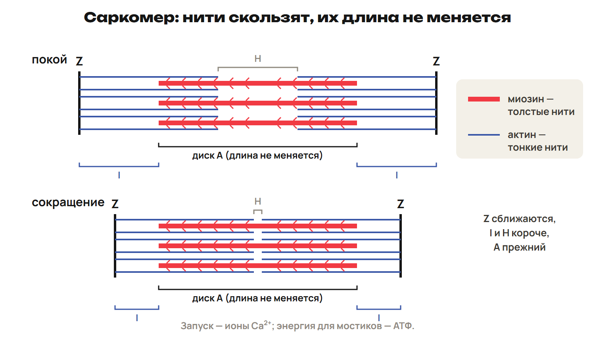
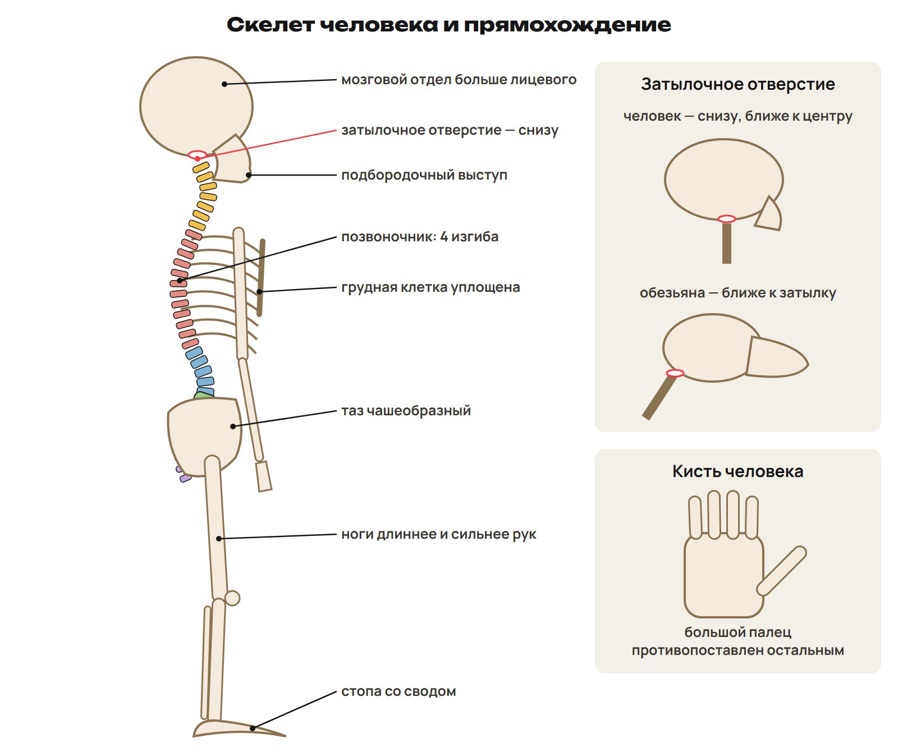

## 1. Скелет и его отделы

Опорно-двигательная система состоит из костей с соединениями и скелетных мышц. Кости — пассивная опора, мышцы — активная часть. Скелет защищает органы, служит опорой и участвует в минеральном обмене Ca/P. Красный костный мозг образует клетки крови. У взрослого более 200 костей, мышц более 600.

| Отдел | Основные кости |
|---|---|
| Мозговой череп | Лобная, затылочная, парные теменные и височные |
| Лицевой череп | Скуловые, верхнечелюстные, непарная нижняя челюсть |
| Грудная клетка | Грудина, 12 пар рёбер, 12 грудных позвонков |
| Плечевой пояс | Лопатки и ключицы |
| Свободная верхняя конечность | Плечевая; лучевая/локтевая; запястье, пясть, фаланги |
| Тазовый пояс | Две тазовые кости, каждая из подвздошной/седалищной/лобковой |
| Свободная нижняя конечность | Бедренная; большая/малая берцовые; предплюсна, плюсна, фаланги |

Надколенник — коленная чашечка. У большого пальца кисти две фаланги, у остальных по три. Первые 7 пар рёбер идут собственными хрящами к грудине, следующие 3 — к хрящу вышележащего ребра; 11-я и 12-я пары свободны спереди.

Позвоночник: 7 шейных + 12 грудных + 5 поясничных + 5 сросшихся крестцовых + 4–5 копчиковых = 33–34. Сросшиеся позвонки считают в составе отделов, не как 33–34 отдельные подвижные кости взрослого.

Кости по форме и строению различаются: плечевая и бедренная — длинные трубчатые, фаланги — короткие трубчатые, лопатка/грудина — плоские, позвонок — смешанная кость.

## 2. Живая кость

Наружное компактное вещество плотное; губчатое в головках трубчатых и в плоских костях образует перекладины по направлениям нагрузки. В полости трубчатой кости с возрастом часть красного мозга заменяется жёлтым, богатым жиром. Красный мозг сохраняется в местах кроветворения.

Надкостница с сосудами и нервами покрывает кость, кроме суставных поверхностей. Её внутренний слой участвует в росте в толщину и восстановлении. Рост в длину связан с ростковым хрящом между головкой и телом, а не со смазывающим суставным хрящом.

Остеобласты образуют костную ткань, остеоциты поддерживают её, остеокласты разрушают при перестройке. Остеон — система костных пластинок вокруг канала с сосудами и нервами. Коллаген — белок соединительной ткани, есть и в кости.

> [!rule] Состав и свойство
> Минеральные соли кальция дают твёрдость, органическая основа (оссеин) — упругость. У детей относительно больше органического вещества, кость гибче. Возраст завершения окостенения зависит от участка; 20–25 лет — учебный ориентир.

> [!example] Прочитай результат опыта
> После удаления минеральных солей кость гибкая: сохранилась органическая основа.
> После разрушения органической части кость хрупкая: сохранились минералы.
> Нормальная кость сочетает свойства, а не состоит из одного компонента.

## 3. Соединения и сустав

Неподвижные соединения — швы мозгового черепа и срастание частей тазовой кости. Между телами соседних позвонков хрящевые диски дают небольшую подвижность. Подвижное соединение — сустав, например плечевой. В грудной клетке хрящи и суставы обеспечивают небольшие движения рёбер при дыхании; не всякое реберное соединение имеет один тип строения.

| Часть сустава | Роль |
|---|---|
| Поверхности с гиалиновым хрящом | Гладкий контакт и уменьшение трения |
| Капсула | Ограничивает полость, удерживает суставные структуры |
| Полость с синовиальной жидкостью | Обеспечивает смазку движения |
| Связки | Укрепляют, направляют и ограничивают движение |
| Дополнительные диски/мениски | Улучшают соответствие поверхностей и распределение нагрузки |

Простой сустав объединяет две кости, сложный — три и более. Формы бывают цилиндрические/блоковидные, эллипсовидные, седловидные, плоские и шаровидные. Межфаланговый — одноосный; лучезапястный — двухосный; плечевой и тазобедренный — шаровидные трёхосные. Локтевой не шаровидный: сгибание/разгибание происходит как в блоковидном сочленении. Полусустав имеет хрящевую прослойку со щелью без обычной суставной капсулы; пример — лобковое соединение таза.

> [!trap] Что легко перепутать
> Надкостница — толщина, ростковой хрящ — длина. Оссеин — упругость, соли — твёрдость. Шов — неподвижно, диск между телами позвонков — ограниченная подвижность, плечевой сустав — свободное движение. Не все соединения костей таза или черепа одинаковы: нижняя челюсть подвижна.

## 4. Мышца и её работа

Гладкая ткань в стенках органов/сосудов работает непроизвольно. Скелетная поперечнополосатая приводит в движение кости. Сердечная тоже поперечнополосатая, но образует миокард и не входит в скелетную ОДС.

Мышца покрыта соединительнотканными оболочками; пучки содержат многоядерные мышечные волокна, каждое — миофибриллы. Между волокнами проходят нервы и сосуды. Сухожилие прикрепляет мышцу к кости и передаёт усилие; само не сокращается, как волокно. Мимические мышцы прикрепляются и к коже, есть круговые мышцы и мышцы языка.

Мышца активно тянет, но не толкает кость. Бицепс сгибает предплечье, трицепс разгибает: они антагонисты. Работа мышц согласуется нервной системой; при разных задачах возможна совместная активация для устойчивости сустава. Мышцы различают по положению, форме и действию: сгибатели/разгибатели, приводящие/отводящие, длинные/широкие/круговые.

| Учебный тип волокон | Особенности |
|---|---|
| Медленные красные | Много миоглобина/митохондрий, аэробное обеспечение, выносливость и поза |
| Быстрые белые гликолитические | Меньше миоглобина, много гликогена, быстрый рывок, быстрее утомляются |

В реальной мышце типы смешаны; быстрые волокна не все одинаковы. Утомление связано с нервными и мышечными механизмами, а не с одной «вредной молекулой». Отдых и кровоснабжение помогают восстановлению.

## 5. Саркомер и скользящие нити

Сарколемма — мембрана волокна, саркоплазма — его содержимое. Саркоплазматический ретикулум хранит Ca²⁺. Т-трубочки проводят электрическое изменение внутрь волокна; одна Т-трубочка с двумя соседними цистернами образует триаду.

Саркомер — участок миофибриллы между двумя Z-линиями. Толстые нити — миозин, тонкие — актин. A-диск соответствует полной длине толстых нитей, включая участки перекрытия; I-диск содержит только тонкие; H-зона — центральная часть с толстыми нитями без тонких. M-линия расположена в середине толстых нитей.

Нервный сигнал → Т-система → выход Ca²⁺ из ретикулума. Кальций через регуляторные белки сдвигает тропомиозин, открывая участки актина для миозина. Циклы мостиков с затратой АТФ перемещают тонкие нити к середине. Z-линии сближаются; I/H уменьшаются, A сохраняется. Нити скользят, а не укорачиваются.

АТФ нужна и для отсоединения миозина от актина с продолжением цикла, и для работы насоса возврата Ca²⁺ в ретикулум. Снижение свободного Ca²⁺ помогает закрыть участки актина и расслабить волокно. Изометрическое сокращение создаёт усилие без изменения длины, изотоническое в идеальной модели меняет длину при постоянном напряжении; обычные движения смешанные.

> [!trap] Не всякое сокращение укорачивает мышцу
> При изометрии длина мышцы сохраняется. При укорочении саркомера не укорачиваются сами актиновые и миозиновые нити. Ca²⁺ даёт регуляторный сигнал, АТФ обеспечивает цикл и возврат кальция.

## 6. Движение, осанка и прямохождение

Малоподвижность снижает нагрузку на мышцы; термины гипокинезия и гиподинамия связаны с уменьшением движения и мышечных усилий. Неравномерная нагрузка и неудобная посадка могут нарушать осанку, но структурный сколиоз имеет разные причины и не определяется одним положением за столом. Плоскостопие — уплощение сводов стопы; на них влияют мышцы, связки, нагрузка и обувь. Свод распределяет нагрузку и амортизирует.

Человек и человекообразные обезьяны имеют общий план скелета и мышц. С прямохождением связаны S-образный позвоночник с четырьмя изгибами, чашеобразный таз, сильные длинные ноги и сводчатая стопа. Затылочное отверстие расположено снизу основания черепа, ближе к центру по сравнению с человекообразными обезьянами. Противопоставленный большой палец кисти связан с работой руки; большой палец стопы так не противопоставлен.

У человека мозговой отдел черепа больше лицевого, челюсти уменьшены; развиты мимические мышцы и мышцы языка. Эти признаки не все объясняются одной причиной прямохождения. Кости работают как рычаги, сустав — точка опоры, мышца создаёт тягу. Модель рычага требует заданных плеч силы: длина всей кости не всегда равна плечу.

> [!rule] Факты ЕНТ недели
> - В позвоночнике обычно 33–34 позвонка: 7 шейных, 12 грудных, 5 поясничных, 5 крестцовых, 4–5 копчиковых.
> - У человека 12 пар рёбер; первые 7 пар соединяются с грудиной собственными хрящами.
> - Тазовая кость образована срастанием подвздошной, седалищной и лобковой костей.
> - Соли кальция дают кости твёрдость, органическая основа (оссеин) — упругость.
> - Надкостница обеспечивает рост в толщину и участвует в восстановлении; рост в длину связан с хрящом.
> - Бицепс сгибает, трицепс разгибает предплечье в локте.
> - Саркомер расположен между двумя Z-линиями; толстые нити — миозин, тонкие — актин.
> - Ca²⁺ запускает взаимодействие нитей; АТФ нужна для цикла мостиков и возврата Ca²⁺ в ретикулум.

> [!try] Перед вариантом
> Проследи путь от выхода Ca²⁺ до сближения Z-линий; затем объясни, что остаётся постоянным в саркомере.
