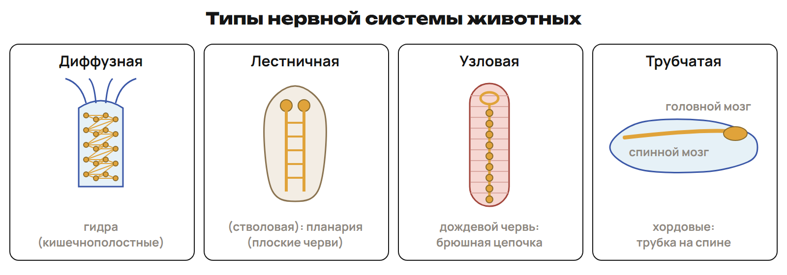
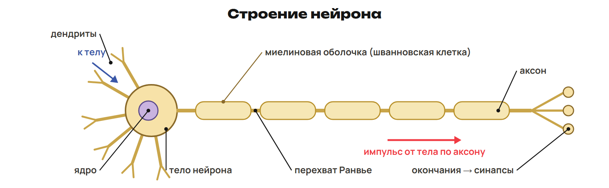
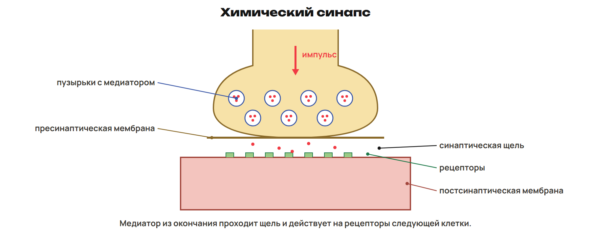
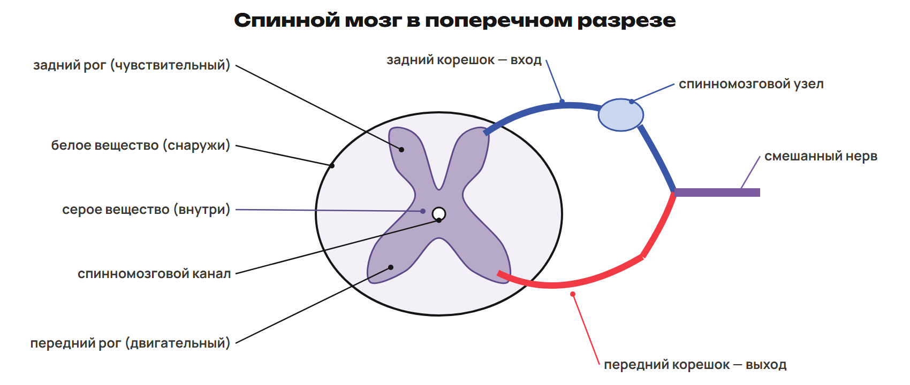

# Урок 19. Нервная система, нейрон, импульс и спинной мозг

19 января 2027; 90 минут. Группы 18:00–19:30 и 19:30–21:00.

Причина → алгоритм → разные примеры → ловушка → самостоятельная попытка. Ключи L показывать после попытки. Предварительное чтение перед первым уроком не требуется.

## План на 90 минут

| Время | Действие |
|---|---|
| 0–12 | 0–7 задача и четыре типа; 7–10 L1; 10–12 ключ и ловушка. |
| 12–28 | 12–23 нейрон, глия, серое/белое вещество; 23–26 L2; 26–28 ключ. |
| 28–42 | 28–36 синапс, медиатор и виды контактов; 36–39 L3; 39–42 ключ. |
| 42–56 | 42–50 покой, импульс, миелин и электрические явления; 50–53 L4; 53–56 ключ. |
| 56–71 | 56–66 расположение, нервы, срез спинного мозга; 66–69 L5; 69–71 ключ. |
| 71–90 | 71–81 корешки и локальное нарушение; 81–84 L6; 84–88 ключ и итог; 88–90 домашний маршрут. |

## 1. От раздражителя к нервной системе · 0–12 минут

**Вопрос:** Почему гидра и человек отвечают на раздражение по-разному?

**Связка:** Начнём с общей задачи нервной системы, затем сравним её устройство.

**Задача нервной системы.** Раздражитель действует снаружи или внутри организма. Нервная система воспринимает информацию, обрабатывает её и координирует органы. Это нервная регуляция. У простейших и губок нервной системы нет.

**Четыре типа.** 

Лестничная и стволовая — два школьных названия одного типа. У медуз система диффузно-узловая.

**Строение → группа.** Диффузная: сеть клеток без узлов — кишечнополостные, например гидра. Лестничная: головные узлы, продольные стволы с перемычками — плоские черви. Узловая: нервные узлы — кольчатые черви, членистоногие, моллюски. Брюшная цепочка характерна для кольчатых червей и членистоногих. Трубчатая: нервная трубка на спинной стороне — хордовые.

Строение нервной системы моллюсков разнообразно: не приписывать каждому брюшную цепочку.

### L1

У животного парные продольные нервные стволы соединены перемычками. Назови тип системы, его второе название и подходящую группу. Чем отличается положение нервной трубки хордовых от цепочки кольчатых червей?

**Ответ и решение:** Лестничная, или стволовая; плоские черви. У хордовых трубка на спинной стороне, у кольчатых червей цепочка на брюшной.

**Типичная ошибка и новая проверка:** Назвать лестничную и стволовую разными типами или перепутать спинную и брюшную стороны.

## 2. Нейрон и нервная ткань · 12–28 минут

**Вопрос:** Как строение клетки задаёт направление сигнала?

**Связка:** Системы устроены по-разному. Посмотрим на их общие клетки.

**Два свойства и две группы клеток.** Возбудимость — способность отвечать на раздражение возбуждением. Проводимость — способность проводить возбуждение. Нейроны воспринимают и передают сигналы. Нейроглия поддерживает, питает и защищает нейроны. Зрелые нейроны обычно не делятся; многие клетки глии способны к делению.

Не превращать школьное обобщение в утверждение об отсутствии любых исключений во всей нервной системе.

**Части нейрона.** 

**Путь внутри типичного нейрона.** Дендриты проводят сигнал к телу нейрона. Аксон проводит сигнал от тела к другой клетке. Миелин покрывает многие аксоны; между участками — перехваты Ранвье. Серое вещество содержит тела нейронов и дендриты. Белое вещество образовано главным образом миелинизированными аксонами. Нерв — пучки нервных волокон в оболочках; ганглий — скопление тел нейронов вне ЦНС.

Серое вещество содержит также другие структуры и глию; белое не состоит из одного химического вещества.

### L2

Отросток проводит сигнал к телу, другой — от тела. Назови оба. В одном участке преобладают тела нейронов, в другом — миелинизированные аксоны. Как различить эти участки? Чем нерв отличается от ганглия?

**Ответ и решение:** К телу — дендрит; от тела — аксон. Тела нейронов характерны для серого вещества, миелинизированные аксоны — для белого. Нерв содержит пучки волокон, ганглий — скопление тел нейронов вне ЦНС.

**Типичная ошибка и новая проверка:** Назвать нерв скоплением тел или считать дендрит длинным выходящим отростком.

## 3. Синапс и передача · 28–42 минут

**Вопрос:** Как сигнал переходит от одной клетки к другой?

**Связка:** Аксон довёл сигнал до окончания. Следующий шаг проходит через контакт клеток.

**Контакт клеток.** Синапс — место передачи сигнала между возбудимыми клетками. Межнейронный связывает нейроны; нервно-мышечный — нейрон и мышцу. Нервно-железистый, или секреторный, связывает нейрон и железистую клетку. В химическом синапсе сигнал передаёт медиатор — вещество-посредник. По действию на следующую клетку различают возбуждающие и тормозные синапсы.

Действие зависит от медиатора и рецептора следующей клетки. Не требовать, чтобы любой медиатор действовал одинаково в любом контакте.

**Где находится щель.** 

Синапс — весь контакт. Щель — только пространство между мембранами.

**Передать и изменить ответ.** Приход импульса к окончанию → выделение медиатора. Медиатор достигает рецепторов следующей клетки. Возбуждающее влияние повышает возможность её возбуждения. Тормозное влияние снижает эту возможность. На одном нейроне могут быть тысячи синаптических контактов.

### L3

Окончание нейрона выделяет медиатор к железистой клетке. Назови вид синапса и вещество-посредник общим термином. Ученик назвал промежуток между мембранами всем синапсом. Исправь.

**Ответ и решение:** Нервно-железистый, или секреторный, синапс; посредник — медиатор. Промежуток — синаптическая щель; синапс включает обе мембраны и щель.

**Типичная ошибка и новая проверка:** Смешать классификацию по связанным клеткам с классификацией по действию.

## 4. Импульс и миелин · 42–56 минут

**Вопрос:** Почему одно волокно проводит сигнал быстрее другого?

**Связка:** Контакт соединяет клетки. Теперь проследим электрическое изменение вдоль волокна.

**Мембранный потенциал.** Между сторонами мембраны существует разность потенциалов. У нейрона в покое внутри отрицательнее, чем снаружи: около −70 мВ. Потенциал действия — быстрое изменение мембранного потенциала при возбуждении. Натрий-калиевый насос поддерживает различия в распределении ионов. Быстрые изменения при импульсе связаны с ионными каналами.

Покой −70 мВ и учебная амплитуда ПД 110–120 мВ — разные величины. Насос не разворачивается для создания быстрой фазы импульса.

**Изоляция и скорость.** Миелин — липопротеидная оболочка многих аксонов. В ПНС её образуют шванновские клетки. Участки миелина разделены перехватами Ранвье. Учебные ориентиры: до 120 м/с по миелинизированным волокнам. По немиелинизированным — около 0,5 м/с. Это ориентиры для разных волокон, а не две неизменные скорости всех нервов.

**Создавать или воспринимать.** Электрические органы помогают нападать и защищаться. Учебные примеры: скат — около 300 В, электрический угорь — до 650 В. Электрорецепторы воспринимают электрическое поле. Боковая линия рыб воспринимает изменения давления воды. ЭЭГ регистрирует электрическую активность мозга, ЭКГ — сердца.

Не приписывать создание мощного разряда электрорецептору.

### L4

В учебной модели две волокнистые структуры проводят с 120 и 0,5 м/с. Какая вероятнее миелинизирована? Во сколько раз различаются скорости? Какая структура рыбы воспринимает поле, а какая создаёт мощный разряд?

**Ответ и решение:** Миелинизирована структура со скоростью 120 м/с. 120 ÷ 0,5 = 240 раз для заданной пары значений. Поле воспринимает электрорецептор; разряд создаёт электрический орган.

**Типичная ошибка и новая проверка:** Перенести отношение заданных двух скоростей на любые волокна или перепутать орган и рецептор.

## 5. ЦНС, ПНС и спинной мозг · 56–71 минут

**Вопрос:** Что находится внутри мозга, а что связывает его с органами?

**Связка:** Волокна проводят сигналы. Разделим центры и связи между ними и телом.

**Два отдела по расположению.** ЦНС — головной и спинной мозг. ПНС — нервы и нервные узлы вне ЦНС. У человека 12 пар черепно-мозговых нервов и 31 пара спинномозговых. Чувствительные нейроны ведут сигнал к ЦНС, двигательные — от ЦНС. Вставочные нейроны связывают нейроны внутри ЦНС.

**Поперечный срез спинного мозга.** 

Не рисовать тело чувствительного нейрона в заднем роге: оно находится в спинномозговом узле.

**Защита и две функции.** Спинной мозг находится в позвоночном канале; длина около 40–45 см. 31 сегмент; три оболочки и спинномозговая жидкость защищают его. Внутри серое вещество, снаружи белое; в центре — канал. Рефлекторная функция: простые реакции, например коленный рефлекс. Проводниковая: пути связывают органы, спинной и головной мозг.

Кора полушарий расположена снаружи; внутри головного мозга также есть ядра серого вещества.

### L5

Распредели по расположению: спинной мозг, головной мозг, спинномозговой нерв, ганглий. Где серое вещество на поперечном срезе спинного мозга? Назови две его функции и числа пар черепных и спинномозговых нервов.

**Ответ и решение:** ЦНС: головной и спинной мозг. ПНС: нерв и ганглий. Серое вещество спинного мозга внутри. Функции рефлекторная и проводниковая; 12 и 31 пара нервов соответственно.

**Типичная ошибка и новая проверка:** Отнести любой ганглий к ЦНС или перенести расположение коры на спинной мозг.

## 6. Корешки, рога и нарушение пути · 71–90 минут

**Вопрос:** Как место повреждения меняет прохождение сигнала?

**Связка:** Отделы различили. Теперь проверим направление через конкретный вход и выход.

**Вход и выход.** Задний корешок проводит чувствительные сигналы к спинному мозгу. Тела этих чувствительных нейронов находятся в спинномозговом узле. Передний рог содержит тела двигательных нейронов. Их аксоны выходят через передний корешок. Передний и задний корешки соединяются в смешанный нерв. Боковые рога содержат вегетативные ядра.

**Как читать описание повреждения.** Сначала найди направление: вход к ЦНС или выход к органу. Затем назови структуру, которую проходит этот участок сигнала. Разрыв заднего корешка прерывает чувствительный вход от соответствующей области. Разрыв переднего корешка прерывает двигательный выход по его волокнам. Сохранность мышцы ещё не означает сохранность всего нервного пути.

Использовать локальную учебную модель: неповреждённые соседние корешки могут иметь перекрывающиеся области. Не выводить полную клиническую картину по одному корешку.

### L6

В модели изолированного пути разорван задний корешок; передний корешок и мышца целы. Какое направление сигнала прервано? Где лежало тело входящего нейрона? Что изменилось бы при повреждении двигательных клеток переднего рога?

**Ответ и решение:** Прерван чувствительный вход к спинному мозгу по этому корешку. Тело чувствительного нейрона — в спинномозговом узле. Повреждение двигательных клеток переднего рога нарушает выход к их мышечным волокнам.

**Типичная ошибка и новая проверка:** Считать, что неповреждённый передний корешок заменит чувствительный вход.

После урока 19: конспект 1–3 — 25 минут, P — 20, G — 35. После урока 20: один A/B/C — 30, исправления — 25, повторение 4–6 и фактов — 15. Всего 150 минут.

План насыщенный. При пробном занятии измерить время объяснений; сокращать повторное чтение таблиц, сохраняя самостоятельные попытки и контроль. Базовые определения и сенсорные маршруты не переносить на самостоятельное изучение до объяснения.
