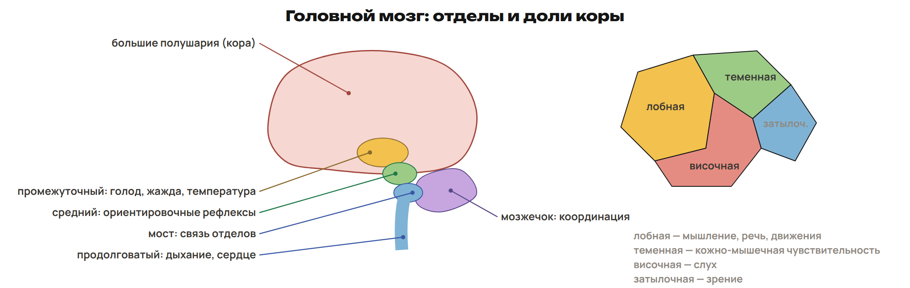
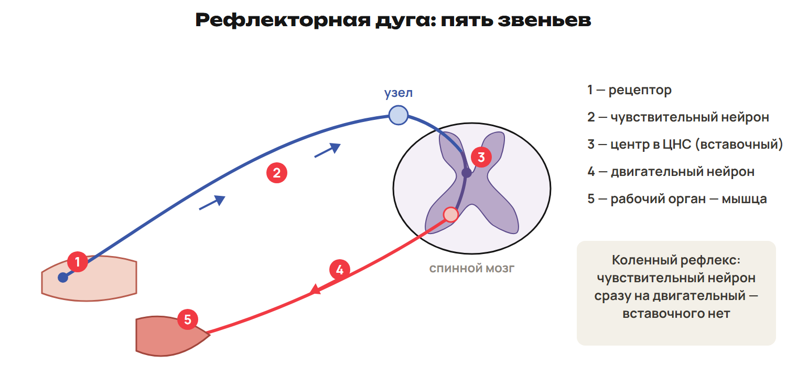
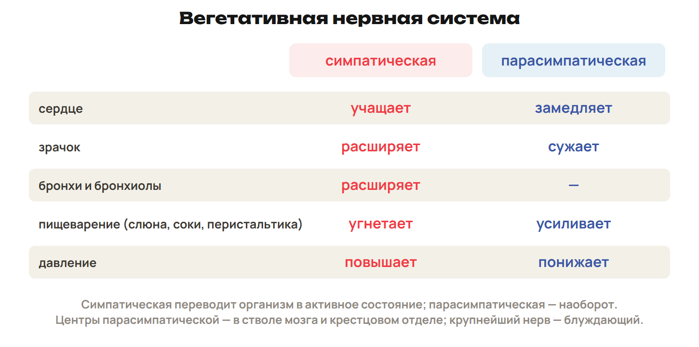
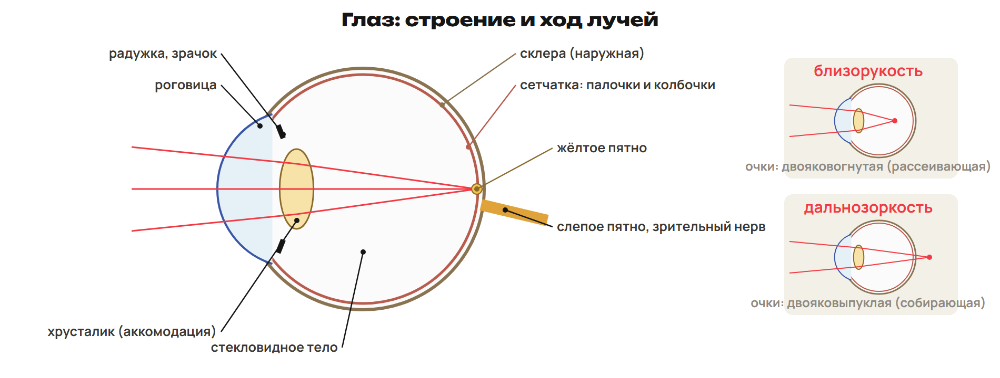

# Урок 20. Головной мозг, рефлекс, вегетативная система и органы чувств

22 января 2027; 90 минут. Группы 18:00–19:30 и 19:30–21:00.

Причина → алгоритм → разные примеры → ловушка → самостоятельная попытка. Ключи L показывать после попытки. Предварительное чтение перед первым уроком не требуется.

## План на 90 минут

| Время | Действие |
|---|---|
| 0–20 | 0–5 вопросы и устное восстановление пути нейрона; 5–8 L7, 8–12 ключ; 12–16 L8, 16–20 ключ. |
| 20–38 | 20–23 трудный шаг G9; 23–26 G10 и G11; 26–33 отделы и кора; 33–35 L9; 35–38 ключ. |
| 38–50 | 38–44 пять звеньев, коленный рефлекс и Павлов; 44–47 L10; 47–50 ключ. |
| 50–60 | 50–55 отделы по функции и противоположные влияния; 55–58 L11; 58–60 ключ. |
| 60–78 | 60–65 глаз и рецепторы; 65–68 линзы; 68–72 ухо и кожа; 72–75 L12; 75–78 ключ. |
| 78–88 | Контроль без подсказок, отдельный ключ после сдачи. |
| 88–90 | Назначить один маршрут, приложение A не продлевает урок. |

## 1. Возврат и вопросы · 0–20 минут

**Вопрос:** Какие старые знания помогут объяснить нервный сигнал?

**Связка:** Вернём мембрану, ткани и мышцы, затем разберём вопросы после первого урока.

### L7

Какие две группы клеток образуют нервную ткань? Сколько Na⁺ и K⁺ переносит натрий-калиевый насос и в какую сторону? Почему этот перенос связан с АТФ?

**Ответ и решение:** Нейроны и нейроглия. За цикл 3 Na⁺ наружу и 2 K⁺ внутрь. Это активный транспорт против градиентов; работа сопряжена с расходом АТФ.

**Типичная ошибка и новая проверка:** Поменять 3 и 2 или назвать насос пассивным каналом.

### L8

Что происходит с длиной саркомера при сокращении и как работают мышцы-антагонисты? Какой витамин важен для сумеречного зрения? В каком отделе находится основной дыхательный центр?

**Ответ и решение:** Саркомер укорачивается за счёт скольжения нитей; антагонисты выполняют противоположные движения. Витамин A; его достаток важен, избыток не улучшает зрение. Основной дыхательный центр — продолговатый мозг.

**Типичная ошибка и новая проверка:** Считать, что сами актиновые нити укорачиваются, или советовать большие дозы витамина.

## 2. Разбор G и головной мозг · 20–38 минут

**Вопрос:** Как узнать отдел мозга по его функции?

**Связка:** Путь первого урока вернули. Свяжем его с центрами головного мозга.

### G9 · схема нейрона

Нарисуй тело нейрона с ядром, два дендрита, аксон и его окончание. Стрелками покажи направление к телу и от тела. Подпиши весь контакт окончания с другой клеткой и посредник химической передачи.

**Ответ и решение:** Дендриты ведут к телу, аксон — от тела к окончанию. Весь контакт — синапс. Вещество-посредник в химическом синапсе — медиатор.

**Типичная ошибка и новая проверка:** Выбирать название только по длине нарисованной линии, не проверив направление.

### G10 · срез спинного мозга

Нарисуй поперечный срез спинного мозга. Обозначь серое и белое вещество, задний и передний корешки. Поставь стрелки относительно мозга; подпиши чувствительный и двигательный пути.

**Ответ и решение:** Серое вещество внутри, белое снаружи. Задний корешок — чувствительный вход к мозгу. Передний корешок — двигательный выход от мозга.

**Типичная ошибка и новая проверка:** Поместить тело чувствительного нейрона в задний рог.

**Пять отделов и четыре доли.** 

Учебный диапазон массы мозга 1200–1500 г; масса сама по себе не измеряет способности. Не утверждать, что серое вещество бывает только снаружи.

**Отдел → ведущая функция.** Продолговатый: дыхание, сердцебиение; глотание, кашель, чихание. Задний: мост проводит сигналы, мозжечок координирует движения и тонус. Средний: ориентировочные реакции на свет и звук, мышечный тонус. Промежуточный: голод, жажда, температура, сон и бодрствование. Передний: большие полушария, кора; память, мышление и речь. Кора — серое вещество; борозды и извилины увеличивают её поверхность.

Последствия повреждения зависят от места и объёма; не сводить любой очаг в продолговатом мозге к мгновенной смерти.

**Доля → функция.** Лобная: мышление, поведение, сложные движения; речь у большинства связана с левой стороной. Теменная: кожно-мышечная чувствительность. Височная: слух. Затылочная: зрение. Управление движениями сторон тела преимущественно перекрёстное.

Гипофиз не относится к среднему мозгу; гормональные связи подробно рассматриваются отдельно.

### L9

Соответствие: А — координация движений; Б — анализ зрительных сигналов. 1 — продолговатый мозг; 2 — височная доля; 3 — мозжечок; 4 — затылочная доля. Назови также отдел, связанный с глотанием.

**Ответ и решение:** А3 Б4. Глотание связано с центрами продолговатого мозга.

**Типичная ошибка и новая проверка:** Смешать мозжечок и средний мозг или отправить зрение в височную долю.

## 3. Рефлекс и опыт Павлова · 38–50 минут

**Вопрос:** Когда ответ врождённый, а когда формируется опытом?

**Связка:** Центры имеют разные функции. Соберём путь ответа и сравним два способа его возникновения.

**Пять звеньев.** 

Пять функциональных звеньев не означают пять нейронов. В простейшей дуге коленного рефлекса нет обязательного вставочного нейрона.

**Дуга и классификация.** Рефлекс — ответ организма на раздражение с участием ЦНС. Рецептор → чувствительный нейрон → центр ЦНС → двигательный нейрон → рабочий орган. Центростремительный — к ЦНС; центробежный — от ЦНС. Безусловные рефлексы врождённые и видовые; условные приобретённые и индивидуальные. В школьной модели условный рефлекс требует участия коры и подкрепления. Инстинкт — цепь безусловных рефлексов.

Соматический рефлекс может быть непроизвольным. Вставочный нейрон есть в дуге отдёргивания, но не обязателен в любой дуге.

**Как звонок стал сигналом.** В опыте Павлова пища вызывает безусловное слюноотделение. Первоначально нейтральный звонок многократно сочетают с пищей. Затем один звонок вызывает приобретённое слюноотделение. Без подкрепления условный ответ угасает. Сильный новый раздражитель может временно затормозить текущий ответ.

Не считать любой ответ на звук врождённым: решает история сочетаний.

### L10

После сочетаний света с пищей слюна выделяется на один свет. Назови тип рефлекса. Назови пять звеньев дуги слюноотделения общими терминами. Что произойдёт с условным ответом без подкрепления? Обязателен ли вставочный нейрон в коленном рефлексе?

**Ответ и решение:** Рефлекс условный. Рецептор → чувствительный нейрон → центр ЦНС → двигательный нейрон → железа. Без подкрепления ответ угасает. В простейшей дуге коленного рефлекса вставочный нейрон не обязателен.

**Типичная ошибка и новая проверка:** Назвать слюнную железу рецептором или вставить пять нейронов вместо пяти звеньев.

## 4. Соматическая и вегетативная системы · 50–60 минут

**Вопрос:** Какая система меняет работу органов при нагрузке?

**Связка:** Рефлекторная дуга приводит к органу. Уточним, какие органы получают разные команды.

**Не путай два основания деления.** ЦНС и ПНС — деление по расположению. Соматическая и вегетативная — по функции. Соматическая система связана с кожей и скелетными мышцами. Она обеспечивает произвольные движения и участвует в непроизвольных рефлексах. Вегетативная регулирует внутренние органы; прямой волевой контроль ей не свойственен.

**Два вегетативных влияния.** 

Не переносить схему противоположных влияний на каждую железу и любой орган без условия.

**Активизация и восстановление.** Симпатическое влияние: учащение сердца, расширение зрачков и бронхиол. Секреция пищеварительных желёз и перистальтика обычно ослабляются. Парасимпатическое: замедление сердца, усиление пищеварения, сужение зрачка. Парасимпатические центры расположены в стволе мозга и крестцовом отделе. Крупный парасимпатический нерв — блуждающий.

### L11

При активизации сердце сокращается чаще, зрачки расширяются, пищеварение ослабевает. Какое влияние преобладает? Как изменится типичный ответ при противоположном влиянии? Почему коленный рефлекс не становится вегетативным из-за своей непроизвольности?

**Ответ и решение:** Преобладает симпатическое влияние. При парасимпатическом сердце обычно замедляется, зрачок сужается, пищеварение усиливается. Коленный рефлекс действует на скелетную мышцу и относится к соматическим.

**Типичная ошибка и новая проверка:** Определять отдел только по признаку «не контролирую сознательно».

## 5. Глаз, ухо и рецепторы тела · 60–78 минут

**Вопрос:** Где раздражитель превращается в нервный сигнал?

**Связка:** Органы получают команды и отправляют информацию. Проследим два сенсорных маршрута.

**Глаз и оптическая коррекция.** 

Только колбочки находятся в центральной ямке жёлтого пятна. Не распространять отсутствие палочек на всё жёлтое пятно.

**Оболочки и путь света.** Снаружи склера, спереди прозрачная роговица. Средняя оболочка сосудистая; спереди радужка со зрачком. Внутренняя сетчатка содержит фоторецепторы. Свет: роговица → передняя камера → зрачок → хрусталик → стекловидное тело → сетчатка. Ресничная мышца меняет кривизну хрусталика: это аккомодация. Зрительный нерв несёт импульсы к зрительным центрам затылочной доли.

**Свет и рецепторы.** Палочки: родопсин, сумеречное и чёрно-белое зрение; важен достаток витамина A. Колбочки: йодопсин, цветное зрение при хорошем освещении. Жёлтое пятно — область наиболее чёткого зрения. Слепое пятно — выход зрительного нерва, фоторецепторов нет. На сетчатке возникает перевёрнутое изображение. На ярком свету зрачок сужается, в темноте расширяется.

**Фокус и линза.** Близорукость: фокус перед сетчаткой, хуже видно вдаль. Коррекция — двояковогнутая, рассеивающая линза. Дальнозоркость: фокус за сетчаткой; коррекция — собирающая линза. Возрастное уменьшение аккомодации — пресбиопия, оно не тождественно дальнозоркости. Дальтонизм — наследственное нарушение различения цветов. Конъюнктивит — воспаление конъюнктивы, слизистой оболочки глаза.

Кривизну хрусталика не путать с шириной зрачка; не предлагать большие дозы витамина A.

**Три отдела уха.** 

Барабанная перепонка отделяет наружное ухо от среднего. Слуховая труба выравнивает давление и не ведёт звук к улитке.

**Колебания → импульс.** Волна → слуховой проход → перепонка → молоточек → наковальня → стремечко. Далее овальное окно → жидкость улитки → волосковые слуховые рецепторы. Затем нервный импульс → слуховой нерв → центры височной доли. Вестибулярный аппарат: два мешочка и три полукружных канала; равновесие. Его работа связана с мозжечком. Слуховая труба связывает среднее ухо с носоглоткой.

**Один принцип разных чувств.** Пять чувств: зрение, слух, обоняние, вкус, осязание. Рецептор воспринимает определённый раздражитель; сигнал обрабатывается в нервных центрах. Кожа: механорецепторы прикосновения и давления, терморецепторы, болевые рецепторы. Рецепторы мышц, сухожилий и суставов сообщают о положении тела. Рецепторы давления расположены на разной глубине. Кора участвует в осознанном ощущении боли.

### L12

Назови линзу при фокусе перед сетчаткой и рецепторы сумеречного зрения. Восстанови участок слухового пути: перепонка → ... → овальное окно → ... → рецепторы. Назови доли для зрительного и слухового сигналов.

**Ответ и решение:** Рассеивающая двояковогнутая линза; сумеречное зрение — палочки. Перепонка → молоточек → наковальня → стремечко → овальное окно → жидкость улитки → волосковые рецепторы. Зрительные сигналы — затылочная доля, слуховые — височная.

**Типичная ошибка и новая проверка:** Поставить слуховую трубу вместо косточек или выбрать собирающую линзу при близорукости.

## 6. Контроль и маршрут · 78–90 минут

**Вопрос:** Можешь ли ты восстановить путь без схемы?

**Связка:** Маршруты света, звука и рефлекса разобраны. Проверь себя без подсказок.

**Контроль Q1–Q6.** Открой лист контроля. Работай самостоятельно 10 минут. Q1–Q3 — одна буква; Q4 — все верные; Q5 — две пары; Q6 — объяснение. Максимум 10 баллов. Сдай ответ до разбора и открытия ключа.

Контроль — обычная проверка недели; ключ показывать после сдачи.

После урока 19: конспект 1–3 — 25 минут, P — 20, G — 35. После урока 20: один A/B/C — 30, исправления — 25, повторение 4–6 и фактов — 15. Всего 150 минут.

Контроль 78–88 минуты, 10 баллов; ключ отделить до выдачи. A — уверенная база, B — отдельные ошибки, C — нужна таблица; учитывать также диагностику, G и объяснение ученика. Приложение только для A, чтение внутри его 30 минут. Реальный темп проверить на пробном занятии; сокращать повторные примеры, сохраняя попытки L/Q.

План насыщенный. При пробном занятии измерить время объяснений; сокращать повторное чтение таблиц, сохраняя самостоятельные попытки и контроль. Базовые определения и сенсорные маршруты не переносить на самостоятельное изучение до объяснения.
