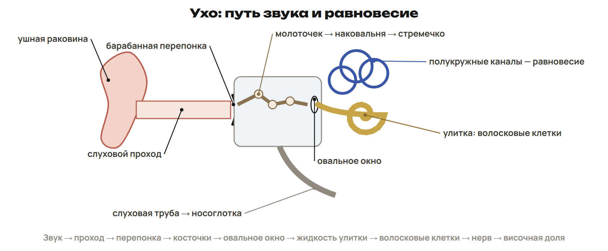

## 1. Нервная система, нейрон и контакт

Нервная система воспринимает раздражители, обрабатывает информацию и координирует органы. У простейших и губок нервной системы нет. Типы её устройства различаются.

| Тип | Пример и строение |
|---|---|
| Диффузная, или сетевидная | Гидра: сеть клеток без центрального узла |
| Лестничная, или стволовая | Планария: головные узлы, продольные стволы и перемычки |
| Узловая | Кольчатые черви и членистоногие: узлы и брюшная цепочка; у моллюсков — узлы с иной организацией связей |
| Трубчатая | Хордовые: нервная трубка на спинной стороне; у позвоночных головной и спинной мозг |

У медуз сеть дополняется скоплениями нервных клеток. У головоногих моллюсков, например осьминога, развиты объединённые головные узлы. Нельзя переносить одну схему брюшной цепочки на всех беспозвоночных.

Нервная ткань содержит нейроны и нейроглию. Нейроны принимают и передают сигналы; глия поддерживает и защищает их, участвует в питании и образовании оболочек. Зрелые нейроны обычно не делятся, но способны изменять ветвление и связи. Главные свойства ткани — возбудимость и проводимость.

У нейрона есть тело с ядром, дендриты и аксон. В обычной схеме дендриты проводят к телу, аксон от тела к другой клетке. Миелин покрывает многие аксоны и помогает изоляции; нерв — пучок нервных волокон в ПНС, не отдельный нейрон.

Синапс — весь контакт передачи сигнала между клетками. В химическом синапсе медиатор выделяется из окончания, проходит через щель и действует на рецепторы следующей мембраны. Пресинаптическая мембрана, щель и постсинаптическая мембрана — разные части. Контакты бывают межнейронными, нервно-мышечными и нервно-железистыми; действие может быть возбуждающим или тормозным, в зависимости от медиатора и рецептора.

## 2. Импульс и миелин

Мембранный потенциал — разность электрических потенциалов между внутренней и наружной сторонами мембраны. У нейрона в покое внутри отрицательно: ориентир около −70 мВ относительно снаружи. Ионные градиенты поддерживаются, в том числе, натрий-калиевым насосом: 3Na⁺ наружу, 2K⁺ внутрь с затратой АТФ.

Потенциал действия — быстрое изменение мембранного потенциала возбудимой клетки. Оно связано с работой ионных каналов, а не с обращением направления насоса. По аксону распространяется последовательное возбуждение участков мембраны. Отрицательный покой нельзя путать с амплитудой изменения потенциала.

В ПНС миелин образуют шванновские клетки. Между участками миелина — перехваты Ранвье. Учебные ориентиры скорости: миелинизированное волокно до 120 м/с, безмиелиновое около 0,5 м/с; точное значение зависит от волокна и условий.

> [!example] Модель времени проведения
> Путь по волокну 0,24 м, скорость 80 м/с: t = s/v = 0,24/80 = 0,003 с = 3 мс.
> Это время прохождения заданного участка; синаптические и другие задержки сюда не включены.

Электрические органы скатов и электрического угря создают разряды для защиты и нападения. Электрорецепторы воспринимают поле, не вырабатывают мощный разряд. Боковая линия рыб воспринимает механические изменения воды. ЭЭГ регистрирует электрическую активность мозга, ЭКГ — сердца.

## 3. ЦНС, ПНС и спинной мозг

По расположению ЦНС — головной и спинной мозг; ПНС — нервы и узлы вне ЦНС. У человека 12 пар черепных и 31 пара спинномозговых нервов. По функции различают чувствительные нейроны, вставочные и двигательные.

Спинной мозг лежит в позвоночном канале, защищён оболочками и жидкостью. В нём 31 сегмент, центральный канал; серое вещество внутри, белое снаружи. Серое содержит преимущественно тела и дендриты, белое — преимущественно миелинизированные аксоны проводящих путей. Спинной мозг проводит сигналы и участвует в рефлексах.

Задний корешок проводит чувствительный сигнал к ЦНС; тела этих чувствительных нейронов лежат в спинномозговом узле вне спинного мозга. Задние рога принимают и обрабатывают вход. В передних рогах находятся тела двигательных нейронов; их аксоны выходят через передние корешки. После слияния корешков нерв смешанный. В отдельных отделах есть боковые рога с вегетативными нейронами.

> [!trap] Корешок, рог и узел
> Задний корешок — чувствительный вход, передний — двигательный выход. Чувствительные тела в узле — не то же самое, что задний рог. В головном мозге серое вещество есть и в наружной коре, и во внутренних ядрах.

## 4. Головной мозг и управление органами

В школьной схеме пять отделов: передний, промежуточный, средний, задний (мост и мозжечок), продолговатый. Кора больших полушарий образована серым веществом, имеет борозды и извилины. Внутри мозга есть белые пути и серые ядра. Масса мозга не служит мерой интеллекта.

| Отдел | Основная связь с функцией |
|---|---|
| Продолговатый | Дыхание, сердцебиение, пищеварительные и защитные рефлексы: глотание, кашель, чихание |
| Мост | Проведение и связи между отделами |
| Мозжечок | Координация движений и поддержание тонуса |
| Средний | Ориентировочные реакции на свет/звук, мышечный тонус, зрачковые реакции |
| Промежуточный | Голод, жажда, температура, сон и интеграция сигналов |
| Большие полушария и кора | Движения, чувствительность, память, мышление, речь |

Четыре доли коры: лобная — произвольные движения, поведение, мышление, речь; теменная — кожно-мышечная чувствительность; височная — слух; затылочная — зрение. Функции распределены по сетям, таблица выделяет главные учебные соответствия. Двигательные пути в основном перекрещены: правое полушарие связано с левой стороной тела и наоборот.

Соматическая система связана с чувствительностью кожи и работой скелетных мышц; включает и непроизвольные рефлексы. Вегетативная управляет внутренними органами. Симпатическое влияние обычно учащает сердце, расширяет зрачки и бронхи, угнетает пищеварительную активность. Парасимпатическое обычно замедляет сердце и усиливает пищеварение. Крупный парасимпатический путь — блуждающий нерв; центры есть в стволе мозга и крестцовом отделе спинного мозга.

## 5. Рефлекс и дуга

Рефлекс — ответ на раздражение с участием ЦНС. Его путь: рецептор → чувствительный нейрон → нервный центр ЦНС → двигательный нейрон → рабочий орган. Рецептор воспринимает сигнал, чувствительное звено ведёт к центру, двигательное — от центра к мышце или железе.

В дуге отдёргивания есть вставочные нейроны. Основная дуга коленного рефлекса может содержать прямую связь чувствительного с двигательным: нервный центр сохраняется, отдельный вставочный не обязателен. Рецептор коленного рефлекса расположен в мышце, реагирует на растяжение. Пять функциональных звеньев — не требование пяти нейронов.

> [!example] Где нарушился путь
> Если перерезан задний корешок данной дуги, сигнал не входит в ЦНС этим путём. Если повреждён передний двигательный выход, чувствительный вход может сохраниться, но мышца не получит команду по нему. В опыте остальные пути считаются сохранными.

Безусловные рефлексы врождённые: например коленный и защитное отдёргивание. Условные приобретаются: в опыте И. П. Павлова нейтральный свет или звук многократно сочетают с пищей, после чего сигнал сам вызывает слюноотделение. Пища и ответ на неё — безусловная основа; выученный сигнал — условный. Без подкрепления выученная реакция может угасать. В школьной модели условные рефлексы связаны с работой коры. Инстинкт — сложная врождённая последовательность действий, связанная с безусловными реакциями.

> [!trap] Произвольность не определяет всю соматическую систему
> Отдёргивание может произойти до осознанного решения. Условный рефлекс не наследуется как уже выученная связь. Вставочный нейрон нужен не в каждой основной рефлекторной дуге.

## 6. Рецепторы и органы чувств

Рецептор превращает действие определённого раздражителя в сигнал. Для зрения важны фоторецепторы, для слуха и равновесия — механорецепторы. Кожные рецепторы воспринимают прикосновение/давление, температуру и повреждающее воздействие; ноцицепторы связаны с болью. Рецепторы мышц, сухожилий и суставов дают информацию о положении тела. Обонятельные и вкусовые сигналы связаны с химическими веществами.

Глаз имеет наружную склеру с прозрачной роговицей, среднюю сосудистую оболочку с радужкой, внутреннюю сетчатку. Зрачок — отверстие радужки; на свету обычно сужается. Свет: роговица → жидкость передней камеры → зрачок → хрусталик → стекловидное тело → сетчатка. Хрусталик с помощью ресничной мышцы меняет кривизну — аккомодация. На сетчатке получается перевёрнутое изображение, обработку выполняет мозг.

Палочки с родопсином чувствительны при слабом освещении, колбочки обеспечивают цветное зрение. Пигменты колбочек в школьной записи называют йодопсином. В центральной ямке жёлтого пятна преобладают колбочки; слепое пятно в месте выхода зрительного нерва не содержит фоторецепторов. Сигнал по зрительному пути достигает затылочной коры.

Близорукость: фокус перед сетчаткой, коррекция рассеивающей (двояковогнутой) линзой. Дальнозоркость: фокус позади сетчатки при рассматриваемых условиях, собирающая (двояковыпуклая) линза. Возрастное снижение аккомодации — отдельный механизм, не определение любой дальнозоркости. Дальтонизм — нарушение цветоразличения. Конъюнктивит — воспаление слизистой оболочки глаза, не самой роговицы. Для зрения важен достаток витамина A; большие дозы не являются способом улучшения зрения.

Наружное ухо: раковина и слуховой проход; барабанная перепонка — граница со средним ухом. Среднее ухо содержит молоточек, наковальню и стремечко; слуховая труба соединяет полость с носоглоткой и выравнивает давление. Стремечко действует на овальное окно. Внутреннее ухо содержит улитку с волосковыми клетками и вестибулярный аппарат с мешочками и тремя полукружными каналами.

Звук: слуховой проход → перепонка → молоточек → наковальня → стремечко → овальное окно → жидкость улитки → волосковые клетки → слуховой нерв/пути → височная кора. Вестибулярные рецепторы связаны с равновесием и координацией; слуховая труба не проводит звук к коре как нерв.

> [!rule] Факты ЕНТ недели
> - Гидра — диффузная НС, планария — лестничная (стволовая), кольчатые черви — узловая, хордовые — трубчатая.
> - Дендриты обычно проводят к телу нейрона, аксон — от тела к другим клеткам.
> - У человека 12 пар черепных и 31 пара спинномозговых нервов.
> - Задние корешки чувствительные, передние двигательные; после соединения нерв смешанный.
> - Продолговатый мозг связан с дыханием и сердцебиением, мозжечок — с координацией движений.
> - Затылочная доля коры — зрение, височная — слух, теменная — кожная чувствительность, лобная — движения/мышление/речь.
> - Палочки с родопсином обеспечивают сумеречное зрение, колбочки с йодопсином — цветное.
> - Косточки среднего уха идут по порядку: молоточек → наковальня → стремечко.

> [!try] Перед вариантом
> Проследи путь от кожного рецептора при касании горячего предмета до мышцы, затем сопоставь путь света с долей коры. Объясни, где механическое или световое воздействие становится нервным сигналом.
