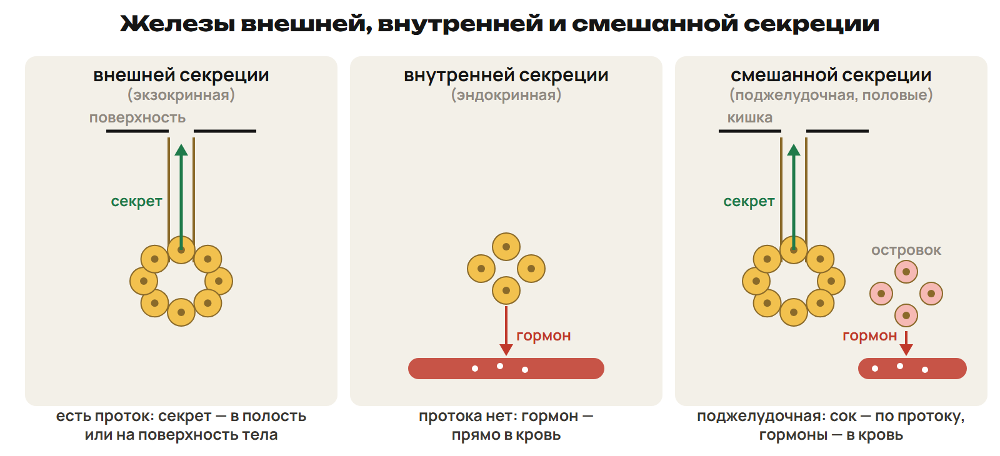
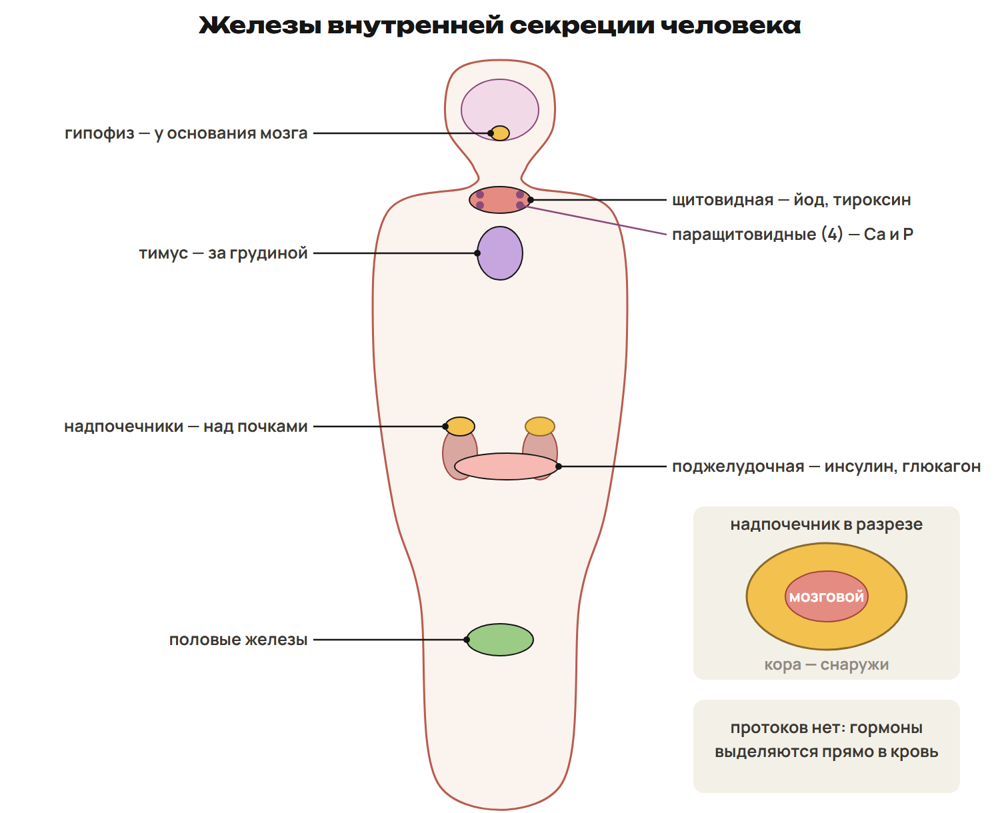
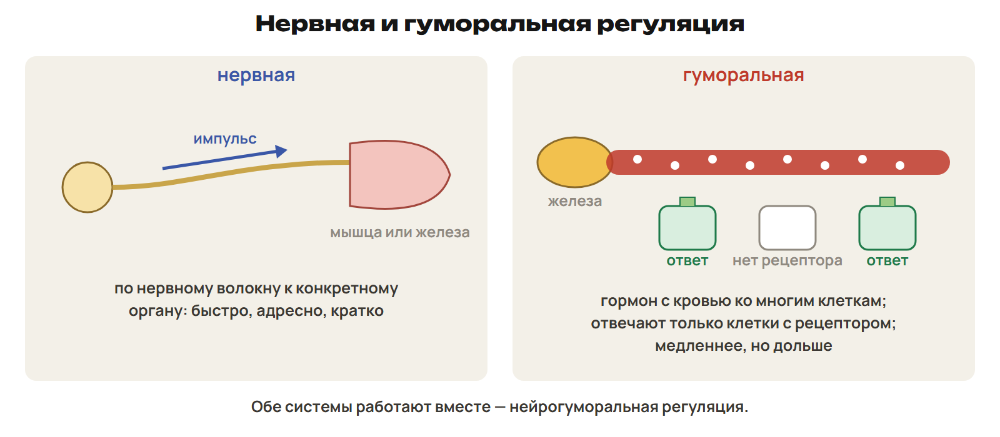

# Куда выделяется секрет
? Как отличить три типа желёз по пути секрета?
↳ Орган выделяет вещество. Проследим, куда оно попадает.
> 0–7 причина, три пути и схема; 7–10 L1; 10–12 ключ.

## Понятие: Секрет и проток
Секреция — синтез и выделение веществ клетками железы.
Выделяемое вещество — секрет.
Экзокринная железа: секрет по протоку в полость органа или на поверхность тела.
Эндокринная: протока нет, гормон поступает в кровь.
Смешанная сочетает обе функции.

## Схема: Три направления

## Пример: Один орган — два пути
Слюнная, слёзная, потовая железы и печень — внешняя секреция.
Гипофиз, щитовидная и надпочечники — внутренняя секреция.
Поджелудочная: сок по протоку в двенадцатиперстную кишку.
Её инсулин и глюкагон поступают в кровь.
Половые железы образуют половые клетки и выделяют гормоны в кровь.
> Не считать «два типа смешанных желёз» двумя отдельными органами. При классификации сначала назвать путь секрета.

## Практика: L1
У железы X секрет по протоку выходит на поверхность кожи.
У железы Y протока нет, её гормон обнаруживается в крови.
Определи тип X и Y. Назови по одному примеру.
Почему наличие гормонов у поджелудочной не делает её только эндокринной?
Ответы:
X — внешняя секреция, например потовая; Y — внутренняя, например щитовидная.
У поджелудочной есть и протоковая ветвь: пищеварительный сок в кишку.
Поэтому железа смешанная.
> 7–10 попытка, 10–12 ключ.

# Гормон, железа и возраст
? Почему избыток одного гормона даёт разные нарушения в разном возрасте?
↳ Путь секрета определён. Свяжем гормон с железой и его действием.
> 12–22 гормоны, гипофиз и щитовидная; 22–25 L2; 25–28 ключ.

## Понятие: Гормон и клетка-мишень
Гормоны — биологически активные вещества, действующие в малых количествах.
Кровь переносит гормон; отвечают клетки с подходящим рецептором.
Гипофункция — недостаточная выработка гормона.
Гиперфункция — избыточная выработка.
Гуморальная регуляция использует жидкости организма и возникла раньше нервной.
> Не приравнивать распространение с кровью к одинаковому действию на все клетки.

## Схема: Железы на карте тела

## Понятие: Гипофиз и соматотропин
Гипофиз расположен у основания головного мозга.
Он регулирует работу многих эндокринных желёз и связан с гипоталамусом.
Соматотропин — гормон роста.
Недостаток в детстве — гипофизарная карликовость.
Избыток в детстве — гигантизм; у взрослого — акромегалия.
> Не переносить влияние гипофиза на абсолютно все эндокринные органы. Возраст — часть условия задачи.

## Понятие: Щитовидная железа и тироксин
Для синтеза тироксина нужен йод; тироксин регулирует основной обмен.
Йододефицит может вызвать эндемический зоб.
Тяжёлый ранний дефицит тиреоидных гормонов нарушает развитие: исторический термин «кретинизм».
Выраженная гипофункция у взрослого связана с микседемой.
Базедова болезнь — пример заболевания с избытком тиреоидных гормонов.
> Зоб бывает при разных причинах, а гипертиреоз — не только при базедовой болезни. По одному симптому диагноз не устанавливать.

## Практика: L2
В условии задан избыток соматотропина: в случае X до завершения роста, в Y у взрослого.
Назови соответствующие нарушения.
Какой элемент нужен для синтеза тироксина?
Почему увеличенная щитовидная железа сама по себе не доказывает избыток тироксина?
Ответы:
X — гигантизм; Y — акромегалия. Для тироксина нужен йод.
Увеличение железы — зоб; оно возможно при разных причинах и уровнях гормонов.
Для вывода о гиперфункции нужны дополнительные данные.
> 22–25 попытка, 25–28 ключ.

# Кальций, иммунитет и надпочечники
? Можно ли приписать всем частям одной железы одинаковые гормоны?
↳ Возраст меняет последствия гормона роста. Теперь разделим органы и их слои.
> 28–36 паращитовидные, тимус, два слоя надпочечников; 36–39 L3; 39–42 ключ.

## Понятие: Паращитовидные и тимус
Паращитовидные железы обычно расположены на задней поверхности щитовидной.
Паратгормон участвует в регуляции обмена кальция и фосфора.
Его недостаток может снизить кальций крови и вызвать судороги.
При избытке усиливается выход кальция из костей.
Тимус находится за грудиной; тимозин связан с созреванием T-лимфоцитов.
> Не путать паратгормон с тироксином. Не делать ломкость костей обязательным признаком недостатка паратгормона.

## Понятие: Кора и мозговой слой
Кора надпочечников выделяет кортикоиды.
Минералокортикоиды регулируют обмен Na, K, воды и солей.
Глюкокортикоиды влияют на обмен белков и углеводов.
Мозговой слой выделяет адреналин и норадреналин.
Адреналин участвует в срочном ответе на стресс.
> Глюкокортикоиды и адреналин не производятся одним и тем же слоем.

## Практика: L3
Соответствие: А — паратгормон; Б — тимозин.
1 — щитовидная; 2 — паращитовидные; 3 — тимус; 4 — мозговой слой надпочечников.
Запиши две пары. Затем назови слой для кортикоидов и для адреналина.
Ответы:
А2 Б3. Кортикоиды — кора; адреналин — мозговой слой надпочечников.
Паратгормон связан с кальцием, тимозин — с созреванием T-лимфоцитов.
> 36–39 попытка, 39–42 ключ.

# Поджелудочная и половые железы
? Как два гормона одной железы меняют один показатель в разные стороны?
↳ Слои надпочечника различаются по гормонам. В поджелудочной различим два противоположных сигнала.
> 42–48 инсулин, глюкагон и половые гормоны; 48–51 L4; 51–54 ключ.

## Понятие: Инсулин и глюкагон
Инсулин снижает глюкозу крови: усиливает её использование и запасание.
В печени и мышцах образуется гликоген — запасной полисахарид.
Глюкагон повышает глюкозу крови, в том числе через распад гликогена печени.
Гликоген и глюкоза — разные вещества.
Недостаток инсулина — одна из причин сахарного диабета.
> Не сводить все формы сахарного диабета только к отсутствию инсулина. Гликоген мышц не выделяется в кровь как готовая глюкоза под действием глюкагона.

## Понятие: Половые железы
Половые железы образуют половые клетки и гормоны.
Семенники выделяют тестостерон.
Яичники выделяют эстрадиол и прогестерон.
Половые гормоны участвуют в формировании вторичных половых признаков.
> Половые железы сочетают образование половых клеток с эндокринной функцией; не обобщать протоковый путь сперматозоидов на яйцеклетку. Подробности полового созревания рассматривать в соответствующей теме.

## Практика: L4
Ученик записал: «Глюкагон запасает глюкозу, а инсулин повышает её в крови».
Исправь оба действия.
Назови запасной углевод печени и его класс.
Почему половые железы относят к смешанным?
Ответы:
Инсулин снижает глюкозу и способствует образованию гликогена.
Глюкагон повышает глюкозу, стимулируя распад гликогена печени.
Гликоген — полисахарид. Половые железы образуют половые клетки и выделяют гормоны в кровь.
> 48–51 попытка, 51–54 ключ.

# Два способа передать команду
? Почему сигнал с кровью действует избирательно, хотя разносится широко?
↳ Гормоны связаны с конкретными эффектами. Сравним их путь с нервным импульсом.
> 54–62 нервная, гуморальная и совместная регуляция; 62–65 L5; 65–68 ключ.

## Схема: Нервная и гуморальная

## Понятие: Сравни по четырём признакам
Нервная: импульсы по нервным путям; адресный сигнал к органу.
Обычно действует быстро, ответ часто кратковременный.
Гормональная: гормон переносится кровью к клеткам-мишеням.
Обычно разворачивается медленнее и действует дольше.
Нейрогуморальная регуляция — совместная работа обеих систем.
> Это сравнительная школьная модель, а не запрет быстрых гормональных или длительных нервных эффектов. Рецептор задаёт избирательность гормона.

## Пример: Общая задача, разные пути
Нервное влияние быстро меняет частоту сокращений сердца.
Адреналин приходит с кровью и тоже усиливает работу сердца.
Он также расширяет бронхиолы и повышает глюкозу крови.
Различай путь сигнала и конечный эффект.
> Одинаковый эффект не означает одинаковый механизм передачи команды.

## Практика: L5
В опыте X к мышце приходит импульс по нервному волокну.
В опыте Y гормон достигает нескольких органов с кровью.
Назови тип регуляции X и Y и обычное различие по длительности.
Почему в Y отвечают не все клетки тела?
Ответы:
X — нервная, Y — гуморальная, в данном случае гормональная.
Гормональный ответ обычно длительнее; нервный часто короче.
Отвечают клетки с подходящими рецепторами.
> 62–65 попытка, 65–68 ключ.

# Стресс и две ветви ответа
? Как один сильный раздражитель включает нервный и гормональный ответы?
↳ Системы работают совместно. Разделим два пути ответа на стресс.
> 68–77 стресс и алгоритм двух ветвей; 77–82 L6; 82–87 ключ; 87–90 выход и домашний маршрут.

## Понятие: Неспецифическая реакция
Стресс — неспецифическая реакция организма на сильное воздействие.
Его вызывают, например, травма, холод, жара или сильные эмоции.
Ответ помогает сохранять гомеостаз.
В нём совместно участвуют нервная и эндокринная системы.
> Неспецифичность означает общие механизмы ответа, а не полное равенство реакций на любые раздражители.

## Пример: Раздели две ветви
Сильное воздействие → рецепторы и нервные центры.
Симпатическая ветвь → мозговой слой надпочечников → адреналин.
Гипоталамус → гипофиз → АКТГ → кора надпочечников → глюкокортикоиды.
При срочном ответе сердце работает чаще, растёт доступность глюкозы.
Для задачи: найти путь → назвать слой → назвать гормон → связать с эффектом.
> АКТГ преимущественно регулирует кору; не проводить от него прямую основную стрелку к выделению адреналина мозговым слоем.

## Практика: L6
В цепочке X: гипоталамус → гипофиз → АКТГ → ... → глюкокортикоиды.
В цепочке Y: симпатические нервы → ... → адреналин.
Восстанови пропуски и объясни, почему это нейрогуморальная регуляция.
Исправь вывод: «При стрессе адреналин образуется в коре».
Ответы:
X — кора надпочечников; Y — мозговой слой.
Нервные сигналы запускают работу эндокринных желёз; гормоны переносятся кровью.
Адреналин образуется в мозговом слое, кортикоиды — в коре.
> 77–82 попытка, 82–87 ключ; ключ открывать после ответа на обе ветви.

## Дома: После урока 21
Прочитай конспект 1–3 после урока: 25 минут.
Выполни P1–P6 за 20 минут и общую часть G за 35 минут.
В тестах пришли строку букв; в G9–G10 — фото хода решения.
Отметь вопрос, который нужно разобрать на втором уроке.
До первого урока чтение не требуется.
