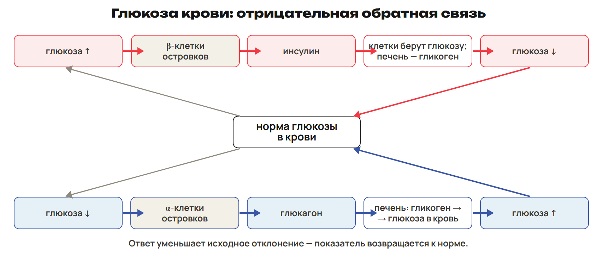
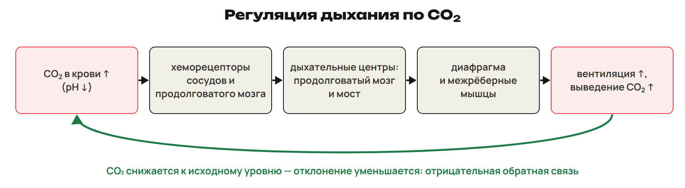
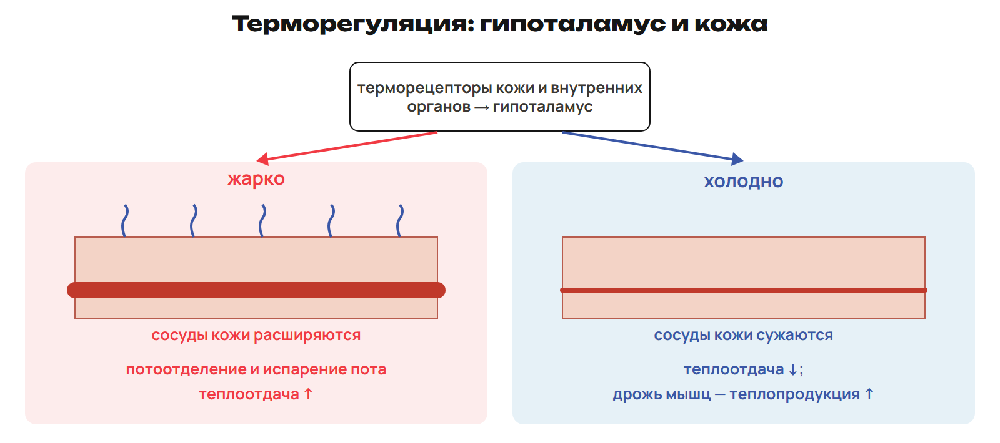
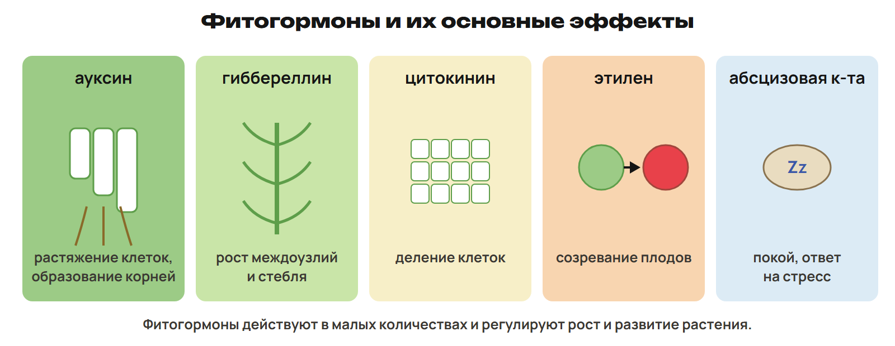
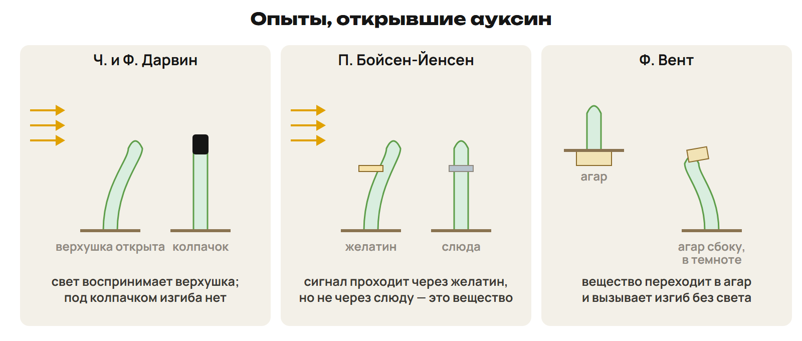
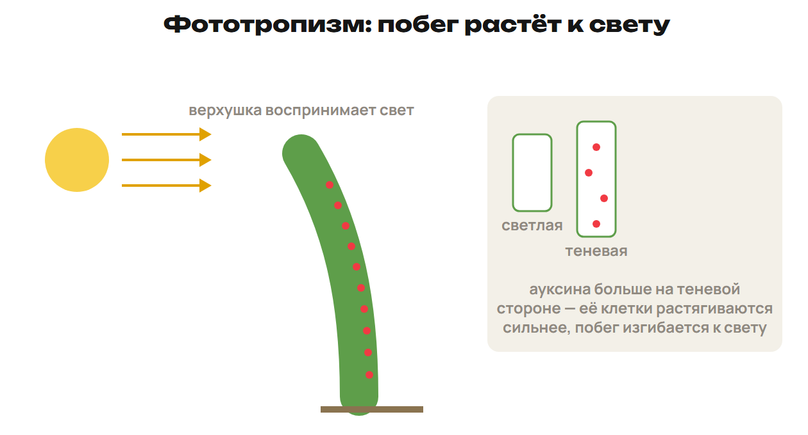
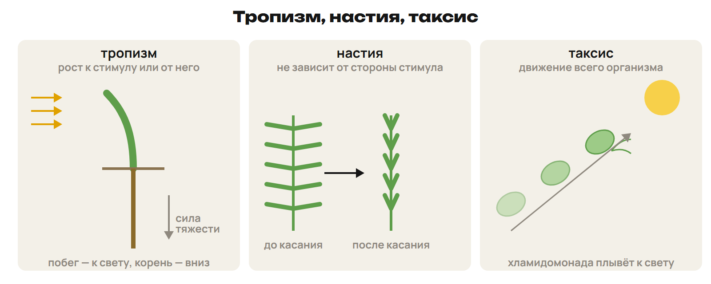

Тебе стало жарко — кожа покраснела и выступил пот. Побег оказался у окна — через время изогнулся к свету. В обоих случаях есть изменение условий, сигнал и ответ. На этой неделе научимся находить каждое звено.

После урока 21 прочитай разделы 1–3 за 25 минут, выполни P и всю G. Разделы 4–6 разберём на уроке 22; после него выполни один назначенный вариант A/B/C.

## 1. Железа: сначала найди путь секрета

Железа синтезирует и выделяет вещества. Выделение называют секрецией, выделяемое вещество — секретом. Тип железы определяет путь секрета: по протоку или во внутреннюю среду.

> [!rule] Как определить тип
> Найди проток → установи, куда поступает секрет → проверь, есть ли у железы ещё гормональная функция.

| Тип | Куда поступает секрет | Примеры |
|---|---|---|
| Внешняя секреция, экзокринная | По протоку на поверхность тела или в полость органа | Слюнные, слёзные, потовые, сальные, молочные; печень, железы желудка и кишечника |
| Внутренняя секреция, эндокринная | Без выводного протока во внутреннюю среду, затем в кровь | Гипофиз, щитовидная, паращитовидные, тимус, надпочечники |
| Смешанная секреция | Есть внешнесекреторная и эндокринная функции | Поджелудочная и половые железы |

У поджелудочной пищеварительный сок идёт по протоку в двенадцатиперстную кишку. Инсулин и глюкагон поступают в кровь. У половых желёз образование и выведение половых клеток сочетаются с выделением гормонов в кровь.

Гормоны — биологически активные вещества, которые в малых количествах меняют работу клеток-мишеней. Кровь разносит гормон широко, но ответ дают клетки с подходящими рецепторами. Гормон — сигнал, а не пищеварительный сок.

Гуморальная регуляция передаёт сигналы через жидкости организма: кровь, лимфу, тканевую жидкость. Она возникла раньше нервной. У растений действуют фитогормоны; у членистоногих есть гормональная регуляция линьки и роста.

> [!example] Два секрета одного органа
> У железы обнаружены пищеварительный сок в протоке и гормон в крови. Это смешанная секреция. Наличие протока не отменяет гормональную функцию.

> [!trap] «Внутрь тела» не равно «в кровь»
> Сок в полости кишечника — внешняя секреция. Эндокринный секрет поступает во внутреннюю среду без выводного протока. К смешанным относят поджелудочную и половые железы: это названия групп, а не число отдельных органов.

> [!try] Проверь путь
> Слюна поступила в ротовую полость по протоку. Какой это тип секреции? Какой признак нужно добавить к описанию железы, чтобы назвать её смешанной?

## 2. Гормон → железа → действие → нарушение

Избыток и недостаток сигнала дают разные последствия. Сначала назови гормон и железу, затем направление изменения. Для гормона роста обязательно учти возраст.

Гипофиз расположен у основания головного мозга и связан с гипоталамусом. Его гормоны регулируют рост и работу ряда эндокринных желёз. Уровень глюкозы может действовать непосредственно на гормональные клетки поджелудочной.

| Железа и гормон | Основное действие | Что различать |
|---|---|---|
| Гипофиз — соматотропин | Рост тела | Недостаток в детстве — гипофизарная карликовость; избыток в детстве — гигантизм; избыток у взрослого — акромегалия |
| Щитовидная — тироксин | Регуляция основного обмена; в состав входит йод | Недостаток гормонов у взрослого — гипотиреоз, выраженная форма — микседема; базедова болезнь сопровождается избытком тиреоидных гормонов |
| Паращитовидные — паратгормон | Обмен кальция и фосфора; повышение кальция крови | Недостаток может снизить кальций крови и вызвать судороги; избыток усиливает потерю кальция костями |
| Тимус — тимозин | Созревание T-лимфоцитов | Железа за грудиной, особенно развита в детстве |
| Кора надпочечников — минералокортикоиды | Обмен Na⁺, K⁺ и воды | Связь с водно-солевым балансом |
| Кора надпочечников — глюкокортикоиды | Обмен белков и углеводов, участие в стрессовом ответе | Отделять от гормонов мозгового слоя |
| Мозговой слой надпочечников — адреналин и норадреналин | Мобилизация при стрессе | Адреналин учащает сердцебиение, повышает глюкозу крови, расширяет бронхиолы |
| Поджелудочная — инсулин и глюкагон | Инсулин снижает, глюкагон повышает глюкозу крови | Гормоны действуют противоположно |
| Половые железы — тестостерон, эстрадиол, прогестерон | Регуляция половой системы и развития половых признаков | Гормональная функция сочетается с образованием половых клеток |

Паращитовидных желёз обычно четыре; они лежат на задней поверхности щитовидной. Надпочечники находятся над почками, но их гормоны действуют и на другие органы.

Для синтеза тироксина нужен йод. При недостатке йода может развиваться эндемический зоб. Тяжёлый дефицит тиреоидных гормонов в раннем детстве нарушает рост и развитие нервной системы; историческое название такого состояния — кретинизм. Увеличение щитовидной железы бывает и по другим причинам.

Микседема связана с выраженным недостатком тиреоидных гормонов у взрослого. Базедова болезнь — заболевание с усиленной работой щитовидной железы. По одной зябкости или частому пульсу причину не определяют: в задаче она должна быть указана.

Инсулин способствует использованию глюкозы клетками и запасанию её в форме гликогена в печени и мышцах. Сам инсулин не превращает одну молекулу в другую: это делают клеточные ферменты. Глюкагон стимулирует распад гликогена в печени и выход глюкозы в кровь. Гликоген — запасной полисахарид. Недостаток действия инсулина связан с сахарным диабетом.

> [!example] Один гормон, разный возраст
> В условии дан избыток соматотропина после завершения роста костей в длину. Увеличиваются кисти, стопы и кости лица — акромегалия. При избытке этого гормона у растущего ребёнка ожидают гигантизм.

> [!trap] Не подменяй причину внешним признаком
> Малый рост имеет разные причины. «Гипофизарная карликовость» относится к недостатку соматотропина в детстве. Не любой зоб означает недостаток йода. Кора надпочечников выделяет кортикоиды, мозговой слой — адреналин и норадреналин.

> [!try] Собери тройки
> Соедини «паратгормон — железа — регулируемый ион» и «тимозин — железа — клетки иммунитета». Затем объясни, почему одинаковое слово «надпочечники» ещё не указывает точный гормон.

## 3. Нервный и гуморальный пути работают вместе

Нервный импульс быстро достигает определённого адресата. Гормон переносится жидкостями и может действовать на разные органы. Вместе эти пути дают нейрогуморальную регуляцию.

| Признак | Нервная регуляция | Гуморальная регуляция |
|---|---|---|
| Сигнал и путь | Импульсы по нервным волокнам, передача через синапсы | Химические вещества, в том числе гормоны, через жидкости |
| Обычная скорость | Быстрее | Часто медленнее нервной |
| Обычная длительность | Чаще кратковременная | Часто более длительная |
| Адресат | Клетки, связанные нервным путём | Клетки с подходящими рецепторами |
| Пример | Команда двигательному нейрону и сокращение мышцы | Действие гормона на обмен веществ |

Скорость и длительность помогают сравнивать типичные пути, но не заменяют поиск сигнала. Гормональные эффекты бывают быстрыми, а нервное влияние может поддерживаться долго.

Стресс — общий ответ на сильное воздействие, например холод, жару, травму или эмоциональную нагрузку. Он мобилизует ресурсы и помогает поддержать внутреннюю среду. Выраженность ответа зависит от силы и длительности воздействия и состояния организма.

> [!rule] Две ветви стрессового ответа
> Быстрая ветвь: нервные центры → симпатический отдел → мозговой слой надпочечников → адреналин.
> Другая ветвь: гипоталамус → гипофиз → АКТГ → кора надпочечников → глюкокортикоиды.

Адреналин учащает работу сердца и помогает повысить доступность глюкозы. Симпатический отдел усиливает кровоснабжение работающих мышц. Глюкокортикоиды участвуют в более длительной перестройке обмена. Нервный запуск и гормональный ответ связаны, но пути к коре и мозговому слою различаются.

> [!example] Как распознать взаимодействие
> Команда по симпатическому нерву запускает выделение адреналина в кровь. Начало пути нервное, дальнейшее действие гормональное. Вся цепочка — нейрогуморальная.

> [!trap] Гормон тоже имеет адрес
> Разносится кровью — не значит действует на любую клетку. АКТГ направлен прежде всего на кору надпочечников; выделение адреналина мозговым слоем запускает симпатическая система.

> [!try] Перед G
> В первой цепочке сигнал идёт по нервному волокну к мышце, во второй гормон поступает в кровь. Назови путь каждой. Затем восстанови обе ветви стрессового ответа без таблицы.

## 4. Гомеостаз: ответ уменьшает исходное отклонение

Внутренняя среда постоянно меняется из-за обмена веществ и внешних условий. Гомеостаз — поддержание её показателей в допустимых пределах. Это динамическое равновесие, а не отсутствие колебаний.

> [!rule] Алгоритм отрицательной обратной связи
> Изменение показателя → воспринимающее звено, или рецептор → регулирующее звено, или центр → эффектор → ответ, уменьшающий исходное отклонение.
> В одной клетке могут сочетаться восприятие изменения и регуляция ответа. Отдельный участок мозга нужен не каждой петле.

**Глюкоза.** Её повышение воспринимают β-клетки островков поджелудочной: они выделяют инсулин. Клетки используют глюкозу, печень и мышцы запасают её как гликоген. Глюкоза крови снижается, стимул к выделению инсулина ослабевает. β-клетки здесь и воспринимают изменение, и регулируют гормональный выход; эффекторами служат клетки-мишени.

При снижении глюкозы α-клетки поджелудочной выделяют глюкагон. Он действует на печень: усиливается распад гликогена и выход глюкозы в кровь. Исходное снижение уменьшается. Гликоген мышц служит прежде всего собственным нуждам мышц.

**CO₂.** Рост CO₂ и связанное с ним снижение pH воспринимают хеморецепторные системы. Периферические рецепторы находятся в аортальных и каротидных тельцах; центральные связаны с продолговатым мозгом. Дыхательные центры продолговатого мозга и моста меняют команды диафрагме и межрёберным мышцам. Вентиляция усиливается, выведение CO₂ возрастает, исходное отклонение уменьшается.

В обычной регуляции дыхания важный стимул — повышение CO₂, а не только уменьшение O₂. Рецепторы растяжения лёгких могут передавать сигналы по блуждающему нерву и ограничивать вдох.

**Температура.** Терморецепторы кожи и внутренних областей передают информацию гипоталамусу. При перегреве усиливаются потоотделение и кожный кровоток. Испарение пота и перенос тепла к коже помогают охладить тело. При охлаждении ответы направлены на сохранение и образование тепла.

**Вода — повторение.** При недостатке воды повышается концентрация растворённых веществ и осмотическое давление. Осморецепторы гипоталамуса воспринимают изменение, усиливается выделение АДГ из задней доли гипофиза. АДГ действует на почку: больше воды реабсорбируется в собирательных трубочках. Вода сохраняется, осмотическое отклонение уменьшается. АДГ синтезируется в гипоталамусе.

> [!example] Найди последнее звено
> Если после роста CO₂ дыхание усилилось, но в ответе написано только «мышцы сократились», цепочка ещё не закончена. Добавь: больше CO₂ удаляется → его избыток уменьшается. Именно это показывает отрицательную обратную связь.

> [!trap] «Отрицательная» не значит вредная
> Название означает уменьшение исходного отклонения. После снижения глюкозы глюкагон повышает её — и это тоже отрицательная обратная связь.

> [!try] Заполни пять звеньев
> Восстанови водную петлю от недостатка воды до уменьшения осмотического отклонения. Отдельно назови воспринимающее звено, регуляцию и эффектор. Где в петле глюкозы их функции совмещены?

## 5. Терморегуляция: терять тепло или производить

Температура тела зависит от соотношения теплопродукции и теплоотдачи. Кожа меняет отдачу тепла, а обмен веществ и работа мышц — его образование.

| Условия | Ответ | Как помогает |
|---|---|---|
| Жарко | Расширяются сосуды кожи, растёт кожный кровоток | Тепло переносится к поверхности и легче отдаётся при подходящих условиях |
| Жарко | Усиливается потоотделение | Испарение пота забирает тепло |
| Холодно | Сужаются сосуды кожи | Меньше тепла переносится к поверхности |
| Холодно | Возникает дрожь — непроизвольные сокращения мышц | Усиливается теплопродукция |
| Холодно | Сокращаются мышцы, поднимающие волоски | Появляется «гусиная кожа»; у человека её теплоизоляционный эффект мал |

Физическая терморегуляция меняет теплоотдачу. Химическая меняет образование тепла при обмене веществ, в том числе в скелетных мышцах и печени. Доля теплопотерь через кожу и количество пота зависят от среды и нагрузки.

> [!example] Что именно охлаждает
> Пот выделился, но при высокой влажности плохо испаряется. Охлаждение слабее: тепло забирает испарение, а не сам факт появления капель на коже.

> [!trap] Два ответа холоду — разные механизмы
> Сужение кожных сосудов уменьшает теплоотдачу. Дрожь увеличивает теплопродукцию. Капилляр сам не имеет мышечной стенки: кровоток регулируют питающие его сосуды.

> [!try] Объясни без слова «норма»
> Почему после охлаждения одновременно могут появиться бледность кожи и дрожь? Для каждого ответа назови, какой член теплового баланса изменился.

## 6. Растения: сигнал, рост и направление движения

У растений нет нервной системы и специальных эндокринных желёз. Фитогормоны образуются в клетках, действуют в малых количествах и согласуют рост и развитие. Результат зависит от органа, концентрации и сочетания сигналов.

| Фитогормон | Основной эффект для различения |
|---|---|
| Ауксин, индолилуксусная кислота — ИУК | Растяжение клеток побега, стимуляция корнеобразования |
| Гиббереллин | Удлинение стебля и междоузлий; у ряда растений способствует переходу к цветению |
| Цитокинин | Деление клеток, развитие побегов |
| Этилен | Созревание плодов, участие в старении |
| Абсцизовая кислота, АБК | Покой и ответы на неблагоприятные условия |

Ауксин, гиббереллин и цитокинин часто связывают со стимуляцией роста; этилен и АБК — с его ограничением. Это сравнение основных эффектов, а не правило «один гормон всегда ускоряет всё». Ауксин образуется в верхушке побега и молодых листьях и переносится к основанию. Корни тоже способны синтезировать ауксин.

### Как опыт раскрывает путь сигнала

Не путай наблюдение и вывод. Закрыли верхушку — это действие. Изгиб исчез — наблюдение. Верхушка нужна для восприятия одностороннего света — вывод.

| Опыт | Наблюдение | Вывод |
|---|---|---|
| Ч. и Ф. Дарвин: колеоптиль, непрозрачный колпачок на верхушке | Изгиб к одностороннему свету не возникает; при открытой верхушке возникает | Верхушка воспринимает световой сигнал, который влияет на рост ниже неё |
| Бойсен-Йенсен: между верхушкой и нижней частью желатин или слюда | Через желатин влияние передаётся, через непроницаемую преграду — нет | От верхушки передаётся подвижный химический сигнал |
| Ф. Вент: верхушка отдаёт вещество агаровой пластинке; блок кладут сбоку на срез | Возникает неравномерный рост и изгиб | Вещество можно собрать в агар; его асимметричное действие вызывает изгиб |

Опыты Бойсен-Йенсена относятся к 1913 году, Вента — к 1928 году. В 1934 году установили химическую природу ИУК. Агаровый опыт показывает действие ростового вещества; название молекулы устанавливают отдельно.

### Почему побег изгибается к свету

Одностороннее освещение → ауксин перераспределяется к теневой стороне → клетки побега там растягиваются сильнее → эта сторона удлиняется больше → побег изгибается к свету. Более длинная сторона оказывается снаружи изгиба.

### Как определить тип движения

Сначала спроси, перемещается ли весь организм. Если нет — зависит ли направление ответа от направления раздражителя? Затем определи, есть ли направленный рост.

| Тип | Признак | Пример |
|---|---|---|
| Тропизм | Направленный рост органа относительно раздражителя | Побег к свету — положительный фототропизм |
| Положительный геотропизм | Рост по направлению силы тяжести | Главный корень вниз |
| Отрицательный геотропизм | Рост против направления силы тяжести | Побег вверх |
| Хемотропизм | Направленный рост в ответ на химическое воздействие | Рост корня от вредного вещества — отрицательный |
| Настия | Направление движения не задаётся направлением раздражителя | Складывание листьев мимозы при касании, раскрывание цветка при изменении освещения |
| Таксис | Перемещение целой подвижной клетки или организма | Хламидомонада плывёт к свету |

Не все движения растения вызваны ростом. Быстрое складывание листьев мимозы связано с изменением тургора. Направление настии не зависит от того, с какой стороны подействовал раздражитель.

Свет, температура, воздух, вода и питание влияют на рост. Фотопериодизм — ответ на соотношение светлого и тёмного времени суток. В учебных примерах к короткодневным относят хлопок, табак, просо, кукурузу и рис; к длиннодневным — пшеницу, рожь, ячмень и овёс. Реакция зависит от сорта. Это группы по реакции на длину дня, а не по отношению к тени или теплу.

> [!example] Одна сторона растёт быстрее
> У побега правая сторона удлинилась сильнее левой. Он изогнётся влево. Если причина — боковой свет слева, это положительный фототропизм; больше ауксина в этой модели справа, в тени.

> [!trap] Не переноси ответ побега на любой орган
> Действие ауксина на корни зависит от концентрации и отличается от действия на побег. Цитокинин связывай с делением клеток, а корнеобразование — с ауксином. Настия имеет раздражитель, но её направление не задаётся направлением этого раздражителя.

> [!rule] Факты ЕНТ недели
> - Поджелудочная и половые железы — смешанной секреции: внешняя функция сочетается с выделением гормонов в кровь.
> - Щитовидная железа выделяет тироксин; для его синтеза нужен йод.
> - Соматотропин: недостаток в детстве — гипофизарная карликовость, избыток в детстве — гигантизм, у взрослого — акромегалия.
> - Кора надпочечников — кортикоиды; мозговой слой — адреналин и норадреналин.
> - Инсулин снижает глюкозу крови, глюкагон повышает её через действие на печень.
> - Дарвины — роль верхушки; Бойсен-Йенсен — передача химического сигнала; Вент — ростовое вещество в агаре.
> - В побеге ауксина больше с теневой стороны; главный корень имеет положительный, побег — отрицательный геотропизм.
> - Цитокинин — деление клеток; ауксин — корнеобразование; этилен — созревание плодов.

> [!try] Перед вариантом
> Восстанови петлю глюкозы и объясни её знак. Затем различи изгиб побега, складывание мимозы и плавание хламидомонады. Какое наблюдение в опыте Вента связывает вещество с неравномерным ростом?
