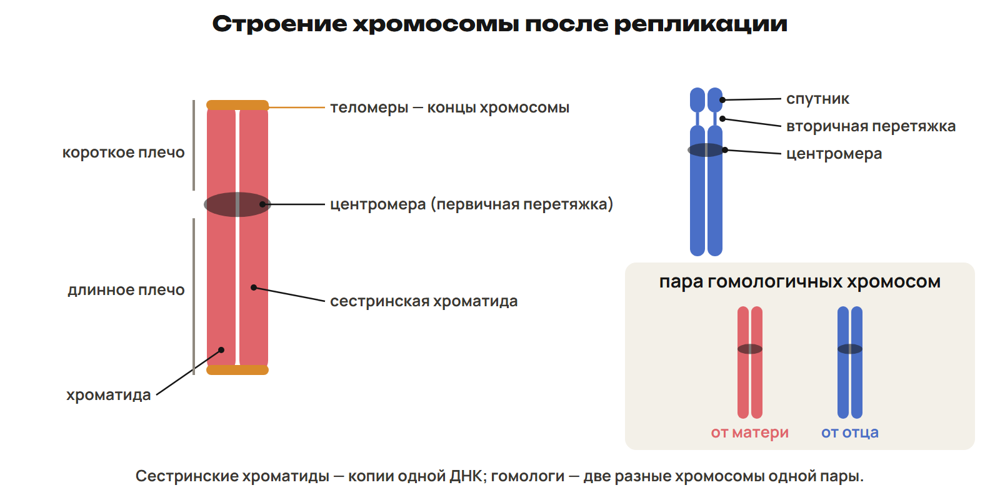
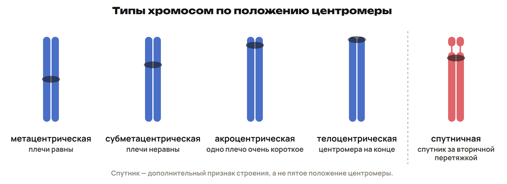
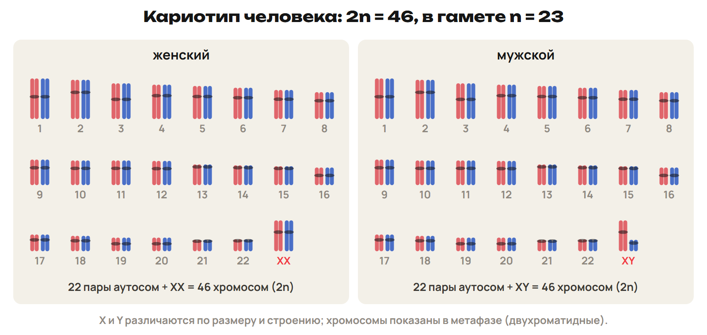
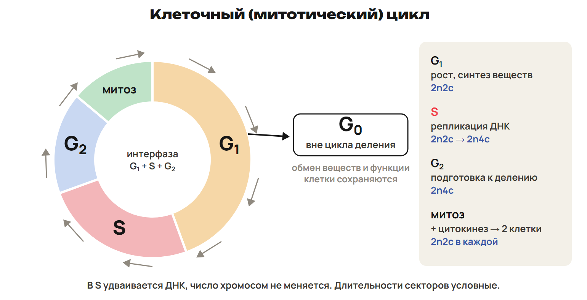

# Урок 23. Хромосомы, клеточный цикл и митоз

2 февраля 2027, вторник; 90 минут. Группы 18:00–19:30 и 19:30–21:00.

Причина → алгоритм → разные примеры → ловушка → самостоятельная попытка. Ключи L показывать после попытки. Предварительное чтение перед первым уроком не требуется.

## План на 90 минут

| Время | Действие |
|---|---|
| 0–12 | 0–6 хроматин, связь с ядром и ДНК; 6–9 L1; 9–12 ключ. |
| 12–28 | 12–22 строение, типы, гомологи и кариотип; 22–25 L2; 25–28 ключ. |
| 28–43 | 28–36 G₁, S, G₂, G₀ и обозначения n/c; 36–40 L3; 40–43 ключ. |
| 43–58 | 43–51 четыре фазы и биологическая роль; 51–55 L4; 55–58 ключ. |
| 58–74 | 58–65 счёт по границе и пример у полюса; 65–70 L5; 70–74 ключ. |
| 74–90 | 74–78 алгоритм и ловушка; 78–83 L6; 83–87 ключ; 87–90 домашний маршрут. |

## 1. Как упакована ДНК · 0–12 минут

**Вопрос:** Почему одну и ту же ДНК в интерфазе и при делении видно по-разному?

**Связка:** В ядре хранится наследственная информация. Проследим, как меняется её упаковка.

**Хроматин и хромосомы.** Хроматин — ДНК, связанная с гистоновыми и негистоновыми белками. В интерфазном ядре большая часть хроматина менее уплотнена. При делении хроматин конденсируется: хромосомы становятся хорошо видны. Эухроматин менее уплотнён и обычно активнее; гетерохроматин более уплотнён. Меняется упаковка наследственного материала, а не его химическая природа.

Не говорить, что в интерфазе хромосомы исчезают или что вся ДНК клетки обязательно читается одновременно.

**Одна молекула, два уровня описания.** ДНК — молекула, в которой записана наследственная информация. Хроматин — её комплекс с белками. Хромосома — отдельная структура этого комплекса. Хроматида содержит одну непрерывную двухцепочечную молекулу ДНК. После репликации у одной хромосомы две сестринские хроматиды.

### L1

Вспомни: какая цепь комплементарна фрагменту АТГГЦТ? Ученик решил: «В интерфазе хромосом нет, есть только свободная ДНК». Исправь это объяснение. Почему конденсация не равна репликации?

**Ответ и решение:** Комплементарный фрагмент — ТАЦЦГА. В интерфазе хромосомы существуют в менее конденсированном состоянии. ДНК связана с белками и образует хроматин. Конденсация уплотняет материал; репликация создаёт копии молекул ДНК.

**Типичная ошибка и новая проверка:** Смешать упаковку и удвоение или считать хроматин веществом без белков.

## 2. Хроматида, гомолог и кариотип · 12–28 минут

**Вопрос:** Чем две сестринские хроматиды отличаются от двух гомологичных хромосом?

**Связка:** Мы различили ДНК и её упаковку. Теперь найдём единицы, которые будем считать.

**Строение двухроматидной хромосомы.** 

**Не считать каждую хроматиду отдельной хромосомой.** Центромера — область первичной перетяжки; по её положению различают типы хромосом. Теломеры — концевые участки, защищающие хромосомы. Сестринские хроматиды — копии одной хромосомы после репликации. Гомологи — две хромосомы одной пары: отцовская и материнская. Они несут соответствующие гены, но могут иметь разные их варианты.

У реплицированной хромосомы две сестринские хроматиды, а не два гомолога. X и Y гомологичны лишь в ограниченных участках.

**Положение центромеры.** 

**Кариотип и число хромосом.** Кариотип — характерные число, размеры и строение хромосом. Идиограмма — графическое изображение кариотипа. Для исследования кариотипа используют метафазные хромосомы. У человека 2n = 46: 22 пары аутосом и одна пара половых хромосом. Типичные сочетания: XX у женщины и XY у мужчины; n = 23. Диплоидный набор дрозофилы — 8, шимпанзе — 48, речного рака — 196.

**Кариотип человека.** 

### L2

На схеме одна Х-образная реплицированная хромосома. Сколько у неё сестринских хроматид? Есть ли здесь пара гомологов? Почему при исследовании кариотипа выбирают метафазу? Сколько у человека пар аутосом и сколько половых хромосом в типичной соматической клетке?

**Ответ и решение:** Две сестринские хроматиды; это одна хромосома, не пара гомологов. В метафазе хромосомы конденсированы и хорошо различимы. У человека 22 пары аутосом и две половые хромосомы.

**Типичная ошибка и новая проверка:** Назвать каждую половину Х отдельной хромосомой или записать 23 пары аутосом.

## 3. Интерфаза: что именно удваивается · 28–43 минут

**Вопрос:** Как ДНК может удвоиться при прежнем числе хромосом?

**Связка:** Теперь считаем хромосомы и молекулы ДНК отдельно.

**Клеточный цикл.** 

**Три периода интерфазы.** G₁: рост, образование органоидов, накопление веществ и АТФ. S: репликация ДНК; к концу у каждой хромосомы две хроматиды. G₂: дальнейшая подготовка к делению, в том числе синтез белков веретена. Интерфаза и деление составляют цикл делящейся клетки. Её длительность зависит от типа и состояния клетки. В G₀ клетка не проходит очередной цикл деления, но остаётся живой и активной.

Не называть G₀ остановкой всей жизнедеятельности. Не закреплять одну долю времени интерфазы как универсальную для любых клеток.

**Две величины вместо одной.** n — гаплоидный набор хромосом; c — количество ДНК в таком наборе. Для диплоидной клетки до S: 2n2c. После завершённой репликации: 2n4c. Число хромосом остаётся 2n, количество ДНК удваивается. Одна хроматида соответствует одной молекуле ДНК.

### L3

В G₁ диплоидная клетка имеет формулу 2n2c. Запиши формулу после завершения S и в G₂. Ученик заменил её на 4n4c: что он посчитал дважды? Можно ли по выходу клетки в G₀ заключить, что в ней прекратился обмен веществ?

**Ответ и решение:** После S и в G₂ — 2n4c. Удвоились молекулы ДНК, а не число хромосом. Ученик ошибочно посчитал сестринские хроматиды самостоятельными хромосомами. В G₀ обмен веществ продолжается; клетка не готовится к очередному делению.

**Типичная ошибка и новая проверка:** Перенести коэффициент удвоения ДНК на n или перепутать S-период интерфазы с фазой митоза.

## 4. Митоз: узнаём фазу по событию · 43–58 минут

**Вопрос:** Какое событие надёжнее названия рисунка помогает определить фазу?

**Связка:** Подготовка завершилась. Проследим распределение удвоенного материала.

**Зачем клетке митоз.** Митоз сохраняет набор хромосом в дочерних ядрах. Он обеспечивает рост и восстановление тканей многоклеточных организмов. У одноклеточных эукариот митотическое деление служит размножению. Один цикл митотического деления даёт две дочерние клетки. Их наследственный материал одинаков, если не произошло мутаций и ошибок распределения.

**Четыре фазы митоза.** 

**От профазы до телофазы.** Профаза: конденсация хромосом, формирование веретена; исчезновение ядрышек и оболочки ядра. Метафаза: двухроматидные хромосомы выстроены на экваторе. Анафаза: сестринские хроматиды расходятся как самостоятельные хромосомы. Телофаза: образуются два ядра, хромосомы деконденсируются. Кариокинез — деление ядра; цитокинез — разделение цитоплазмы. При обычном митотическом делении результат — две клетки с исходным набором.

Распад оболочки может выделяться в прометафазу. В растительной клетке цитокинез идёт с образованием клеточной пластинки, а не перетяжки.

### L4

Соответствие: А — хромосомы на экваторе; Б — сестринские хроматиды расходятся к полюсам. 1 — профаза; 2 — анафаза; 3 — телофаза; 4 — метафаза. Запиши две пары. Как называется деление ядра и как — разделение цитоплазмы?

**Ответ и решение:** А4 Б2. Кариокинез — деление ядра; цитокинез — цитоплазмы. В анафазе бывшие хроматиды уже являются дочерними хромосомами.

**Типичная ошибка и новая проверка:** Узнать фазу только по букве на рисунке или назвать цитокинезом образование двух ядер.

## 5. Анафаза: вся клетка или один полюс · 58–74 минут

**Вопрос:** Почему у полюса и во всей анафазной клетке получаются разные числа?

**Связка:** Хроматиды разошлись. Сначала обозначим границу, внутри которой считаем.

**Сначала граница, затем формула.** До разделения хроматид: одна двухроматидная хромосома, две молекулы ДНК. После разделения: две однохроматидные дочерние хромосомы. Новой репликации в анафазе нет: общее количество ДНК не выросло. Вся анафазная клетка до цитокинеза — 4n4c. У каждого полюса — 2n2c. После завершённого деления каждая дочерняя клетка — 2n2c.

Не называть всю анафазную клетку обычной тетраплоидной дочерней клеткой: это временный способ учёта до разделения цитоплазмы.

**Человек: один полюс.** Исходный диплоидный набор — 46 хромосом, значит n = 23. У одного полюса анафазы митоза: 2n2c. 2 × 23 = 46 хромосом; 2 × 23 = 46 молекул ДНК. Каждая хромосома у полюса однохроматидная. Теперь самостоятельно посчитай всю ещё не разделившуюся клетку.

### L5

В соматической клетке человека нормальный набор 2n = 46. Идёт анафаза митоза, цитокинеза ещё не было. Сколько хромосом и молекул ДНК во всей клетке? Запиши формулу. Почему число хромосом выросло без ещё одной репликации? Что получит каждая дочерняя клетка после завершения деления?

**Ответ и решение:** Во всей клетке — 92 хромосомы и 92 молекулы ДНК, 4n4c. Разделившиеся сестринские хроматиды стали самостоятельными хромосомами. Общее число молекул ДНК осталось прежним. Каждая дочь получит 46 хромосом и 46 молекул ДНК, 2n2c.

**Типичная ошибка и новая проверка:** Приписать 92 хромосомы каждому полюсу или удвоить ДНК ещё раз в анафазе.

## 6. Переносим алгоритм на новый набор · 74–90 минут

**Вопрос:** Сохраняется ли ход решения, если изменилось видовое число хромосом?

**Связка:** Граница счёта выбрана. Проверь тот же алгоритм без числового примера перед глазами.

**n → этап → формула → числа.** Из диплоидного числа 2n найди n: раздели число пополам. Установи этап: до S, после S, анафаза или уже отдельная дочерняя клетка. Назови границу: вся клетка либо один полюс. Выбери формулу n/c и подставь n. В ответе подпиши отдельно хромосомы и молекулы ДНК.

В промежутке S-периода количество ДНК меняется постепенно. Формулу 2n4c применять после завершения репликации.

### L6

У дрозофилы 2n = 8. Одна клетка находится в метафазе митоза. Найди n, число хромосом и молекул ДНК в этой клетке. Какими будут эти числа в каждой дочерней клетке после цитокинеза? Назови процесс интерфазы, благодаря которому обе дочери получат полный набор.

**Ответ и решение:** n = 4. Метафаза: 2n4c — 8 хромосом и 16 молекул ДНК. Каждая дочерняя клетка: 2n2c — 8 хромосом и 8 молекул ДНК. Нужна предшествующая репликация в S-периоде интерфазы.

**Типичная ошибка и новая проверка:** Разделить пополам число хромосом при митозе или прочитать 4c как четыре молекулы ДНК.

После урока 23: конспект 1–3 — 25 минут, P — 20, G — 35. После урока 24: один A/B/C — 30, исправления — 25, повторение 4–6 и фактов — 15, контекст-трек — 15. Всего 165 минут.

План насыщенный. На пробном занятии измерить время объяснений и самостоятельных попыток. При замедлении сокращать повторное чтение таблиц и повторные примеры, сохраняя самостоятельные L и рубеж. Базовые определения сначала объяснить на уроке, затем закреплять дома.
