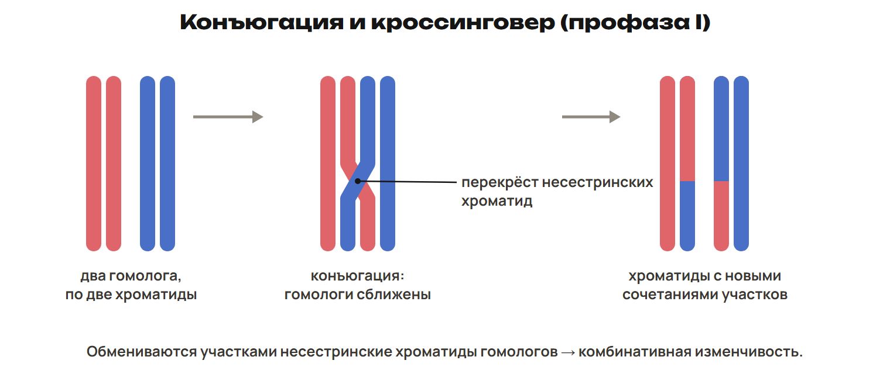
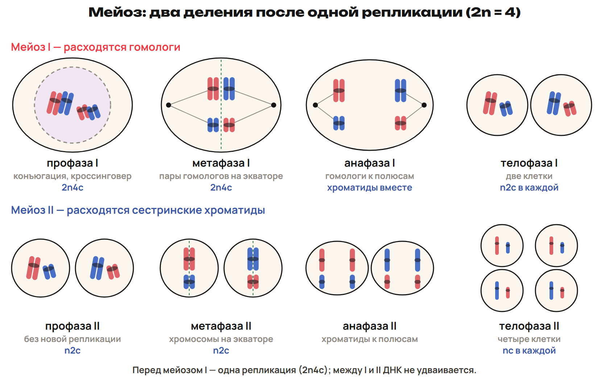

# Возврат: где потерялась граница счёта
? В ошибке изменилось число ДНК или только то, что назвали хромосомой?
↳ Вернёмся к двум решениям и найдём причину, которую можно исправить правилом.
> 0–4 выбрать две причины по G; 4–12 G9/G10; 12–17 L7; 17–20 ключ.

## Понятие: Сравни сначала ход решения
Открой свои G9 и G10; сохрани исходную попытку.
Отметь в каждой задаче n, этап и границу счёта.
Сверь формулу перед числом: 2n2c, 2n4c или 4n4c.
Объясни одну ошибку словами, затем исправь расчёт.
Правильное число без подписи «хромосомы / ДНК» ещё не объясняет решение.

## Практика: Разбор G9–G10
G9: условный вид 2n = 12; сравни G₁, G₂, метафазу и дочь после цитокинеза.
G10: условный вид 2n = 48; сравни всю анафазную клетку и один полюс.
Что произошло с двухроматидными хромосомами при начале расхождения?
Сначала защити собственный ход решения, затем открой ключ.
Ответы:
G9: G₁ — 12 / 12, 2n2c; G₂ — 12 / 24, 2n4c.
Метафаза — 12 / 24, 2n4c; каждая дочь — 12 / 12, 2n2c.
G10: вся клетка — 96 / 96, 4n4c; один полюс — 48 / 48, 2n2c.
В каждой паре сначала хромосомы, затем молекулы ДНК.
Двухроматидных хромосом уже нет: сестринские хроматиды стали отдельными хромосомами.
> 4–12 разбор после сданной попытки.

## Практика: L7
В метафазе митоза отношение «хромосомы : молекулы ДНК» равно 1 : 2.
В анафазе той же целой клетки оно стало 1 : 1.
Какое событие изменило это отношение?
Доказывает ли оно, что между метафазой и анафазой прошёл новый S-период?
Ответы:
Сестринские хроматиды разделились и стали самостоятельными хромосомами.
Число учитываемых хромосом выросло, общее число молекул ДНК сохранилось.
Нового S-периода не было: репликация завершилась до митоза.
> 12–17 новая попытка, 17–20 ключ.

# Мейоз I: расходятся гомологи
? Как получить гаплоидные клетки, сохранив в хромосоме две хроматиды?
↳ При митозе расходились сестринские хроматиды. В первом мейотическом делении расходится другая пара.
> 20–28 один S-период, профаза I и редукция; 28–32 L8; 32–35 ключ.

## Понятие: Одна репликация, два деления
Мейоз уменьшает число хромосом вдвое: из 2n получается n.
Перед мейозом I ДНК реплицируется один раз: 2n2c → 2n4c.
Далее идут мейоз I и мейоз II, всего восемь основных фаз.
Между этими делениями новой репликации ДНК нет.
В мейозе I расходятся гомологичные хромосомы.

## Схема: Конъюгация и кроссинговер

## Понятие: Четыре фазы первого деления
Профаза I: конъюгация гомологов; кроссинговер между их несестринскими хроматидами.
Метафаза I: на экваторе расположены пары гомологов.
Анафаза I: гомологи расходятся; сестринские хроматиды остаются вместе.
Телофаза I: формируются два набора n2c, затем обычно разделяется клетка.
Мейоз I — редукционное деление: число хромосом в каждом новом ядре уменьшается вдвое.
> Не говорить, что кроссинговер обязателен у каждого организма для образования любой гаметы. В базовом сравнении он характерен для профазы I, а не митоза.

## Практика: L8
У человека 2n = 46. В клетке, вступившей в мейоз I после репликации, 46 хромосом и 92 молекулы ДНК.
Что расходится в анафазе I: гомологи или сестринские хроматиды?
Сколько хромосом и молекул ДНК окажется в каждой клетке после мейоза I?
Как называется это деление по изменению набора?
Ответы:
Расходятся гомологичные двухроматидные хромосомы.
После I в каждой клетке n2c: 23 хромосомы и 46 молекул ДНК.
Это редукционное деление; хромосомы ещё двухроматидные.
> 28–32 попытка, 32–35 ключ.

# Мейоз II и сравнение с митозом
? Почему второе деление не уменьшает набор n ещё вдвое?
↳ После мейоза I гомологи уже разделены. Теперь нужно разделить оставшиеся копии.
> 35–41 четыре фазы II и сравнение; 41–44 L9; 44–47 ключ.

## Схема: Восемь фаз мейоза

## Понятие: Четыре фазы второго деления
Профаза II: подготовка веретена; новой репликации перед ней нет.
Метафаза II: отдельные двухроматидные хромосомы на экваторе.
Анафаза II: сестринские хроматиды расходятся как дочерние хромосомы.
Телофаза II: образуются ядра с однохроматидными хромосомами.
Итог обычной симметричной модели — четыре клетки nc.
Мейоз II — эквационное деление: в каждой дочерней клетке остаётся n.

## Понятие: Сравни по результату и событиям
Митоз: одно деление, четыре фазы, две клетки с исходным набором.
Мейоз: два деления, восемь фаз, в дочерних ядрах набор вдвое меньше исходного.
Конъюгация и кроссинговер характерны для профазы I мейоза.
Митоз даёт рост, восстановление, бесполое размножение; мейоз связан с половым циклом.
На гаплоидном гаметофите растений гаметы образуются митозом.
На диплоидном спорофите мейоз даёт споры: не все гаметы образуются мейозом.
> Митоз сохраняет исходную плоидность: он возможен и у гаплоидных клеток. Не делать диплоидность обязательным итогом любого митоза.

## Практика: L9
После мейоза I человека в каждой клетке 23 хромосомы и 46 молекул ДНК.
Что разойдётся в анафазе II?
Сколько хромосом и молекул ДНК будет в каждой клетке после мейоза II?
Почему правило «любая гамета образуется мейозом» неверно?
Ответы:
Сестринские хроматиды станут самостоятельными хромосомами.
После II в каждой клетке nc: 23 хромосомы и 23 молекулы ДНК.
Например, на гаплоидном гаметофите растения гаметы образуются митозом.
> 41–44 попытка, 44–47 ключ.

# Гаметогенез: название клетки и формула
? Почему четыре результата мейоза не всегда означают четыре полноценные гаметы?
↳ Мейоз распределяет наследственный материал. Гаметогенез добавляет рост, форму и неравномерное распределение цитоплазмы.
> 47–56 стадии и два пути; 56–60 L10; 60–63 ключ.

## Понятие: Размножение → рост → созревание → формирование
Размножение: сперматогонии и оогонии делятся митозом.
Рост и репликация: сперматоцит или овоцит I порядка достигает состояния 2n4c.
Созревание: после мейоза I клетка II порядка имеет n2c.
После мейоза II сперматиды имеют nc.
Формирование: сперматиды превращаются в сперматозоиды без нового деления, nc.
У оогенеза отдельную стадию формирования, как в сперматогенезе, не выделяют.

## Схема: Сперматогенез и оогенез

## Понятие: Два пути распределения цитоплазмы
Один сперматоцит I порядка даёт четыре сперматиды, затем четыре сперматозоида.
В завершённой модели один овоцит I даёт одну яйцеклетку и три полярных тельца.
Почти вся цитоплазма сохраняется в яйцеклетке; полярные тельца погибают.
У человека ооцит II порядка останавливается в мейозе II до оплодотворения.
Оогонии человека размножаются главным образом до рождения; мейоз начинается внутриутробно.
Сперматогенез начинается с половой зрелости и в репродуктивном периоде идёт непрерывно.
> Три полярных тельца — завершённая учебная модель: первое тельце тоже разделилось. Не переносить её как обязательное число видимых телец в каждом реальном ооците.

## Понятие: Формирование сперматозоида
Аппарат Гольджи участвует в образовании акросомы.
Одна из центриолей участвует в образовании жгутика.
Митохондрии обеспечивают АТФ для движения жгутика.
Большая часть цитоплазмы отторгается.
Сперматозоид и породившая его сперматида имеют одинаковую формулу nc.

## Практика: L10
Соответствие: А — сперматоцит II порядка; Б — сперматида.
1 — 2n2c; 2 — nc; 3 — 2n4c; 4 — n2c.
Сколько сперматид даёт один сперматоцит I?
Сколько яйцеклеток даёт один овоцит I в завершённой модели и зачем нужны неравные деления?
Ответы:
А4 Б2. Один сперматоцит I даёт четыре сперматиды.
Один овоцит I даёт одну яйцеклетку; остальные продукты — полярные тельца.
Неравные деления сохраняют почти всю цитоплазму и запас веществ в яйцеклетке.
> 56–60 попытка, 60–63 ключ.

# n/c и подготовка к рубежу
? Можешь ли ты объяснить правило на новом наборе и восстановить старую регуляторную цепь?
↳ Название клетки связано с формулой. Проверим счёт и вернём две темы прошлых недель.
> 63–66 алгоритм n/c; 66–70 L11 и ключ; 70–75 L12; 75–78 ключ и готовность к рубежу.

## Понятие: Четыре шага задачи
Найди n по известному диплоидному набору.
Определи этап и границу: вся клетка, один полюс или отдельный продукт деления.
Выбери формулу: G₁ 2n2c; после S 2n4c; после I n2c; после II nc.
Умножь n на нужные коэффициенты и подпиши две величины.
Для анафазы отдельно проверь, разделены ли сестринские хроматиды.
> Сравнение анафаз I и II с полным подсчётом — приложение A; базовый маршрут сначала закрепить на завершённых этапах.

## Практика: L11
У условного животного 2n = 12.
Найди n и числа хромосом / молекул ДНК в метафазе I.
Затем посчитай каждую отдельную клетку после мейоза I.
Назови событие, из-за которого число хромосом в ней стало вдвое меньше.
Ответы:
n = 6. Метафаза I: 2n4c — 12 хромосом и 24 молекулы ДНК.
После I: n2c — 6 хромосом и 12 молекул ДНК в каждой клетке.
Гомологи разошлись в разные дочерние наборы; сестринские хроматиды ещё соединены.
> 66–69 попытка, 69–70 ключ.

## Практика: L12
Восстанови путь рефлекса: рецептор → ... → нервный центр → ... → исполнитель.
После приёма пищи глюкоза крови выросла. Какой гормон поджелудочной помогает вернуть её к прежнему уровню?
Назови два результата его действия.
Объясни, почему такая обратная связь отрицательная.
Ответы:
Рецептор → чувствительный путь → центр → двигательный путь → исполнитель.
Инсулин усиливает использование глюкозы и её запасание в виде гликогена.
Глюкоза крови снижается; ответ уменьшает исходное отклонение.
Поэтому обратная связь отрицательная.
> 70–75 попытка, 75–78 ключ.

# Рубеж и домашний маршрут
? Можешь ли ты без подсказки определить событие деления, формулу и путь регуляции?
↳ Собрали новую тему и вернули нервную и гормональную регуляцию. Проверь их самостоятельно.
> 78–88 Q1–Q6 без подсказок; 88–90 назначить один A/B/C и исправления.

## Понятие: Рубеж Q1–Q6
Открой лист рубежного контроля по неделям 10–12.
Работай самостоятельно 10 минут.
Q1–Q3 — одна буква; Q4 — все верные; Q5 — две пары; Q6 — расчёт с объяснением.
Максимум 10 баллов.
Сдай ответ до разбора и открытия ключа.
> Ключ отделить от ученической страницы. Показать после сдачи, затем использовать ошибки вместе с G для выбора маршрута.

## Дома: После урока 24
Выполни один назначенный вариант A/B/C — 30 минут.
Для A прочитай четыре приложения ниже внутри этих 30 минут.
Исправь до двух причин ошибки — 25 минут.
Повтори разделы 4–6 конспекта и факты — 15 минут.
Вместе с работой после урока 23 — 150 минут.

## Понятие: Углубление A · Канцерогенез
Канцерогенез — развитие злокачественного новообразования.
В опухолевых клетках нарушается регуляция работы генов и деления.
Злокачественные клетки способны распространяться и образовывать метастазы.
Соматические мутации могут возникать под действием физических и химических факторов.
Некоторые вирусы участвуют в канцерогенезе.
Наследственная предрасположенность возможна, но сама по себе не равна наличию опухоли.
> Приложение A внутри его 30 минут. Не считать генетический материал всех онкогенных вирусов только РНК.

## Понятие: Углубление A · Кариокинез без цитокинеза
Деление ядра и разделение цитоплазмы — разные события.
Митотические кариокинезы без цитокинеза могут дать многоядерную клетку.
В модели после двух полных ядерных циклов из одного ядра получатся четыре ядра.
Если каждый митоз шёл нормально, каждое новое ядро сохраняет исходный набор.
Несколько диплоидных ядер не равны одному полиплоидному ядру.
> Не подменять эту модель слиянием ядер или автоматически переносить её на происхождение всех многоядерных клеток.

## Понятие: Углубление A · Анафаза I и II
Дрозофила, 2n = 8: в анафазе I расходятся двухроматидные гомологи.
Вся клетка I: 8 хромосом / 16 ДНК, 2n4c; один полюс: 4 / 8, n2c.
В анафазе II в одной клетке расходятся сестринские хроматиды.
Вся такая клетка II: 8 хромосом / 8 ДНК, 2n2c; один полюс: 4 / 4, nc.
До цитокинеза счёт во всей клетке отличается от счёта у одного полюса.
Новой репликации между делениями нет.

## Понятие: Углубление A · Полярная плазма
У раннего эмбриона дрозофилы полярная плазма находится у заднего полюса яйца.
Она содержит богатые РНК гранулы и участвует в определении первичных половых клеток.
В опытах перенос такой плазмы меняет судьбу восприимчивых клеток раннего эмбриона.
Вывод: компоненты цитоплазмы могут участвовать в выборе пути развития.
Это не означает, что такой перенос превратит клетку любой ткани в половую.
> Начало гаметогенеза рассматривать на указанном объекте и ранней стадии развития. Подробности эмбриогенеза — в следующей теме.
