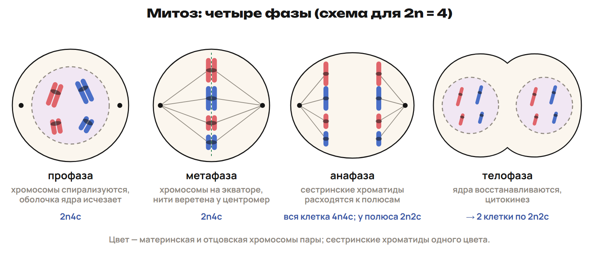

Кожа восстанавливается, потому что клетки делятся. Но при образовании половых клеток набор хромосом должен уменьшиться вдвое. Чтобы различить эти процессы, следи за двумя вещами: что расходится к полюсам и сколько ДНК остаётся в каждой клетке.

После урока 23 прочитай разделы 1–3 за 25 минут, выполни P и всю G. Разделы 4–6 разберём на уроке 24; после него выполни один назначенный вариант A/B/C.

## 1. Хромосома, хроматида и гомологи

Хроматин — комплекс ДНК с гистоновыми и негистоновыми белками. В интерфазе значительная часть хроматина деконденсирована. При делении он уплотняется, и отдельные хромосомы становятся хорошо видны. Хромосомы существуют и в интерфазе: меняется степень их упаковки.

Эухроматин менее уплотнён и генетически активнее; гетерохроматин сильнее уплотнён и обычно малоактивен. В школьном описании состава хромосом на ДНК приходится до 40 %, на белки — до 60 %.

Хроматида содержит одну непрерывную двухцепочечную молекулу ДНК. До репликации хромосома однохроматидная; после репликации состоит из двух сестринских хроматид. Пока они соединены, это одна удвоенная хромосома.

> [!rule] Сначала определи, что сравниваешь
> Хромосома — единица набора; хроматида — одна её копия после репликации; гомологи — две разные хромосомы одной пары, материнская и отцовская.

Центромера — первичная перетяжка. По обе стороны от неё расположены плечи, на концах — теломеры. Теломеры защищают концы хромосом. У некоторых хромосом есть вторичная перетяжка и спутник. У человека пять пар хромосом имеют ядрышкообразующие участки с генами рРНК.

| Положение центромеры | Тип хромосомы |
|---|---|
| Примерно посередине, плечи равны | Метацентрическая |
| Смещена от середины, плечи неравны | Субметацентрическая |
| Близко к концу, одно плечо очень короткое | Акроцентрическая |
| На конце, видимое плечо одно | Телоцентрическая |

Спутничная хромосома имеет спутник, отделённый вторичной перетяжкой. Это дополнительный признак строения, а не ещё одно положение центромеры. У человека пять пар хромосом имеют ядрышкообразующие участки с генами рРНК. У человека X-хромосома субметацентрическая, Y — акроцентрическая.

Гомологичные хромосомы сходны по размерам, строению и набору генов. Одна получена от матери, другая от отца; варианты генов могут различаться. X и Y различаются по строению и имеют лишь ограниченные участки гомологии.

Диплоидный набор обозначают 2n: хромосомы представлены парами. Гаплоидный набор n содержит по одной хромосоме каждой пары. У человека обычная диплоидная клетка содержит 46 хромосом, гамета — 23. Это 22 пары аутосом и пара половых хромосом XX или XY. У дрозофилы 2n = 8, у шимпанзе 2n = 48, у речного рака 2n = 196.

Кариотип — признаки набора хромосом: число, размеры и строение. Его графическое изображение — идиограмма. Для изучения кариотипа выбирают метафазу, когда хромосомы уплотнены и хорошо различимы. Хромосомы хранят наследственную информацию и передают её дочерним клеткам.

> [!example] Копия или пара
> Две хроматиды одной удвоенной хромосомы — сестринские. Материнская и отцовская хромосомы одной пары — гомологи. Если каждая из двух гомологичных хромосом удвоилась, получились две хромосомы и четыре хроматиды.

> [!trap] Буква X — не единица счёта
> X-образная фигура обычно показывает одну двухроматидную хромосому. Две её половины не становятся отдельными хромосомами до расхождения сестринских хроматид.

> [!try] Проверь различие
> Две хромосомы одной пары содержат одинаковые гены, но пришли от разных родителей. Это гомологи или сестринские хроматиды? Может ли один гомолог состоять из двух хроматид?

## 2. Клеточный цикл: G₁ → S → G₂ → деление

Клеточный цикл охватывает жизнь делящейся клетки от её появления до образования дочерних клеток. Митотический цикл включает интерфазу и митоз. В интерфазе клетка растёт, пополняет органоиды, запасает вещества и АТФ, удваивает ДНК.

> [!rule] Как читать цикл
> G₁ — рост до репликации → S — удвоение ДНК → G₂ — подготовка к делению → митоз и цитокинез. В S меняется количество ДНК, но число хромосом сохраняется.

| Период | Главные события | Формула для диплоидной клетки |
|---|---|---|
| G₁, пресинтетический | Рост, синтез веществ, восстановление органоидов | 2n2c |
| S, синтетический | Репликация ДНК, образование сестринских хроматид | Переход 2n2c → 2n4c |
| G₂, постсинтетический | Подготовка аппарата деления, накопление белков и энергии | 2n4c |

Здесь n — один гаплоидный набор хромосом, c — количество ДНК одного гаплоидного набора до репликации. В задачах на число молекул 1c соответствует n молекулам ДНК. Поэтому 2n4c означает два набора хромосом и удвоенную по сравнению с G₁ ДНК.

G₀ — состояние вне активного цикла деления. Клетка может выполнять свои функции и сохраняет обмен веществ. Это не остановка всех жизненных процессов. Продолжительность интерфазы зависит от клетки; учебное «около 80 % цикла» не является постоянной долей для всех клеток.

> [!example] Человек: до и после S
> В G₁ — 46 хромосом и 46 молекул ДНК. В G₂ — 46 хромосом и 92 молекулы ДНК: каждая хромосома стала двухроматидной. Значит, число хромосом не удвоилось.

> [!trap] S относится к интерфазе
> Репликация — подготовка к делению, а не фаза митоза. Удвоение ДНК не означает появления дополнительной пары гомологичных хромосом.

> [!try] Найди событие
> Клетка уже удвоила ДНК, но хромосомы ещё не выстроились на экваторе. Какие периоды интерфазы она прошла? Почему нельзя назвать это метафазой только по удвоенной ДНК?

## 3. Митоз: сохрани набор в каждой дочерней клетке

Рост и восстановление тканей требуют передачи полного набора хромосом. При митозе из одной клетки обычно образуются две дочерние с тем же набором. Для одноклеточных эукариот митотическое деление может быть способом размножения.

> [!rule] Алгоритм фазы
> Уплотнение хромосом — профаза → расположение на экваторе — метафаза → расхождение сестринских хроматид — анафаза → восстановление ядер — телофаза.

| Фаза | Что наблюдать |
|---|---|
| Профаза | Хромосомы конденсируются, ядрышки и ядерная оболочка исчезают, формируется веретено |
| Метафаза | Двухроматидные хромосомы на экваторе; веретено связано с областью центромер |
| Анафаза | Сестринские хроматиды расходятся и становятся самостоятельными дочерними хромосомами |
| Телофаза | Вокруг наборов восстанавливаются ядра, хромосомы деконденсируются, веретено исчезает |

В школьной схеме используют четыре фазы. Иногда между профазой и метафазой отдельно выделяют прометафазу. На движение хромосом затрачивается энергия АТФ. Митоз можно наблюдать в делящихся клетках корешка лука.

Кариокинез — деление ядра; цитокинез — деление цитоплазмы. Они связаны, но обозначают разные события. У животных цитоплазма разделяется перетяжкой. Митоз — непрямое деление, амитоз — прямое.

> [!example] Одна анафаза — два места счёта
> У человека в метафазе 46 хромосом и 92 молекулы ДНК. В анафазе до цитокинеза во всей клетке 92 однохроматидные хромосомы и 92 молекулы ДНК — 4n4c. У каждого полюса по 46 хромосом и 46 молекул — 2n2c. После цитокинеза столько будет в каждой дочерней клетке.

> [!trap] Не смешивай целую клетку и один полюс
> В анафазе митоза число хромосом во всей клетке временно удваивается из-за разделения хроматид. Число молекул ДНК при этом не увеличивается. Репликации в анафазе нет.

> [!try] Реши по признаку
> На рисунке две группы однохроматидных хромосом движутся к полюсам. Если это митоз, какая фаза показана? Чем рисунок отличался бы от метафазы и телофазы?

## 4. Мейоз: одна репликация, два деления

При мейозе диплоидный набор уменьшается до гаплоидного. ДНК удваивается один раз перед мейозом I. Затем идут два деления по четыре фазы; между ними новой репликации нет.

> [!rule] Два последовательных расхождения
> Мейоз I разъединяет гомологичные хромосомы и уменьшает набор: 2n → n. Мейоз II разъединяет сестринские хроматиды; набор в готовых дочерних клетках остаётся n.

В профазе I гомологи сближаются — это конъюгация. При кроссинговере участками обмениваются несестринские хроматиды гомологичных хромосом. Такое перераспределение наследственного материала способствует разнообразию потомства. Профаза I обычно наиболее продолжительная фаза мейоза.

| Фаза | Мейоз I | Мейоз II |
|---|---|---|
| Профаза | Конденсация, конъюгация, кроссинговер | Подготовка второго веретена без новой репликации |
| Метафаза | Пары гомологов на экваторе | Отдельные двухроматидные хромосомы на экваторе |
| Анафаза | Расходятся гомологи; сестринские хроматиды соединены | Расходятся сестринские хроматиды |
| Телофаза | По завершении деления две клетки n2c | По завершении деления четыре клетки nc |

Мейоз I называют редукционным делением, мейоз II — эквационным. При образовании половых клеток животных итогом обычно становятся гаплоидные клетки. Но не все гаметы возникают мейозом: у мхов на гаплоидном гаметофите они образуются митозом; на диплоидном спорофите мейоз даёт споры.

| Признак | Митоз диплоидной клетки | Мейоз диплоидной клетки |
|---|---|---|
| Деления и фазы | Одно деление, четыре фазы | Два деления, восемь фаз |
| Набор дочерних клеток | 2n, как у исходной | n, вдвое меньше исходного |
| Конъюгация и кроссинговер в обычной схеме | Нет | Профаза I |
| Результат | Две клетки | Четыре клетки в общей модели |
| Роль | Рост, восстановление, бесполое размножение | Уменьшение набора, половое размножение, изменчивость |

> [!example] Сохрани хроматиды после первого деления
> Сперматоцит I человека после репликации: 46 хромосом, 92 молекулы ДНК. После мейоза I в каждом сперматоците II — 23 и 46. После мейоза II в каждой сперматиде — 23 и 23.

> [!trap] Четыре клетки не всегда означают четыре гаметы
> В оогенезе почти вся цитоплазма сохраняется в одной клетке. Между мейозом I и II ДНК не удваивается. Гомологи расходятся в I делении, хроматиды — во II.

> [!try] Назови причину
> После первого деления клетка гаплоидна, но каждая её хромосома всё ещё из двух хроматид. Почему это n2c, а не 2n2c? Что должно разойтись во втором делении?

## 5. Гаметогенез: найди название клетки и стадию

Гаметогенез — образование и созревание половых клеток. Сперматогенез идёт в семенниках, оогенез — в яичниках. Эти процессы включают размножение, рост и созревание; в сперматогенезе есть отдельная стадия формирования.

> [!rule] Цепочка сперматогенеза
> Сперматогоний — митотическое размножение → сперматоцит I после роста и репликации, 2n4c → два сперматоцита II, n2c → четыре сперматиды, nc → четыре сперматозоида, nc.

На стадии размножения сперматогонии и оогонии делятся митозом: в G₁ это 2n2c, после S — 2n4c. На стадии роста клетка увеличивается и готовится к мейозу I; после репликации сперматоцит и овоцит I имеют 2n4c. Созревание — два деления мейоза.

Формирование, или спермиогенез, превращает сперматиду в сперматозоид без нового деления. Из аппарата Гольджи формируется акросома, одна из центриолей участвует в образовании жгутика, митохондрии обеспечивают его движение АТФ. Большая часть цитоплазмы удаляется.

В оогенезе деления цитоплазмы неравномерные. В завершённой учебной модели один овоцит I даёт одну яйцеклетку и три полярных тельца; тельца обычно дегенерируют. Число три предполагает, что первое полярное тельце тоже разделилось. У человека овоцит II задерживается в мейозе II, а завершение этого деления связано с оплодотворением.

| Признак | Сперматогенез | Оогенез человека |
|---|---|---|
| Начало мейоза | С половой зрелости | Во внутриутробном периоде |
| Размножение исходных клеток | В репродуктивном периоде | Оогонии — главным образом до рождения |
| Рост | Относительно короткий | Длительный, с накоплением веществ |
| Деление цитоплазмы | Примерно равномерное | Неравномерное |
| Формирование отдельной стадией | Есть | Нет |
| Итог одной исходной клетки I порядка | Четыре сперматиды, затем сперматозоиды | Одна яйцеклетка и полярные тельца |

Сперматозоиды образуются непрерывно; созревание овоцитов циклично, а цикл около 28 дней — учебный ориентир, не одинаковая длительность для всех. Яйцеклетка крупная, примерно 150–200 мкм, с запасами веществ и мРНК. Её окружают фолликулярные клетки; лучистый венец образован клетками, а не микроворсинками яйцеклетки.

> [!example] Название меняется на этапе
> Клетка после мейоза I в сперматогенезе — сперматоцит II, n2c. После мейоза II — сперматида, nc. После формирования — сперматозоид, nc. Последний переход меняет строение, а не набор.

> [!trap] В мейоз входит клетка I порядка
> Сперматогонии делятся митозом. Мейоз начинает сперматоцит I; заканчивается он сперматидой, а не «четырьмя сперматоцитами». Полярные тельца не становятся дополнительными яйцеклетками.

> [!try] Проследи одну клетку
> Укажи формулу сперматоцита I после репликации, сперматоцита II и сперматиды. На каком переходе уменьшается набор? На каком формируется жгутик?

## 6. Счёт n/c: этап → формула → числа

Сначала задай объект счёта: вся клетка, один полюс или одна дочерняя клетка. Затем найди n и установи этап. Считай каждую непрерывную молекулу ДНК отдельно, даже если две молекулы ещё соединены в одной хромосоме.

> [!rule] Алгоритм задачи
> 2n → раздели на два и найди n → определи этап и место счёта → выбери формулу → умножь коэффициенты при n и c на найденное n. Проверь, что между мейозом I и II репликации нет.

| Этап и объект счёта | Формула | Хромосом у человека | Молекул ДНК |
|---|---|---|---|
| G₁ одной диплоидной клетки | 2n2c | 46 | 46 |
| G₂, профаза, метафаза митоза | 2n4c | 46 | 92 |
| Анафаза митоза, вся клетка | 4n4c | 92 | 92 |
| Анафаза митоза, один полюс | 2n2c | 46 | 46 |
| Одна дочерняя клетка после митоза | 2n2c | 46 | 46 |
| Сперматоцит, овоцит I после S; профаза, метафаза I | 2n4c | 46 | 92 |
| Одна клетка после мейоза I, клетка II порядка | n2c | 23 | 46 |
| Одна клетка после мейоза II, сперматида или яйцеклетка | nc | 23 | 23 |
| Зигота до репликации | 2n2c | 46 | 46 |

> [!example] Счёт после мейоза I
> У человека 2n = 46, значит, n = 23. После мейоза I одна клетка имеет n2c: 23 хромосомы и 2 × 23 = 46 молекул ДНК. Каждая хромосома пока двухроматидная. После мейоза II — nc: 23 и 23.

> [!trap] Формула описывает выбранный этап
> n2c — не «две гаметы», а набор и ДНК в одной клетке. Формула 4n4c в анафазе митоза относится ко всей ещё не разделённой клетке; у одного полюса в тот же момент 2n2c.

> [!rule] Факты ЕНТ недели
> - У человека 2n = 46, n = 23: 22 пары аутосом и пара половых хромосом XX или XY.
> - Диплоидный набор дрозофилы — 8, шимпанзе — 48 хромосом.
> - Кариотип изучают в метафазе: хромосомы хорошо различимы.
> - Периоды интерфазы — G₁, S, G₂; репликация ДНК идёт в S-периоде.
> - Митоз — одно деление и четыре фазы; мейоз — два деления и восемь фаз.
> - Конъюгация и кроссинговер происходят в профазе I мейоза.
> - Мейоз I — редукционное деление; мейоз II — эквационное.
> - Один сперматоцит I даёт четыре сперматиды, затем четыре сперматозоида; овоцит I в завершённой учебной модели — одну яйцеклетку и три полярных тельца.

> [!try] Перед вариантом
> Без подсказки объясни, почему S не меняет число хромосом, почему после мейоза I ещё n2c и чем сперматида отличается от сперматоцита II. Затем по таблице восстанови путь одной человеческой клетки от G₁ до четырёх сперматид.
