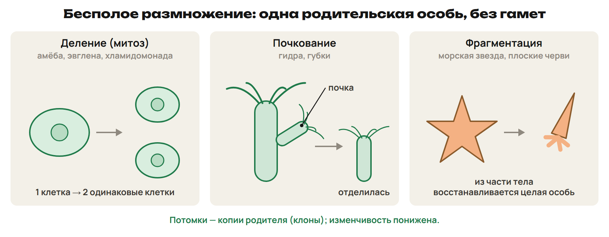
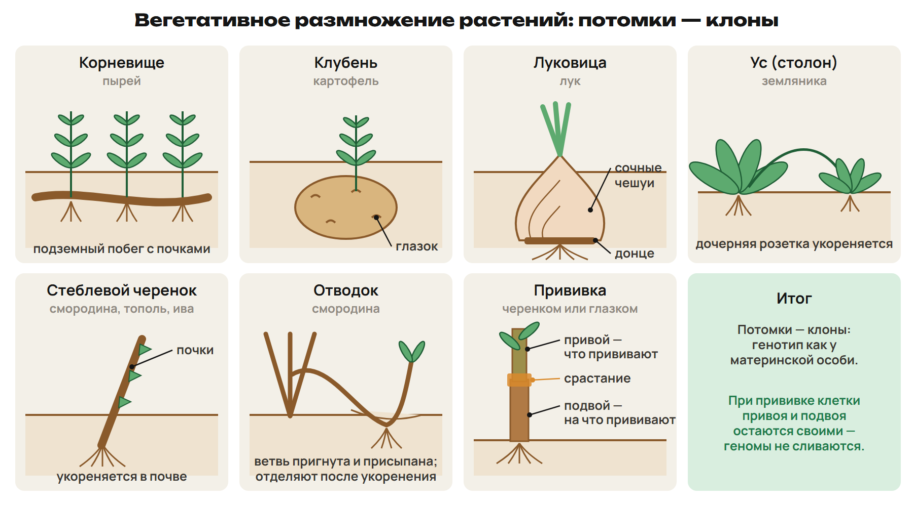
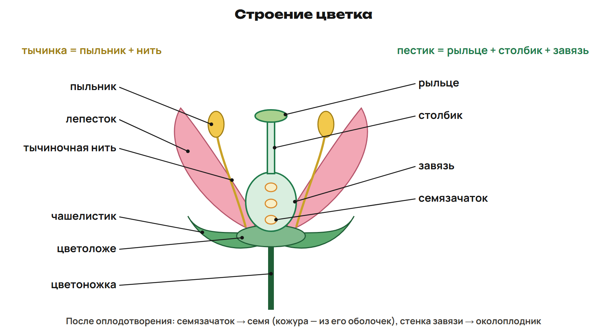
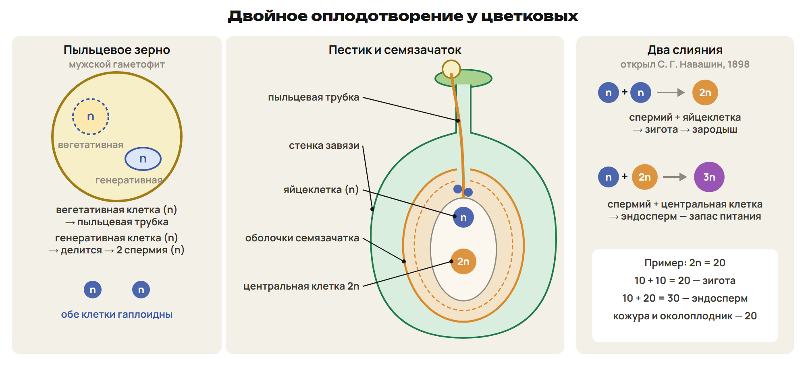
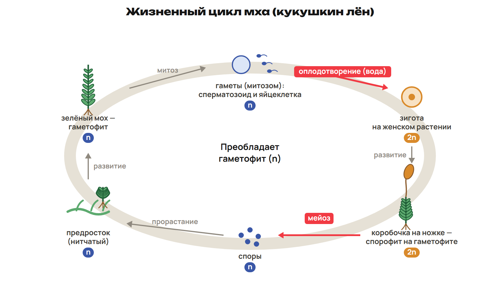
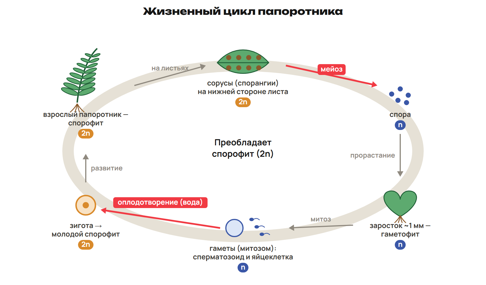
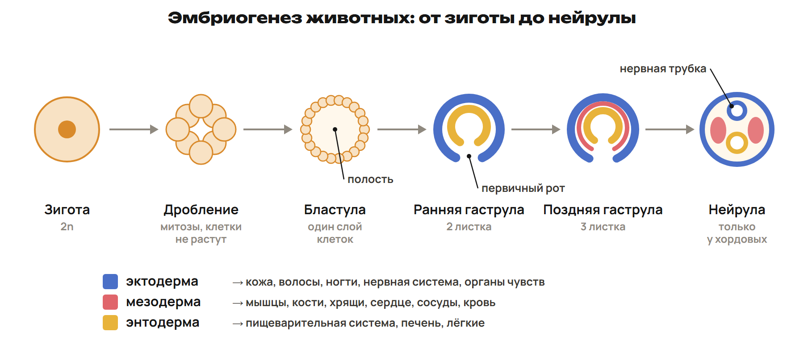
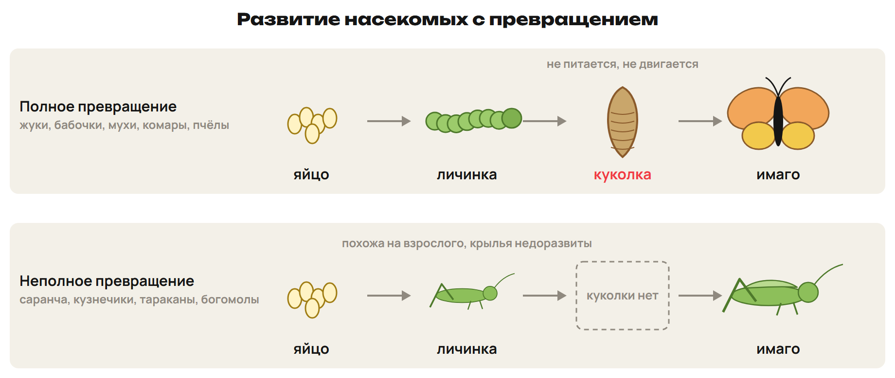

Из черенка вырастает новое растение, из цветка образуется плод, а из гусеницы — бабочка. Во всех случаях появляются новые структуры, но только в первом и втором речь о размножении. Научимся различать образование нового организма, смену поколений и развитие одной особи.

После урока 25 прочитай разделы 1–3 за 25 минут, выполни P и всю G. Разделы 4–6 разберём на уроке 26; после него выполни один назначенный вариант A/B/C.

## 1. Размножение: участвует ли яйцеклетка

Размножение — воспроизведение себе подобных. Оно сохраняет преемственность жизни, но бывает устроено по-разному. При бесполом размножении новая особь возникает без участия гамет; при половом участвуют половые клетки.

> [!rule] Алгоритм определения
> Найди исходную клетку или часть тела → проверь участие гамет → установи, было ли оплодотворение → назови способ. Одного числа родителей для вывода недостаточно.

Бесполое размножение обычно начинается от одной материнской особи. Потомки генетически близки и при отсутствии мутаций имеют тот же генотип; такие потомки — клоны. Этот древний способ позволяет быстро увеличивать численность, но не создаёт новых сочетаний родительских генов путём оплодотворения.

| Способ | Что происходит | Примеры |
|---|---|---|
| Деление | Клетка даёт дочерние клетки | Амёба, эвглена, хламидомонада; у эукариот связано с митозом |
| Почкование | На теле возникает вырост, развивающийся в новую особь | Гидра, губки |
| Фрагментация | Часть организма восстанавливает целое | Некоторые плоские черви, морские звёзды |

Бактерии тоже делятся надвое, но митоза у них нет: у прокариот отсутствует оформленное ядро. У полипов сцифоидных медуз поперечное отделение частей называют стробиляцией. Не каждый оторванный луч морской звезды даёт целый организм: возможность зависит от вида и сохранённых частей тела.

При оплодотворении сливаются гаметы: яйцеклетка и мужская гамета. В типичном цикле это восстанавливает диплоидный набор. Перекрёстное оплодотворение сочетает наследственный материал разных особей; самооплодотворение возможно у некоторых гермафродитов. Поэтому половое размножение не всегда означает двух отдельных родителей.

Гермафродит имеет мужские и женские половые органы. У дождевого червя есть семенники и яичники, но обычно два червя обмениваются семенной жидкостью и оплодотворяются перекрёстно. Наличие обоих типов органов само по себе не доказывает самооплодотворение.

Партеногенез — развитие из неоплодотворённой яйцеклетки. В школьной классификации это половое размножение, поскольку участвует яйцеклетка. Примеры — летние поколения тлей, дафнии, трутни медоносной пчелы. У пчёл оплодотворённые яйца дают самок, неоплодотворённые — самцов. Генетическое сходство потомков при партеногенезе зависит от механизма; одинаковость всех потомков не является его определением.

Конъюгация у инфузорий связана с обменом наследственным материалом. У бактерий так называют перенос ДНК между клетками. Сам обмен не равен увеличению числа особей. Однояйцевые близнецы происходят из одного раннего зародыша, разнояйцевые — из разных оплодотворённых яйцеклеток. Б. Л. Астауров получал партеногенетические формы тутового шелкопряда действием высокой температуры.

> [!example] Одна особь — разные способы
> У гидры из выроста тела развивается новая гидра: почкование, бесполое размножение. Из неоплодотворённой яйцеклетки пчелы развивается трутень: партеногенез. В обоих случаях нет слияния гамет, но только во втором исходная клетка — яйцеклетка.

> [!trap] Гермафродит не означает самооплодотворение
> Дождевой червь обычно оплодотворяется перекрёстно. Партеногенез не превращается в бесполое размножение из-за отсутствия оплодотворения. Клон может отличаться по внешним признакам из-за условий среды и по генотипу при мутации.

> [!try] Назови решающий признак
> Организм возник из части тела; другой — из яйцеклетки без слияния со сперматозоидом. Какой факт позволяет различить способы, даже если у каждого потомка только одна родительская особь?

## 2. Вегетативное размножение и прививка

Вегетативное размножение растений — бесполое размножение частями вегетативных органов. Новый организм формируется из побега, корня, листа или их части. Семя после обычного оплодотворения к этому способу не относится.

> [!rule] Определи орган, а не положение в почве
> Найди почки, узлы и листья → установи, побег это или корень → назови способ. Подземный орган не обязательно корень: клубень картофеля и корневище пырея — видоизменённые побеги.

| Орган или приём | Пример |
|---|---|
| Корневище | Пырей |
| Клубень | Картофель |
| Луковица | Лук |
| Ус, столон | Земляника |
| Корневой отпрыск | Малина |
| Стеблевой черенок | Смородина, ива, виноград, роза |
| Листовой черенок | Фиалка |
| Отводок | Укоренение побега смородины до отделения от куста |

Черенок — отделённая часть органа, из которой получают растение. Отводок укореняется, пока связан с материнским растением. Размножение кусочком клубня возможно при сохранении жизнеспособной почки — глазка.

Прививка соединяет части двух растений. Привой — часть нужного растения, которую прививают; подвой — растение с корневой системой, на которое прививают. Для срастания черенка совмещают области камбия; при окулировке прививают глазок — почку с участком ткани — в разрез коры.

Каллус — масса разрастающихся клеток, возникающая при заживлении и в культуре тканей. Из клеток образовательной ткани на питательной среде при действии фитогормонов получают новые растения. Выращивание из подходящей меристемы позволяет получать оздоровлённый посадочный материал; любая культура тканей не гарантирует отсутствия вирусов.

> [!example] Сорт над корнями другого растения
> Черенок нужного сорта яблони привили на укоренённое растение. Черенок — привой, укоренённая часть — подвой. Прививка соединяет ткани, но не превращает все клетки в генетическую смесь двух сортов.

> [!trap] Отводок не равен черенку
> Черенок отделяют, а отводок сначала укореняют на материнском растении. Глазок клубня — почка побега. Без почки обычный кусок клубня не выполняет ту же роль.

> [!try] Сравни два действия
> Побег пригнули к почве и отделили после укоренения. Другой побег сразу срезали и поставили на укоренение. Как называется каждый приём? Почему оба относятся к бесполому размножению?

## 3. Цветок: от опыления до семени и плода

Цветок — орган полового размножения цветкового растения. Тычинка включает тычиночную нить и пыльник; пестик — рыльце, столбик и завязь. В завязи находятся семязачатки, в них развивается женский гаметофит — зародышевый мешок с яйцеклеткой.

Чашелистики, лепестки, цветоложе и цветоножка — другие части цветка. Обоеполый цветок имеет тычинки и пестик, например у тюльпана и яблони. У кукурузы цветки раздельнополые: мужские в метёлке, женские в початке на том же растении.

> [!rule] Две разные операции
> Опыление — перенос пыльцы на рыльце. Оплодотворение — слияние мужской гаметы с женской клеткой. Между ними пыльца прорастает, и пыльцевая трубка доставляет спермии к зародышевому мешку.

Самоопыление связано с переносом пыльцы в пределах одного растения; обычные примеры — горох, арахис, пшеница. При перекрёстном опылении пыльца поступает с другой особи. Её переносят ветер, насекомые, другие животные, у некоторых водных растений — вода. У ветроопыляемых растений обычно много сухой лёгкой пыльцы; при насекомоопылении помогают липкая пыльца, заметные цветки, запах и нектар.

Пыльцевое зерно — мужской гаметофит, а не одна гамета. В двухклеточной стадии у цветковых есть гаплоидные вегетативная и генеративная клетки. Вегетативная образует трубку; генеративная делится митозом и даёт два гаплоидных спермия. У некоторых растений это деление происходит ещё до высыпания пыльцы.

В типичном зародышевом мешке яйцеклетка имеет n, центральная клетка — два материнских гаплоидных набора, суммарно 2n. Два спермия выполняют разные слияния:

| Слияние | Продукт | Во что развивается |
|---|---|---|
| Спермий n + яйцеклетка n | Зигота 2n | Зародыш |
| Второй спермий n + центральная клетка 2n | Первичное ядро эндосперма 3n | Питательная ткань — эндосперм |

Это двойное оплодотворение. Его открыл С. Г. Навашин в 1898 году. Эндосперм содержит два материнских и один отцовский набор. В обычном процессе его развитие согласовано с образованием зародыша.

Из семязачатка развивается семя. Из его оболочек — кожура семени; из зиготы — зародыш. Из завязи развивается плод, а её стенки образуют околоплодник. У некоторых растений в образовании плода участвуют и другие части цветка.

> [!example] Подставь один набор
> У условного цветкового растения 2n = 24, значит, n = 12. Спермий и яйцеклетка содержат по 12 хромосом, центральная клетка — 24. Зигота: 12 + 12 = 24; первичное ядро эндосперма: 12 + 24 = 36. Его формула 3n, а не 2n.

Некоторые растения могут образовывать зародыш без обычного оплодотворения; пример — одуванчик. Поэтому отсутствие оплодотворения не означает, что семя не может образоваться ни у одного растения.

> [!trap] Не удваивай одну яйцеклетку дважды
> В двойном оплодотворении участвуют два спермия и две женские клетки. Генеративная клетка делится; обе исходные клетки пыльцы гаплоидны. Кожура связана с оболочками семязачатка, околоплодник — со стенкой завязи.

> [!try] Проследи происхождение
> Назови исходные структуры для пыльцевой трубки, двух спермиев, зародыша, эндосперма, кожуры семени и околоплодника. Где происходит опыление, а где слияния клеток?

## 4. Жизненный цикл: найди две границы набора

Спорофит — диплоидное поколение 2n: развивается из зиготы и образует споры мейозом. Гаметофит — гаплоидное поколение n: развивается из споры и образует гаметы митозом. Споры и гаметы одинаковы по гаплоидности, но выполняют разные роли.

> [!rule] Алгоритм схемы
> Оплодотворение n + n → 2n → спорофит → мейоз 2n → n → спора → гаметофит → гаметы митозом. Найди стрелки смены набора и подпиши остальные структуры.

Спора развивается без слияния с другой клеткой. Гамета участвует в оплодотворении. У зелёных водорослей встречаются разные циклы. В рассматриваемой модели гаплоидное тело даёт гаметы митозом; диплоидна зигота, которая проходит мейоз и даёт гаплоидные клетки.

| Группа | Преобладающее поколение | Где искать мейоз | Где гаметофит |
|---|---|---|---|
| Мхи | Гаметофит n | В коробочке спорофита | Зелёный листостебельный мох, например кукушкин лён |
| Папоротники | Спорофит 2n | В спорангиях, собранных в сорусы | Небольшой заросток n |
| Сосна | Спорофит 2n | В мужских и женских структурах шишек | Мужской — пыльца; женский — внутри семязачатка |
| Цветковые | Спорофит 2n | В пыльниках и семязачатках | Пыльца и зародышевый мешок |

У листостебельного мха видимое зелёное растение — гаметофит. Из споры развивается нитчатый предросток, затем гаметофит. После оплодотворения из зиготы на нём развивается спорофит — коробочка на ножке. Он связан с гаметофитом и зависит от него; молодые части спорофита могут фотосинтезировать. В коробочке мейоз даёт споры n. Примеры мхов — кукушкин лён и сфагнум.

У папоротника крупное растение с листьями — спорофит 2n. Сорус — группа спорангиев, а не гаметофит. Внутри спорангиев мейозом формируются споры; из споры вырастает небольшой заросток n с ризоидами. У многих папоротников он сердцевидный, размер — порядка миллиметров. На нём антеридии образуют сперматозоиды, архегонии — яйцеклетки. Для движения сперматозоидов мхов и папоротников к яйцеклетке нужна вода.

У семенных самостоятельного заростка нет; гаметофиты сильно уменьшены и связаны со спорофитом. Микро- и мегаспоры формируются мейозом внутри шишек или цветков. Пыльца переносится наружу, но утверждение «у семенных нет спор» неверно.

Сосна — однодомное растение: мужские и женские шишки на одном дереве. В мужских образуются микроспоры и пыльца, в семязачатках женских — мегаспоры и женский гаметофит. Пыльцу переносит ветер; спермии формируются при развитии мужского гаметофита и доставляются трубкой. После оплодотворения возникает зародыш 2n. Питательная ткань семени сосны — женский гаметофит n, сформированный до оплодотворения; это не триплоидный эндосперм цветковых.

> [!example] Одна группа спор — два разных объекта
> Сорус на листе папоротника состоит из спорангиев спорофита, 2n. В них после мейоза возникают споры n. Сердцевидная пластинка, выросшая из споры, — уже гаметофит n. Место на схеме важнее внешней величины объекта.

> [!trap] Митоз не всегда означает диплоидную клетку
> Гаметофит n образует гаметы митозом и сохраняет n. Мейоз у наземных растений даёт споры, а не сразу яйцеклетки. У семенных споры существуют внутри репродуктивных органов.

> [!try] Пройди цикл в обе стороны
> Начни с коробочки мха и назови набор до мейоза, после мейоза и после следующего оплодотворения. Повтори для заростка папоротника: из какой клетки он появился и какое поколение возникнет из зиготы?

## 5. Онтогенез животных: стадия, ткань, тип развития

Онтогенез — индивидуальное развитие от возникновения организма до конца жизни. Эмбриональный период предшествует рождению или выходу из яйца, постэмбриональный следует за ним. При партеногенезе начало эмбриогенеза связано с развитием неоплодотворённой яйцеклетки.

> [!rule] Сначала выбери модель животного
> Зигота → дробление → бластула → гаструляция → органогенез. У хордовых при формировании нервной трубки выделяют стадию нейрулы. Не переноси её название на любое животное.

При дроблении быстрые митотические деления дают бластомеры; между делениями клетки почти не растут, общий объём зародыша заметно не увеличивается. В простой схеме бластула — слой клеток вокруг полости. Отделение частей очень раннего зародыша может привести к однояйцевым близнецам.

При гаструляции клетки перемещаются и формируют зародышевые листки. У трёхслойных животных возникают эктодерма, энтодерма и мезодерма. Кишечнополостные, например гидра и медузы, двухслойны: мезодермы у них нет. При нейруляции хордовых из эктодермы образуется нервная трубка — зачаток центральной нервной системы.

| Зародышевый листок | Основные производные, которые различаем |
|---|---|
| Эктодерма | Эпидермис и его производные: волосы, ногти, кожные железы; нервная система; чувствительные эпителии ряда органов чувств |
| Мезодерма | Мышцы, кости, хрящи, связки, сухожилия; сердце, сосуды, кровь; основные ткани выделительной и половой систем |
| Энтодерма | Эпителий большей части пищеварительной трубки, эпителиальные клетки печени и поджелудочной; эпителий дыхательных путей и лёгких |

Орган обычно состоит из нескольких тканей разного происхождения. Например, в стенке кишечника энтодермален эпителий, но не вся стенка вместе с мышцами и сосудами. Для кожи различай эпидермис и лежащие глубже ткани.

Прямое развитие — молодая особь в основном похожа на взрослую, отдельной личинки с перестройкой нет. Примеры: дождевой червь, речной рак, паукообразные, многие брюхоногие и головоногие моллюски; у позвоночных — обычная модель птиц, млекопитающих и пресмыкающихся. У земноводных, миног и части рыб есть личиночные стадии.

Непрямое развитие включает личинку, отличающуюся от взрослого по строению и образу жизни. У печёночного сосальщика личиночные стадии связаны с малым прудовиком, взрослый паразит живёт в печени окончательного хозяина, например коровы.

| Развитие насекомого | Стадии | Примеры |
|---|---|---|
| Полное превращение | Яйцо → личинка → куколка → имаго | Бабочки, жуки, мухи, комары, пчёлы |
| Неполное превращение | Яйцо → личинка, или нимфа → имаго | Саранча, кузнечики, тараканы, богомолы, вши |

Куколка не питается; внутри перестраиваются органы. Она не обязательно совершенно неподвижна. При неполном превращении нимфа похожа на взрослое насекомое, но крылья и половая система ещё не развиты. Различия питания личинок и взрослых могут снижать конкуренцию: гусеница ест листья, взрослая бабочка — нектар; личинка майского жука питается корнями, жук — листьями.

> [!example] Орган или его ткань
> Для эпителия дыхательных путей выбирай энтодерму, для мышц стенки органа — мезодерму, для центральной нервной системы — эктодерму. Одно слово «лёгкое» скрывает несколько тканей, поэтому уточняй, о какой части спрашивают.

> [!trap] Куколка — признак полного превращения
> Наличие личинки само по себе ещё не отличает полное превращение от неполного. Нейрула относится к хордовым, а не ко всем трёхслойным животным. Не приписывай весь орган одному листку по происхождению одного эпителия.

> [!try] Узнай путь по пропущенной стадии
> В цепи «яйцо → личинка → … → имаго» у бабочки пропущена куколка. Что изменится в такой цепи для саранчи? Какое преимущество может дать различное питание личинки и взрослой особи?

## 6. Онтогенез растений и рост

У цветкового растения сначала формируются зародыш и семя, затем семя прорастает, развивается молодое растение, начинается размножение и наступает старение. Зародыш содержит зачатки корня, побега и почки; запас веществ помогает начать рост до самостоятельного фотосинтеза.

> [!rule] Найди этап по событию
> Формирование зародыша и семени → прорастание и проросток → молодое растение до первого размножения → взрослая генеративная стадия → старение. В школьной периодизации границу раннего этапа связывают с прорастанием.

Пшеница как однолетник проходит цикл за один подходящий сезон; арча может жить около тысячи лет. Переход к образованию семян и плодов меняет распределение веществ, поэтому темп роста может снижаться. Рост зависит от наследственных особенностей, температуры, воды и питания.

Меристемы, или образовательные ткани, обеспечивают деление клеток. Вода нужна для растяжения клеток; её нехватка может тормозить и деление, и растяжение. Температурный оптимум зависит от вида и этапа: диапазон 25–35 °C из учебных примеров нельзя применять ко всем растениям и условиям.

Камбий обеспечивает вторичный рост в толщину у типичных двудольных и голосеменных. У обычных злаков и лилейных такого камбия нет. Это не означает, что любое однодольное растение имеет полый стебель или что для всей группы невозможны иные способы утолщения.

В умеренном климате деятельность камбия часто сезонна: весной и летом активнее, зимой наступает покой. Различие сезонных слоёв древесины даёт годичные кольца. Ширина зависит от условий года; одно узкое кольцо не позволяет без других данных установить единственную причину. Толщина колец сама по себе не служит надёжным указателем стороны света.

Сухие семена также могут находиться в покое. При благоприятных условиях отдельные виды бамбука растут на 50–100 см в сутки. Это пример высокой скорости, а не постоянная скорость любого побега бамбука.

Пример медленного роста — дион съедобный из Мексики: 0,76 мм в год. Конкретная скорость зависит от условий; это не постоянная норма для каждого растения.

> [!example] Толщина и длина — разные изменения
> Ствол двудольного дерева стал толще за счёт работы камбия. Рост побега в длину обеспечивают другие участки образовательной ткани. Отсутствие обычного камбия у злака не означает отсутствия роста вообще.

> [!trap] Покой не равен гибели
> Сезонный покой и покой семени — состояния живого растения. Вода влияет на растяжение, но её дефицит способен тормозить и другие процессы. Годичные кольца оценивай вместе с условиями, а не как неизменное правило о северной стороне.

> [!rule] Факты ЕНТ недели
> - Гидра и губки размножаются почкованием; тли, дафнии и трутни медоносной пчелы — примеры партеногенеза.
> - Дождевой червь — гермафродит с перекрёстным оплодотворением; самоопыление характерно для гороха, арахиса и пшеницы.
> - Двойное оплодотворение цветковых открыл С. Г. Навашин в 1898 году.
> - Вегетативная клетка даёт пыльцевую трубку, генеративная — два спермия; зигота 2n, эндосперм 3n; кожура — из оболочек семязачатка, околоплодник — из стенок завязи.
> - У мхов преобладает гаметофит n; у папоротников и семенных — спорофит 2n.
> - Эктодерма — эпидермис и нервная система; мезодерма — мышцы, кости, кровь; энтодерма — эпителий кишечника и дыхательных путей.
> - Полное превращение с куколкой: бабочки, жуки, мухи, комары, пчёлы; неполное без куколки: саранча, кузнечики, тараканы, богомолы.
> - Камбий даёт рост в толщину у типичных двудольных; у обычных злаков и лилейных его нет; бамбук в благоприятных условиях растёт на 50–100 см в сутки.

> [!try] Перед вариантом
> Восстанови два цикла: мох и папоротник. Затем объясни, почему эндосперм цветкового 3n, эпителий кишечника энтодермален, а куколка позволяет отличить полное превращение от неполного.
