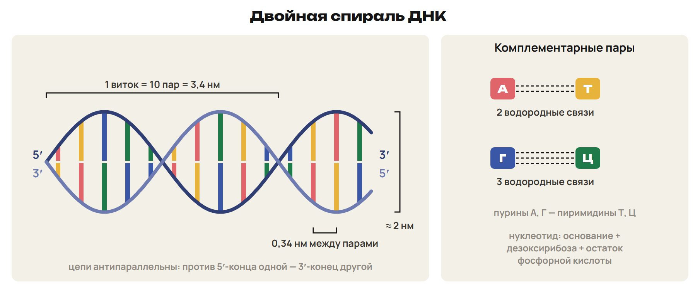
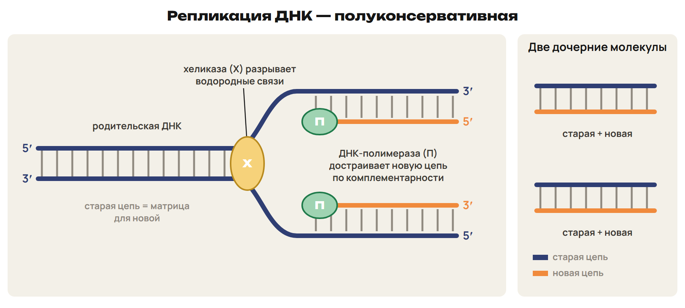
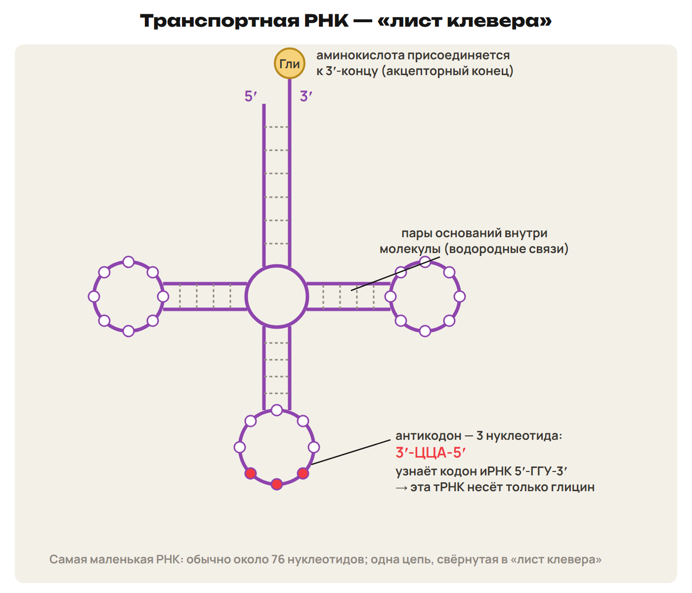

# Урок 27. ДНК, репликация и РНК

Вторник 16 февраля 2027; 90 минут. Группы 18:00–19:30 и 19:30–21:00.

Причина → алгоритм → разные примеры → ловушка → самостоятельная попытка. Ключи L показывать после попытки. Предварительное чтение перед первым уроком не требуется.

## План на 90 минут

| Время | Действие |
|---|---|
| 0–15 | 0–10 строение, числа и история; 10–13 L1; 13–15 ключ. |
| 15–30 | 15–24 функции ДНК, ферменты и три модели; 24–28 L2; 28–30 ключ. |
| 30–46 | 30–39 опыт и предсказания моделей; 39–43 L3; 43–46 ключ. |
| 46–61 | 46–54 правила, проценты и число пар; 54–58 L4; 58–61 ключ. |
| 61–78 | 61–70 виды РНК и различия с ДНК; 70–75 L5; 75–78 ключ. |
| 78–90 | 78–84 L6; 84–88 ключ и самопроверка; 88–90 домашний маршрут. |

## 1. Две цепи одной молекулы · 0–15 минут

**Вопрос:** Как достроить вторую цепь и не перепутать направление?

**Связка:** Строение нуклеотида знакомо. Теперь используем его для чтения молекулы ДНК.

**Нуклеотид, цепь, молекула.** ДНК — полинуклеотид: основание, дезоксирибоза и остаток фосфорной кислоты. А и Г — пуриновые основания; Т и Ц — пиримидиновые. Внутри цепи нуклеотиды соединены 3′,5′-фосфодиэфирными связями. Между комплементарными основаниями двух цепей — водородные связи. А–Т: две связи; Г–Ц: три. Цепи антипараллельны: напротив 5′-конца одной расположен 3′-конец другой.

**Пара оснований — один шаг вдоль оси.** 

**Числа для учебной модели.** Один виток: 10 пар оснований и 3,4 нм; шаг между парами — 0,34 нм. Длина участка = число пар × 0,34 нм; два нуклеотида пары не удваивают длину. В расчётах этой недели Mᵣ одного нуклеотида принимаем равной 345. Масса ДНК = число нуклеотидов обеих цепей × 345. Гаплоидный набор человека содержит около 3 · 10⁹ пар, их суммарная длина — около 1 м. Компактность хромосом обеспечивается упаковкой ДНК с белками.

0,34 нм и 345 — заданные школьные величины. Последняя строка относится к суммарной длине ДНК набора, не к длине одной хромосомы.

**Как связаны открытия.** Ф. Мишер выделил нуклеин из ядер лейкоцитов в 1869 году. О. Эвери в 1944 году показал роль ДНК в передаче наследственных свойств бактерий. Р. Фёльген в 1924 году исследовал локализацию ДНК. Дж. Уотсон и Ф. Крик предложили модель двойной спирали в 1953 году. Исследования структуры ДНК связаны с Нобелевской премией 1962 года. У эукариот ДНК находится в ядре, а также в митохондриях и пластидах.

### L1

Дана цепь ДНК: 5′-ГАТЦЦА-3′. Запиши комплементарную цепь непосредственно под ней, указав оба конца. Какие связи удерживают основания двух цепей, а какие соединяют нуклеотиды одной цепи?

**Ответ и решение:** 5′-ГАТЦЦА-3′ 3′-ЦТАГГТ-5′ Между цепями — водородные связи; вдоль одной цепи — фосфодиэфирные.

**Типичная ошибка и новая проверка:** Записать обе цепи в одном направлении. Новая проверка: подписать противоположные концы до подбора букв.

## 2. Репликация: матрица и новая цепь · 15–30 минут

**Вопрос:** Что в дочерней молекуле сохраняется от исходной?

**Связка:** Достроили короткий фрагмент. Тот же принцип позволяет копировать целую молекулу.

**Хранить, передавать, реализовывать.** Порядок нуклеотидов хранит наследственную информацию. Репликация позволяет передавать её дочерним клеткам. Реализация информации происходит через синтез РНК и белка. Повреждения ДНК исправляют системы репарации. У делящейся эукариотической клетки репликация идёт в S-периоде интерфазы. Количество ДНК удваивается; число хромосом до расхождения хроматид не удваивается.

Репликация сама по себе не заменяет распределение хромосом при делении. S-период здесь относится к эукариотической клетке, не к опыту на бактериях.

**К каждой старой цепи — новая.** 

**Ферменты и результат.** Хеликаза разделяет цепи, нарушая водородные связи между основаниями. Каждая старая цепь служит матрицей. ДНК-полимераза соединяет комплементарные нуклеотиды новой цепи. Вдоль новой цепи возникают фосфодиэфирные связи. При точном копировании получаются две молекулы с исходной последовательностью. Одна старая и одна новая цепь в каждой — полуконсервативный принцип.

**Три возможные модели.** Полуконсервативная: каждая молекула содержит старую и новую цепи. Консервативная: исходная двойная спираль остаётся целиком старой, новая — целиком новой. Дисперсная: в каждой цепи чередуются старые и новые участки. Одинаковый общий состав не позволяет различить эти модели без метки. Нужно проследить судьбу старого материала в дочерних молекулах.

### L2

При копировании молекулы обе старые цепи разошлись; к каждой достроилась новая. Назови модель и два фермента: какой разделяет цепи, какой строит новую? Если обычная диплоидная клетка была в G₁, какую формулу n/c она получит после S-периода?

**Ответ и решение:** Полуконсервативная репликация: старая + новая цепь в каждой молекуле. Хеликаза разделяет цепи, ДНК-полимераза достраивает новую. 2n2c → 2n4c: число хромосом сохраняется, количество ДНК удваивается.

**Типичная ошибка и новая проверка:** Назвать разрыв водородных связей работой полимеразы или превратить 2n в 4n сразу после репликации.

## 3. Метка азота проверяет модель · 30–46 минут

**Вопрос:** Почему одной полосы после первого копирования ещё недостаточно для полного вывода?

**Связка:** Модели различаются судьбой старых цепей. Отметим эти цепи тяжёлым азотом.

**Опыт Мезельсона и Сталя.** М. Мезельсон и Ф. Сталь, 1958 год; объект — кишечная палочка, E. coli. Бактерии сначала выращивали с ¹⁵N, затем перенесли на среду с ¹⁴N. ¹⁵N — тяжёлый стабильный изотоп, а не радиоактивная метка. Плотность ДНК определяли ультрацентрифугированием в градиенте CsCl. После первого цикла — только гибридная ДНК; после второго — гибридная и лёгкая поровну. Метки показывают происхождение цепей, полосы — различие плотности молекул.

**Модель → предсказание → наблюдение.** 

**Как считать потомков одной молекулы.** Каждый полный цикл репликации удваивает число молекул. После первого цикла каждая исходная тяжёлая молекула дала две гибридные. При следующих циклах её две старые цепи остаются в двух гибридных молекулах. Остальные молекулы состоят из новых лёгких цепей. Консервативную модель отвергает первый цикл, дисперсную — второй. Считаем полную сохраняемую линию потомков в постоянной лёгкой среде.

### L3

Исходно есть три полностью тяжёлые молекулы ДНК. Каждая линия прошла два полных цикла репликации на ¹⁴N; все потомки сохранены. Найди общее число молекул, число гибридных и лёгких, долю гибридных. Какая модель дала бы тяжёлую и лёгкую полосы уже после первого цикла?

**Ответ и решение:** Всего 3 × 2² = 12 молекул. Старых цепей шесть, поэтому гибридных шесть; лёгких 12 − 6 = 6. Доля гибридных: 6/12 = 50 %; полностью тяжёлых после двух циклов нет. Две полосы после первого цикла предсказывала консервативная модель.

**Типичная ошибка и новая проверка:** Удвоить число старых цепей или считать, что все новые молекулы остаются гибридными. Новая проверка: нарисовать только шесть исходных тяжёлых цепей.

## 4. Правила Чаргаффа и состав ДНК · 46–61 минут

**Вопрос:** Как найти три неизвестных процента по одному известному?

**Связка:** Копирование сохранило пары оснований. По этим парам можно восстановить состав двух цепей.

**Равенства относятся к двум цепям.** Правила Э. Чаргаффа, 1949–1951: А = Т и Г = Ц в двуцепочечной ДНК. Пурины равны пиримидинам: А + Г = Т + Ц. Из первых равенств следует также А + Ц = Г + Т. Если известен процент А, то Т такой же, а Г и Ц — по 50 % − А. Состав одной выбранной цепи может не удовлетворять А = Т и Г = Ц. На одиночную молекулу РНК эти равенства автоматически не переносят.

**Алгоритм численного расчёта.** Установи, число дано для одной цепи или для обеих. Для всей двуцепочечной ДНК найди комплементарный нуклеотид. Остаток общего количества поровну раздели между второй парой оснований. Число пар = общее число нуклеотидов / 2. Длина = пары × 0,34 нм; масса = все нуклеотиды × 345. Водородные связи = 2 × число пар А–Т + 3 × число пар Г–Ц.

### L4

В двуцепочечной ДНК тимин составляет 17 % всех нуклеотидов. Найди долю каждого из остальных трёх оснований. Почему те же ответы нельзя получить только из сообщения «в одной цепи РНК У = 17 %»?

**Ответ и решение:** А = Т = 17 %. На Г + Ц остаётся 100 − 34 = 66 %, значит, Г = Ц = 33 %. Равенства следуют из пар двух цепей ДНК; для одной цепи РНК такого условия нет.

**Типичная ошибка и новая проверка:** Отнять 17 % от 100 % и поделить на три. Новая проверка: сначала записать равенство комплементарных оснований.

## 5. РНК: три функции и сравнение · 61–78 минут

**Вопрос:** Почему одинаковые четыре буквы не означают одинаковую работу всех РНК?

**Связка:** Подсчитали состав ДНК. Для РНК сначала определим её вид и роль.

**Общее строение, разные функции.** РНК содержит рибозу и основания А, Г, Ц, У; обычные клеточные РНК одноцепочечны. Участки одной цепи могут образовывать комплементарные пары и изгибы. мРНК несёт информацию от ДНК и служит матрицей синтеза белка. тРНК доставляет аминокислоты; её антикодон распознаёт кодон мРНК. рРНК с белками образует рибосому и участвует в образовании пептидных связей. Некоторые РНК катализируют реакции; есть вирусы с РНК-геномом.

**Переносчик с двумя функциональными участками.** 

**Что запомнить о трёх видах.** Учебные ориентиры долей: рРНК 85–90 %, тРНК около 10 %, мРНК до 5 %. тРНК обычно около 76 нуклеотидов, в учебных примерах 75–95; Mᵣ около 25–30 тыс. Аминокислоту к 3′-концу присоединяет аминоацил-тРНК-синтетаза. Ядрышко связано с образованием рРНК и сборкой субъединиц рибосом. Субъединицы эукариотической рибосомы — 60S и 40S. Для рассматриваемой ядерной мРНК эукариот типичны кэп на 5′-конце и поли-А на 3′-конце.

Доли и длины — учебные ориентиры, не универсальная норма каждой клетки. Кэп и поли-А не приписывать всем РНК; числа S не складывать как количество частиц.

### L5

Относительная молекулярная масса двуцепочечного фрагмента ДНК — 276 000. В учебной модели Mᵣ одного нуклеотида равна 345; шаг между парами — 0,34 нм. Найди общее число нуклеотидов, число пар и длину. Почему при поиске длины нужно делить найденное число нуклеотидов на два?

**Ответ и решение:** Всего 276 000/345 = 800 нуклеотидов в двух цепях. Пар 800/2 = 400; длина 400 × 0,34 = 136 нм. Одна пара занимает один шаг вдоль оси молекулы, хотя содержит два нуклеотида.

**Типичная ошибка и новая проверка:** Умножить 800 на 0,34 нм и получить удвоенную длину или назвать 800 числом пар.

## 6. Матрица, переносчик, органоид · 78–90 минут

**Вопрос:** Как узнать молекулу по её функции, а не только по названию?

**Связка:** Различили виды РНК. Проверим роли до перехода к синтезу белка.

### L6

Три объекта описаны функциями: I — матрица синтеза белка; II — переносчик аминокислоты; III — РНК в составе рибосомы. Назови каждый вид РНК. У какого есть антикодон и 3′-конец для аминокислоты? Какой вид количественно преобладает в приведённой учебной таблице?

**Ответ и решение:** I — мРНК; II — тРНК; III — рРНК. Антикодон и акцепторный 3′-конец есть у тРНК. По учебной таблице преобладает рРНК, 85–90 %.

**Типичная ошибка и новая проверка:** Назвать рибосому отдельным видом РНК или приписать антикодон мРНК. Новая проверка: назвать матрицу и переносчик разными словами.

**Что проверить перед домашней работой.** Две цепи ДНК — два противоположных направления. В каждой дочерней молекуле после репликации — старая и новая цепи. После первого цикла опыта — только гибридная ДНК. Состав всей двуцепочечной ДНК подчиняется правилам Чаргаффа. Длину считаем по парам, массу — по нуклеотидам обеих цепей. мРНК — матрица, тРНК — переносчик, рРНК — часть рибосомы.

После урока 27: конспект 1–3 — 25 минут, P — 20, G — 35. После урока 28: один A/B/C — 30, исправления — 25, повторение 4–6 и фактов — 15, контекст-трек — 15. Всего 165 минут.
