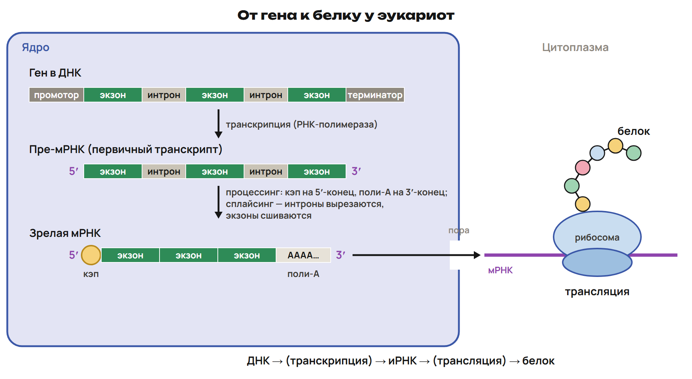
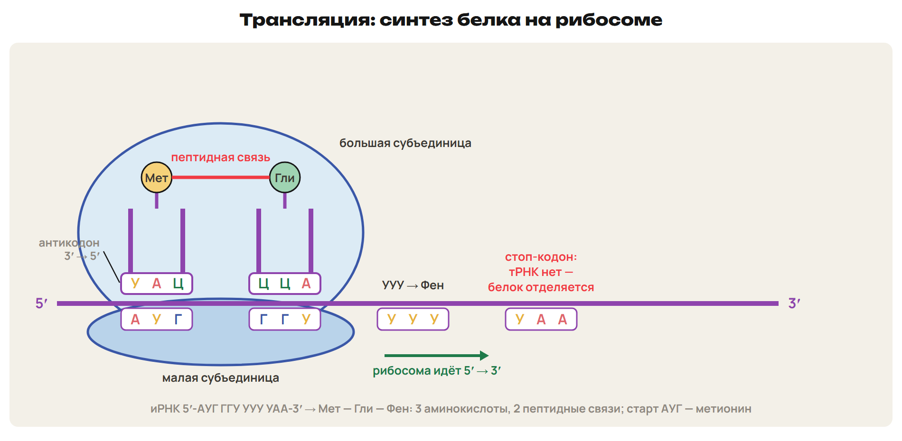

# Урок 28. Генетический код и синтез белка

Пятница 19 февраля 2027; 90 минут. Группы 18:00–19:30 и 19:30–21:00.

Причина → алгоритм → разные примеры → ловушка → самостоятельная попытка. Ключи L показывать после попытки. Предварительное чтение перед первым уроком не требуется.

## План на 90 минут

| Время | Действие |
|---|---|
| 0–20 | 0–4 вопросы; 4–14 G9/G10; 14–18 L7; 18–20 ключ. |
| 20–33 | 20–27 ген, свойства кода и чтение таблицы; 27–31 L8; 31–33 ключ. |
| 33–49 | 33–42 пять элементов транскрипции, цепи и процессинг; 42–47 L9; 47–49 ключ. |
| 49–64 | 49–57 тРНК, этапы и алгоритм перевода; 57–62 L10; 62–64 ключ. |
| 64–78 | 64–67 алгоритм размеров; 67–72 L11; 72–74 ключ; 74–77 L12 и ключ; 77–78 факт недели. |
| 78–88 | Контроль без подсказок, отдельный ключ после сдачи. |
| 88–90 | Назначить один маршрут, приложение A не продлевает урок. |

## 1. Возврат: состав и судьба старых цепей · 0–20 минут

**Вопрос:** Какие данные относятся к одной цепи, а какие — к молекуле?

**Связка:** Домашние расчёты связали пары оснований и копирование. Сначала проверим область счёта.

**Отметь единицу счёта.** Для состава: одна цепь или все нуклеотиды двойной молекулы? Для длины: число пар, а не сумма нуклеотидов двух цепей. Для опыта: сколько исходных тяжёлых молекул и сколько полных циклов? Для доли: часть нужного типа делится на общее число потомков. Старые цепи не появляются заново на лёгкой среде.

### Разбор G9–G10

G9. В двуцепочечной ДНК Ц = 288, это 24 % всех нуклеотидов. Найди состав, пары, длину, массу и число водородных связей. G10. Две исходные тяжёлые молекулы прошли три цикла на ¹⁴N; все потомки сохранены. Найди общее число, гибридные и лёгкие молекулы; назови долю гибридных.

**Ответ и решение:** G9: N = 288/0,24 = 1200; Г = Ц = 288, А = Т = 312. 600 пар, L = 204 нм; Mᵣ = 414 000. H-связи: 2 × 312 + 3 × 288 = 1488. G10: 2 × 2³ = 16; четыре гибридные и 12 лёгких, 25 %. Первый цикл исключает консервативную, второй — дисперсную модель.

**Типичная ошибка и новая проверка:** Принять число Ц за число всех пар Г–Ц в одной цепи без проверки формулировки либо удвоить число гибридных в каждом цикле.

### L7

Гуанин составляет 31 % всех нуклеотидов двуцепочечной ДНК. Найди Ц, А и Т. Сохраняется ли обязательное равенство А = У для одной молекулы мРНК?

**Ответ и решение:** Ц = 31 %; на А + Т остаётся 38 %, по 19 % каждого. Для одной мРНК обязательного равенства А = У нет.

**Типичная ошибка и новая проверка:** Применять правило комплементарности всей двойной ДНК к одной РНК. Новая проверка: назвать, сколько цепей задано.

## 2. Генетический код: как прочитать таблицу · 20–33 минут

**Вопрос:** Почему несколько кодонов одной аминокислоты не делают код неоднозначным?

**Связка:** Состав молекулы посчитан. Теперь важен порядок оснований и деление на тройки.

**От гена к последовательности.** Ген — участок ДНК с информацией о функциональном продукте. Продуктом может быть белок или функциональная РНК. Регуляторные гены участвуют в управлении работой других генов. Генотип — совокупность генов организма. Генетический код связывает кодоны мРНК с аминокислотами. 64 кодона: 61 смысловой и три стоп-кодона — УАА, УАГ, УГА.

**Свойства и пределы школьной записи.** Триплетность: один кодон содержит три нуклеотида. В данной рамке кодоны идут непрерывно и не перекрываются. Рибосома читает мРНК в направлении 5′ → 3′. Однозначность: один смысловой кодон задаёт одну аминокислоту. Вырожденность: несколько кодонов могут задавать одну аминокислоту. Порядок кодонов соответствует порядку аминокислот; основной код почти универсален.

Непрерывность относится к читаемому кодирующему участку зрелой мРНК, не к гену с интронами. Исключения митохондриального кода рассматриваются в приложении A.

**Таблица на языке мРНК.** Первое основание ищи слева, второе сверху, третье справа. В таблице стоят А, У, Г, Ц; тимин в кодон мРНК не подставляют. АУГ — метионин и обычный старт в рассматриваемых заданиях. УУУ — фенилаланин: М. Ниренберг и Г. Маттеи, 1961 год. По одному кодону в основном коде имеют метионин и триптофан. Полная таблица и сокращения аминокислот — в разделе 4 конспекта и в памятке.

### L8

По таблице назови значения кодонов АУГ, УГГ, ЦАГ, УГА. УУУ и УУЦ задают фенилаланин: какое свойство это показывает? Почему из этого не следует, что один кодон может задавать две разные аминокислоты?

**Ответ и решение:** АУГ — Мет, УГГ — Три, ЦАГ — Глн, УГА — стоп. Два кодона одной аминокислоты показывают вырожденность. Каждый из этих смысловых кодонов остаётся однозначным.

**Типичная ошибка и новая проверка:** Прочитать УГГ как тирозин или ЦАГ как гистидин по ошибочной таблице; спутать вырожденность и неоднозначность.

## 3. Транскрипция и созревание мРНК · 33–49 минут

**Вопрос:** С какой цепью совпадает запись мРНК и когда это совпадение нужно оговаривать?

**Связка:** Код читают по мРНК. Получим её из заданной цепи ДНК.

**Пять элементов транскрипции.** Матрица — одна цепь ДНК; растущий продукт — РНК. Субстраты — АТФ, ГТФ, ЦТФ, УТФ. Эти рибонуклеотиды служат и источником энергии для удлинения. Ферменты — РНК-полимеразы; участвуют белковые факторы. Промотор связан с началом, терминатор — с завершением транскрипции. Транскрипцией образуются мРНК, тРНК и рРНК.

Не приписывать ТАТА-бокс каждому промотору и не заменять терминатор ДНК стоп-кодоном мРНК.

**Две цепи — две роли.** РНК-полимераза читает матричную цепь ДНК в направлении 3′ → 5′. Новая РНК растёт в направлении 5′ → 3′ и комплементарна матрице. Для данного участка до процессинга РНК совпадает с кодирующей цепью ДНК, если Т заменить на У. Сначала подпиши концы и назови, какая цепь дана. Затем подбирай основания; кодирующую цепь повторно не комплементируй. РНК-полимераза может начинать цепь самостоятельно.

**РНК проходит созревание.** 

**Что остаётся после процессинга.** Пре-мРНК — первичный транскрипт рассматриваемого ядерного гена эукариоты. Кэп присоединяется к 5′-концу, поли-А — к 3′-концу. При сплайсинге интроны вырезаются, экзоны соединяются. Экзоны остаются в зрелой мРНК; не вся их длина обязательно переводится в белок. Зрелая мРНК выходит из ядра к рибосомам. Удалённый интрон нельзя включать в длину зрелой мРНК.

Интрон не называют «бесполезной ДНК». Для расчёта отдельно задать кодирующую часть, стоп и нетранслируемые участки.

### L9

Дана матричная цепь ДНК: 3′-ТАЦ ТТТ ГГГ АЦЦ АТТ-5′. Запиши РНК 5′ → 3′ и кодирующую цепь ДНК 5′ → 3′. Считай данный участок непрерывным: процессинг и редактирование последовательность не изменяют. Какая цепь ДНК совпадает с РНК с заменой У на Т?

**Ответ и решение:** мРНК: 5′-АУГ ААА ЦЦЦ УГГ УАА-3′. Кодирующая ДНК: 5′-АТГ ААА ЦЦЦ ТГГ ТАА-3′. РНК комплементарна матричной и совпадает с кодирующей после замены Т на У.

**Типичная ошибка и новая проверка:** Скопировать матричную цепь без комплементарности или заменить Т на У в неверной цепи. Новая проверка: сопоставить первый триплет ТАЦ с АУГ.

## 4. Трансляция: от кодона к пептиду · 49–64 минут

**Вопрос:** Что происходит, когда рибосома доходит до стоп-кодона?

**Связка:** РНК получена и созрела. Теперь её кодоны служат матрицей для порядка аминокислот.

**Кодон и антикодон встречаются в рибосоме.** 

**Три этапа трансляции.** Инициация: рибосома начинает на заданном стартовом АУГ, приходит инициаторная тРНК с метионином. Элонгация: тРНК доставляют аминокислоты, образуются пептидные связи. Транслокация — перемещение рибосомы на один кодон. Терминация: УАА, УАГ или УГА останавливает перевод в данной рамке. Стоп-кодон не задаёт аминокислоту и не имеет соответствующей тРНК. Полипептид освобождается при участии белковых факторов.

Матрица трансляции — мРНК, органоид — рибосома; РНК-полимераза относится к транскрипции. Не описывать все детали бактерий и эукариот одной обязательной схемой посадки.

**Алгоритм перевода фрагмента.** Укажи направление мРНК 5′ → 3′ и заданный старт. Раздели читаемую часть на неперекрывающиеся тройки. Для каждой тройки найди аминокислоту по таблице основного кода. Первый стоп в этой рамке прекращает перевод. Антикодоны пиши напротив кодонов в направлении 3′ → 5′. У линейного пептида из k аминокислот k − 1 пептидная связь.

### L10

мРНК: 5′-АУГ ЦЦУ ГАА УУА УГА-3′; перевод начинается с указанного первого АУГ. По основному коду запиши полипептид и число пептидных связей. Запиши антикодоны тРНК 3′ → 5′ для смысловых кодонов. Нужно ли записывать антикодон для УГА?

**Ответ и решение:** Кодоны АУГ / ЦЦУ / ГАА / УУА / УГА → Мет — Про — Глу — Лей — стоп. Четыре аминокислоты, три пептидные связи. Антикодоны: 3′-УАЦ-5′; 3′-ГГА-5′; 3′-ЦУУ-5′; 3′-ААУ-5′. Для УГА соответствующей тРНК и антикодона нет.

**Типичная ошибка и новая проверка:** Посчитать стоп пятой аминокислотой или записать антикодоны в том же направлении без разворота. Новая проверка: подписать концы хотя бы одной пары.

## 5. Размеры молекул и путь информации · 64–78 минут

**Вопрос:** Где в расчёте появляются множители три и два?

**Связка:** Прочитали короткую последовательность. Свяжем число аминокислот с длиной кодирующего участка.

**Сначала границы расчётной модели.** Одна аминокислота — один смысловой кодон: три нуклеотида мРНК. Соответствующий двуцепочечный участок содержит три пары, то есть шесть нуклеотидов. Стоп добавляет три нуклеотида РНК и три пары ДНК, только когда он включён условием. Интроны и нетранслируемые участки учитывают отдельно, если они заданы. Для учебного приближения принимаем Mᵣ нуклеотида 345 и аминокислотного остатка 120. Это расчёт выбранного участка, а не универсальная длина целого гена.

### L11

Полипептид содержит 110 аминокислот, включая инициаторный метионин. Найди число нуклеотидов кодирующей части мРНК, число пар и всех нуклеотидов соответствующей ДНК, длину и Mᵣ ДНК, Mᵣ полипептида. Стоп-кодон, интроны и нетранслируемые участки в этот расчёт не включать. Задано: шаг 0,34 нм, Mᵣ нуклеотида 345, Mᵣ аминокислотного остатка в учебной модели 120.

**Ответ и решение:** мРНК: 110 × 3 = 330 нуклеотидов. ДНК: 330 пар, 660 нуклеотидов; L = 330 × 0,34 = 112,2 нм. Mᵣ ДНК = 660 × 345 = 227 700. Mᵣ полипептида ≈ 110 × 120 = 13 200.

**Типичная ошибка и новая проверка:** Считать 330 нуклеотидами всей двойной ДНК или добавить стоп вопреки условию. Учебный коэффициент 120 уже задан для остатка, воду повторно не вычитать.

### L12

Процесс I: матрица — ДНК, продукт — РНК, работает РНК-полимераза. Процесс II: матрица — мРНК, продукт — полипептид, работает рибосома. Назови процессы и для каждого различи завершение: терминатор ДНК или стоп-кодон мРНК?

**Ответ и решение:** I — транскрипция, завершение связано с терминатором ДНК. II — трансляция, завершение происходит на стоп-кодоне мРНК в данной рамке. ДНК-полимераза и копирование ДНК относятся к репликации.

**Типичная ошибка и новая проверка:** Смешать РНК-полимеразу и рибосому или остановить транскрипцию на стоп-кодоне.

**Казахстанская молекулярная биология.** М. А. Айтхожин — основатель молекулярной биологии в Казахстане. Его исследования связаны с белоксинтезирующим аппаратом, в том числе растений. Его группа открыла информосомы растений — комплексы нерибосомной РНК с белком. Различия белоксинтезирующих систем бактерий и эукариот позволяют избирательно подавлять бактериальную трансляцию.

## 6. Контроль и домашний маршрут · 78–90 минут

**Вопрос:** Можешь ли ты пройти от исходных данных до ответа без подмены процесса?

**Связка:** Связали состав, направление и размеры. Проверим это на новых условиях.

**Контроль Q1–Q6.** 10 минут, 10 баллов. Q1–Q3 — одна буква; Q4 — все верные буквы; Q5 — две пары. Q6 — объяснение и расчёт по контексту. Следи за направлением цепей, областью счёта и заданной моделью кода. Ответы сдай до обсуждения ключа.

После урока 27: конспект 1–3 — 25 минут, P — 20, G — 35. После урока 28: один A/B/C — 30, исправления — 25, повторение 4–6 и фактов — 15, контекст-трек — 15. Всего 165 минут.

Контроль 78–88 минуты, 10 баллов; ключ отделить до выдачи. A — уверенная база, B — отдельные ошибки, C — нужна таблица; учитывать также диагностику, G и объяснение ученика. Приложение только для A, чтение внутри его 30 минут. Реальный темп проверить на пробном занятии; сокращать повторные примеры, сохраняя попытки L/Q.

## Приложение к варианту A — внутри его 30 минут

Четыре опоры ниже читаются с вариантом A; они не увеличивают 90 минут урока.

### Углубление A · Детали транскрипции

Эукариотические РНК-полимеразы имеют крупные и малые субъединицы; работают с белковыми факторами. Если промотор содержит ТАТА-бокс, его распознаёт ТАТА-связывающий фактор. Асимметрия промотора связана с направлением и выбором матричной цепи. У бактерий σ-фактор участвует в распознавании промотора; в описанной модели отделяется после первых 8–10 нуклеотидов. РНК-полимераза может начинать цепь самостоятельно. Размер раскрытого участка около 17 пар и скорость 40–50 нуклеотидов/с — параметры учебного примера, не общая постоянная.

### Углубление A · Созревание и рамка

Кэп, сплайсинг и поли-А относятся к созреванию; редактирование дополнительно меняет последовательность РНК. Этапы созревания могут регулировать уровень экспрессии. У одной последовательности есть три возможные рамки; читаемая задаётся началом трансляции. В обычной эукариотической модели рибосома сканирует от кэпа к старту. У бактерий внутренние стартовые сигналы позволяют начинать на определённых участках мРНК. При элонгации один белковый фактор доставляет аминоацил-тРНК, другой обеспечивает транслокацию.

### Углубление A · Правило и исключение

Для митохондрий позвоночных в данной таблице УГА задаёт Три, АУА — Мет. В основном коде УГА — стоп, АУА — Иле: используем код, прямо названный в условии. Третье равенство Чаргаффа А + Ц = Г + Т относится ко всей двуцепочечной ДНК. Консервативная модель предсказывает тяжёлую и лёгкую полосы уже после первого цикла. Дисперсная — одну промежуточную полосу и после второго. При полуконсервативной модели число старых тяжёлых цепей в сохраняемой линии не растёт.

### Углубление A · Несколько шагов расчёта

Пример: 70 аминокислот, один стоп-кодон и один интрон длиной 30 нуклеотидов; других участков нет. Кодирующая часть со стопом: 70 × 3 + 3 = 213 нуклеотидов; фрагмент гена: 213 + 30 = 243 пары. L = 243 × 0,34 = 82,62 нм; Mᵣ ДНК = 2 × 243 × 345 = 167 670. Учебная Mᵣ полипептида ≈ 70 × 120 = 8400. Если компонент с относительной массой a встречается хотя бы один раз и его доля b %, то Mᵣ,min = a × 100/b. Например, a = 56 и b = 0,2 % дают минимальную Mᵣ 28 000.
