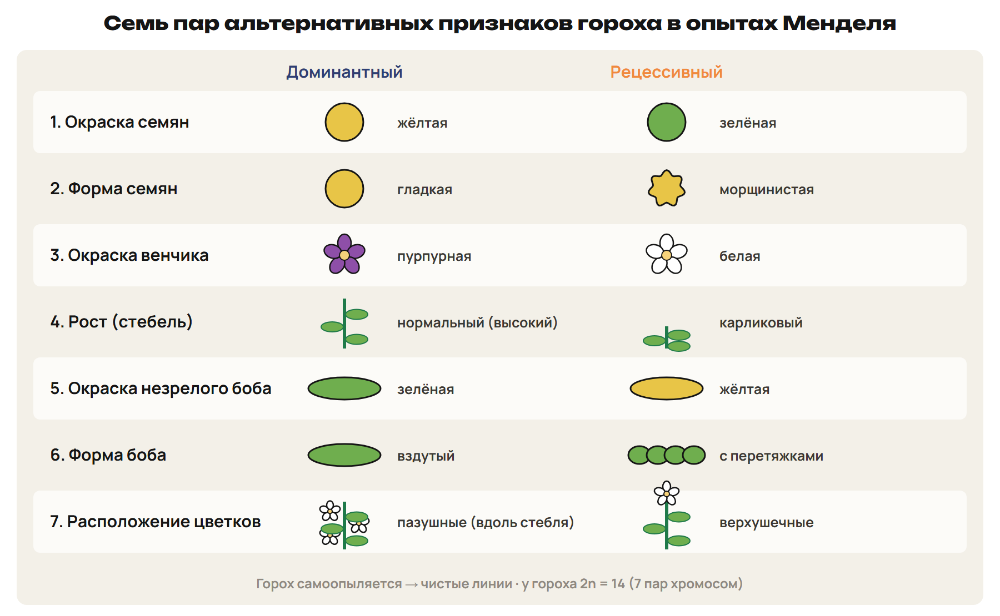
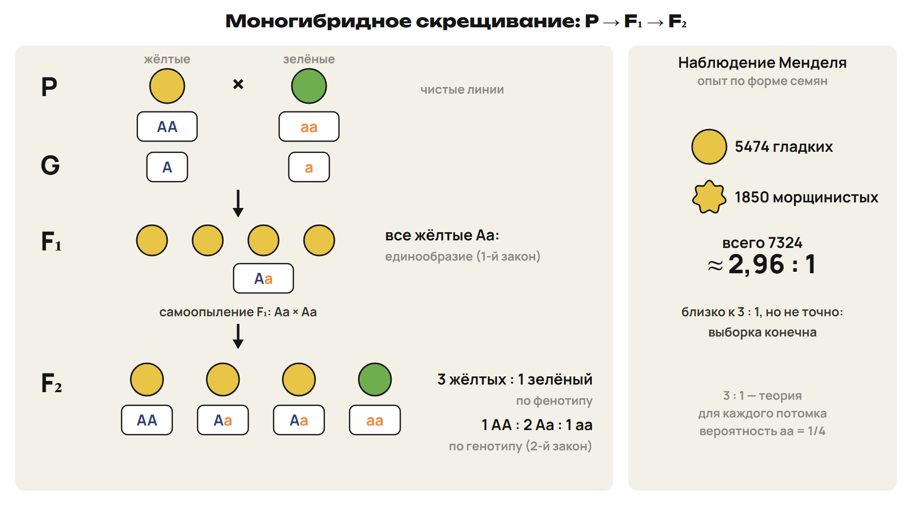
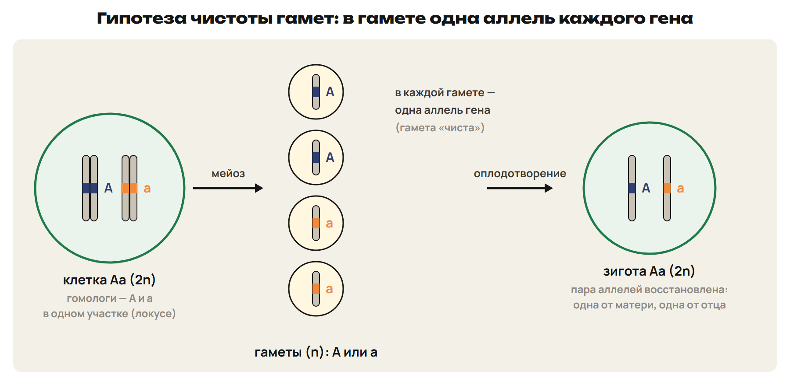
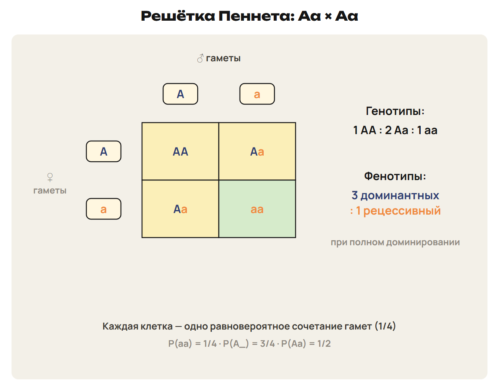

# Мендель: считать потомков, а не отдельные случаи
? Почему по одному потомку нельзя установить закон наследования?
↳ Ген и хромосома знакомы. Теперь проследим передачу вариантов признака через поколения.
> 0–10 метод, горох и исторические данные; 10–13 L1; 13–15 ключ.

## Понятие: Генетика и гибридологический метод
Генетика изучает закономерности наследственности и изменчивости.
Г. Мендель — основатель генетики.
«Опыты над растительными гибридами» опубликованы в 1866 году.
Гибридологический метод: скрещивание и анализ потомства.
Мендель сочетал опыты с подсчётом числовых соотношений.
Законы были переоткрыты в 1900 году.
> Встречающееся в учебнике 1901 заменить на 1900. Дату статьи отличать от даты переоткрытия.

## Схема: Почему горох удобен для опыта

Самоопыление помогает сохранять исследуемые чистые линии.
Перекрёстное опыление позволяет выбрать обоих родителей.
В опытах — семь пар альтернативных признаков; 2n гороха = 14.
Чистая линия гомозиготна по рассматриваемому локусу.
> Самоопыление не делает любое растение автоматически гомозиготным по всем генам. Не связывать число семи признаков с универсальным правилом «одна хромосома — один ген».

## Понятие: Наблюдение и теоретическое отношение
В моногибридном опыте по форме семян: 5474 гладких и 1850 морщинистых.
Всего 7324; отношение около 2,96 : 1.
Теоретическая модель даёт 3 : 1 при заданных условиях.
Конечная выборка не обязана совпадать с этим отношением точно.
Вероятность относится к каждому новому потомку.

## Практика: L1
Назови объект опытов Менделя и два преимущества этого растения.
Что добавляет подсчёт большого потомства к описанию одного растения?
Назови год статьи и год переоткрытия законов.
Почему 5474 : 1850 не записывают как точное 3 : 1?
Ответы:
Горох; самоопыление и возможность контролировать скрещивание.
Подсчёт позволяет сопоставлять частоты с ожидаемыми отношениями.
Статья — 1866, переоткрытие — 1900.
Наблюдаемая конечная выборка даёт около 2,96 : 1, а не точное отношение.
> 10–13 попытка, 13–15 ключ.

# Аллель, генотип и единообразное F₁
? Почему одинаковый внешний признак не всегда означает одинаковый генотип?
↳ Скрещивание описывает передачу аллелей. Сначала договоримся, что означает каждая буква.
> 15–25 понятия, символы и первый закон; 25–28 L2; 28–30 ключ.

## Понятие: Один ген — разные аллели
Аллели — варианты одного гена в одинаковых локусах гомологичных хромосом.
В диплоидной модели по локусу записывают две аллели.
AA и aa — гомозиготы; Aa — гетерозигота.
Генотип — совокупность генов; запись Aa показывает исследуемый локус.
Фенотип — проявление признаков организма.
При полном доминировании AA и Aa имеют одинаковый доминантный фенотип.
> Различать определение генотипа организма и краткую запись одного изучаемого локуса. Фенотип не ограничивается только внешним видом.

## Понятие: Как читать генетическую запись
P — родители; ♀ и ♂ отмечают родительские организмы.
 × — скрещивание; G — гаметы; F₁ и F₂ — поколения потомков.
При полном доминировании A обозначает доминантную аллель, a — рецессивную.
У гаметы одна аллель каждого рассматриваемого гена.
Рецессивный фенотип в этой модели имеет генотип aa.
Для доминантного фенотипа сначала оставь два варианта: AA или Aa.

## Схема: От чистых линий к F₂

Первый закон: при AA × aa все потомки F₁ — Aa.
При полном доминировании F₁ проявляет доминантный вариант.
Результат не меняется при обмене родительскими ролями в данной модели.
> Область — рассматриваемое аутосомное наследование. Неполное доминирование изменит вид F₁, но сохранит его единообразие; это будет во втором уроке.

## Практика: L2
У гороха пурпурный венчик A полностью доминирует над белым a.
Скрещены чистые линии: P ♀ AA × ♂ aa.
Запиши G и F₁; назови генотип и фенотип потомков.
Как изменится ответ для P ♀ aa × ♂ AA в этой же модели?
Ответы:
G: у AA только A, у aa только a.
F₁: все Aa, венчик пурпурный.
Гибриды единообразны по генотипу и рассматриваемому фенотипу.
При обмене родительскими ролями результат тот же.
> 25–28 попытка, 28–30 ключ.

# Чистота гамет: хромосомы расходятся, аллели не смешиваются
? Почему гетерозигота Aa образует гаметы A и a, а не гамету Aa?
↳ Получили гибрид. Его собственное потомство объясняется поведением гомологов в мейозе.
> 30–39 цитологическая основа и гаметы; 39–43 L3; 43–45 ключ.

## Схема: Аллели в мейозе гетерозиготы

Аллели одного локуса расположены в гомологичных хромосомах.
Мейоз разводит гомологи по гаплоидным клеткам.
Чистота гамет: A и a не превращаются в усреднённую аллель.
Оплодотворение вновь соединяет две аллели локуса.
> У животных речь о мейозе клеток-предшественников гамет. У растений мейоз образует споры, а гаметы появляются в гаметофите; не называть мейоз делением зиготы на четыре гаметы.

## Понятие: Сколько сортов по одному локусу
AA образует один сорт гамет A.
aa образует один сорт гамет a.
Aa образует два сорта A и a, по 1/2 в заданной модели.
Один сорт — тип состава, а не одна физическая гамета.
Вероятности задаются для случайного оплодотворения.
Потомки равножизнеспособны, если в условии не оговорено иное.

## Практика: L3
Назови сорта гамет по исследуемому локусу у AA, Aa и aa.
Каковы вероятности A и a у гетерозиготы?
В обычной животной модели зрелая гамета n1c или 2n2c?
Объясни, как оплодотворение восстанавливает парность аллелей.
Ответы:
AA → A; Aa → A и a по 1/2; aa → a.
Зрелая гамета — n1c.
Два гаплоидных набора соединяются; потомок получает по аллели от каждого родителя.
Аллели не смешиваются и сохраняются при передаче.
> 39–43 попытка, 43–45 ключ.

# Решётка Пеннета и второй закон
? Откуда возникают разные отношения 1 : 2 : 1 и 3 : 1?
↳ Знаем гаметы гибрида. Теперь переберём их случайные сочетания.
> 45–53 решётка и два способа группировки; 53–58 L4; 58–61 ключ.

## Схема: Четыре сочетания двух сортов гамет

Р. Пеннет предложил таблицу сочетаний гамет.
Сначала выпиши гаметы, затем заполни все клетки.
Две клетки Aa дают один генотипический класс с вероятностью 1/2.
AA и Aa объединяются только при подсчёте доминантного фенотипа.

## Понятие: Алгоритм моногибридной задачи
Дано: обозначь аллели и тип доминирования.
P: установи генотипы родителей.
G: выпиши сорта гамет и вероятности.
Решётка: соедини по одной аллели двух родителей.
Ответ: отдельно генотипы, фенотипы и требуемая вероятность.
Ожидаемое число = число потомков × вероятность; это прогноз модели.

## Практика: L4
У гороха высокий стебель A полностью доминирует над карликовым a.
P ♀ Aa × ♂ Aa; гаметы равновероятны, оплодотворение случайно.
Найди генотипические и фенотипические вероятности F₁.
Какие числа ожидаются среди 192 потомков? Не считай эти числа обязательным результатом опыта.
Ответы:
G: A и a у каждого родителя; клетки AA, Aa, Aa, aa.
Генотипы 1/4 AA : 1/2 Aa : 1/4 aa; ожидаются 48, 96, 48.
Фенотипы 3/4 высоких : 1/4 карликовых; ожидаются 144 и 48.
3 : 1 описывает фенотипы, 1 : 2 : 1 — генотипы.
> 53–58 попытка, 58–61 ключ. Таблицу 2 × 2 построить в тетради.

# Шесть моногибридных скрещиваний
? Нужно ли строить четыре клетки, если один родитель даёт один сорт гамет?
↳ Одинаковый алгоритм работает не только для двух гетерозигот. Меняется список гамет.
> 61–70 шесть случаев и проверка по гаметам; 70–75 L5; 75–78 ключ.

## Понятие: Результат выбирается родителями
AA × AA → все AA; AA × Aa → 1 AA : 1 Aa.
AA × aa → все Aa; Aa × Aa → 1 AA : 2 Aa : 1 aa.
Aa × aa → 1 Aa : 1 aa; aa × aa → все aa.
Это шесть различных сочетаний по одному локусу без учёта обмена родителей.
Генотипическое отношение сначала получи из гамет.
Фенотипическое отношение зависит также от типа доминирования.

## Практика: L5
У гороха зелёный боб A полностью доминирует над жёлтым a.
P ♀ Aa × ♂ aa; вероятности гамет обычные для этой модели.
Запиши G и вероятности генотипов F₁.
Какие фенотипические числа ожидаются среди 56 потомков?
Ответы:
G: у ♀ A и a по 1/2; у ♂ только a.
F₁: 1/2 Aa и 1/2 aa.
Ожидаются 28 зелёных и 28 жёлтых бобов.
Числа относятся к ожидаемому распределению, а не к обязательному итогу опыта.
> 70–75 попытка, 75–78 ключ.

# Вероятность одного потомка и условная доля
? Почему среди доминантных потомков гетерозигот 2/3, а не 1/2?
↳ Решётка одна и та же, но вопрос может ограничить круг потомков для подсчёта.
> 78–82 условная выборка; 82–86 L6; 86–88 ключ; 88–90 маршрут.

## Понятие: Сначала назови множество для доли
После Aa × Aa при полном доминировании: AA, Aa, Aa, aa.
Среди всех потомков гетерозигот 2/4 = 1/2.
Среди доминантных фенотипов остаются только AA, Aa, Aa.
В этой группе гетерозигот 2/3, гомозигот AA 1/3.
Рецессивный потомок имеет вероятность 1/4 при каждом новом оплодотворении.
Из четырёх реальных потомков не обязательно ровно один рецессивный.

## Практика: L6
P ♀ Aa × ♂ Aa, полное доминирование, потомки равножизнеспособны.
Найди долю Aa среди всех потомков и отдельно среди имеющих доминантный фенотип.
Какое из шести моногибридных скрещиваний даёт теоретически только Aa?
Почему четыре рождения не гарантируют точное фенотипическое отношение 3 : 1?
Ответы:
Среди всех Aa: 2/4 = 1/2; среди доминантных: 2/3.
Только Aa даёт P ♀ AA × ♂ aa или обмен родительскими ролями.
Случайное получение малого потомства может дать другие частоты.
Теоретическая вероятность не предписывает точное число каждого типа.
> 82–86 попытка, 86–88 ключ.

## Дома: После урока 29
Прочитай разделы 1–3 конспекта: 25 минут.
Реши P1–P6 : 20 минут.
Выполни всю G: 35 минут.
Тест пришли строкой; две задачи — фото решения.
Запиши вопрос к началу следующего урока.
