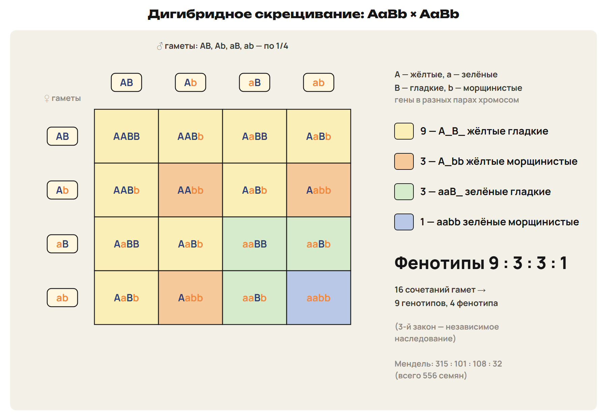
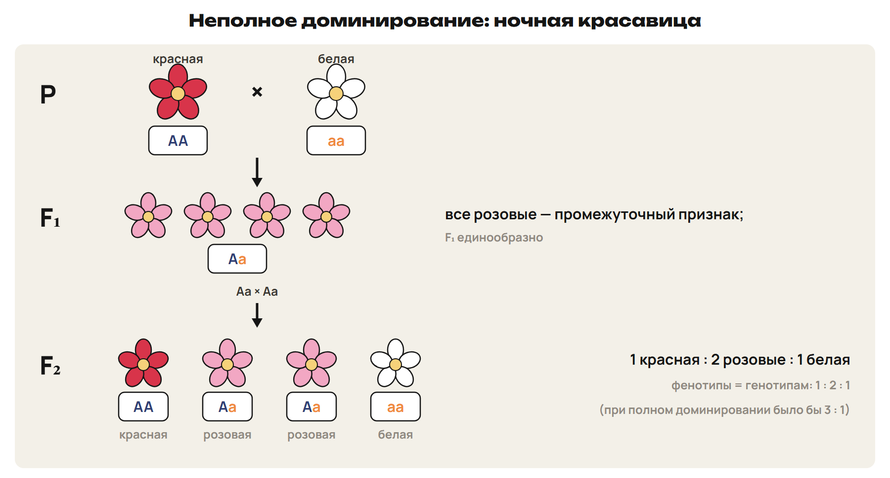
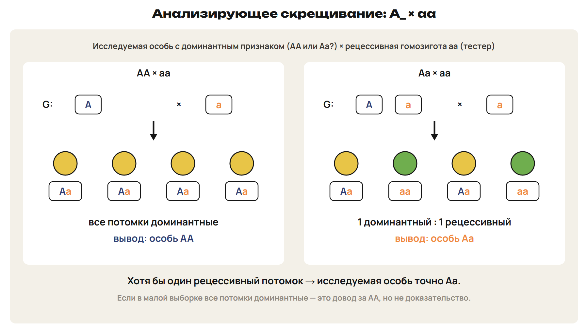

После урока 29 прочитай разделы 1–3, затем реши P и общую часть G. После урока 30 повтори разделы 4–6 и факты, выполни один назначенный вариант A/B/C. Сначала попытка, затем ключ.

## 1. Мендель, метод и язык генетики

Почему одинаково выглядящие родители могут дать разное потомство? Доминантный фенотип не всегда раскрывает генотип. Генетика изучает закономерности наследственности и изменчивости; её основателем считают Грегора Менделя. Его статья «Опыты над растительными гибридами» опубликована в 1866 году, законы переоткрыты в 1900 году.

Гибридологический метод — скрещивание организмов с различающимися альтернативными признаками и анализ потомства. Мендель соединял скрещивания с подсчётом результатов. У гороха удобно самоопыление, возможны контролируемые скрещивания, различимы семь пар признаков; в диплоидной клетке 2n = 14.

Ген — участок наследственного материала, связанный с функциональным продуктом. Аллели — варианты одного гена в соответствующих участках гомологичных хромосом. Например, в задаче A связано с высокой формой гороха, a — с карликовой. Это один ген с двумя рассматриваемыми аллелями, а не два разных гена.

Генотип — совокупность генов организма; запись AA, Aa или aa описывает его по выбранному гену. Фенотип — проявляющиеся признаки. При полном доминировании AA и Aa имеют одинаковый доминантный фенотип, aa — рецессивный. Рецессивная аллель в Aa сохраняется и может перейти потомку.

> [!rule] Сначала обозначения
> P — родители; ♀ и ♂ — материнская и отцовская формы; символ ♀ называют зеркалом Венеры, ♂ — щитом и копьём Марса; × — скрещивание; G — гаметы; F₁ и F₂ — первое и второе поколения. По каждому выбранному гену у диплоидного организма две аллели, у гаметы — одна. A/a и B/b записывай латиницей.

Гомозигота имеет одинаковые аллели по исследуемому гену: AA или aa. Гетерозигота — разные: Aa. Чистая линия сохраняет изучаемый вариант при размножении; в рассматриваемом скрещивании родители гомозиготны по этому гену. Самоопыление помогает получать и сохранять такие линии, но не превращает любое растение сразу в гомозиготу.

Моногибридное скрещивание рассматривает одну пару альтернативных признаков, дигибридное — две. Два цвета одного признака не делают скрещивание дигибридным.

> [!example] Два одинаковых фенотипа
> AA и Aa — высокие растения при полном доминировании A. Но первое даёт только гаметы A, второе — A и a. По одному внешнему виду эти генотипы не различить.

> [!trap] Ген — не название одной аллели
> A и a — варианты одного гена. «Доминантный» описывает проявление аллели в выбранной модели, а не её полезность или распространённость.

> [!try] Прочитай запись
> Что описывают P, G и F₁? Чем отличаются AA и Aa, если оба растения высокие? Какой генотип соответствует карликовому растению при полном доминировании A?

## 2. Единообразие F₁ и расщепление F₂

При скрещивании чистых линий AA и aa каждый потомок получает A от одного родителя и a от другого. Все F₁ имеют генотип Aa. Это единообразие гибридов первого поколения — первый закон Менделя. Название «первый закон» появилось после смерти Менделя. При полном доминировании они похожи по признаку на доминантного родителя независимо от того, был он материнской или отцовской формой.

P: ♀ AA × ♂ aa. G: A × a. F₁: все Aa. Для исторического опыта с горохом A — жёлтые семена, a — зелёные; все F₁ жёлтые.

У гибридов F₁ гаметы A и a образуются с одинаковой вероятностью. При их скрещивании четыре сочетания гамет равновероятны. Р. Пеннет предложил записывать их решёткой: гаметы одного родителя идут по строкам, другого — по столбцам.

P: ♀ Aa × ♂ Aa. G: у каждой формы A и a по 1/2. F₂:

| ♀ \ ♂ | A | a |
|---|---|---|
| A | AA | Aa |
| a | Aa | aa |

По генотипу: 1 AA : 2 Aa : 1 aa. При полном доминировании по фенотипу: 3 A_ : 1 aa, где A_ означает AA или Aa. Это расщепление — второй закон Менделя. Один потомок имеет вероятность 1/4 оказаться aa; вероятность доминантного фенотипа — 3/4.

> [!rule] Алгоритм моногибридной задачи
> Обозначь аллели и доминирование → выпиши P → получи G → соедини по одной аллели каждого родителя → сгруппируй F по генотипу и фенотипу → назови вероятность нужного исхода.

В опыте Менделя получено 7324 семени: 5474 жёлтых и 1850 зелёных, около 2,96 : 1. Это близко к теоретическим 3 : 1. Конечная выборка не обязана делиться точно на четыре равные части.

> [!example] Гетерозигота и рецессивная гомозигота
> У гороха высокая форма A полностью доминирует над карликовой a. P: ♀ Aa × ♂ aa; G: A, a × a. F₁: 1 Aa : 1 aa, половина высоких и половина карликовых. Для 240 потомков ожидаются 120 высоких и 120 карликовых; фактические числа могут отличаться.

> [!trap] Две разные группировки
> 3 : 1 объединяет AA и Aa по фенотипу. В записи 1 : 2 : 1 они остаются разными генотипами. Одинаковый фенотип не делает их одним генотипом.

> [!try] Проверь каждую клетку
> В Aa × Aa найди вероятность AA, Aa и aa. Почему сочетания A от матери с a от отца и a от матери с A от отца дают один генотип Aa, но учитываются двумя клетками?

## 3. Чистота гамет, мейоз и вероятность

Гипотеза чистоты гамет: каждая гамета получает одну аллель из пары, аллели гетерозиготы не смешиваются. Цитологическая основа — расхождение гомологичных хромосом при мейозе. В рассматриваемой диплоидной клетке аллели находятся в соответствующих участках пары гомологов; после мейоза гамета несёт один гомолог, при оплодотворении пара восстанавливается.

У животных мейоз идёт в клетках-предшественниках гамет. У растений он образует споры, а гаметы возникают позднее в гаметофите. Не представляй любой жизненный цикл как деление зиготы непосредственно на четыре гаметы.

Для одного гена AA даёт только A, aa — только a, Aa — A и a по 1/2. Если рассмотрены два гена, в гамете должно быть по одной аллели каждого: например, AB. «Одна аллель» не означает одну букву на весь набор генов.

Все шесть сочетаний моногибридных родителей при полном доминировании:

| P | Генотипы потомков | Фенотипы |
|---|---|---|
| AA × AA | Все AA | Все доминантные |
| AA × Aa | 1 AA : 1 Aa | Все доминантные |
| AA × aa | Все Aa | Все доминантные |
| Aa × Aa | 1 AA : 2 Aa : 1 aa | 3 доминантных : 1 рецессивный |
| Aa × aa | 1 Aa : 1 aa | 1 доминантный : 1 рецессивный |
| aa × aa | Все aa | Все рецессивные |

> [!rule] Укажи, среди кого ищешь долю
> Для Aa × Aa вероятность Aa среди всех потомков равна 1/2. Среди потомков с доминантным фенотипом остаются только AA и Aa: из трёх равновероятных клеток две — Aa, поэтому условная доля 2/3.

При вычислении ожидаемого числа умножь вероятность на число потомков. Это теоретическое ожидание, не обещание точного результата. Вероятность для следующего потомка при неизменных условиях не меняется от того, какими были предыдущие.

> [!example] Половина или две трети
> В Aa × Aa клетки AA, Aa, Aa, aa равновероятны. Среди всех — две Aa из четырёх. Если уже известно, что потомок имеет доминантный фенотип, клетка aa исключена: две Aa из трёх оставшихся.

> [!trap] Гамета не несёт пару аллелей одного гена
> Запись Aa для гаметы неверна в этой модели. Обозначения A и a относятся к аллелям; n и c описывают набор хромосом и количество ДНК, а не число букв в генотипе.

> [!try] Выбери нужную совокупность
> В Aa × Aa найди долю гомозигот среди всех потомков и долю AA среди доминантных. Какую вероятность используешь для ожидаемого числа aa из большой партии?

## 4. Дигибридное скрещивание и третий закон

Теперь проследи два гена. В этой модели они находятся в разных парах хромосом, распределяются независимо, а доминирование по каждому признаку полное. A — жёлтые семена гороха, a — зелёные; B — гладкая форма, b — морщинистая.

P: ♀ AABB × ♂ aabb. G: AB × ab. F₁: все AaBb, жёлтые гладкие. У дигетерозиготы AaBb четыре сорта гамет: AB, Ab, aB, ab, каждый с вероятностью 1/4. В каждой гамете одна аллель первого и одна второго гена.

Третий закон Менделя — независимое наследование: рассматриваемые гены из разных негомологичных хромосом наследуются независимо, возникают новые сочетания признаков. Цитологическая основа — независимое распределение разных пар гомологов в мейозе.

P: ♀ AaBb × ♂ AaBb. G: AB, Ab, aB, ab у обеих форм. F₂:

| ♀ \ ♂ | AB | Ab | aB | ab |
|---|---|---|---|---|
| AB | AABB | AABb | AaBB | AaBb |
| Ab | AABb | AAbb | AaBb | Aabb |
| aB | AaBB | AaBb | aaBB | aaBb |
| ab | AaBb | Aabb | aaBb | aabb |

Все 16 клеток равновероятны, но не все различны. Генотипические классы:

1 AABB : 2 AABb : 2 AaBB : 4 AaBb : 1 AAbb : 2 Aabb : 1 aaBB : 2 aaBb : 1 aabb.

Это девять генотипов. По фенотипу четыре класса: 9 A_B_ : 3 A_bb : 3 aaB_ : 1 aabb — жёлтые гладкие, жёлтые морщинистые, зелёные гладкие, зелёные морщинистые. Два средних класса дают сочетания признаков, которых не было у исходных чистых линий. Это генетическая рекомбинация.

> [!rule] Сначала один ген, затем второй
> Для Aa × Aa вероятность A_ равна 3/4, aa — 1/4. При независимом наследовании вероятность сочетания перемножается: A_bb — 3/4 × 1/4 = 3/16; aabb — 1/4 × 1/4 = 1/16. Для AaBb: 1/2 × 1/2 = 1/4.

В опыте Менделя из 556 семян было 315 жёлтых гладких, 101 жёлтое морщинистое, 108 зелёных гладких и 32 зелёных морщинистых. Отдельно по цвету: 416 жёлтых и 140 зелёных; по форме: 423 гладких и 133 морщинистых. Каждая пара приблизительно даёт 3 : 1.

Число сортов гамет определяй по генотипу: AABB даёт AB; AABb — AB и Ab; AaBb — четыре перечисленных сорта. Не включай в гамету сразу A и a. Семь пар изученных признаков и семь пар хромосом гороха — разные факты: совпадение чисел не доказывает, что каждый из семи генов лежит в отдельной паре.

> [!example] Девять классов — не девять одинаковых долей
> AaBb занимает четыре клетки из 16, Aabb — две, aabb — одну. Поэтому вероятности равны 1/4, 1/8 и 1/16 соответственно. Сначала считай одинаковые генотипы, затем дели на общее число равновероятных сочетаний.

> [!trap] Соотношение зависит от условий
> 9 : 3 : 3 : 1 относится к AaBb × AaBb при независимом наследовании и полном доминировании по обоим генам. Смена генотипа родителя меняет гаметы и результат; одно слово «дигибридное» не задаёт ответ.

> [!try] Проверь оба признака
> В решётке найди все клетки Aabb и все aaB_. Почему генотипов девять, фенотипов четыре, а клеток 16? Чем отличаются гаметы AABb и AaBb?

## 5. Неполное доминирование и летальность

При полном доминировании Aa выглядит по признаку как AA. При неполном доминировании гетерозигота имеет промежуточный фенотип. У ночной красавицы AA — красные цветки, aa — белые, Aa — розовые; буквы здесь обозначают аллели, а не утверждают полное доминирование A.

P: ♀ AA × ♂ aa. G: A × a. F₁: все Aa, розовые. Единообразие сохраняется, хотя потомки не повторяют окраску одного из родителей. При P: ♀ Aa × ♂ Aa генотипы F₂ по-прежнему 1 AA : 2 Aa : 1 aa, но теперь и фенотипы различаются: 1 красный : 2 розовых : 1 белый.

Неполное доминирование также рассматривают на окраске цветков львиного зева и оперения андалузских кур. В задаче сначала прочитай соответствие генотипа и окраски; одинаковые буквенные обозначения не заменяют условия.

> [!rule] Сравни одно и то же скрещивание
> Aa × Aa всегда даёт генотипическое отношение 1 : 2 : 1 в заданной модели равных гамет. При полном доминировании фенотипы 3 : 1; при неполном — 1 : 2 : 1. Генотипические клетки не меняются, меняется их объединение по фенотипу.

Отдельный случай — гибель одной гомозиготы. В рассматриваемом примере мышей Aa жёлтые, aa серые, AA погибают. P: ♀ Aa × ♂ Aa; G: A, a × A, a. Среди зачатий: 1 AA : 2 Aa : 1 aa. После гибели AA остаются 2 Aa : 1 aa — две жёлтые к одной серой.

> [!example] Назови основание доли
> Погибает 1/4 зачатий, выживает 3/4. Среди всех зачатий доля жёлтых Aa равна 1/2, среди выживших — 2/3. Вероятность серого aa среди выживших — 1/3. Это разные вопросы с разным знаменателем.

> [!trap] 2 : 1 не означает неполное доминирование
> Здесь одна генотипическая группа не доживает до подсчёта. Неполное доминирование само по себе не убирает ни одну из трёх групп. По случайному отношению 2 : 1 в небольшой выборке нельзя без условий доказать летальность.

> [!try] Найди момент изменения отношения
> Сравни Aa × Aa для ночной красавицы и описанных мышей. Какие классы получаются при оплодотворении? У кого и почему меняется соотношение при подсчёте живого потомства?

## 6. Анализирующее скрещивание и обратные задачи

При полном доминировании особь с фенотипом A_ может иметь AA или Aa. Для проверки её скрещивают с рецессивной гомозиготой aa. Такое скрещивание называют анализирующим: тестер передаёт только a, поэтому генотипы потомков показывают гаметы исследуемой особи.

P: ♀ AA × ♂ aa; G: A × a; F₁: все Aa. Для P: ♀ Aa × ♂ aa; G: A, a × a; F₁: 1 Aa : 1 aa. Рецессивный потомок в данной модели доказывает наличие a у проверяемого родителя. Анализирующее скрещивание помогает выявлять скрытые рецессивные аллели в селекции.

> [!rule] Теоретическое распределение и конечная выборка
> Если задано теоретически «все потомки доминантные» в анализирующем скрещивании, модель соответствует AA × aa. Если в реальном опыте все полученные потомки доминантные, наблюдение согласуется с AA, но не исключает Aa: случайно могли слиться только гаметы A. Увеличение выборки усиливает вывод, не превращая конечный опыт в абсолютное доказательство.

По теоретическому расщеплению можно восстановить родителей. 3 : 1 по фенотипу при полном доминировании соответствует Aa × Aa; 1 : 1 в анализирующем скрещивании — Aa × aa. Для неполного доминирования 1 : 2 : 1 соответствует Aa × Aa. Всегда учитывай, как именно условие связывает генотип и фенотип.

Для двух независимых генов анализирующее скрещивание P: ♀ AaBb × ♂ aabb. G: AB, Ab, aB, ab по 1/4 × ab. F₁: AaBb, Aabb, aaBb, aabb по 1/4. При полном доминировании это четыре фенотипа 1 : 1 : 1 : 1.

> [!example] Один исход по двум генам
> В AaBb × aabb вероятность получить Aa от первой пары равна 1/2, Bb от второй — 1/2. При независимости вероятность AaBb = 1/2 × 1/2 = 1/4. Сначала найди отдельные вероятности, затем их произведение.

В обратной задаче сначала посмотри на рецессивных потомков. aa получает a от обоих родителей. Потом сравни предполагаемые родительские генотипы с их собственными фенотипами, выпиши гаметы и проверь всё распределение. Приближённые опытные числа должны согласовываться с моделью; они не обязаны точно повторять её отношение.

> [!trap] Внешний вид не заменяет тестера
> Для одного гена тестер — aa, не любая особь с известной окраской. «Все потомки в небольшой выборке одинаковы» и «теоретически возможно только одно сочетание» — разные основания вывода.

> [!try] Начни с рецессивного потомка
> У растения с доминантным фенотипом после скрещивания с aa появился потомок aa. Какой генотип был у растения? Что изменится в выводе, если в небольшом опыте все потомки оказались доминантными?

> [!rule] Факты ЕНТ недели
> - Г. Мендель — основатель генетики; «Опыты над растительными гибридами» опубликованы в 1866 году.
> - Объект Менделя — горох посевной: самоопыление и семь пар альтернативных признаков.
> - У гороха 2n = 14: семь пар хромосом в диплоидной клетке.
> - Р. Пеннет предложил решётку для записи сочетаний родительских гамет.
> - Законы Менделя переоткрыты в 1900 году.
> - Опыты Менделя: 7324 семени — 5474 жёлтых и 1850 зелёных; дигибридный опыт — 556 семян, 315 : 101 : 108 : 32.
> - Ночная красавица, львиный зев и андалузские куры — примеры неполного доминирования; при скрещивании гетерозигот F₂ — 1 : 2 : 1.
> - AaBb при независимом наследовании даёт четыре сорта гамет; AaBb × AaBb — 16 сочетаний, девять генотипов и четыре фенотипа при полном доминировании.
