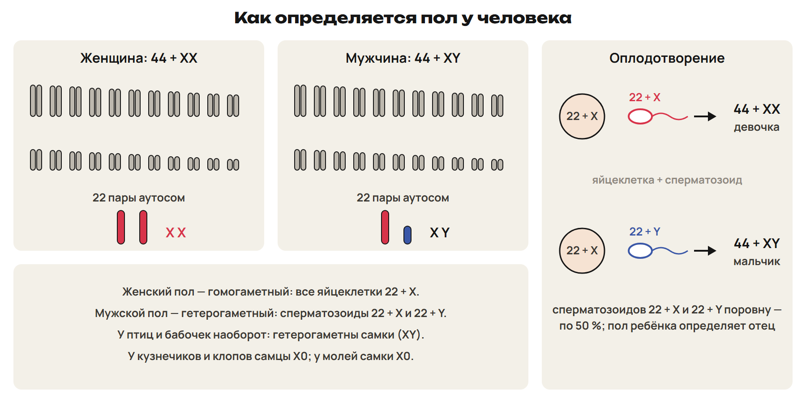
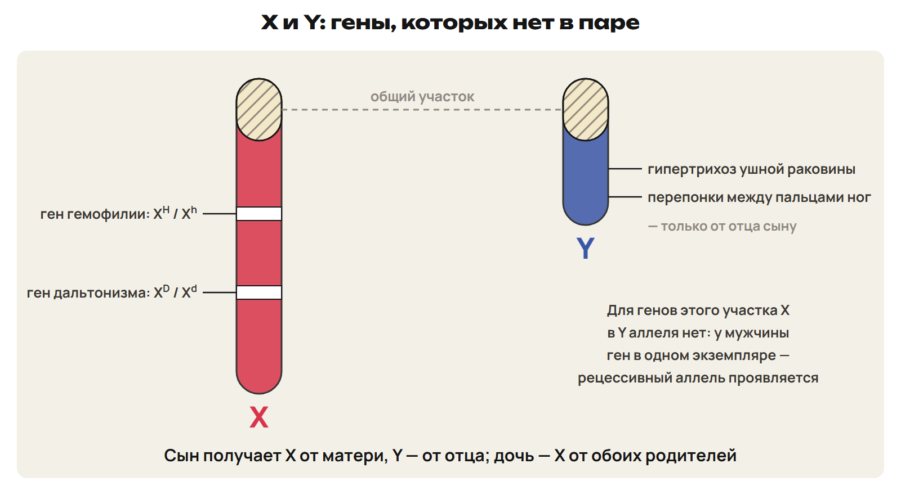
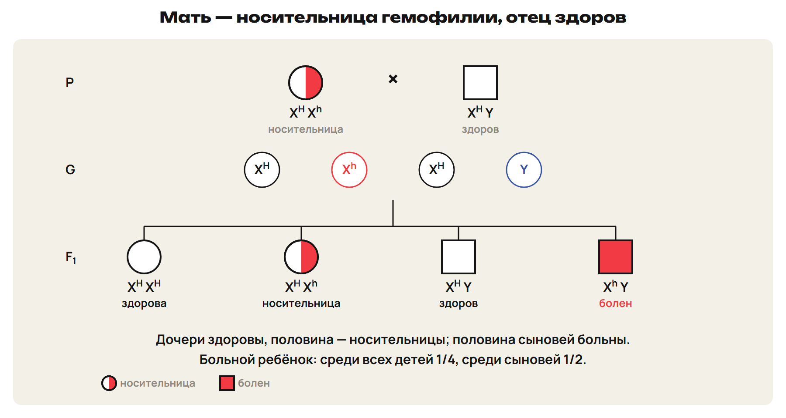
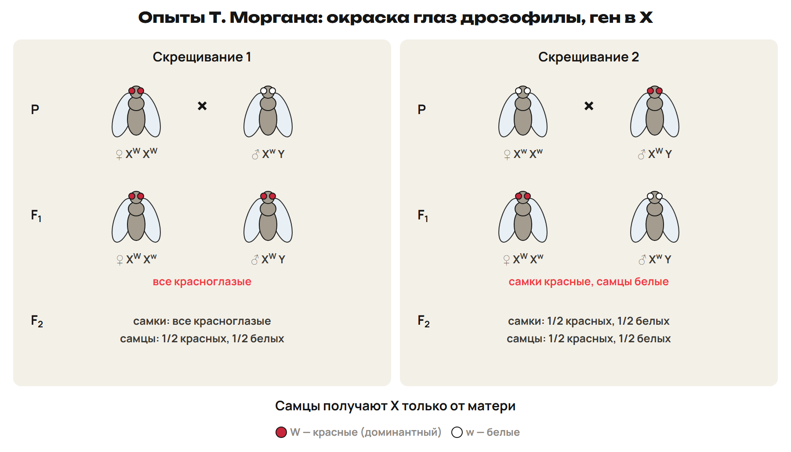
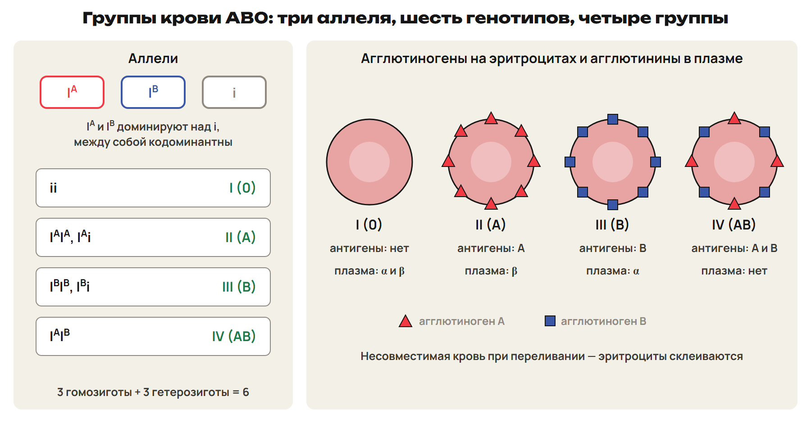

# Как определяется пол
? Почему сыновей и дочерей рождается примерно поровну?
↳ Гены в аутосомах подчиняются законам Менделя. Сегодня — гены в половых хромосомах.
> 0–10 способы определения пола, аутосомы и половые хромосомы; 10–13 L1; 13–15 ключ.

## Понятие: Два способа определения пола
Генотипический: пол задают гаметы в момент оплодотворения.
После оплодотворения пол не меняется; так у большинства организмов.
Фенотипический: пол зависит от условий среды.
У крокодилов пол зависит от температуры развития яиц.

## Схема: Аутосомы и половые хромосомы

У человека 46 хромосом: 44 аутосомы и 2 половые.
Женщина XX — пара гомологична; мужчина XY — хромосомы разные.
Яйцеклетка 22 + X; сперматозоиды 22 + X и 22 + Y поровну.
> «23 пары гомологичных хромосом» — верно только для женщин.

## Практика: L1
Сколько аутосом и половых хромосом в соматической клетке женщины?
А в её яйцеклетке?
Чем генотипический способ отличается от фенотипического? Пример.
Ответы:
Соматическая клетка — 44 + XX; яйцеклетка — 22 + X.
Генотипический — пол задан гаметами; фенотипический — зависит от среды.
Пример: крокодилы, температура развития яиц.
> 10–13 попытка, 13–15 ключ.

# Гомо- и гетерогаметный пол
? Почему у кур пол цыплёнка определяет не петух?
> 15–22 таблица организмов; 22–25 L2; 25–27 ключ.

## Понятие: Кто определяет пол потомства
Гомогаметный пол даёт одинаковые гаметы.
Гетерогаметный — два типа гамет поровну.
Пол потомка определяет гетерогаметный родитель.
Человек, млекопитающие, дрозофила: самки XX, самцы XY.
Птицы и большинство бабочек: самки XY, самцы XX.
Моли: самки X0. Кузнечики и клопы: самцы X0.
Ловушка: у птиц и бабочек гетерогаметны самки — пол определяет мать.

## Практика: L2
У бабочек самка XY, самец XX.
Какие гаметы по половым хромосомам у самки и у самца?
Кто определяет пол потомства?
Какие гаметы у самца клопа?
Ответы:
Самка — X и Y, самец — только X; пол определяет самка.
Самец клопа X0: гаметы с X и без половой хромосомы.
> 22–25 попытка, 25–27 ключ.

# Наследование, сцепленное с полом
? Почему гемофилией болеют почти только мужчины?
↳ У мужчины одна X. Если ген лежит в X, второго аллеля у него нет.
> 27–40 путь X, запись, алгоритм, разбор; 40–46 L3; 46–50 ключ.

## Схема: X и Y

Сцепленные с полом — признаки, гены которых в половых хромосомах.
Для человека это гены X: Y почти не содержит жизненно важных генов.
Для многих генов X в Y нет аллеля — у мужчины рецессивный проявляется.

## Понятие: Путь X-хромосомы
Сын получает X от матери, Y — от отца.
Дочь получает одну X от матери и одну от отца.
X-признак матери — сыновьям и дочерям; X-признак отца — только дочерям.
От матери сыновьям, от отца дочерям — крисс-кросс.
Ловушка: сын никогда не получает X от отца.

## Понятие: Гемофилия и дальтонизм
Гемофилия — несвёртываемость крови; дальтонизм — неспособность различать цвета.
Оба признака рецессивные, гены в X; доминантный аллель — норма.
Гетерозиготная женщина здорова — носительница.
Запись: Xᴰ — норма, Xᵈ — дальтонизм; носительница Xᴰ Xᵈ, дальтоник Xᵈ Y.
Аутосомный ген — без X: шестипалый мужчина-дальтоник Aa Xᵈ Y.
> В учебнике ген в одном экземпляре назван «гомозиготным». Говорить: «аллель один, рецессивный проявляется».

## Понятие: Алгоритм задачи на X-признак
1) Обозначь аллели индексом при X.
2) Запиши генотипы родителей: у мужчины одна X и Y.
3) Гаметы: у мужчины X и Y.
4) Решётка.
5) Ответ отдельно для сыновей, дочерей или всех детей.

## Схема: Мать-носительница гемофилии

P: ♀ Xᴴ Xʰ × ♂ Xᴴ Y. G: Xᴴ, Xʰ и Xᴴ, Y.
Дочери Xᴴ Xᴴ и Xᴴ Xʰ — здоровы, половина носительницы.
Сыновья Xᴴ Y и Xʰ Y — половина больны.
Больной ребёнок: среди всех детей 1/4, среди сыновей 1/2.

## Практика: L3
У здоровых родителей родился сын-дальтоник.
Запиши генотипы родителей.
Какова вероятность, что следующий сын тоже будет дальтоником?
Может ли у этой пары родиться дочь-дальтоник?
Ответы:
Сын получил Xᵈ от матери: мать Xᴰ Xᵈ, отец Xᴰ Y.
Сыновья Xᴰ Y и Xᵈ Y — дальтоник с вероятностью 1/2.
Дочери получают Xᴰ от отца — дальтоников нет, половина носительницы.
> 40–46 попытка, 46–50 ключ.

# Признаки Y, опыты Моргана, признаки под контролем пола
? Может ли признак отца перейти только к сыновьям?
> 50–56 Y-признаки, Морган, кошки, облысение; 56–60 L4; 60–62 ключ.

## Понятие: Y-признаки и X-доминантные признаки
Признаки Y — только от отца сыну.
Пример: перепонки между пальцами ног, гипертрихоз ушной раковины.
X-доминантный признак: больной мужчина передаёт его всем дочерям.
Больная женщина — сыновьям и дочерям; признак виден в каждом поколении.

## Схема: Опыты Т. Моргана

Дрозофила: W — красные глаза, w — белые, ген в X; 4 пары хромосом.
♀ Xᵂ Xᵂ × ♂ Xʷ Y → F₁ все красные; в F₂ белоглазы половина самцов.
♀ Xʷ Xʷ × ♂ Xᵂ Y → F₁ самки красные, самцы белые.
Самцы получили X от матери.

## Понятие: Кошки и признаки под контролем пола
Ген окраски кошек (чёрная или рыжая) — в X.
Черепаховые — только гетерозиготные кошки; коты черепаховыми не бывают.
Под контролем пола: ген в аутосоме, проявление зависит от пола.
Возрастное облысение: у мужчин как доминантный, у женщин как рецессивный.
Ловушка: облысение не сцеплено с полом — ген в аутосоме.

## Практика: L4
Мужчина с гипертрихозом ушной раковины: у кого из детей будет признак?
Почему возрастное облысение не сцеплено с полом?
♀ Xᵂ Xᵂ × ♂ Xʷ Y: найди F₁ и долю белоглазых среди самцов F₂.
Ответы:
Гипертрихоз — у всех сыновей (Y от отца), у дочерей нет.
Облысение — ген в аутосоме, проявление зависит от пола.
F₁ Xᵂ Xʷ и Xᵂ Y — красные; в F₂ среди самцов белоглазых 1/2.
> 56–60 попытка, 60–62 ключ.

# Группы крови и множественные аллели
? Почему групп крови четыре, если аллелей три?
> 62–72 аллели, кодоминирование, исключение; 72–77 L5; 77–80 ключ.

## Понятие: Множественный аллелизм
В популяции больше двух аллелей одного гена.
Серия аллелей — результат повторных мутаций гена в одном месте хромосомы.
У человека только два аллеля; в гамету попадает один.
Наследование — как при моногибридном скрещивании.

## Схема: Группы крови AB0

Iᴬ и Iᴮ доминируют над i; между собой кодоминантны.
I — ii; II — IᴬIᴬ, Iᴬi; III — IᴮIᴮ, Iᴮi; IV — IᴬIᴮ.
3 аллеля → 6 генотипов → 4 группы.
Значение: переливание крови, установление отцовства.
Ловушка: кодоминирование — проявляются оба аллеля, не промежуточный признак.

## Понятие: Какие группы возможны
Iᴬi × Iᴮi → IV, II, III, I — по 1/4.
IᴬIᴮ × ii → только II или III, по 1/2.
Ребёнок I или IV группы у второй пары невозможен.
Сначала ищи, какой аллель ребёнок получил от каждого родителя.

## Практика: L5
У матери I группы родился ребёнок II группы.
Предполагаемый отец — III группы, гомозиготный.
Может ли он быть отцом? Какие группы могут быть у настоящего отца?
Ответы:
Ребёнок Iᴬi: i от матери, Iᴬ от отца.
У отца IᴮIᴮ нет Iᴬ — отцом быть не может.
Настоящий отец — II (IᴬIᴬ или Iᴬi) или IV (IᴬIᴮ).
> 72–77 попытка, 77–80 ключ.

# Проверка в формате ЕНТ
? Что из сегодняшнего легче всего перепутать?
> 80–85 L6; 85–88 ключ; 88–90 маршрут.

## Практика: L6
1) Какой признак сцеплен с полом? А) облысение; Б) гемофилия; В) группа крови; Г) шестипалость.
2) Сколько генотипов дают три аллеля гена групп крови?
3) Отец болен X-доминантным заболеванием, мать здорова. Какая доля дочерей больна?
Ответы:
1) Б — ген гемофилии в X.
2) Шесть.
3) Все дочери: каждая получает X отца.
> 80–85 попытка, 85–88 ключ.

## Дома: После урока 31
Прочитай разделы 1–3 конспекта: 25 минут.
Реши P1–P6: 20 минут.
Выполни всю G: 35 минут.
Тест пришли строкой; G9–G10 — фото решения; G11 — текст или голосовое.
Запиши вопрос к началу следующего урока.
