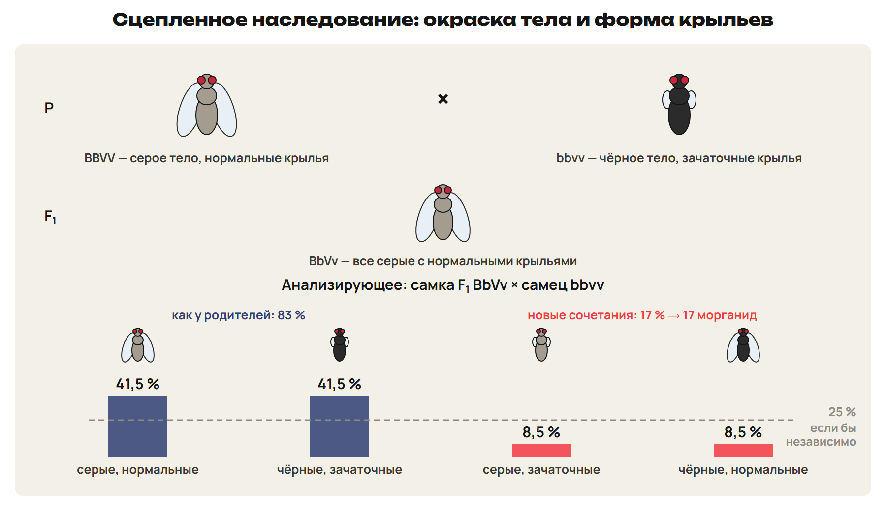
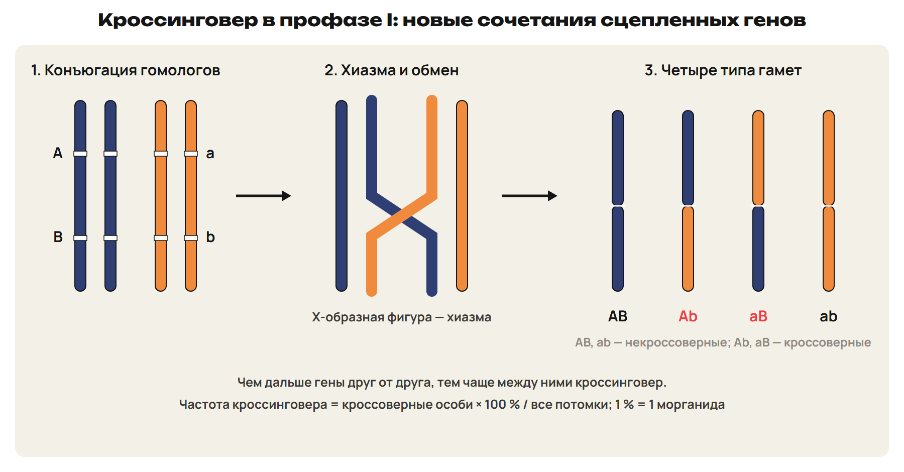
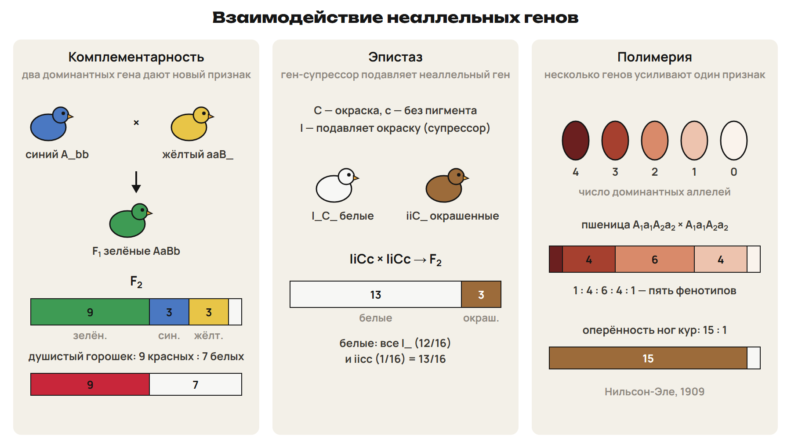

# Возврат: X-признаки и группы крови
? Какие вопросы остались после урока 31?
> 0–4 вопросы; 4–13 разбор G9 и G10; 13–18 L7; 18–20 ключ.

## Понятие: Разбор G9 и G10
G9: ♀ Xᴴ Xʰ × ♂ Xʰ Y — больных по 1/2 среди дочерей, сыновей и всех детей.
Дочь больна, если получила Xʰ от обоих родителей.
G10: ребёнок ii → мать Iᴮi, отец Iᴬi.
IV группа у следующего ребёнка — 1/4.

## Практика: L7
У матери II группы (Iᴬi), у отца IV группы.
Какие группы крови возможны у детей и с какой вероятностью?
Ответы:
Дети: IᴬIᴬ, IᴬIᴮ, Iᴬi, Iᴮi.
II — 1/2, IV — 1/4, III — 1/4; I группа невозможна.
> 13–18 попытка, 18–20 ключ.

# Хромосомная теория и сцепленное наследование
? Генов тысячи, а хромосом 23 пары. Могут ли все гены наследоваться независимо?
↳ Третий закон Менделя работает для генов в разных парах хромосом.
> 20–28 теория и опыт Моргана; 28–31 L8; 31–33 ключ.

## Понятие: Хромосомная теория
1909 — В. Иогансен назвал наследственные факторы генами.
1911 — Т. Морган с коллегами сформулировали хромосомную теорию.
Гены лежат в хромосоме линейно; у каждого гена свой локус.
Гены одной хромосомы — группа сцепления; наследуются вместе.
Групп сцепления = гаплоидный набор: человек 23, дрозофила 4, кукуруза 10.
Ловушка: у человека 23 группы сцепления, а не 46.

## Схема: Опыт с окраской тела и формой крыльев

BBVV × bbvv → F₁ BbVv — серые с нормальными крыльями.
Самка F₁ × самец bbvv: 41,5 % + 41,5 % как родители, 8,5 % + 8,5 % новые.
Независимое наследование дало бы по 25 %.
Вывод: гены окраски тела и формы крыльев в одной хромосоме.
> В учебнике это расщепление названо F₂ — на самом деле это анализирующее скрещивание.

## Практика: L8
Анализирующее скрещивание дигетерозиготы:
43 % AaBb, 43 % aabb, 7 % Aabb, 7 % aaBb.
Независимое наследование или сцепление? Расстояние между генами?
Ответы:
Родительских классов 86 % — гены сцеплены.
Новые сочетания 7 + 7 = 14 % — 14 морганид.
> 28–31 попытка, 31–33 ключ.

# Кроссинговер и морганиды
? Откуда берутся новые сочетания у сцепленных генов?
> 33–41 кроссинговер, морганида, порядок генов; 41–46 L9; 46–48 ключ.

## Схема: Кроссинговер в профазе I

Гомологи конъюгируют, образуют хиазмы и обмениваются участками.
Кроссоверные гаметы — с новыми сочетаниями, некроссоверные — без обмена.
Кроссинговер открыл Т. Морган в 1911 году.

## Понятие: Частота кроссинговера
Частота = кроссоверные особи × 100 % / все потомки анализирующего скрещивания.
1 % кроссинговера = 1 морганида.
Чем дальше гены, тем чаще кроссинговер; по частотам строят карты.
Кукуруза: 200 кроссоверных из 1000 → 20 морганид.
K–L 12, L–M 5, K–M 7: 7 + 5 = 12 → порядок K — M — L.
Ловушка: в частоту входят оба новых класса, делим на всех потомков.

## Практика: L9
Гены X, Y и Z в одной хромосоме: X–Y 3 морганиды, Y–Z 11, X–Z 14.
Какой ген в середине?
Сколько групп сцепления у кукурузы?
Ответы:
3 + 11 = 14 — ген Y между X и Z.
У кукурузы 10 групп сцепления.
> 41–46 попытка, 46–48 ключ.

# Взаимодействие генов
? Может ли у потомков появиться признак, которого не было у родителей?
> 48–58 типы взаимодействия; 58–63 L10; 63–65 ключ.

## Понятие: Аллельные и неаллельные гены
Генотип — все гены; фенотип — все признаки.
Аллельные: полное и неполное доминирование, кодоминирование.
Неаллельные: комплементарность, эпистаз, полимерия.
Плейотропия — один ген влияет на несколько признаков.
Пример плейотропии: дефект ногтей и коленных суставов.

## Схема: Три типа взаимодействия неаллельных генов

Комплементарность: синий × жёлтый попугай → F₁ зелёные; F₂ 9 : 3 : 3 : 1.
Душистый горошек (Бэтсон и Пеннет, 1906): белые × белые → F₁ красные; F₂ 9 : 7.
Эпистаз: супрессор I подавляет окраску C у кур; F₂ 13 : 3.
Полимерия (Нильсон-Эле, 1909): пшеница 1 : 4 : 6 : 4 : 1; ноги кур 15 : 1.
> В учебнике рядом с 9 : 7 написано «или 9 : 3 : 3 : 1» — при 9 : 7 фенотипов два.

## Понятие: Расщепление → модель
1 : 1 : 1 : 1 в анализирующем — независимое наследование.
Две большие и две малые группы — сцепление и кроссинговер.
9 : 3 : 3 : 1 с новым признаком, 9 : 7 — комплементарность.
13 : 3 — эпистаз.
15 : 1 и 1 : 4 : 6 : 4 : 1 — полимерия.
Ловушка: полимерия — много генов на один признак; плейотропия — наоборот.

## Практика: L10
Назови модель:
а) синий × жёлтый попугай → F₁ зелёные, F₂ 9 : 3 : 3 : 1;
б) F₂ 15 : 1; в) F₂ 13 : 3;
г) один ген влияет на несколько признаков.
Ответы:
а) комплементарность; б) полимерия; в) эпистаз; г) плейотропия.
> 58–63 попытка, 63–65 ключ.

# Практика в формате ЕНТ
? Как перевести числа потомков в шестнадцатые доли?
> 65–70 L11; 70–72 ключ; 72–76 L12; 76–78 ключ.

## Практика: L11
В F₂ 270 растений с красными цветками и 210 с белыми.
Переведи в шестнадцатые доли и назови тип взаимодействия.
Ответы:
480 : 16 = 30; 270 : 30 = 9, 210 : 30 = 7.
9 : 7 — комплементарность.
> 65–70 попытка, 70–72 ключ.

## Практика: L12
Окраска зерна пшеницы — полимерия, гены A₁ и A₂.
A₁a₁A₂a₂ × A₁a₁A₂a₂.
Какая доля зёрен белая? Какая — с двумя доминантными аллелями?
Ответы:
По числу доминантных аллелей 1 : 4 : 6 : 4 : 1.
Белые — 1/16; с двумя доминантными — 6/16 = 3/8.
> 72–76 попытка, 76–78 ключ.

# Контроль
? Без конспекта: 10 минут, 10 баллов.
> 78–88 контроль; 88–90 назначить вариант.

## Понятие: Дополнительно для A: доказательство сцепления
Независимо: дигетерозигота × aabb → четыре класса по 25 %.
Опыт: родительских классов 83 % — гены в одной хромосоме.
Новые классы — результат кроссинговера.
17 % новых сочетаний — 17 морганид.

## Понятие: Дополнительно для A: аутосомный и X-признак
Гены пишем раздельно: Aa Xᴰ Xᵈ.
Вероятность по каждому гену считаем отдельно и перемножаем.
Мать Aa Xᴰ Xᵈ × отец aa Xᴰ Y (A — карие глаза, a — голубые).
Голубоглазый сын-дальтоник: 1/2 × 1/4 = 1/8.

## Понятие: Дополнительно для A: переделанное 9 : 3 : 3 : 1
9 : 7 = 9 : (3 + 3 + 1).
13 : 3 = (9 + 3 + 1) : 3.
15 : 1 = (9 + 3 + 3) : 1.
Число генотипов: 1 аллель — 1, 2 — 3, 3 — 6.

## Дома: После урока 32
Повтори разделы 4–6 конспекта и факты: 15 минут.
Выполни назначенный вариант A, B или C: 30 минут.
Тест — строкой; задачи 9–10 — фото; № 11 — текст или голосовое.
После проверки — 25 минут исправлений по двум причинам.
