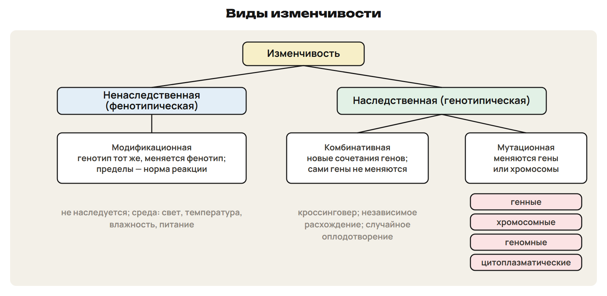
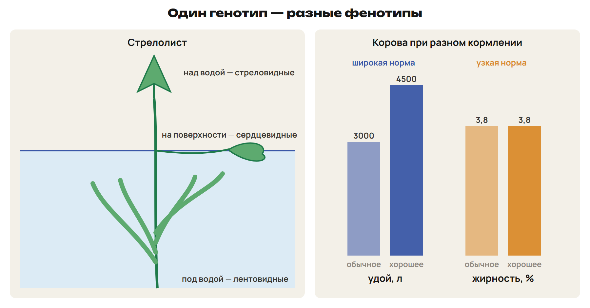
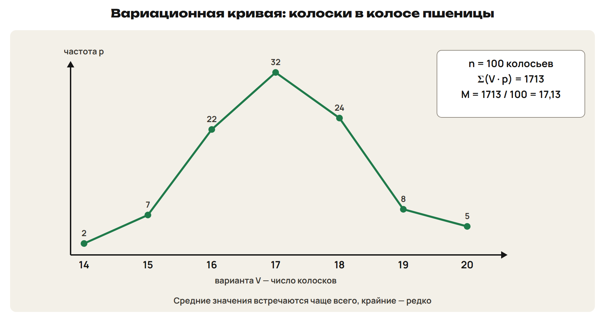
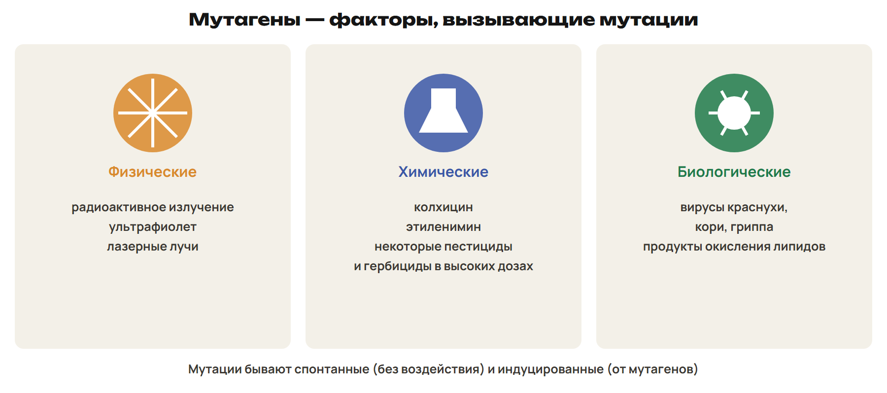
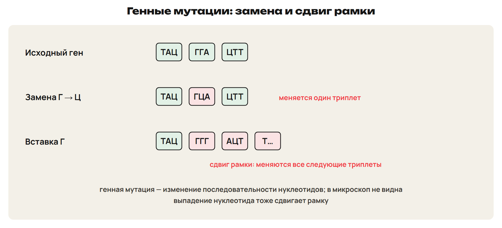
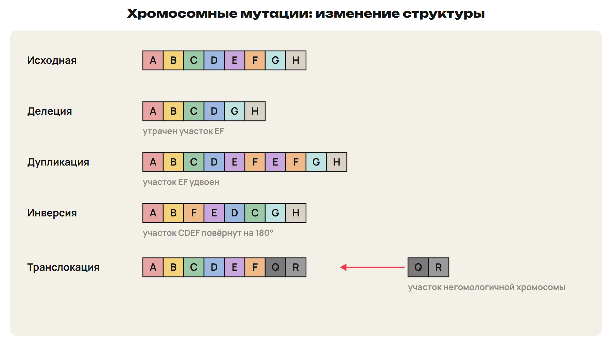
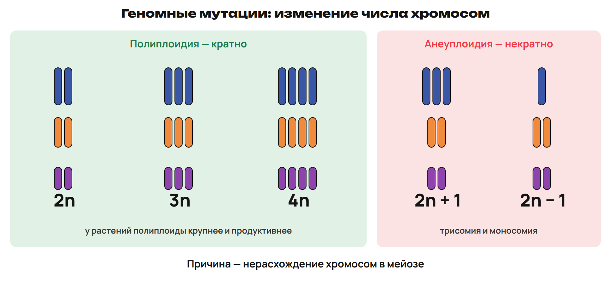

# Виды изменчивости и модификации
? Почему черенки одного растения вырастают разными?
↳ На прошлых неделях — наследственность. Сегодня — изменчивость.
> 0–10 виды изменчивости, модификации; 10–13 L1; 13–15 ключ.

## Схема: Виды изменчивости

Модификационная — меняется только фенотип; не наследуется.
Комбинативная — новые сочетания генов; наследуется.
Мутационная — меняются гены или хромосомы; наследуется.

## Понятие: Модификационная изменчивость
Проявление генотипа под действием среды: свет, температура, влажность, питание.
Не наследуется, возникает быстро, ограничена нормой реакции, приспособительная.
Опыт Г. Боннье: одно растение на равнине и в горах — разный рост.
Семена обоих в одинаковых условиях дают одинаковые проростки.
Картофель из клубней одного куста: разная высота и число клубней.

## Схема: Стрелолист и норма реакции

Над водой — стреловидные листья, на поверхности — сердцевидные, под водой — лентовидные.
Генотип у всех листьев один.

## Практика: L1
Определи вид изменчивости:
а) одуванчик в горах ниже, чем на равнине;
б) у потомков новое сочетание признаков родителей;
в) после облучения у бактерий появилась наследуемая устойчивость.
Ответы:
а) модификационная — генотип тот же;
б) комбинативная;
в) мутационная.
> 10–13 попытка, 13–15 ключ.

# Норма реакции
? Можно ли откормом коровы повысить жирность её молока?
> 15–25 норма реакции; 25–28 L2; 28–30 ключ.

## Понятие: Что наследуется
Норма реакции — пределы модификационной изменчивости одного генотипа.
Норма реакции задаётся генотипом и наследуется; модификация — нет.
Широкая норма — количественные признаки: масса, рост, удой.
Узкая — качественные: цвет глаз, цветков, ладонный рисунок.
При хорошем кормлении удой растёт, жирность молока — нет.
Ловушка: наследуется не достигнутый результат, а пределы.

## Практика: L2
Распредели на широкую и узкую норму: масса зерна, цвет глаз, удой, ладонный рисунок.
Что наследуется: удой 4000 л или норма реакции удоя?
Ответы:
Широкая — масса зерна, удой; узкая — цвет глаз, ладонный рисунок.
Наследуется норма реакции.
> 25–28 попытка, 28–30 ключ.

# Вариационный ряд
? Как описать числом изменчивость сотни колосьев?
> 30–39 ряд, кривая, средняя; 39–43 L3; 43–45 ключ.

## Схема: Вариационная кривая

Варианты V — значения признака по возрастанию; p — частота.
Средние значения встречаются чаще, крайние — редко.
M = Σ(V · p) / n.
Колоски пшеницы: Σ = 1713, n = 100, M = 17,13.

## Практика: L3
V 1, 2, 3, 4, 5; p 1, 3, 4, 1, 1.
Найди среднюю величину и самую частую варианту.
Ответы:
Σ(V · p) = 1 + 6 + 12 + 4 + 5 = 28; n = 10.
M = 2,8; чаще всего — 3.
> 39–43 попытка, 43–45 ключ.

# Мутации и мутагены
? Откуда берутся новые признаки, которых не было у предков?
> 45–54 мутации и мутагены; 54–58 L4; 58–60 ключ.

## Понятие: Мутационная теория
Мутация — случайное наследственное изменение генотипа.
Термин ввёл Х. де Фриз в 1901 году; объект — энотера.
Мутации есть у всех организмов; чаще вредные.
Мутации вызывают факторы среды — мутагены.

## Схема: Три группы мутагенов

Физические — радиация, ультрафиолет, лазерные лучи.
Химические — колхицин, этиленимин.
Биологические — вирусы краснухи, кори, гриппа.

## Понятие: Как делят мутации
Спонтанные — без намеренного воздействия; индуцированные — от мутагенов.
Генеративные — в половых клетках, передаются потомству.
Соматические — в клетках тела, при половом размножении не передаются.
Мутации случайны и ненаправленны.
Ловушка: соматическая мутация не попадёт в семена.

## Практика: L4
Отнеси к группам: лазерные лучи, вирус кори, этиленимин.
Мутация возникла в клетке листа у растения, которое размножают семенами.
Передастся ли она семенному потомству?
Ответы:
Физический, биологический, химический.
Мутация соматическая — семенам не передастся.
> 54–58 попытка, 58–60 ключ.

# Виды мутаций
? На каком уровне может измениться генотип?
> 60–72 генные, хромосомные, геномные; 72–77 L5; 77–80 ключ.

## Схема: Генные мутации

Генная мутация — изменение последовательности нуклеотидов.
Замена меняет один триплет; вставка или выпадение сдвигают рамку.
В микроскоп не видна. Пример — серповидноклеточная анемия.

## Схема: Хромосомные мутации

Делеция — утрата участка: ABCDGH.
Дупликация — удвоение: ABCDEFEFGH.
Инверсия — поворот на 180°: ABFEDCGH.
Транслокация — перенос на негомологичную хромосому.

## Схема: Геномные мутации

Полиплоидия — кратное увеличение набора: 3n, 4n.
Анеуплоидия — некратное: 2n + 1, 2n − 1 (К. Бриджес, дрозофила).
Причина — нерасхождение хромосом в мейозе.
Цитоплазматические мутации — в ДНК митохондрий и пластид.
Ловушка: синдром Дауна — геномная мутация, а не хромосомная.

## Практика: L5
Определи тип мутации:
а) в гене Ц заменён на Т;
б) хромосома утратила участок;
в) в клетке 2n − 1 хромосом.
Ответы:
а) генная;
б) хромосомная, делеция;
в) геномная, анеуплоидия.
> 72–77 попытка, 77–80 ключ.

# Проверка в формате ЕНТ
? Где ловушка в каждом задании?
> 80–85 L6; 85–88 ключ; 88–90 маршрут.

## Практика: L6
1) Сколько хромосом у человека при триплоидии?
2) Какая перестройка превратила ABCDEF в ABEDCF?
3) Выбери верные: А) модификации наследуются; Б) норма реакции наследуется; В) соматические мутации передаются семенам; Г) генная мутация видна в микроскоп; Д) колхицин — химический мутаген; Е) мутации ненаправленны.
Ответы:
1) 69.
2) Инверсия: CDE → EDC.
3) БДЕ.
> 80–85 попытка, 85–88 ключ.

## Дома: После урока 33
Прочитай разделы 1–4 конспекта: 25 минут.
Реши P1–P6: 20 минут.
Выполни всю G: 35 минут.
Тест — строкой; G9–G10 — фото; G11 — текст или голосовое.
Запиши вопрос к началу следующего урока.
