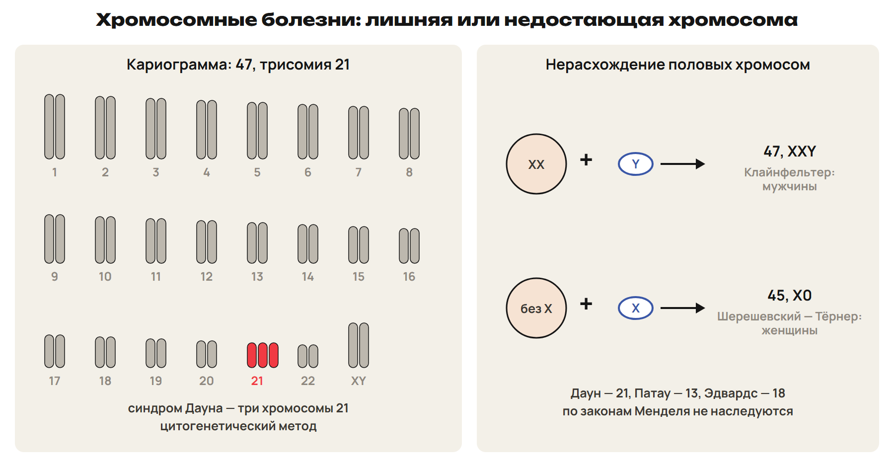
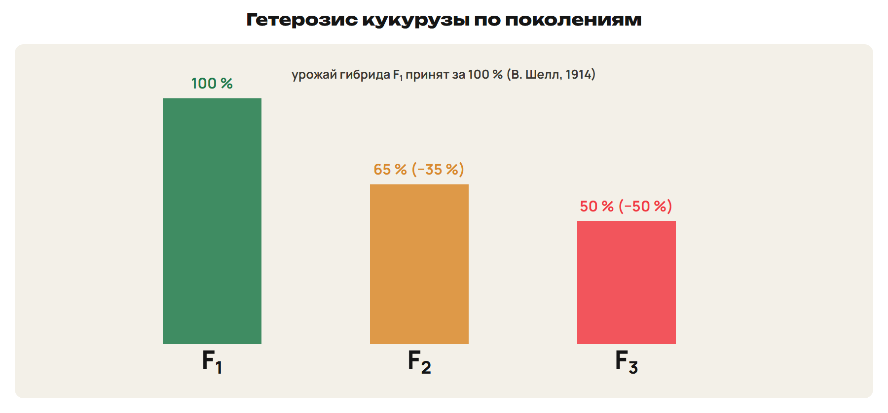
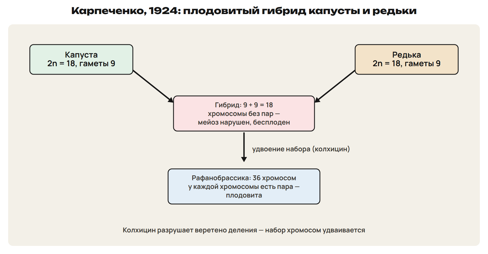
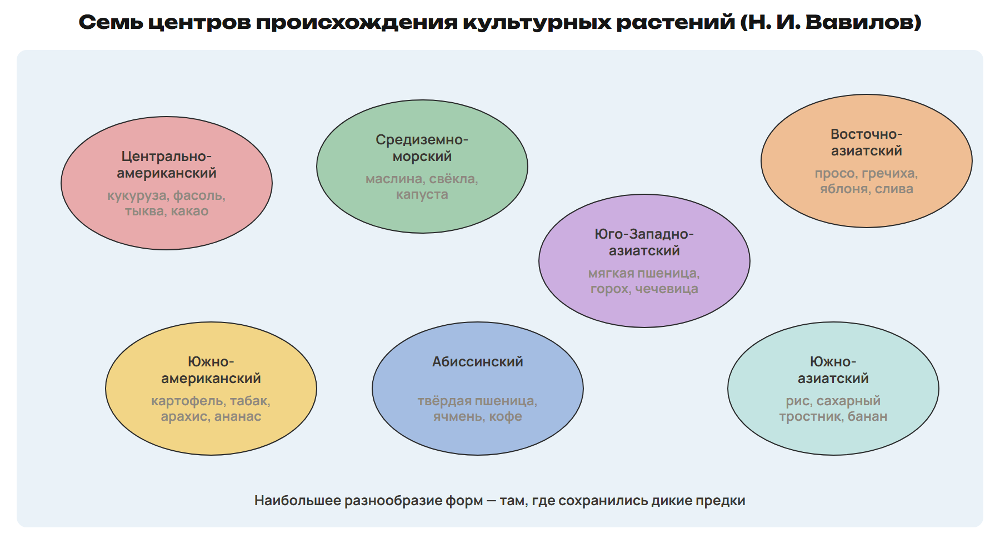

# Возврат
? Какие примеры изменчивости вызвали спор?
> 0–3 вопросы; 3–10 разбор G9 и G10; 10–13 L7; 13–15 ключ.

## Понятие: Разбор G9 и G10
G9: Σ(V · p) = 240; делим на 40 листьев: M = 6 см.
Черенки одного растения — модификации.
G10: гибрид 8 + 10 = 18 хромосом — бесплоден.
Колхицин удваивает набор: 36 — плодовит.

## Практика: L7
Сколько хромосом при синдроме Клайнфельтера и при трисомии 18?
Какие это мутации?
Ответы:
47 и 47.
Обе геномные (анеуплоидия).
> 10–13 попытка, 13–15 ключ.

# Хромосомные болезни
? Как узнать, что у ребёнка лишняя хромосома?
> 15–26 синдромы и методы; 26–31 L8; 31–33 ключ.

## Схема: Синдромы и нерасхождение

Даун — 47, трисомия 21; Патау — 13; Эдвардс — 18.
Клайнфельтер — 47, XXY, только мужчины.
Шерешевский — Тёрнер — 45, X0, только женщины.
По законам Менделя не наследуются; бывают мозаичные формы.
Ловушка: XXY — мужчины, X0 — женщины.

## Понятие: Методы генетики человека
Генеалогический — родословные, тип наследования.
Близнецовый — роль наследственности и среды.
Цитогенетический — число и строение хромосом; генные мутации не видит.
Биохимический — болезни обмена: диабет, фенилкетонурия.
Иммуногенетический — группы крови, резус; популяционно-статистический — частоты генов.
1956 — у человека 46 хромосом.

## Практика: L8
Подбери метод:
а) тип наследования болезни в семье;
б) роль среды;
в) резус-совместимость;
г) фенилкетонурия.
Ответы:
а) генеалогический; б) близнецовый;
в) иммуногенетический; г) биохимический.
> 26–31 попытка, 31–33 ключ.

# Комбинативная изменчивость
? Почему у братьев и сестёр разные сочетания признаков?
> 33–39 источники и закон Вавилова; 39–42 L9; 42–43 ключ.

## Понятие: Источники и закон гомологических рядов
1) Кроссинговер в профазе I.
2) Независимое расхождение гомологичных хромосом.
3) Случайное слияние гамет.
Вавилов: близкие виды имеют сходные ряды наследственной изменчивости.
Примеры: окраска зерна злаков, альбиносы у грызунов, короткопалость.
Ловушка: закон гомологических рядов — не гомологичные хромосомы.

## Практика: L9
Назови три источника комбинативной изменчивости.
Приведи пример закона гомологических рядов.
Ответы:
Кроссинговер, независимое расхождение, случайное оплодотворение.
Альбиносы у разных грызунов; сходная окраска зерна у злаков.
> 39–42 попытка, 42–43 ключ.

# Селекция
? Как получить сорт, которого нет в природе?
> 43–56 методы селекции; 56–62 L10; 62–65 ключ.

## Понятие: Отбор и гибридизация
Селекция создаёт породы, сорта, штаммы; основа — генетика.
Отбор: массовый и индивидуальный (чистые линии).
Инбридинг — гомозиготность; проявляются вредные рецессивные.
Аутбридинг — жизнеспособность и продуктивность.
Отдалённые гибриды обычно бесплодны.

## Схема: Гетерозис

Гетерозис — превосходство гибридов F₁ над родителями.
В. Шелл, 1914, кукуруза: F₂ ниже на 35 %, F₃ — на 50 %.
Гибридные семена покупают каждый год.

## Схема: Полиплоидия Карпеченко

Колхицин разрушает веретено — набор удваивается.
Г. Д. Карпеченко, 1924: гибрид капусты и редьки стал плодовитым.
Искусственный мутагенез — облучение, этиленимин; штаммы микроорганизмов.

## Понятие: Селекция животных и Казахстан
Подбор пар, чистые линии, искусственное осеменение.
М. Ф. Иванов — асканийская порода овец.
Архар-меринос: тонкорунные овцы × архар — дикий горный баран.
Казахская белоголовая и алатауская породы скота, костанайская лошадь.

## Практика: L10
Подбери метод: а) чистая линия кукурузы; б) урожайный гибрид на один сезон;
в) плодовитый гибрид капусты и редьки; г) продуктивный штамм гриба.
Ответы:
а) инбридинг; б) скрещивание линий — гетерозис F₁;
в) удвоение набора колхицином; г) искусственный мутагенез.
> 56–62 попытка, 62–65 ключ.

# Центры происхождения
? Почему Вавилов искал предков культур в горах и тропиках?
> 65–69 центры; 69–72 L11; 73–77 L12.

## Схема: Семь центров Вавилова

Южноазиатский — рис; Восточноазиатский — просо, гречиха.
Юго-Западноазиатский — мягкая пшеница; Средиземноморский — маслина, капуста.
Абиссинский — твёрдая пшеница, кофе; Центральноамериканский — кукуруза.
Южноамериканский — картофель, табак.

## Практика: L11
Назови центр происхождения:
банан, гречиха, горох, капуста, кофе, фасоль, табак.
Ответы:
Южноазиатский, Восточноазиатский, Юго-Западноазиатский.
Средиземноморский, Абиссинский, Центральноамериканский, Южноамериканский.
> 69–72 попытка, 72–73 ключ.

## Практика: L12
Гибрид F₁ дал 70 ц/га.
Какой урожай в F₂ (ниже на 35 %) и в F₃ (ниже на 50 %)?
Ответы:
F₂ = 70 × 0,65 = 45,5 ц/га.
F₃ = 70 × 0,50 = 35 ц/га.
> 73–77 попытка, 77–78 ключ.

# Контроль
? Без конспекта: 10 минут, 10 баллов.
> 78–88 контроль; 88–90 назначить вариант.

## Понятие: Дополнительно для A: точечные мутации
Транзиция — пурин на пурин или пиримидин на пиримидин.
Трансверсия — пурин на пиримидин или наоборот.
Мутации — побочный продукт ошибок репликации, репарации, рекомбинации.
Системы репарации исправляют большую часть повреждений.

## Понятие: Дополнительно для A: аллополиплоид и нерасхождение
Гибрид AB бесплоден; после удвоения AABB — у каждой хромосомы есть пара.
Гамета XX + Y → 47, XXY; гамета без X + X → 45, X0.

## Понятие: Дополнительно для A: статистика
σ и коэффициент вариации описывают разброс точнее средней.
χ² Пирсона: случайно ли отклонение расщепления от ожидаемого.
Критерий Стьюдента сравнивает средние двух выборок.

## Дома: После урока 34
Повтори разделы 5–7 конспекта и факты: 15 минут.
Выполни назначенный вариант A, B или C: 30 минут.
Тест — строкой; задачи 9–10 — фото; № 11 — текст или голосовое.
После проверки — 25 минут исправлений по двум причинам.
