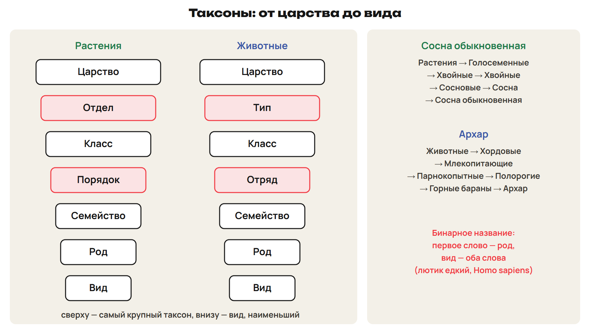
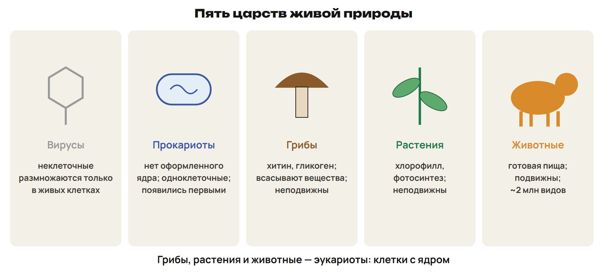
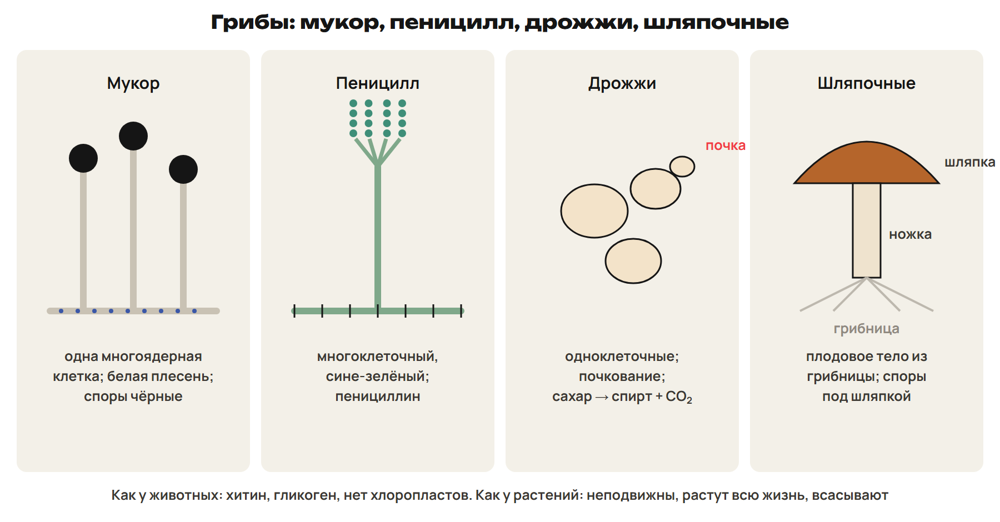
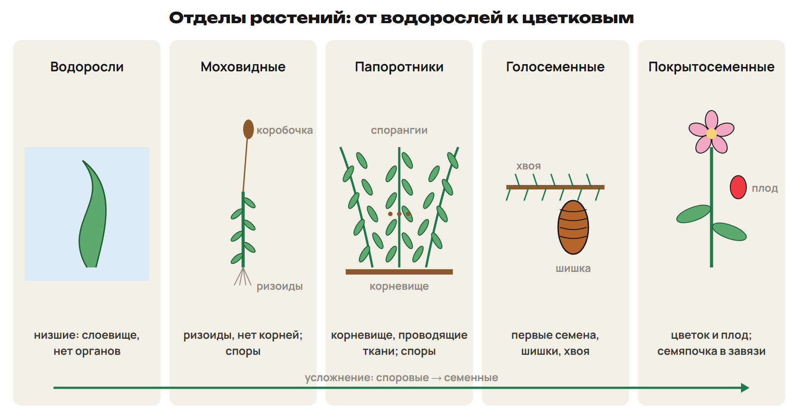
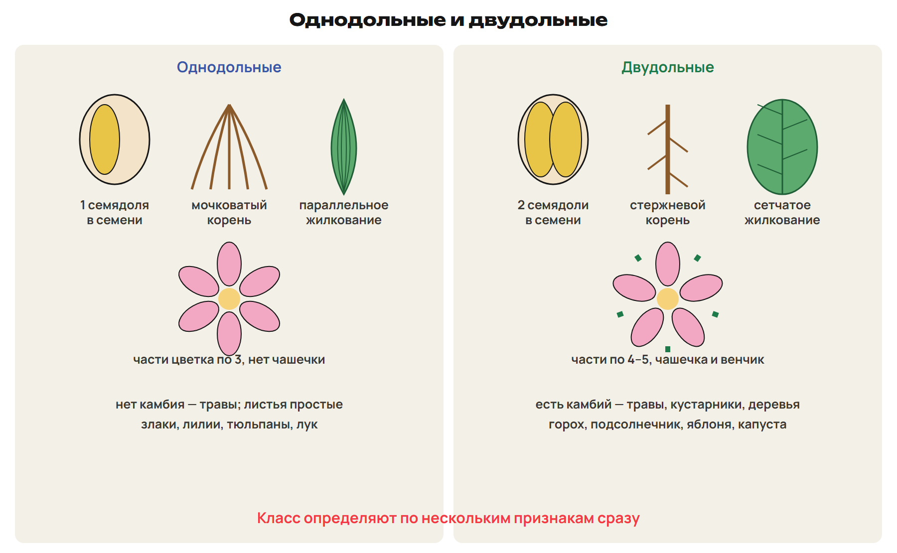
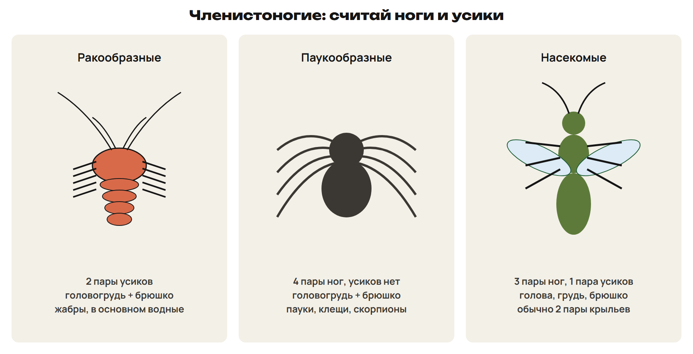
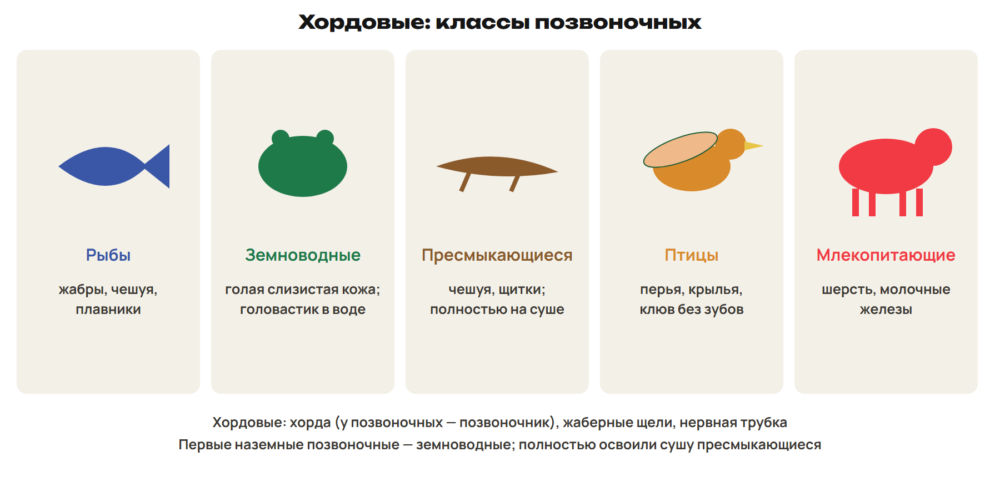
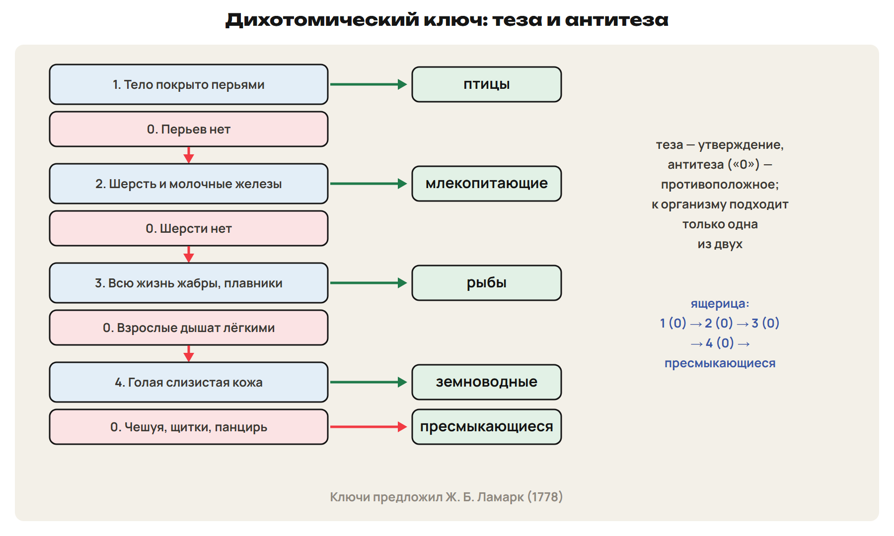

После урока 35 прочитай разделы 1–3, реши P и общую часть G. После урока 36 повтори разделы 4–8, сводную таблицу и факты, выполни один назначенный вариант A/B/C. Сначала попытка, затем ключ.

## 1. Систематика, вид и таксоны

Как найти одно растение среди сотен тысяч видов? Для этого организмы раскладывают по группам — от крупных к мелким.

**Систематика** описывает, называет и классифицирует организмы и показывает их родство. Основатель — шведский учёный **Карл Линней** (1707–1778), труд «**Система природы**» (1735).

> [!rule] Вид
> Вид — совокупность сходных по строению особей, которые свободно скрещиваются и дают плодовитое потомство, приспособлены к определённой среде и населяют определённую территорию.
> Вид — основная и наименьшая единица классификации. Вид состоит из популяций.
> Все собаки — один вид, несмотря на породы.

**Бинарная номенклатура:** каждый вид называют двумя латинскими словами. Первое — существительное, это **род**; второе — прилагательное. Название вида — **оба слова вместе**: лютик едкий и лютик ползучий — два вида рода лютик; *Homo sapiens* — человек разумный.

| Растения | Животные |
|---|---|
| Царство | Царство |
| **Отдел** | **Тип** |
| Класс | Класс |
| **Порядок** | **Отряд** |
| Семейство | Семейство |
| Род | Род |
| Вид | Вид |

> [!example] Разберём: систематическое положение
> Сосна обыкновенная: Растения → Голосеменные → Хвойные → Хвойные (порядок) → Сосновые → Сосна → Сосна обыкновенная.
> Архар: Животные → Хордовые → Млекопитающие → Парнокопытные → Полорогие → Горные бараны → Архар.

> [!trap] Отдел и тип
> У растений — отдел и порядок, у животных — тип и отряд. Вид — наименьший таксон, царство — наибольший. В названии «лютик едкий» слово «едкий» само по себе — не название вида.

## 2. Царства живой природы

Царство — самая крупная категория. Выделяют **пять царств**: вирусы, прокариоты (бактерии), грибы, растения, животные; иногда отдельно — протисты (одноклеточные эукариоты).

- **Вирусы** — неклеточные, размножаются только в живых клетках.
- **Прокариоты** — нет оформленного ядра, одноклеточные; появились на Земле первыми.
- **Эукариоты** — грибы, растения, животные: клетки с ядром.
- **Растения** — фотосинтез с хлорофиллом, выделяют кислород, неподвижны, растут всю жизнь.
- **Животные** — питаются готовой пищей, подвижны; около 2 млн видов — самое многочисленное царство.
- Эвглена зелёная и хламидомонада питаются смешанно: на свету как растения, в темноте — готовыми веществами.

## 3. Грибы

Грибы — **особое царство**: у них есть признаки и растений, и животных.

| Как у растений | Как у животных |
|---|---|
| клеточная стенка | стенка из хитина |
| неподвижны, растут всю жизнь | запасают гликоген |
| всасывают вещества поверхностью тела | нет хлоропластов — гетеротрофы |
| размножаются спорами | есть лизосомы |

Почти все грибы — **сапротрофы**: разлагают органические остатки.

- **Мукор** (белая хлебная плесень) — **одна гигантская многоядерная клетка**, споры чернеют на концах нитей.
- **Пеницилл** — **многоклеточный**, сине-зелёный; из него получают антибиотик пенициллин.
- **Дрожжи** — **одноклеточные** грибы: сбраживают сахар в спирт и CO₂ (тесто становится пористым), живут без кислорода, размножаются **почкованием**.
- **Шляпочные** — плодовое тело (шляпка и ножка) из грибницы; споры созревают под шляпкой; есть ядовитые: мухоморы, ложные опята.

> [!trap] Мукор, пеницилл, дрожжи
> Мукор — одноклеточный многоядерный; пеницилл — многоклеточный; дрожжи — одноклеточные, почкуются. Грибы — не растения: хитин и гликоген, хлоропластов нет.

## 4. Отделы растений

**Водоросли** — **низшие** растения: тело — **слоевище (таллом)**, нет тканей и органов. Бывают одноклеточные (хламидомонада, хлорелла), колониальные (вольвокс), многоклеточные. Все остальные — **высшие**: у них есть органы и ткани.

| Отдел | Главные признаки |
|---|---|
| Моховидные | стебель и листья, **нет корней — ризоиды**, нет проводящих тканей, **споры** в коробочке |
| Плауновидные, хвощевидные | высшие споровые травы и полукустарники |
| Папоротниковидные | **корневище**, проводящие и опорные ткани, споры на нижней стороне листьев; древние папоротники образовали каменный уголь |
| Голосеменные | **первые семенные**: семя и мощные корни; семяпочки **открыто** на чешуях **шишек**; хвоя (сосна, ель, арча, лиственница) |
| Покрытосеменные | **цветок и плод**; семяпочка внутри **завязи**; сосуды |

> [!trap] Споры и семена
> Водоросли низшие; мхи — высшие, хотя корней у них нет. Мхи и папоротники — споровые. Голосеменные — первые семенные, семена лежат открыто; у цветковых семяпочка в завязи.

## 5. Однодольные и двудольные

Отдел цветковых делится на два класса.

| Признак | Однодольные | Двудольные |
|---|---|---|
| Семядоли | одна | две |
| Корневая система | мочковатая | стержневая |
| Жилкование | параллельное или дуговидное | сетчатое |
| Листья | всегда простые | простые и сложные |
| Околоцветник | простой | двойной (чашечка + венчик) |
| Части цветка | кратно трём | кратно четырём или пяти |
| Камбий | нет — травы | есть — травы, кустарники, деревья |
| Примеры | злаки, лилии, тюльпаны, лук, пальмы | горох, подсолнечник, яблоня, дуб, капуста |

> [!trap] Не по одному признаку
> Класс определяют по нескольким признакам: подорожник — двудольное с признаками однодольных, вороний глаз — однодольное с признаками двудольных.

## 6. Беспозвоночные: типы по усложнению

Ж. Б. Ламарк впервые разделил животных на беспозвоночных и позвоночных. У беспозвоночных нет внутреннего скелета.

| Тип | Что появилось |
|---|---|
| Простейшие | одна клетка — целый организм (амёба, инфузория) |
| Губки | первые многоклеточные |
| Кишечнополостные | **два слоя клеток**, лучевая симметрия (гидра, медузы) |
| Плоские черви | **три слоя клеток**, мышцы (планария) |
| Круглые черви | **полость тела** (нематоды) |
| Кольчатые черви | **сегменты**, **кровеносная система** (дождевой червь, пиявка) |
| Моллюски | мантия, часто раковина (улитки, осьминоги) |
| Членистоногие | хитиновый наружный скелет, членистые конечности |

## 7. Членистоногие и хордовые

Господствующие типы — **членистоногие** (самый многочисленный) и **хордовые** (самый совершенный). Членистоногие: хитиновый покров, сегменты, членистые конечности с суставами, отделы тела.

| Класс | Отделы тела | Ноги | Усики |
|---|---|---|---|
| Ракообразные | головогрудь + брюшко | у высших раков 5 пар | **2 пары**; дышат жабрами |
| Паукообразные | головогрудь + брюшко | **4 пары** | **нет** |
| Насекомые | голова, грудь, брюшко | **3 пары** | **1 пара**; обычно 2 пары крыльев |

Насекомых больше 1 млн видов — это самый многочисленный класс.

**Хордовые:** впервые внутренний скелет — **хорда**; у позвоночных её заменяет **позвоночник**; **жаберные щели** в глотке (у высших — только у зародыша); **нервная трубка** над хордой.

| Класс позвоночных | Главные признаки |
|---|---|
| Рыбы | жабры, чешуя, плавники |
| Земноводные | личинки в воде дышат жабрами; у взрослых лёгкие и голая слизистая кожа |
| Пресмыкающиеся | полностью освоили сушу: только лёгкие, размножение без воды; чешуя, щитки, панцирь |
| Птицы | перья, крылья, клюв без зубов, теплокровность |
| Млекопитающие | шерсть, молочные железы, наружное ухо, зубы разных типов |

> [!trap] Не перепутай
> Паукообразные — 4 пары ног и нет усиков; насекомые — 3 пары ног и 1 пара усиков; ракообразные — 2 пары усиков.
> Двуслойные — кишечнополостные; полость тела впервые — у круглых червей; кровеносная система — у кольчатых.
> Хорда — не позвоночник. Первые наземные позвоночные — земноводные; полностью освоили сушу пресмыкающиеся.

## 8. Как определить группу и как пользоваться ключом

> [!rule] Алгоритм «к какой группе относится организм»
> 1) Ядро есть или нет → прокариоты или эукариоты.
> 2) Хлорофилл → растения; хитин, гликоген, всасывание → грибы; готовая пища, подвижность → животные.
> 3) Растения: споры или семена; семена открыто в шишках или цветок и плод; у цветковых — класс по нескольким признакам.
> 4) Животные: внутренний скелет (хордовые) или нет; у членистоногих — ноги, усики, отделы тела.

**Дихотомический ключ** каждый раз делит выбор на две части. **Теза** — утверждение, **антитеза** — противоположное ему (обозначают «0» или «−»). Каждая ступень заканчивается номером следующей ступени или названием организма.

> [!example] Разберём: ключ к позвоночным
> 1. Тело покрыто перьями → птицы. 0. Перьев нет → 2.
> 2. Есть шерсть и молочные железы → млекопитающие. 0. Шерсти нет → 3.
> 3. Всю жизнь дышат жабрами, есть плавники → рыбы. 0. Взрослые дышат лёгкими → 4.
> 4. Кожа голая, слизистая; личинка в воде → земноводные. 0. Чешуя, щитки или панцирь → пресмыкающиеся.
> Ящерица: перьев нет → 2; шерсти нет → 3; лёгкие → 4; чешуя → пресмыкающиеся.

> [!rule] Сводная таблица: растения, грибы, животные
> Питание: растения — фотосинтез; грибы — всасывание готовых веществ; животные — готовая пища.
> Клеточная стенка: растения — целлюлоза; грибы — хитин; животные — нет.
> Запасное вещество: растения — крахмал; грибы и животные — гликоген.
> Движение и рост: растения и грибы неподвижны и растут всю жизнь; животные подвижны.

> [!rule] Факты ЕНТ недели
> - Систематика — описание и классификация организмов; основатель К. Линней, «Система природы» (1735).
> - Бинарная номенклатура: род (существительное) + видовое слово; вид — наименьший таксон, царство — наибольший.
> - Растения: отдел и порядок; животные: тип и отряд; 5 царств: вирусы, прокариоты, грибы, растения, животные.
> - Грибы: хитин и гликоген; мукор — одна многоядерная клетка, пеницилл — пенициллин, дрожжи — почкование, спирт и CO₂.
> - Водоросли — низшие, слоевище; мхи — ризоиды; папоротники — корневище, каменный уголь; голосеменные — первое семя, шишки.
> - Однодольные: 1 семядоля, мочковатые корни, параллельное жилкование, части цветка кратны 3; двудольные — 2, стержневой, сетчатое, 4–5.
> - Ламарк разделил животных на беспозвоночных и позвоночных и предложил дихотомические ключи; теза и антитеза.
> - Насекомые — 3 пары ног, 1 пара усиков, больше 1 млн видов; пауки — 4 пары ног, без усиков; хордовые — хорда, жаберные щели, нервная трубка.
