После урока 37 прочитай разделы 1–6, реши P и общую часть G. После урока 38 повтори разделы 7–12, таблицы и факты, выполни один назначенный вариант A/B/C. Сначала попытка, затем ключ.

## 1. Эволюционные учения

**Эволюция** — необратимое историческое развитие живой природы. Термин впервые применил Ш. Бонне (1762).

- **К. Линней** создал систему и бинарные названия, впервые применил морфологический критерий вида, но **эволюцию не признавал**: считал виды неизменными.
- **Ж. Б. Ламарк** — первая целостная эволюционная теория, «**Философия зоологии**» (**1809**). Градация — постепенное повышение организации. Ошибки: причина эволюции — «стремление к совершенству», а признаки, приобретённые упражнением, будто бы наследуются.
- **Ч. Дарвин** — «**Происхождение видов путём естественного отбора**» (**1859**). Три движущие силы: **наследственная изменчивость, борьба за существование, естественный отбор**; главным Дарвин считал отбор.
- **Искусственный отбор** ведёт человек — он даёт **сорта и породы**, а не новые виды.
- **Синтетическая теория эволюции (СТЭ)** соединила дарвинизм и генетику: С. С. Четвериков (1926), Р. Фишер (1930). Материал эволюции — наследственная изменчивость; факторы — популяционные волны, изоляция, дрейф генов; движущая сила — естественный отбор. Элементарная единица эволюции — **популяция**.

| | Ламарк | Дарвин |
|---|---|---|
| Труд | «Философия зоологии», 1809 | «Происхождение видов…», 1859 |
| Причина изменений | стремление к совершенству, упражнение органов | изменчивость + борьба + отбор |
| Что наследуется | приобретённые при жизни признаки (ошибка) | случайные наследственные изменения |
| Цапля | вытягивала ноги — у птенцов они длиннее | у части цапель ноги длиннее от рождения — они чаще выживают и оставляют потомство |

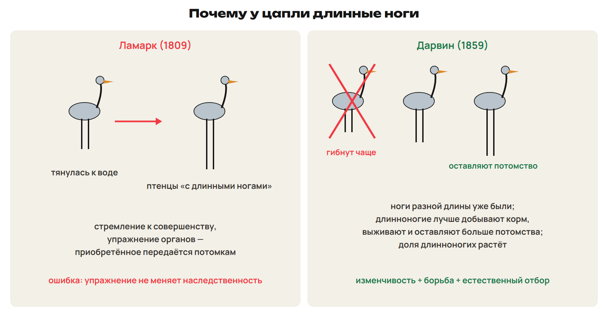

> [!trap] Ламарк или Дарвин
> «Изменились, потому что им было нужно» или «потому что упражнялись» — объяснение Ламарка, оно ошибочно: результаты тренировок не меняют ДНК.
> По Дарвину изменчивость **уже была**, а отбор сохранил выгодные варианты. Линней — не эволюционист.

## 2. Избыточная численность и борьба за существование

Организмы дают потомства **больше, чем может выжить**. В головке мака около 3000 семян: на второй год было бы 3000 × 3000 = 9 000 000 растений, на третий — 27 000 000 000. Ресурсы ограничены — начинается **борьба за существование**.

| Форма | Между кем | Пример |
|---|---|---|
| Внутривидовая — самая острая | особи одного вида | турниры оленей; сосны в лесу за свет |
| Межвидовая | разные виды | хищник и жертва; волки и лисы за зайцев |
| С неблагоприятными условиями | организм и неживая природа | ранние заморозки, засуха, наводнения |

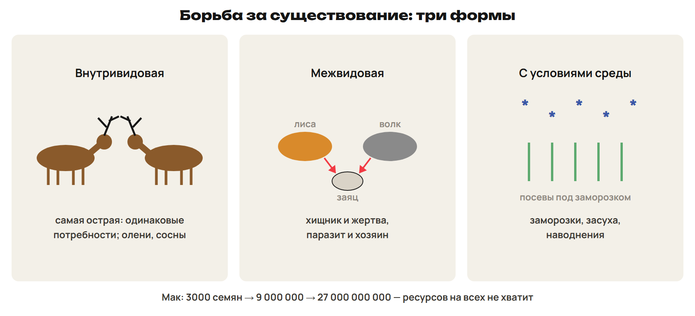

> [!trap] Не сильнейший
> Выживает не сильнейший, а **лучше приспособленный**. Эволюционный успех — сколько потомков оставит особь, а не сколько она проживёт. Внутривидовая борьба острее всего: потребности одинаковые.

## 3. Изменчивость — материал эволюции

Если бы все особи были одинаковы, отбору не из чего было бы выбирать. **Мутации** дают новые признаки (они случайны, большинство вредны), **комбинативная** изменчивость — новые сочетания генов. **Модификации не наследуются** и материалом эволюции не служат, хотя помогают выжить особи. Изменчивость поставляет материал, отбор направляет.

## 4. Естественный отбор и его формы

**Естественный отбор** — выживание и размножение более приспособленных. Предпосылка — избыточная численность и борьба; результат — приспособленность. Отбор сохраняет особь с **комплексом** признаков, а не один признак.

| Форма | Кого сохраняет | Условия | Пример |
|---|---|---|---|
| Движущий | уклонение от нормы в одну сторону | условия меняются | уменьшение размеров у вшей и блох; быстрый бег копытных; березовая пяденица |
| Стабилизирующий | среднее значение, крайние гибнут | условия постоянны | после бури погибли птицы с самыми длинными и самыми короткими крыльями; сроки цветения абрикоса |
| Разделительный | обе крайние формы, средние гибнут | — | кривая становится двувершинной |

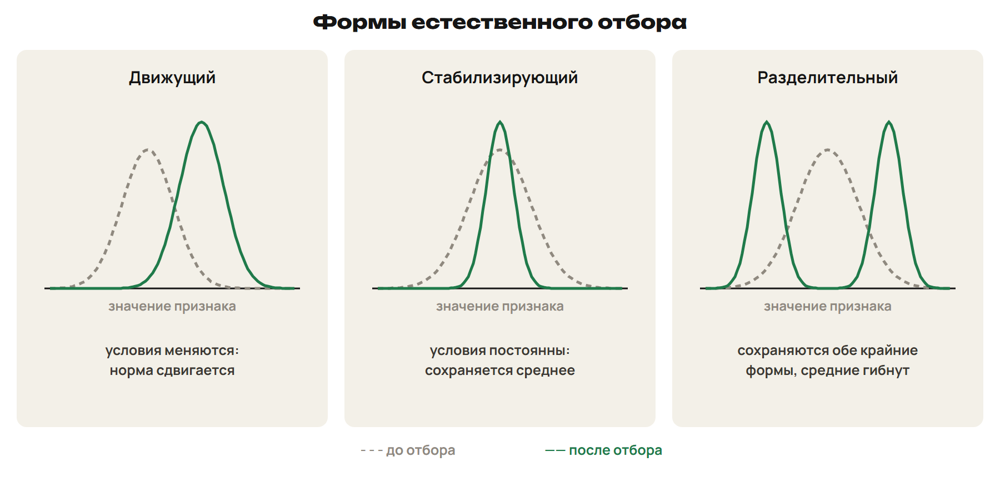

Стабилизирующий отбор изучал И. И. Шмальгаузен.

> [!rule] Объясни по Дарвину
> 1) Признак у особей различался ещё до смены условий.
> 2) Потомства больше, чем может выжить — борьба за существование.
> 3) Особи с выгодным в новых условиях признаком чаще выживают и оставляют больше потомства.
> 4) Признак передаётся потомкам, его доля растёт из поколения в поколение.

## 5. Приспособленность и её относительность

**Приспособленность** — особенности строения, поведения и физиологии, повышающие выживание в данных условиях. Примеры: разные синицы на одном дереве едят разный корм; у саксаула и верблюжьей колючки — длинные корни и мелкие листья.

| Окраска | Суть | Пример |
|---|---|---|
| Маскировка | сливаться с фоном | полосы зебры и тигра; тёмная спина и светлое брюхо рыб |
| Мимикрия | незащищённый похож на защищённого или на предмет | муха-журчалка похожа на осу; палочник — на веточку; уж — на ядовитого аспида |
| Демонстрация | напугать врага яркой окраской или позой | божья коровка, клоп-солдатик; раздувающаяся кобра |

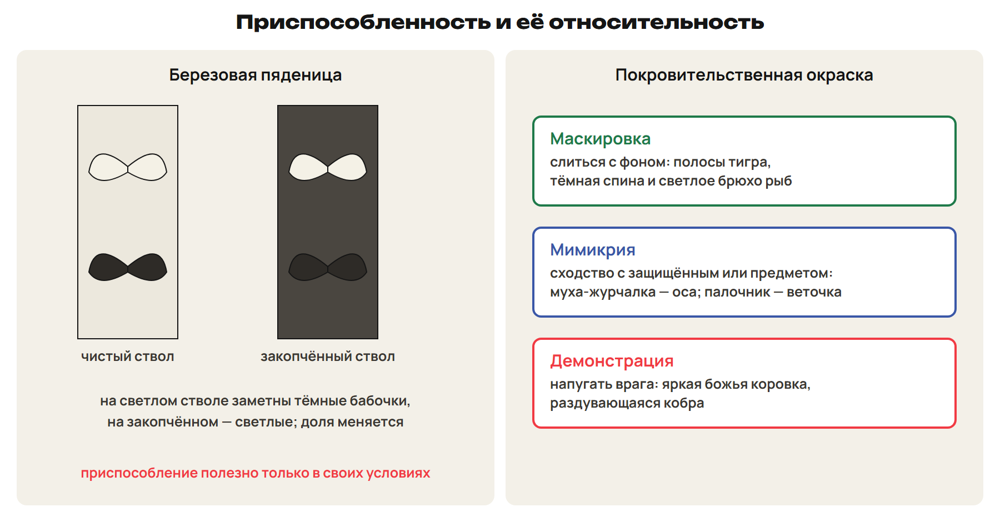

**Приспособления относительны** — полезны только в тех условиях, где возникли: зелёный кузнечик заметен на пожелтевшей траве, белый заяц виден на фоне тёмных стволов. **Березовая пяденица:** светлые бабочки сменились тёмными, когда стволы закоптились, а после очистки воздуха снова стали светлыми — движущий отбор пошёл в обратную сторону.

> [!trap] Мимикрия и маскировка
> Маскировка — слиться с фоном. Мимикрия — быть похожим на **другой** объект или защищённый вид. Демонстрация — наоборот, привлечь внимание и напугать.

## 6. Вид, критерии вида, популяция

**Вид** — особи, сходные по строению и жизнедеятельности, живущие на своей территории в виде популяций и не образующие гибридов с другими видами.

| Критерий | Что сравнивают |
|---|---|
| Морфологический — самый древний | строение; недостаточен: виды-двойники внешне не различаются |
| Физиологический | биохимия и физиология |
| Генетический — сегодня основной | число и форма хромосом, плодовитость потомства |
| Экологический | ареал и условия жизни |

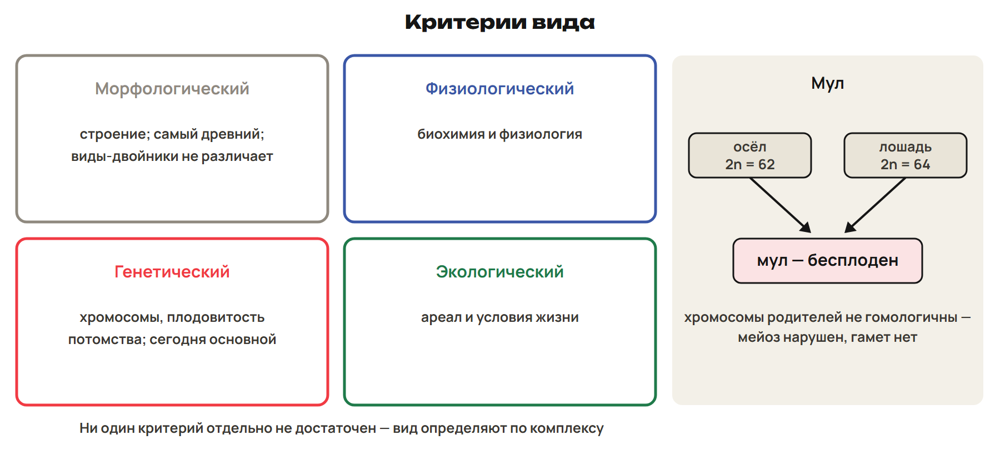

Ни один критерий отдельно не достаточен. **Межвидовые гибриды бесплодны:** хромосомы родителей не гомологичны, мейоз нарушен (мул — гибрид осла и лошади).

**Популяция** — особи одного вида, свободно скрещивающиеся между собой и долго живущие в части ареала; у неё свой генофонд. **Популяция — элементарная единица эволюции.**

> [!trap] Единица эволюции
> Эволюционирует популяция — не особь и не вид. Генетический критерий — основной, морфологический — самый древний.

## 7. Популяционные волны, дрейф генов, изоляция

- **Популяционные волны** (С. С. Четвериков) — колебания численности; на подъёме больше материала для отбора, на спаде отбор жёстче.
- **Дрейф генов** — **случайное** изменение частот аллелей в **малых** популяциях. При 5000 потомках частота аллеля 0,50 колеблется в пределах 0,48–0,52, при 50 — уже 0,30–0,70. Итог дрейфа — утрата аллеля или его закрепление **независимо от полезности**.
- **Эффект основателя** — новая популяция от нескольких особей несёт лишь часть генов исходной.
- **Изоляция** — невозможность свободного скрещивания: **географическая** (горы, реки), **экологическая** (разные места и сроки размножения), **биологическая** (строение, поведение, сроки созревания гамет, бесплодие гибридов).

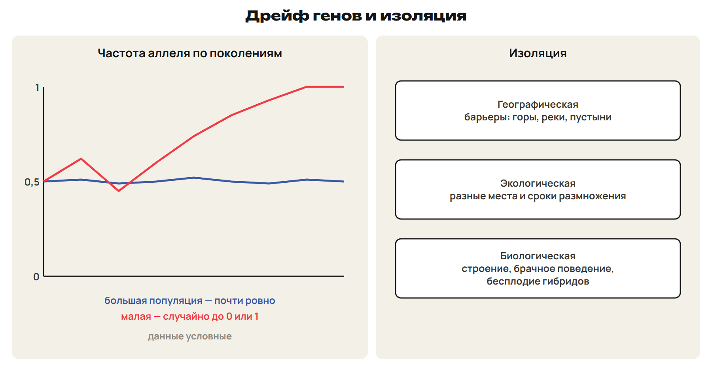

> [!trap] Дрейф и отбор
> Дрейф — случайный, сильнее в малых популяциях. Отбор — направленный: сохраняет выгодное.

## 8. Видообразование

**Микроэволюция** — изменения генофонда популяций, ведущие к новым видам.

| Способ | Ареал | Пример |
|---|---|---|
| Географическое (аллопатрическое) | разделён барьером или вид расселился | галапагосские вьюрки; попугайчики Австралии, разделённые засухой |
| Экологическое (симпатрическое) | одна территория, разные условия | рыбы озера Ланао; бокоплавы Байкала; синицы на одном дереве |

**Полиплоидия** — новый вид возникает сразу, без разделения ареала: полиплоид не скрещивается с родительскими формами. Ряд пшеницы — 14, 28, 42 хромосомы, роз — 14, 28, 42, 56. **Эндемики** живут только в одном месте; острова и древние озёра — места частого видообразования.

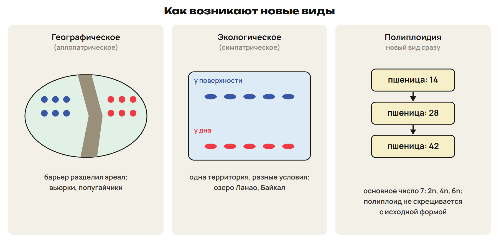

> [!trap] Два названия
> Географическое = аллопатрическое (разрыв ареала). Экологическое = симпатрическое (одна территория). Полиплоидия — без разрыва ареала.

## 9. Макроэволюция и её направления

**Макроэволюция** — образование надвидовых групп (родов, семейств, классов); идёт на основе микроэволюции. Оба термина предложил Ю. А. Филипченко (1927). **Биологический прогресс** — рост численности и ареала; **регресс** — сокращение.

| Путь | Суть | Пример |
|---|---|---|
| Ароморфоз | усложнение, повышение уровня организации | мезодерма у плоских червей; кровеносная система у кольчатых; четырёхкамерное сердце |
| Идиоадаптация | частные приспособления без изменения уровня | покровительственная окраска; плоское тело камбалы и ската |
| Дегенерация | упрощение строения | паразитические черви без пищеварительной системы; повилика |

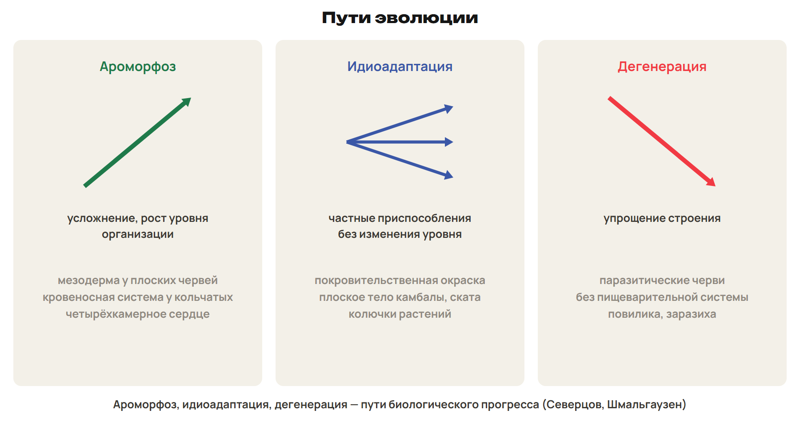

**Дивергенция** — расхождение признаков **родственных** форм; **конвергенция** — сходство **неродственных** в сходных условиях (крылья бабочки, птицы, летучей мыши). Пути прогресса описали А. Н. Северцов и И. И. Шмальгаузен.

## 10. Доказательства эволюции

| Доказательство | Суть |
|---|---|
| Цитологические | все организмы из клеток, сходных по строению и составу |
| Сравнительно-анатомические | единый план строения (Ж. Кювье); гомологичные органы, рудименты, атавизмы |
| Эмбриологические | закон зародышевого сходства (К. Бэр); онтогенез — краткое повторение филогенеза (Геккель и Мюллер) |
| Палеонтологические | переходные формы (археоптерикс; утконос и ехидна); филогенетический ряд лошади (В. О. Ковалевский) |
| Биогеографические | Австралия давно изолирована — сумчатые, утконосы |
| Биохимические | сходство белков: при диабете применяют свиной инсулин |

- **Гомологичные органы** — одно происхождение, функции могут различаться: рука человека и ласт кита; колючки кактуса и усики гороха (видоизменённые листья).
- **Аналогичные** — сходные функции, разное происхождение: крыло бабочки и крыло птицы; колючки кактуса (лист) и боярышника (стебель).
- **Рудименты** есть у всех особей: аппендикс, третье веко человека, тазовые кости кита. **Атавизмы** — у отдельных особей: хвост, многососковость.

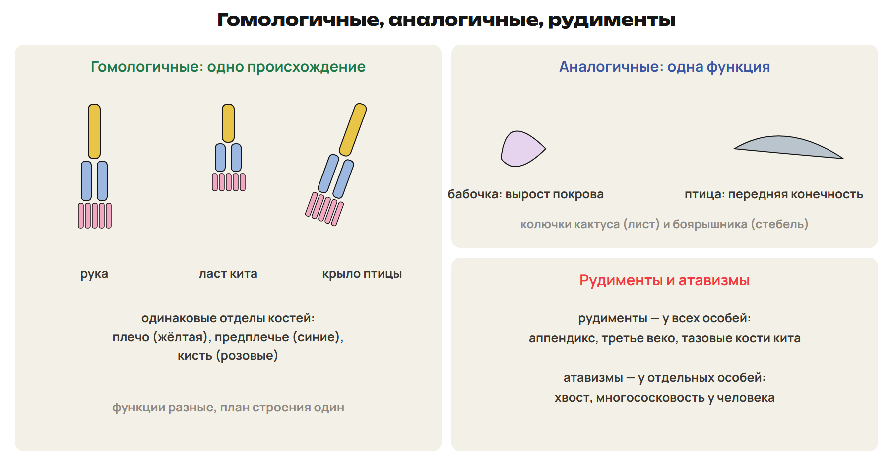

> [!trap] Гомология и аналогия
> Гомологичные — одно происхождение; аналогичные — одна функция. Рудимент — у всех, атавизм — у отдельных особей.

## 11. Кладограммы

**Филогенетическое дерево** показывает родство видов. **Лист** — вид, **узел** — разделение предка на два вида, **корень** — общий предок всех. **Кладограмма** показывает только порядок ветвления, **без длины ветвей**; у филограммы длина ветвей — число мутаций, у хронограммы — время.

> [!rule] Как читать кладограмму
> Чем ближе к листьям общий узел двух видов, тем ближе их родство.
> Близость листьев на рисунке ничего не значит — смотри на узлы.
> Кладограмма не говорит, кто от кого произошёл.

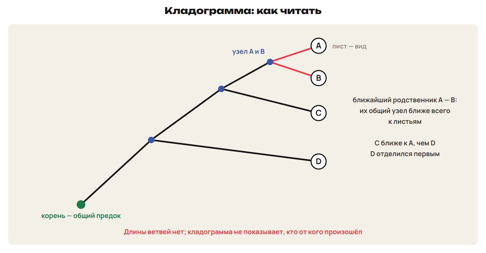

**LUCA** — последний универсальный общий предок всех ныне живущих организмов (3,5–3,8 млрд лет назад); ископаемых нет, его изучают сравнением геномов. LUCA — не первый живой организм.

## 12. Происхождение жизни и человека

- Самозарождение опровергли **Ф. Реди** (1668: в закрытом мясе личинки мух не появились) и **Л. Пастер** (прокипячённый бульон в колбе с изогнутой трубкой не мутнел).
- **Гипотеза А. И. Опарина (1924) и Дж. Холдейна (1929):** жизнь возникла в ходе долгой химической эволюции в первичном океане; органические вещества → **коацерваты** → первые прокариоты → эукариоты.
- **Антропогенез:** прямохождение освободило руки; труд, речь и общественная жизнь усилили развитие мозга.

| Этап | Представители | Объём мозга |
|---|---|---|
| Протоантропы | австралопитек, человек умелый | около 530 см³ |
| Архантропы | питекантроп, человек прямоходящий; огонь | 800–1200 см³ |
| Палеоантропы | неандертальцы | 1200–1400 см³ |
| Неоантропы | кроманьонцы — ранние Homo sapiens | — |

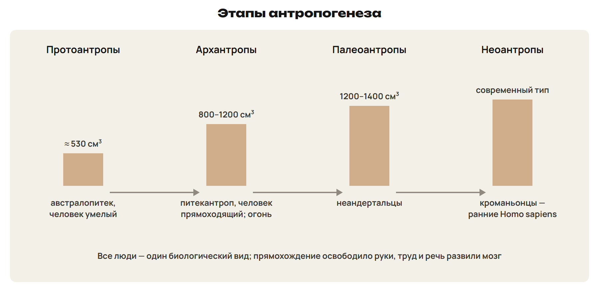

Все люди — **один биологический вид**: между расами нет генетической изоляции. Предки ли протоантропы человека — пока неизвестно: это предположение, а не факт.

> [!trap] Факт или предположение
> Найденный отпечаток археоптерикса с перьями и зубами — факт. «Археоптерикс — предок всех современных птиц» — предположение. LUCA — вывод из сравнения геномов, ископаемых нет.

> [!rule] Факты ЕНТ недели
> - Ламарк — «Философия зоологии» (1809); Дарвин — «Происхождение видов…» (1859): изменчивость, борьба за существование, естественный отбор.
> - Искусственный отбор — сорта и породы; СТЭ — Четвериков (1926), Фишер (1930); единица эволюции — популяция.
> - Внутривидовая борьба — самая острая; отбор движущий, стабилизирующий (Шмальгаузен), разделительный.
> - Маскировка, мимикрия, демонстрация; приспособления относительны (березовая пяденица).
> - Критерии вида: морфологический (древнейший), физиологический, генетический (основной), экологический; мул бесплоден.
> - Дрейф генов — в малых популяциях; видообразование географическое (вьюрки) и экологическое (Байкал); пшеница 14, 28, 42.
> - Ароморфоз, идиоадаптация, дегенерация; гомологичные и аналогичные органы; Бэр; Геккель — Мюллер; ряд лошади — Ковалевский.
> - Реди, Пастер; Опарин — Холдейн, коацерваты; протоантропы → архантропы → палеоантропы → неоантропы.
