После урока 39 прочитай разделы 1–6, реши P и общую часть G. После урока 40 повтори разделы 7–11, таблицы и факты, выполни один назначенный вариант A/B/C. Сначала попытка, затем ключ.

## 1. Экосистема и её компоненты

Почему в лесу не накапливаются горы опавших листьев, а энергия Солнца не копится в лисах?

**Экосистема** — устойчивое сообщество живых организмов в постоянной связи с неживой природой; биотическая и абиотическая части связаны **обменом веществ и энергии**. **Сообщество** — объединение организмов **разных видов**. Уровни: организм → популяция → сообщество → экосистема. Энергия в большинство экосистем приходит **от Солнца**.

| Компонент | Кто | Роль |
|---|---|---|
| **Продуценты** (автотрофы) | зелёные растения, фитопланктон | из неорганических веществ создают органические; **1-й трофический уровень** |
| **Консументы** (гетеротрофы) | I порядка — растительноядные; II — хищники; III — хищники хищников; паразиты | потребляют готовое органическое вещество |
| **Редуценты** (сапротрофы) | бактерии и грибы | разлагают мёртвые остатки — **минерализация**, элементы возвращаются в неживую природу |

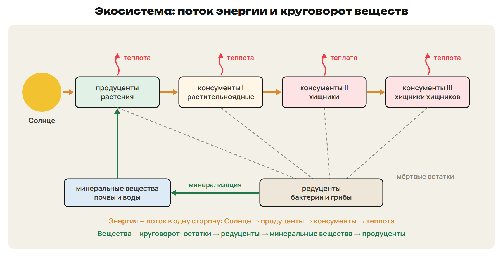

**Хищник** убивает жертву и сразу съедает; **паразит** как можно дольше живёт за счёт хозяина. **Всеядные** занимают сразу несколько трофических уровней.

## 2. Пищевые цепи и сети

**Пищевая цепь** — ряд организмов, последовательно извлекающих органические вещества и энергию друг из друга. **Пищевая сеть** — переплетение цепей. **Трофический уровень** — организмы, получающие энергию Солнца через одинаковое число посредников. Звеньев в цепи **обычно 3–5**: к концу доходит слишком мало энергии.

| Цепь | Начинается с | Пример |
|---|---|---|
| **Пастбищная** (выедания) | живых растений | луговой цветок → бабочка → лягушка → уж → цапля |
| **Детритная** (разложения) | мёртвой органики (детрита) | листовая подстилка → дождевой червь → чёрный дрозд → ястреб-перепелятник |

В **лесу** преобладают детритные цепи, в поверхностных водах моря — пастбищные. Продуценты усваивают не более 1–2 % солнечной энергии.

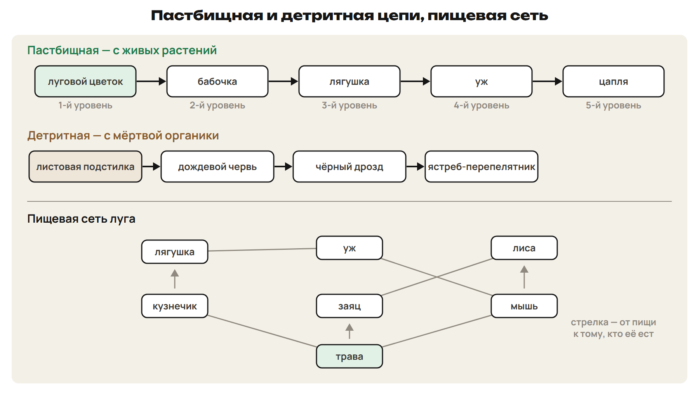

> [!trap] Уровень и порядок
> Продуцент — 1-й уровень; консумент I порядка — 2-й уровень; консумент II порядка — 3-й. Детритная цепь начинается с мёртвой органики, а не «с редуцентов».

## 3. Поток энергии, правило 10 %, пирамиды

**Правило 10 % (Линдеман, 1942):** на следующий уровень переходит **в среднем около 10 %** энергии; около 90 % тратится на жизнедеятельность и **рассеивается в виде теплоты**. Это среднее значение: в разных экосистемах от 1 до 30 %.

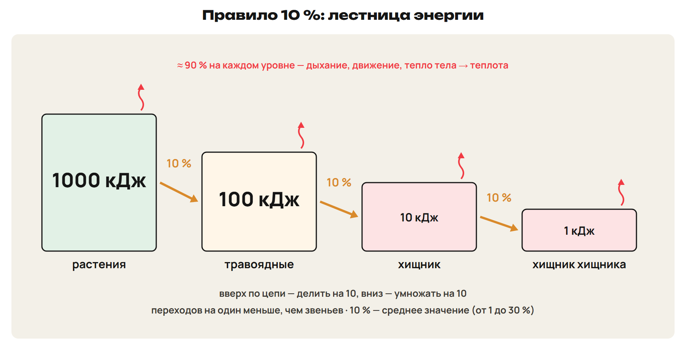

> [!rule] Как считать по правилу 10 %
> Вверх по цепи — делить на 10, вниз (сколько нужно корма) — умножать на 10 на каждый переход.
> **Переходов на один меньше, чем звеньев:** цепь из 4 звеньев — 3 перехода.
> Пример: трава → кузнечики → лягушки → уж. Уж прибавил 0,5 кг → лягушек 5 кг → кузнечиков 50 кг → травы 500 кг.

**Эффективность переноса** = прибавка массы / съеденный корм · 100 %: съели 240 кг травы, прибавили 30 кг — 12,5 %.

| Пирамида | Что показывает | Бывает перевёрнутой? |
|---|---|---|
| Чисел | число особей на уровне | да: одно дерево кормит множество насекомых |
| Биомассы | массу организмов уровня | да, в море: фитопланктон быстро размножается, его биомасса в данный момент меньше биомассы консументов |
| Энергии | энергию, проходящую через уровень за единицу времени | **нет, никогда** |

Пирамиды впервые построил Ч. Элтон (1927). Пирамиды чисел и биомассы — «снимок» в данный момент, пирамида энергии — скорость прохождения пищи.

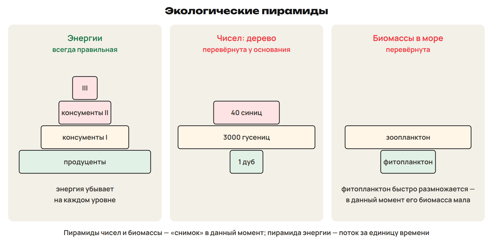

> [!trap] Поток или круговорот
> Энергия идёт **в одну сторону** и уходит теплотой — **поток энергии**. Вещества возвращаются в неживую природу через редуцентов — **круговорот веществ**.

## 4. Популяция и её показатели

**Популяция** — наименьшая структурная единица обитания вида. Раздел экологии о популяциях — демэкология.

| Показатель | Что это |
|---|---|
| Численность | число особей — основной показатель |
| Плотность | численность / площадь (объём) |
| Рождаемость, смертность | число родившихся, умерших за единицу времени |
| Прирост | рождаемость − смертность; бывает отрицательным |
| Возрастной состав | молодые и зрелые — популяция стабильна; только старые — сокращается |
| Половой состав | соотношение самцов и самок |
| Генофонд | все гены особей популяции |

> [!rule] Метод мечения с повторным отловом
> N = M · C / R: M — помечено в первый раз, C — поймано во второй раз, R — меченых во втором улове.
> Условия: нет миграций, выборка случайна, меченые перемешались и выживают так же.
> Пример: пометили 60 карасей; во втором улове 50, меченых 12 → N = 60 · 50 / 12 = 250.

## 5. Рост популяции и стратегии

**Репродуктивный потенциал** — способность увеличивать численность; **сопротивление среды** ограничивает рост; **несущая ёмкость среды** — численность, при которой прирост близок к нулю. **Экспоненциальный рост** — за равные промежутки численность умножается на одно и то же число: бактерия делится каждые 20 мин — 1 → 2 → 4 → 8.

| | J-кривая, r-стратегия | S-кривая, K-стратегия |
|---|---|---|
| Кривая | резкий рост → пик → падение, плато нет | рост → замедление → **плато** |
| Размножение | высокая плодовитость, ранняя зрелость, быстрая смена поколений | низкая плодовитость, забота о потомстве, долгая жизнь |
| Примеры | саранча, тли, бактерии, мышевидные грызуны, однолетние растения | слоны, человекообразные обезьяны, морские млекопитающие, крупные кошачьи |

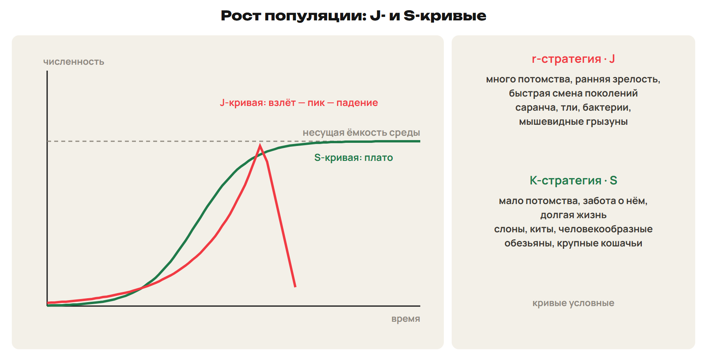

Численности **хищника и жертвы** (заяц и рысь) колеблются согласованно: они регулируют друг друга.

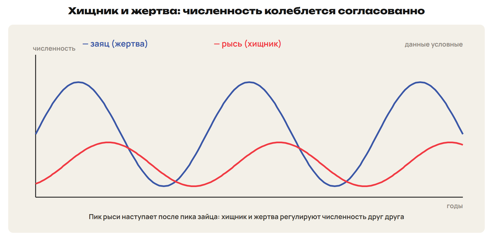

> [!trap] Прирост и плотность
> Прирост = рождаемость − смертность (особей за время). Плотность = особи / площадь. J-кривая без плато — r-стратегия, S-кривая с плато — K-стратегия.

## 6. Экологические факторы и адаптации

Для каждого фактора есть минимум и максимум. Диапазон, где организм живёт и размножается, — **предел выносливости**; лучшие условия — **зона оптимума**. **Лимитирующий фактор** ограничивает жизнь сильнее других; для животных часто — корм.

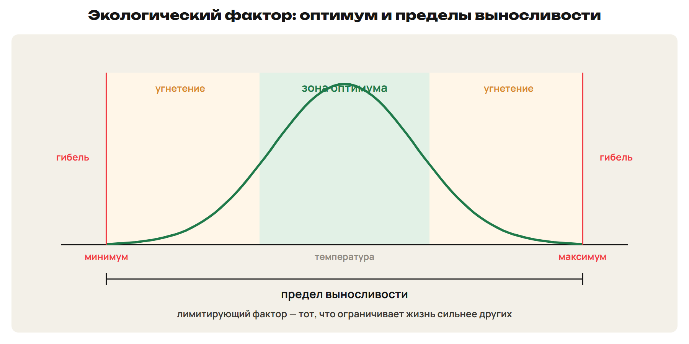

- **Свет:** глубже 100 м зелёным водорослям света не хватает; **красные водоросли** живут глубже.
- **Пустыня:** листья-чешуйки или колючки (саксаул); суккуленты запасают воду (алоэ, кактусы); длинные корни (верблюжья колючка); ночная активность, летняя спячка степной черепахи.
- **Температура:** пойкилотермные (растения, большинство животных) зависят от неё; гомойотермные (птицы, млекопитающие) держат постоянную температуру тела.

## 7. Взаимоотношения организмов

| Тип | Знаки | Пример |
|---|---|---|
| Мутуализм | + + (обязательно) | лишайник (гриб + водоросль), микориза |
| Кооперация | + + (необязательно) | рак-отшельник и актиния; птицы на копытных |
| Комменсализм (нахлебничество) | + 0 | гиены доедают добычу львов |
| Квартирантство | + 0 (жильё) | мальки под зонтиком медузы, рыба-клоун в актинии |
| Хищничество | + − | волк и заяц; каннибализм у щуки |
| Паразитизм | + − | клещи, глисты; кукушка — гнездовой паразит |
| Конкуренция | − − | серые крысы вытеснили чёрных |
| Аменсализм | − 0 | одностороннее отрицательное воздействие |
| Нейтрализм | 0 0 | белки и лоси в одном лесу |

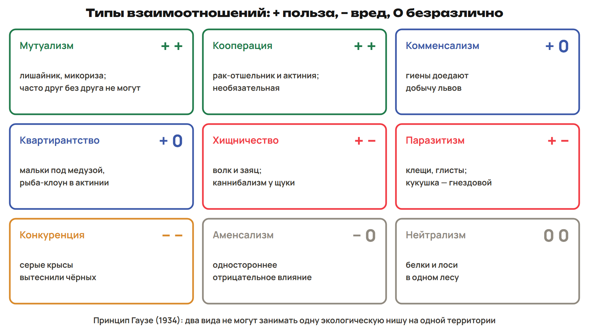

**Принцип Гаузе (1934):** два вида не могут занимать одну экологическую нишу на одной территории — один вытеснит другого. Клубеньковые бактерии и бобовые — взаимовыгодный симбиоз. Хищники выбирают больных и слабых и регулируют численность жертв.

> [!trap] Четыре «плюса»
> Мутуализм — польза обоим, часто друг без друга не могут; кооперация — польза обоим, но не обязательно; комменсализм — польза одному за счёт пищи; квартирантство — за счёт жилья.

## 8. Круговороты веществ

**Углерод:** CO₂ воздуха (доли процента) поглощается при **фотосинтезе**; выделяется при **дыхании, горении, гниении**, извержениях вулканов. Часть углерода выведена из круговорота: известняк и мел (раковины), уголь, нефть, газ; при сжигании топлива он быстро возвращается в атмосферу.

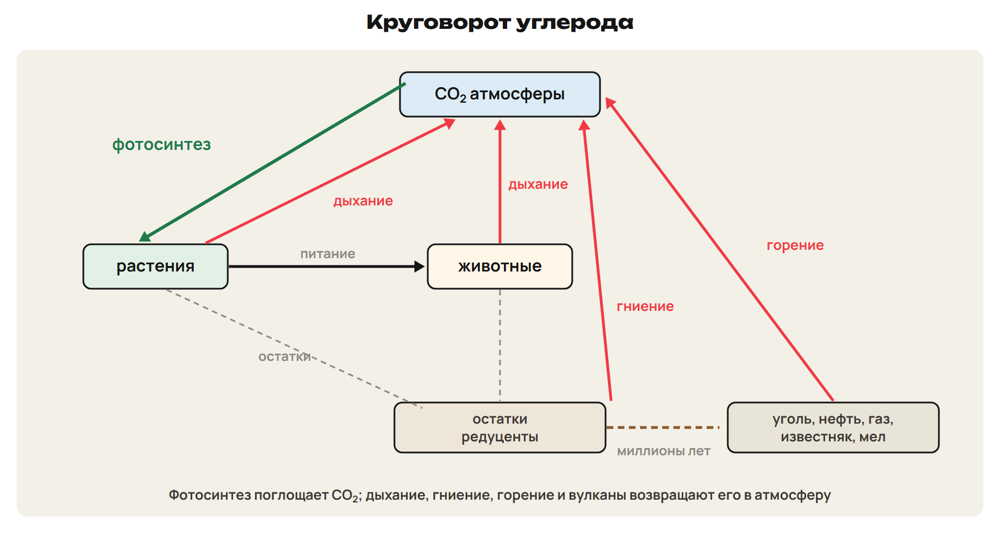

**Азот:** в воздухе около 78 % N₂, но растения усваивают только соединения (нитраты).

> [!rule] Круговорот азота
> **Фиксация:** молнии (оксиды азота → нитраты) и **клубеньковые бактерии**, **цианобактерии**.
> Остатки и мочевина → аммонифицирующие бактерии → **нитрифицирующие** → нитраты для растений.
> **Денитрифицирующие** бактерии (без кислорода) возвращают N₂ в атмосферу.

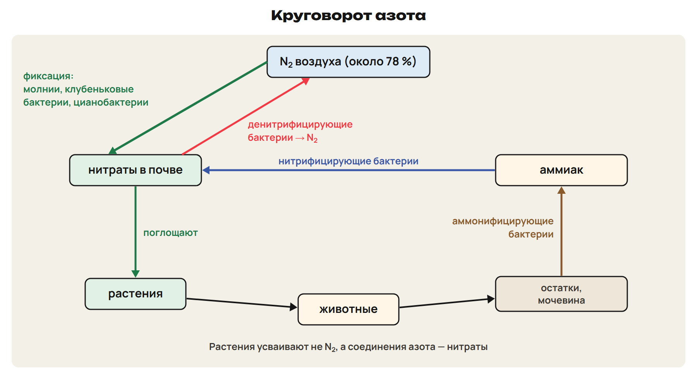

**Почва** = разрушенные породы + **гумус** + живые организмы; плодородие определяет прежде всего гумус.

## 9. Биоразнообразие и охрана

**Биоразнообразие** — генетическое, видовое, экосистемное. Описано около 2 млн видов. Больше всего видов — во влажных тропических лесах и на коралловых рифах.

- Причины сокращения: разрушение мест обитания, чрезмерная добыча, завезённые виды, загрязнение. Человек уничтожил **тарпана, морскую корову, странствующего голубя**.
- Охрана: **Конвенция о биологическом разнообразии (Рио-де-Жанейро, 1992)**; **заповедник** — хозяйственная деятельность запрещена; **заказник** — запрещена частично; национальные парки; разведение в неволе (зубр, «Стерх»); банки семян — на **Шпицбергене (2008)** и ВИР **Н. И. Вавилова**.

## 10. Закон Харди — Вайнберга

В **идеальной популяции** частоты аллелей и генотипов не меняются из поколения в поколение. Условия: популяция **большая**, скрещивание **случайное**, **нет мутаций, миграций и отбора**. В природе идеальных популяций нет, но закон применяют для расчётов.

> [!rule] Формулы
> p — частота доминантного аллеля A, q — рецессивного a: **p + q = 1**.
> **p² (AA) + 2pq (Aa) + q² (aa) = 1.**
> Начинай с **q²** — доли рецессивных гомозигот: только их видно по фенотипу.

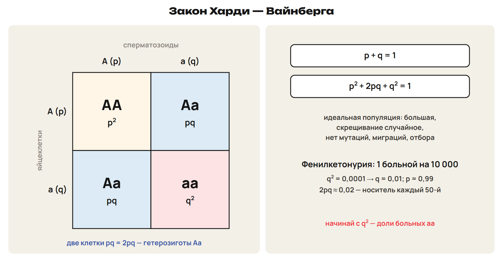

> [!example] Фенилкетонурия
> 1 больной на 10 000 → q² = 0,0001 → q = 0,01, p = 0,99 → носителей 2pq ≈ 0,02 — каждый 50-й. Рецессивные аллели в основном «спрятаны» в гетерозиготах.

Кровнородственные браки повышают долю гомозигот — рецессивные болезни проявляются чаще.

> [!trap] Больные и носители
> q² — доля больных (aa); носители — 2pq (Aa). Популяция в экологии — показатели и рост; популяция как единица эволюции — прошлая неделя.

## 11. Влияние человека и проблемы Казахстана

| Проблема | Причина | Последствия |
|---|---|---|
| Парниковый эффект | рост **CO₂** (сжигание топлива, вырубка лесов), метан | потепление, таяние ледников, подъём уровня океана, засухи и наводнения |
| Разрушение озонового слоя | **фреоны** | озоновые дыры; больше ультрафиолета — больше мутаций |
| Кислотные дожди | **оксиды серы и азота** | гибель лесов и жизни в озёрах, разрушение зданий |
| Пестициды | стойкость, токсичность | **накопление по пищевой цепи**, гибель полезных хищников, устойчивость вредителей |

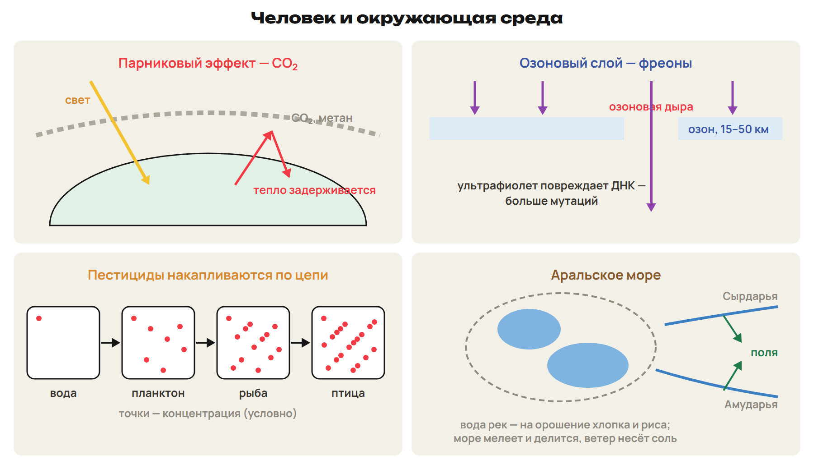

- **Семипалатинский полигон:** первый взрыв 29 августа 1949 г., более 450 испытаний; движение «Невада — Семипалатинск»; закрыт 29 августа 1991 г.
- **Аральское море:** воду Сырдарьи и Амударьи разобрали на орошение хлопка и риса; море потеряло больше половины воды, ветер разносит соль и пыль.
- Каспий: нефтедобыча угрожает осетровым; в городах воздух загрязняют транспорт и металлургия.

> [!trap] Три проблемы — три причины
> Парниковый эффект — CO₂; озоновые дыры — фреоны; кислотные дожди — оксиды серы и азота.

> [!try] Проверь себя
> 1) Сколько травы нужно, чтобы цапля в цепи трава → кузнечик → лягушка → цапля прибавила 2 кг? 2) Почему пирамида энергии не бывает перевёрнутой? 3) Больных 1 на 2500: найди q и долю носителей.

> [!rule] Факты ЕНТ недели
> - Продуценты — 1-й уровень; консументы; редуценты — минерализация; цепи обычно 3–5 звеньев.
> - Правило 10 % — Линдеман (1942); пирамида энергии всегда правильная; биомасса в море и численность «дерево — насекомые» бывают перевёрнутыми.
> - Пастбищная цепь — с живых растений, детритная — с мёртвой органики; в лесу — детритные.
> - J-кривая — r-стратегия; S-кривая с плато — K-стратегия; несущая ёмкость среды.
> - Мутуализм — лишайник, микориза; комменсализм, квартирантство, паразитизм, конкуренция, нейтрализм; принцип Гаузе.
> - Фотосинтез поглощает CO₂; дыхание, горение, гниение выделяют; клубеньковые бактерии и цианобактерии фиксируют азот, денитрификаторы возвращают N₂.
> - Харди — Вайнберг: p + q = 1; p² + 2pq + q² = 1; большая популяция, случайное скрещивание, нет мутаций, миграций, отбора.
> - CO₂ — парниковый эффект; фреоны — озон; оксиды S и N — кислотные дожди; ДДТ накапливается по цепи; полигон 1949–1991; Арал — забор воды на хлопок и рис.
