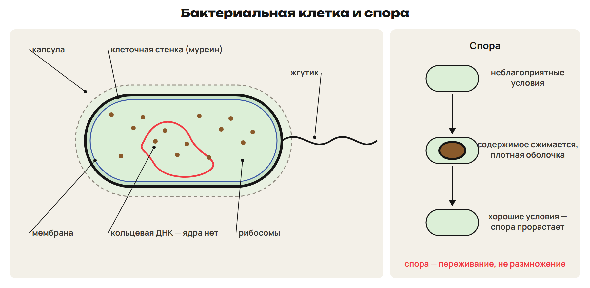
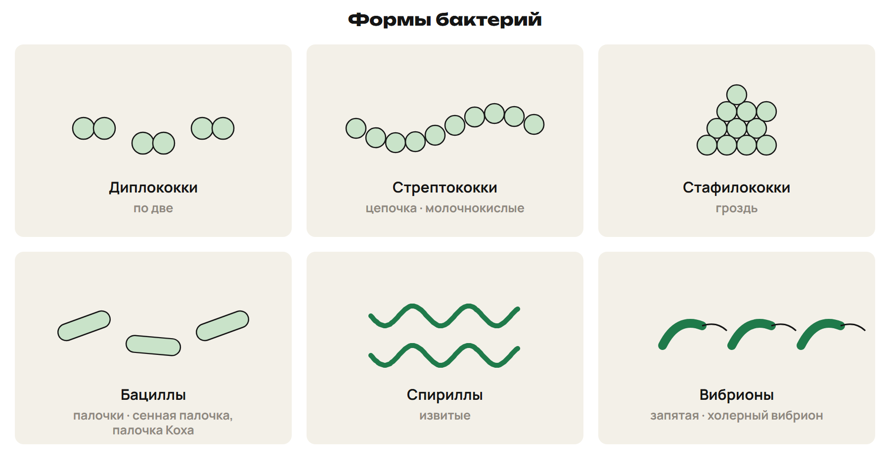
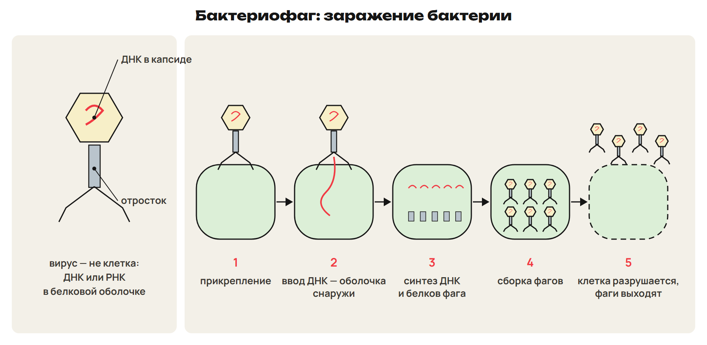
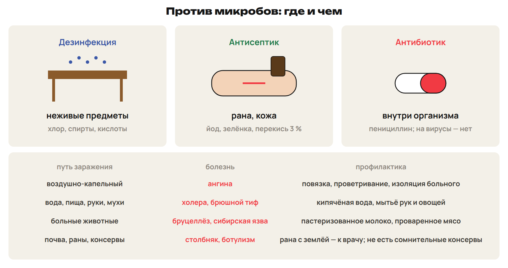
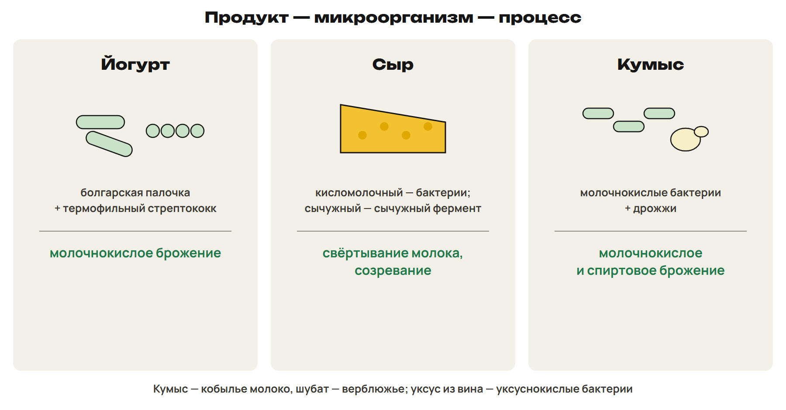

# Бактерии
? Почему кефир полезен, а молоко из грязного ведра опасно?
↳ Прокариоты мы встречали в первой неделе. Сегодня — что умеют бактерии.
> 0–11 строение, формы, споры; 11–14 L1; 14–16 ключ.

## Схема: Бактериальная клетка

Стенка из муреина, у многих — капсула; кольцевая ДНК, ядра нет.
Жгутики; многоклеточных бактерий нет, есть колонии.
Споры — переживание неблагоприятных условий.
Ловушка: спора бактерии — не размножение.

## Схема: Формы бактерий

Кокки: дипло- (по 2), стрепто- (цепочка), стафило- (гроздь).
Бациллы — палочки: сенная палочка, палочка Коха.
Спириллы и спирохеты — извитые; вибрионы — запятая (холера).

## Практика: L1
Форма: гроздь шариков; запятая; цепочка шариков.
Зачем бактерии спора?
Ответы:
Стафилококк; вибрион; стрептококк.
Пережить неблагоприятные условия.
> 11–14 попытка, 14–16 ключ.

# Значение бактерий
? Что было бы на Земле без бактерий гниения?
> 16–23 польза и вред; 23–26 L2; 26–28 ключ.

## Понятие: Польза и вред
Цианобактерии создали кислородную атмосферу.
Клубеньковые — азот; гнилостные — перегной и минеральные вещества.
Молочнокислые — кефир, творог, сыр; уксуснокислые — уксус.
Вред: болезни, порча продуктов, цветение водоёмов.

## Практика: L2
Роль: клубеньковые; бактерии гниения;
молочнокислые; уксуснокислые бактерии.
Ответы:
Азот в почву; остатки → перегной и минеральные вещества.
Кефир, творог, сыр; вино → уксус.
> 23–26 попытка, 26–28 ключ.

# Вирусы
? Почему грипп не лечат антибиотиками?
> 28–38 строение, фаг, сравнение; 38–43 L3; 43–46 ключ.

## Схема: Бактериофаг

Вирус — не клетка: ДНК или РНК в белковом капсиде.
Бактериофаг — вирус бактерий.
Прикрепление → ввод нуклеиновой кислоты → синтез → сборка → выход.
Антибиотики на вирусы не действуют.
Ловушка: фаг — вирус, а не бактерия.

## Понятие: Бактерии и вирусы
Бактерия — клетка; вирус — нет.
Бактерия — ДНК; вирус — ДНК или РНК.
Бактерия делится; вирус собирается в клетке-хозяине.
Вирусные болезни: грипп, корь, бешенство, СПИД, мозаика табака.

## Практика: L3
Расставь: сборка; выход; прикрепление; синтез; впрыскивание ДНК.
Что остаётся снаружи клетки?
Ответы:
Прикрепление → впрыскивание ДНК → синтез → сборка → выход.
Белковая оболочка фага.
> 38–43 попытка, 43–46 ключ.

# Инфекции и борьба с ними
? Чем протирают стол, чем — рану, а что пьют?
> 46–56 средства и профилактика; 56–61 L4; 61–64 ключ.

## Схема: Средства против микробов

Дезинфекция — предметы; антисептик — рана; антибиотик — внутри.
Пенициллин — Флеминг (1928); производство в СССР — Ермольева.
Антисептика — Земмельвейс, Пирогов, Пастер, Листер.
Неразумный приём антибиотиков — дисбактериоз.

## Понятие: Пути заражения
Воздушно-капельный — ангина: повязка, проветривание.
Вода и пища — холера, брюшной тиф: кипячёная вода, мытьё рук.
Животные — бруцеллёз: пастеризованное молоко.
Почва — столбняк, ботулизм: рана с землёй — к врачу.

## Практика: L4
Обработали пол; смазали края раны зелёнкой; назначили пенициллин.
Как защититься от бруцеллёза?
Ответы:
Дезинфекция; антисептик; антибиотик.
Пастеризованное молоко, проваренное мясо.
> 56–61 попытка, 61–64 ключ.

# Пищевая биотехнология
? Почему кефир кислый?
> 64–71 продукты и микроорганизмы; 71–76 L5; 76–78 ключ.

## Схема: Продукт — микроорганизм — процесс

Йогурт — болгарская палочка + термофильный стрептококк.
Сыр: кисломолочный — бактерии; сычужный — сычужный фермент.
Кумыс — кобылье молоко, бактерии и дрожжи; шубат — верблюжье.
Алгоритм: организм → процесс → продукт.

## Практика: L5
Для кумыса и сычужного сыра: кто работает, какой процесс?
Ответы:
Кумыс — молочнокислые бактерии и дрожжи; молочнокислое и спиртовое брожение.
Сыр — сычужный фермент свёртывает молоко, затем созревание.
> 71–76 попытка, 76–78 ключ.

# Проверка в формате ЕНТ
? Где ловушка в каждом задании?
> 78–84 L6; 84–88 ключ; 88–90 маршрут.

## Практика: L6
1) Чем бактерия отличается от вируса? 2) Кто открыл пенициллин?
3) Верные: А) споры — для размножения; Б) холерный вибрион — запятая; В) антисептики — в ране;
Г) вирусы делятся; Д) кумыс — с участием дрожжей; Е) стенка бактерий — из целлюлозы.
Ответы:
1) Бактерия — клетка, вирус — нет. 2) Флеминг. 3) БВД.
> 78–84 попытка, 84–88 ключ.

## Дома: После урока 41
Прочитай разделы 1–5 конспекта: 25 минут.
Реши P1–P6: 20 минут.
Выполни всю G: 35 минут.
Тест — строкой; G9–G10 — фото; G11 — текст или голосовое.
Запиши вопрос к началу следующего урока.
