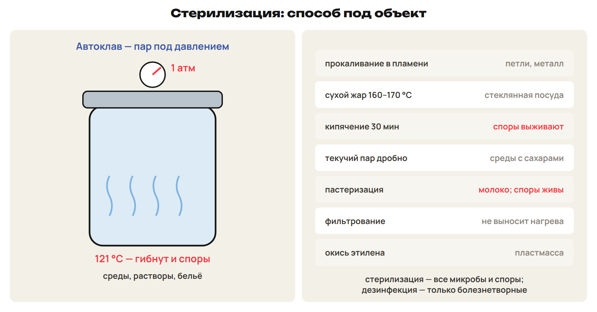
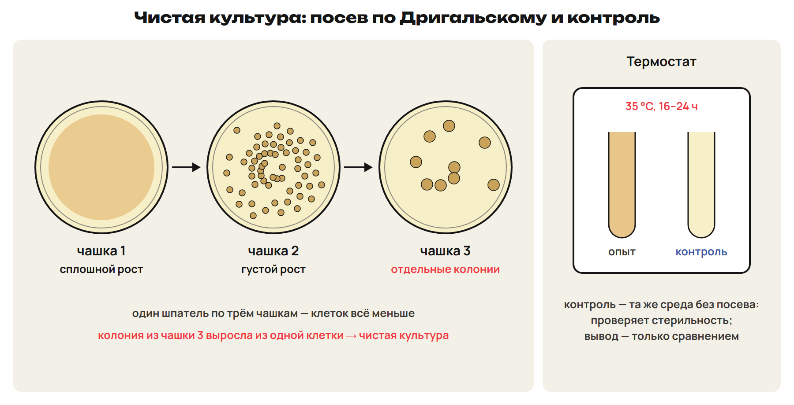
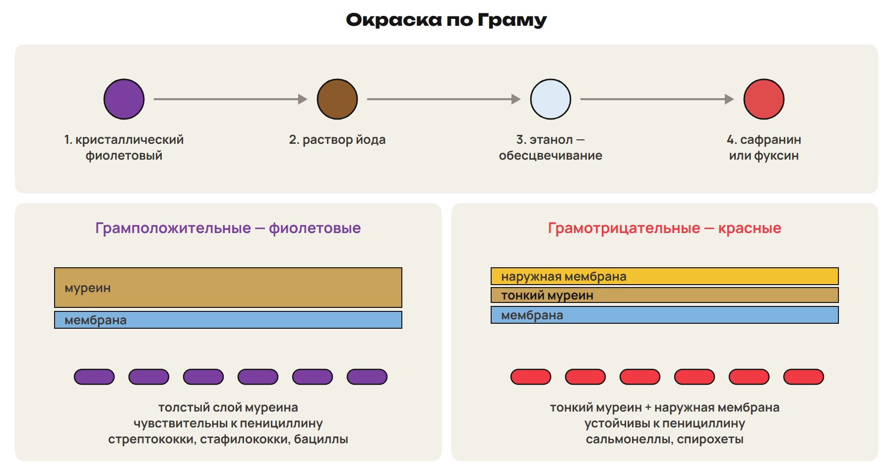
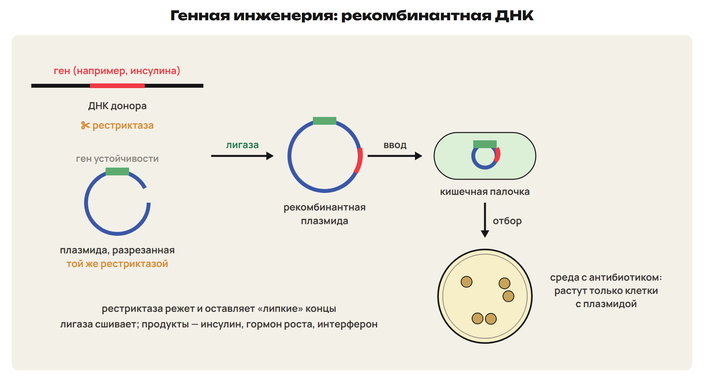
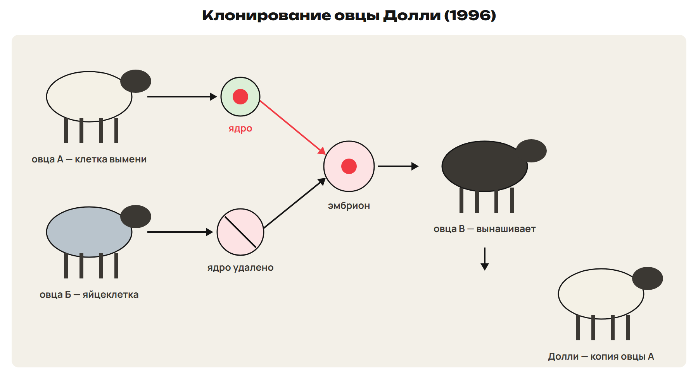
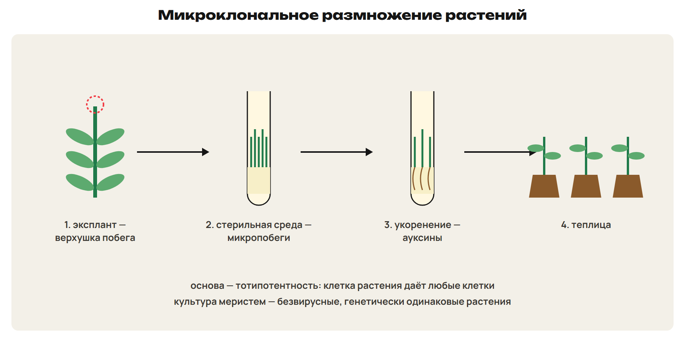

После урока 41 прочитай разделы 1–5, реши P и общую часть G. После урока 42 повтори разделы 6–9, таблицы и факты, выполни один назначенный вариант A/B/C. Сначала попытка, затем ключ.

## 1. Бактерии: строение, формы, споры

Почему кефир полезен, а молоко из грязного ведра опасно, хотя в обоих живут бактерии?

**Микробиология** — наука о микроскопических организмах; бактерии увидели только с изобретением микроскопа.

- **Строение:** оболочка — мембрана и **клеточная стенка из муреина** (не из целлюлозы), у многих поверх неё **слизистая капсула**; цитоплазма; **кольцевая ДНК** — ядра нет; у многих **жгутики**.
- Бактерии **не бывают многоклеточными**, но образуют **колонии**.
- **Споры** — покоящаяся форма для **переживания** высушивания, жары и холода; **в размножении не участвуют**. Сенная палочка переживает кипячение.

| Форма | Название | Пример |
|---|---|---|
| Шаровидные | кокки: диплококки (по 2), **стрептококки** (цепочка), тетракокки (по 4), **стафилококки** (гроздь) | молочнокислые стрептококки |
| Палочки | **бациллы** | сенная палочка, палочка Коха (туберкулёз), кишечная палочка |
| Извитые | спириллы, спирохеты | возбудители болезней, обитатели водоёмов |
| Запятая | **вибрионы** | холерный вибрион |

> [!trap] Споры и формы
> Споры бактерий — для переживания, не для размножения. Стрептококк — цепочка, стафилококк — гроздь. Форма не определяет образ жизни: одной формы бывают и полезные, и болезнетворные.

## 2. Значение бактерий

Больше всего бактерий в почве, меньше всего — в воздухе на высоте.

- **Польза:** цианобактерии создали кислородную атмосферу; **клубеньковые бактерии** на корнях бобовых обогащают почву азотом; **бактерии гниения** — «санитары планеты»: превращают остатки в перегной и минеральные вещества; **молочнокислые** — кефир, айран, творог, курт, сыр, квашеная капуста, силос; **уксуснокислые** — уксус; кишечные симбионты.
- **Вред:** болезнетворные бактерии; порча продуктов (защита — консервирование, соление, сушка, засахаривание); цветение водоёмов.

Л. Пастер: бесконечно малые существа играют в природе бесконечно большую роль.

## 3. Вирусы и бактериофаги

**Вирусы — неклеточная форма жизни:** нуклеиновая кислота (**ДНК или РНК**) в **белковой оболочке (капсиде)**. Вне клетки не питаются, не растут, не размножаются; своих ферментных систем нет — это **внутриклеточные паразиты**. **Бактериофаги** — вирусы бактерий.

> [!rule] Заражение клетки фагом
> 1) Прикрепление к оболочке клетки. 2) Впрыскивание нуклеиновой кислоты — белковая оболочка остаётся снаружи. 3) Клетка строит вирусные нуклеиновые кислоты и белки. 4) Сборка вирусов. 5) Клетка разрушается, вирусы выходят.

| | Бактерии | Вирусы |
|---|---|---|
| Строение | клетка: оболочка, цитоплазма, кольцевая ДНК | нет клетки: нуклеиновая кислота + белковая оболочка |
| Наследственный материал | ДНК | ДНК или РНК |
| Обмен веществ | свой | нет — только в клетке-хозяине |
| Размножение | деление клетки | сборка в клетке-хозяине |
| Антибиотики | действуют | **не действуют** |

Вирусные болезни: грипп, корь, оспа, полиомиелит, гепатит, бешенство, СПИД; у растений — мозаичная болезнь табака. Вирус трудно уничтожить, не повредив клетку, поэтому вирусные болезни трудно лечить.

> [!trap] Вирус и фаг
> Вирус — не клетка, антибиотики на него не действуют. Бактериофаг — вирус бактерий, а не бактерия, которая ест вирусы.

## 4. Инфекции и борьба с ними

| Средство | Где действует | Примеры |
|---|---|---|
| **Дезинфекция** | на неживых предметах | хлорсодержащие средства, спирты, кислоты |
| **Антисептики** | в ране, на теле | спирт, йод, зелёнка (края раны), 3 %-я перекись водорода, фурацилин |
| **Антибиотики** | внутри организма | пенициллин, стрептомицин |

- Антисептику внедряли И. Земмельвейс, Н. И. Пирогов, Л. Пастер, Дж. Листер. Антисептики не ускоряют заживление — только убивают микробов.
- **Антибиотики** — вещества микроорганизмов, подавляющие бактерии. **Пенициллин открыл А. Флеминг (1928)**; производство в СССР наладила З. В. Ермольева. Неразумный приём → **дисбактериоз**, аллергия; бактерии привыкают к антибиотикам.

| Путь заражения | Болезнь | Профилактика |
|---|---|---|
| Воздушно-капельный | ангина | повязка, проветривание, изоляция больного |
| Вода, пища, руки, мухи | холера, брюшной тиф | кипячёная вода, мытьё овощей и рук |
| От больных животных | бруцеллёз, сибирская язва | пастеризованное молоко, проваренное мясо, ветеринарный контроль |
| Почвенные анаэробы | ботулизм, столбняк | не есть сомнительные консервы; рана с землёй — к врачу |

## 5. Пищевая биотехнология

**Молочнокислые бактерии** превращают молочный сахар в **молочную кислоту** — простокваша, кефир, ряженка, йогурт; они подавляют гнилостные бактерии кишечника (И. Мечников). Нарушение микрофлоры кишечника — дисбактериоз.

| Продукт | Кто или что работает | Процесс |
|---|---|---|
| Йогурт | болгарская палочка + термофильный стрептококк | молочнокислое брожение |
| Кисломолочный сыр | молочнокислые бактерии | молочнокислое брожение, созревание |
| Сычужный сыр | сычужный фермент | свёртывание молока ферментом, созревание |
| Кумыс | молочнокислые бактерии **и дрожжи** | молочнокислое и спиртовое брожение (кобылье молоко) |
| Шубат | молочнокислые микроорганизмы | брожение верблюжьего молока |
| Уксус | уксуснокислые бактерии | вино → уксус |

Дрожжи — одноклеточные грибы, размножаются почкованием, примерно в 10 раз крупнее бактерий.

> [!rule] Организм → процесс → продукт
> Назови микроорганизм (бактерия, дрожжи, гриб), процесс (молочнокислое или спиртовое брожение, синтез белка по введённому гену, гниение) и продукт (молочная кислота, этанол и CO₂, инсулин, перегной).

## 6. Микробиологические методы

**Бактериальная культура** — бактерии одного вида, потомки одной клетки, выращенные на питательной среде.

- **Стерилизация** уничтожает **все** микроорганизмы и их споры; **дезинфекция** — только болезнетворные.

| Способ | Режим | Что обрабатывают |
|---|---|---|
| Прокаливание в пламени | — | бактериологические петли, металл |
| Сухой жар | 160–170 °C, 1–1,5 ч | стеклянная посуда, инструменты |
| Кипячение | 30 мин, **споры выживают** | шприцы, инструменты |
| **Автоклав** — пар под давлением | **1 атм — 121 °C**, споры гибнут за 20 мин | питательные среды, растворы, бельё |
| Текучий пар (дробно) | — | среды с сахарами |
| Пастеризация | прогрев без кипячения с быстрым охлаждением, споры не гибнут | молоко |
| Фильтрование | бактериальные фильтры | жидкости, портящиеся от нагревания |
| Химическая | окись этилена | пластмассовые чашки Петри |

> [!trap] Что не стерилизует
> Кипячение не убивает споры; автоклав при 121 °C — убивает. Пастеризация — не стерилизация.

- **Питательные среды:** жидкие (мясо-пептонный бульон, МПБ) и плотные (мясо-пептонный агар, МПА; загуститель — **агар-агар**); среда должна быть стерильной, с нужным pH; элективные среды подходят одному виду.
- **Посев:** петлю прокаливают, края пробирки проводят через пламя. **Чистую культуру** получают, разобщая клетки: метод Пастера (разведения в жидкости), **Коха** (плотные среды → изолированные колонии), **Дригальского** — шпателем по трём чашкам: в первой сплошной рост, во второй густой, **в третьей изолированные колонии**. Из одной колонии — чистая культура.
- **Инкубация** — выдерживание в **термостате** (например, 35 °C, 16–24 ч); результат сравнивают с **отрицательным контролем** — пробиркой без посева.

> [!rule] Контроль опыта
> Контроль — та же пробирка или чашка без изучаемого воздействия. Вывод делают только сравнением с контролем; всё остальное (среда, температура, время) — одинаково.

## 7. Окраска по Граму

Метод Х. К. Грама (1884): мазок высушивают и фиксируют над пламенем, затем: 1) **кристаллический фиолетовый**; 2) **раствор йода**; 3) **этанол** (обесцвечивание); 4) **сафранин или фуксин** (красный).

| | Грамположительные (грам+) | Грамотрицательные (грам−) |
|---|---|---|
| Цвет | **фиолетовые** — краситель не вымывается | **красные** — фиолетовый вымыт спиртом |
| Клеточная стенка | **толстый** слой муреина | **тонкий** муреин + **наружная мембрана** с липополисахаридами |
| Пенициллин и лизоцим | **чувствительны** | **устойчивы** |
| Примеры | стрептококки, стафилококки, бациллы | сальмонеллы, спирохеты, большинство палочек |

**Капсула** защищает бактерию от высыхания и фагоцитоза и повышает её вирулентность. **Эндоспоры** сохраняются годами, гибнут при 121 °C за 20 минут.

## 8. Генная инженерия

**Рекомбинантная ДНК** — молекула, полученная вне организма соединением фрагментов ДНК, которые в природе вместе не встречаются.

> [!rule] Этапы генной инженерии
> 1) Выделить нужный ген. 2) Встроить его в **вектор** (плазмиду). 3) Ввести вектор в клетку (чаще — кишечная палочка). 4) **Отобрать** клетки, получившие ген.
> **Рестриктаза** режет ДНК в определённых местах и оставляет «липкие» концы; ген и плазмиду режут **одной рестриктазой**. **Лигаза** сшивает фрагменты.

**Плазмида** — небольшая кольцевая ДНК бактерии вне хромосомы; реплицируется сама и часто несёт **гены устойчивости к антибиотикам**. Поэтому отбор ведут на среде с антибиотиком: выживают только клетки с плазмидой.

Продукты генной инженерии: **инсулин человека**, **гормон роста**, **интерферон** (белок против вирусов), вакцина против гепатита B; генетически модифицированные растения, устойчивые к засухе и вредителям.

> [!trap] Режет и сшивает
> Рестриктаза режет, лигаза сшивает. Плазмида — дополнительная кольцевая ДНК, а не хромосома и не вирус.

## 9. Клонирование и микроклональное размножение

**Клон** — точная генетическая копия; клоны — потомки бесполого размножения. Естественные клоны: вегетативное размножение растений, однояйцевые близнецы.

- **Пересадка ядер:** метод разработал Г. В. Лопашов на амфибиях. **1996 — овца Долли** (группа Я. Уилмута): ядро клетки вымени овцы-донора → в яйцеклетку без ядра другой овцы → эмбрион в суррогатную мать. Долли — генетическая копия **донора ядра**.
- **Репродуктивное** клонирование — целый организм (спасение редких видов); **терапевтическое** — стволовые клетки для тканей, которые не отторгаются.

**Микроклональное размножение растений** — получение in vitro генетически одинаковых растений из кусочка ткани (экспланта). Основа — **тотипотентность** растительной клетки. Этапы: 1) растение-донор и стерильная культура эксплантов; 2) микроразмножение; 3) укоренение (ауксины) и адаптация; 4) выращивание в теплице. Культура меристем даёт **безвирусные** растения; из одной меристемы картофеля — более 100 000 растений в год.

Микроорганизмы — продуценты ферментов, антибиотиков, витаминов; ферменты нужны пищевой, кожевенной, текстильной и фармацевтической промышленности.

> [!trap] Чья копия Долли
> Долли — копия овцы, давшей ядро, а не той, что дала яйцеклетку или вынашивала.

> [!try] Проверь себя
> 1) Чем стерилизовать питательную среду и чем — бактериологическую петлю? 2) Каким цветом окрасятся грам− бактерии? 3) Почему пенициллин не лечит грипп?

> [!rule] Факты ЕНТ недели
> - Бактерии — прокариоты: кольцевая ДНК, стенка из муреина, жгутики; споры — переживание, не размножение.
> - Кокки (стрептококк — цепочка, стафилококк — гроздь), бациллы, спириллы, вибрионы; холерный вибрион, палочка Коха, сенная палочка.
> - Вирусы: ДНК или РНК + белковый капсид; бактериофаги; антибиотики на вирусы не действуют.
> - Пенициллин — Флеминг (1928); антисептика — Земмельвейс, Пирогов, Пастер, Листер.
> - Стерилизация — все микробы и споры; дезинфекция — патогенные; автоклав 1 атм — 121 °C; сухой жар 160–170 °C; пастеризация — молоко.
> - МПА и МПБ; агар-агар; чистая культура — Кох, Дригальский; Грам: фиолетовые — грам+, красные — грам−.
> - Рестриктаза режет, лигаза сшивает; вектор — плазмида; инсулин, гормон роста, интерферон — из бактерий.
> - Долли — 1996, пересадка ядра; микроклональное размножение — тотипотентность, безвирусный материал; кумыс — кобылье молоко, шубат — верблюжье.
