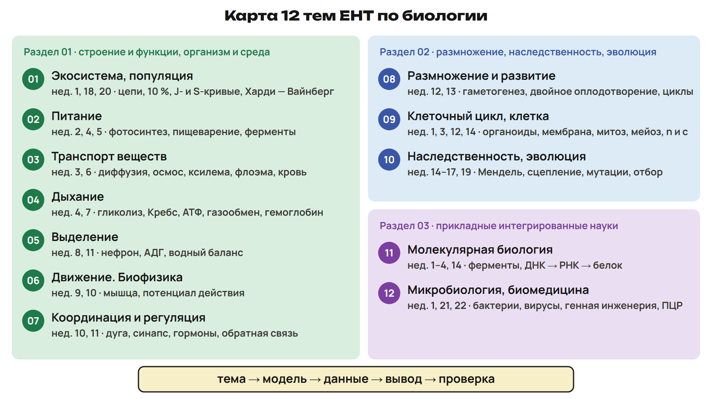

Перед пробниками полезно не учить новое, а быстро узнавать тему и модель. Здесь — карта 12 тем спецификации с неделями курса, все расчёты курса и карта пробелов: заполни её после каждого пробника.

## 1. Карта 12 тем

Чаще всего задание кажется трудным, потому что не ясно, **из какой темы** ситуация и **какая модель** нужна. Карта — первый шаг любого задания.

| № | Тема | Недели | Главные модели |
|---|---|---|---|
| 01 | Разнообразие, биосфера, экосистема, популяция, влияние человека | 1, 18, 20 | таксоны и ключ; цепи, пирамиды, правило 10 %; J- и S-кривые; Харди — Вайнберг |
| 02 | Питание | 2, 4, 5 | биомолекулы; фотосинтез: световая и темновая фазы; отделы пищеварения и ферменты |
| 03 | Транспорт веществ | 3, 6 | диффузия, осмос, активный транспорт; ксилема и флоэма; кровь, сердце, круги |
| 04 | Дыхание | 4, 7 | гликолиз, цикл Кребса, АТФ; газообмен, гемоглобин, кривые диссоциации |
| 05 | Выделение | 8, 11 | нефрон: фильтрация, реабсорбция, секреция; АДГ и водный баланс |
| 06 | Движение. Биофизика | 9, 10 | рычаги, мышечное сокращение; потенциал покоя и действия |
| 07 | Координация и регуляция | 10, 11 | рефлекторная дуга, синапс; гормоны и обратная связь; фитогормоны |
| 08 | Размножение, рост и развитие | 12, 13 | гаметогенез; двойное оплодотворение; жизненные циклы; онтогенез |
| 09 | Клеточный цикл, клеточная биология | 1, 3, 12, 14 | органоиды; мембрана; митоз и мейоз, n и c |
| 10 | Наследственность и изменчивость, селекция, эволюция | 14–17, 19 | законы Менделя; пол и сцепление; мутации; отбор, видообразование |
| 11 | Молекулярная биология и биохимия | 1–4, 14 | вода, биомолекулы, ферменты; ДНК → РНК → белок |
| 12 | Микробиология, биотехнология, биомедицина, биоинформатика | 1, 21, 22 | бактерии и вирусы; генная инженерия; ПЦР, микроскопы, моноклональные антитела |

## 2. Расчёты курса

| Модель | Как считать | Пример |
|---|---|---|
| Харди — Вайнберг (нед. 20) | q² → q; p = 1 − q; гетерозиготы 2pq | aa = 0,16 → q = 0,4, p = 0,6, 2pq = 0,48 |
| Правило 10 % (нед. 20) | на каждый следующий уровень — 10 % | 10 000 кДж → 1000 → 100 → 10 кДж у консумента III порядка |
| Размер по увеличению (нед. 1, 22) | изображение : увеличение; мм → мкм | 30 мм = 30 000 мкм; 30 000 : 1500 = 20 мкм |
| ПЦР (нед. 22) | исходные копии × 2ⁿ | 3 · 2⁵ = 96 копий |
| Вариационный ряд (нед. 17) | M = Σ(V · p) / n | 5 см — 1, 6 — 3, 7 — 5, 8 — 3, 9 — 1: 91 : 13 = 7 см |
| Менделевское расщепление (нед. 15) | гаметы → решётка → доли | Aa × Aa → 3 : 1 по фенотипу, 1 : 2 : 1 по генотипу |

> [!trap] Ловушки расчётов
> 2pq — не pq. Консумент III порядка — четвёртый уровень, а не третий. Перед делением переведи миллиметры в микрометры. 2ⁿ умножают на число исходных копий, а не прибавляют.

> [!rule] Ещё модели расчётного трека
> - Чаргафф (нед. 2): А = Т, Г = Ц; доли — среди всех нуклеотидов обеих цепей.
> - АТФ (нед. 4): гликолиз 2, кислородный этап 36, весь путь 38 на глюкозу.
> - Минутный объём дыхания (нед. 7): ДО × частота.
> - Фильтрация (нед. 8): мл/мин × 60 × 24 — первичная моча за сутки; возврат = первичная − конечная.
> - Импульс (нед. 10): t = s/v; 1 с = 1000 мс.
> - n и c (нед. 12): после S ДНК вдвое больше, число хромосом то же; в анафазе митоза 4n4c.
> - Эндосперм (нед. 13): спермий n + центральная клетка 2n = 3n.
> - Белок → ДНК (нед. 14): 1 остаток — 3 нуклеотида мРНК — 3 пары ДНК; 0,34 нм на пару; связей a − 1.
> - Кроссинговер (нед. 16): оба кроссоверных класса × 100 % : все потомки = морганиды.

## 3. Карта пробелов

После каждого пробника по ключу отметь, сколько ошибок в каждой теме, и повтори разделы из последнего столбца.

| Тема | Пробник: ошибок | Что повторить (неделя, раздел) |
|---|---|---|
| 01 Экосистема, популяция | __ | нед. 20, разделы 2–5, 10 |
| 02 Питание | __ | нед. 4: «Фотосинтез», «Сравнение двух процессов»; нед. 5, разделы 3–4 |
| 03 Транспорт веществ | __ | нед. 3: «Пассивный транспорт», «Осмос»; нед. 6, разделы 1, 6 |
| 04 Дыхание | __ | нед. 4: «Три этапа энергетического обмена»; нед. 6 — кривые диссоциации; нед. 7, раздел 4 |
| 05 Выделение | __ | нед. 8, разделы 2–3 |
| 06 Движение. Биофизика | __ | нед. 10, раздел 2; нед. 9, раздел 5 |
| 07 Координация и регуляция | __ | нед. 11, разделы 2, 4; нед. 10, раздел 5 |
| 08 Размножение и развитие | __ | нед. 12, раздел 5; нед. 13, разделы 3–5 |
| 09 Клеточный цикл | __ | нед. 12, разделы 2–4, 6 |
| 10 Наследственность, эволюция | __ | нед. 15, разделы 2–4; нед. 16–17, 19 |
| 11 Молекулярная биология | __ | нед. 14, разделы 4, 6; нед. 3: «Фермент и субстрат» |
| 12 Микробиология, биомедицина | __ | нед. 21, раздел 8; нед. 22, разделы 3, 7 |

Тип ошибки записывай словами: «не узнал тему», «не та модель», «перепутал условие и результат», «вывод шире данных», «ошибка в расчёте», «не знал факт».

> [!try] Проверь себя
> 1) aa = 0,16. Доля гетерозигот? 2) Сколько копий дадут 3 молекулы ДНК после 5 циклов ПЦР? 3) Из какой темы задание про нефрон и АДГ?
> Ответы: 1) 2pq = 0,48; 2) 3 · 2⁵ = 96; 3) тема 05 «Выделение».
