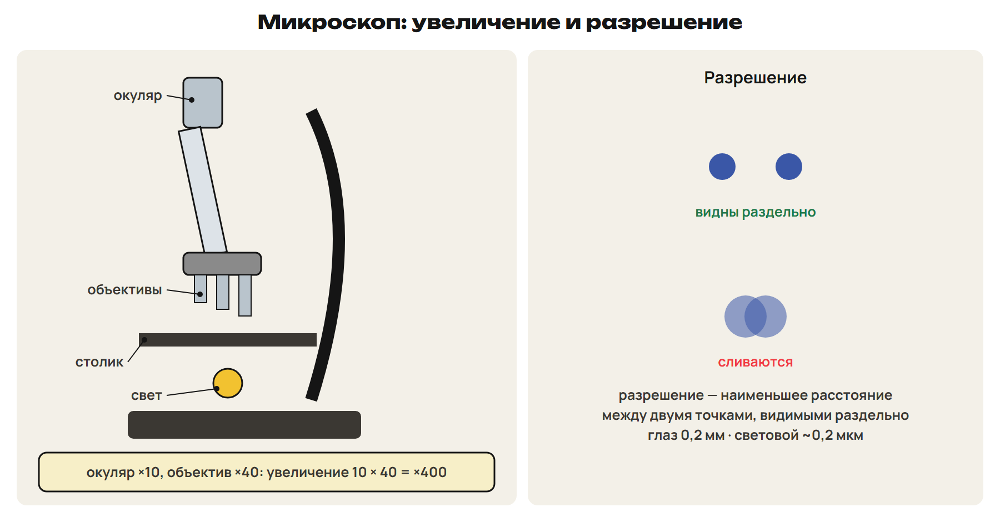
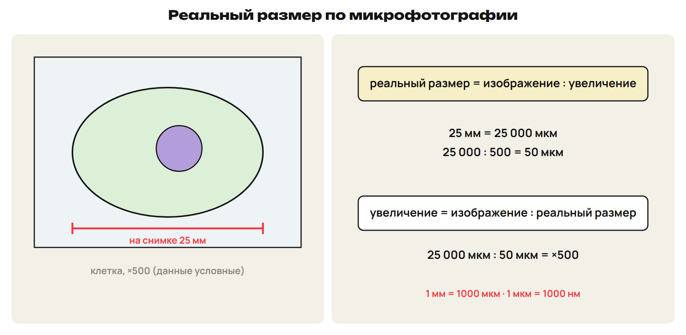
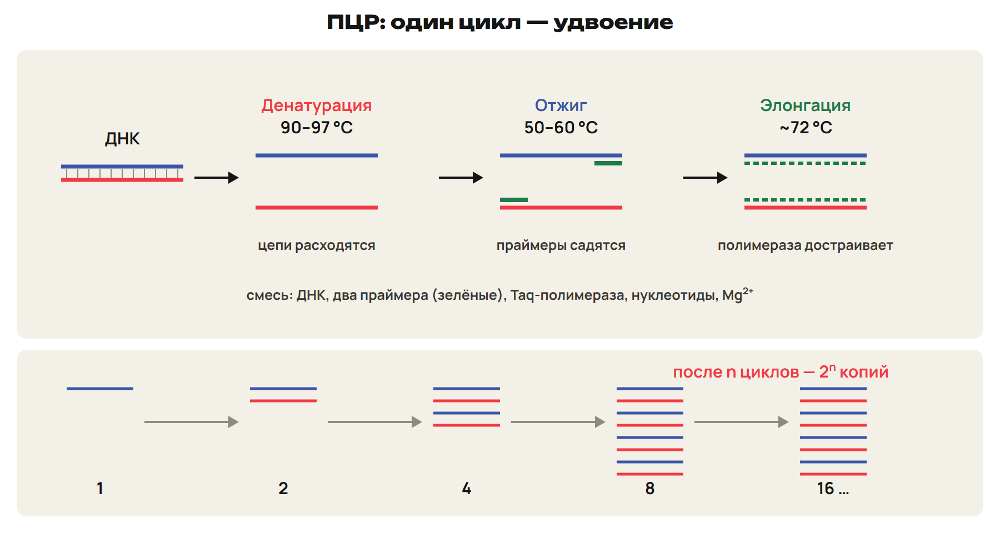
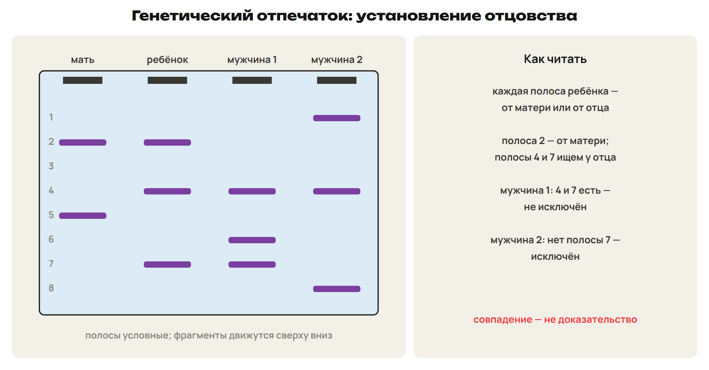
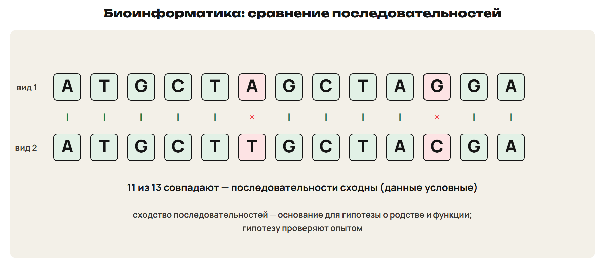
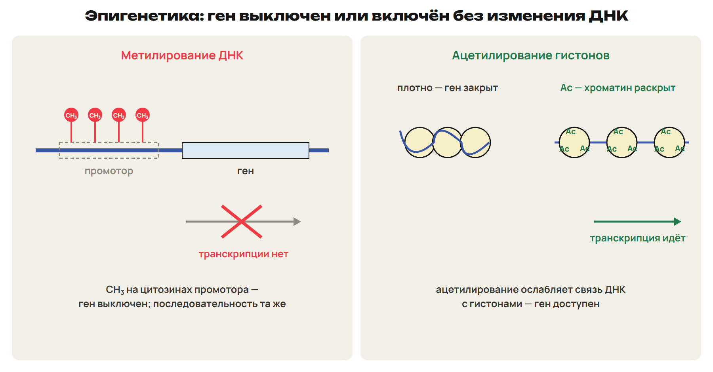
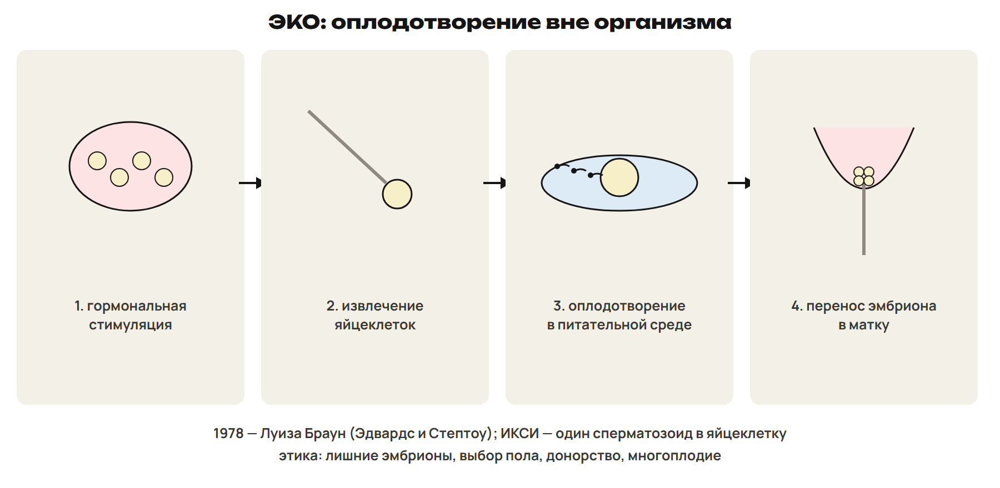
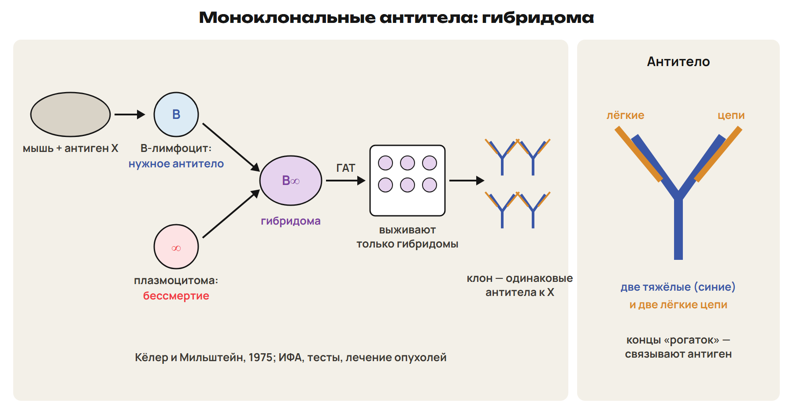
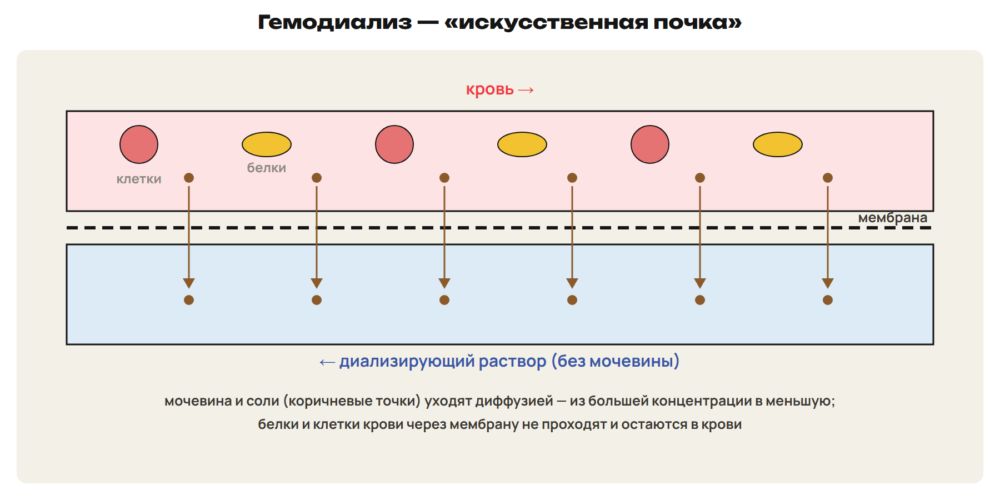
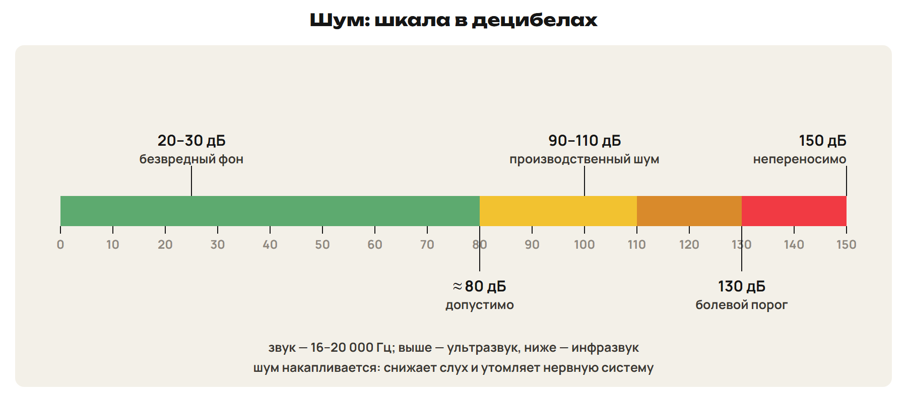

После урока 43 прочитай разделы 1–4, реши P и общую часть G. После урока 44 повтори разделы 5–9, таблицу микроскопов, схему ПЦР и факты, выполни один назначенный вариант A/B/C. Сначала попытка, затем ключ.

## 1. Микроскопы: увеличение и разрешение

Почему в школьный микроскоп не видно вирус, даже если увеличить картинку на компьютере?

- **Увеличение = увеличение объектива × увеличение окуляра.** Окуляр ×10, объективы ×10, ×40, ×100 → от ×100 до ×1000.
- **Разрешающая способность** — **наименьшее расстояние между двумя точками, которые видны раздельно**. Глаз — около 0,2 мм; **световой микроскоп — около 0,2 мкм**. Увеличение без разрешения не добавляет деталей: картинка крупнее, но размытая.
- **Контраст** — различие яркости объекта и фона: слишком бледный объект не виден.

| Микроскоп | Что использует | Особенности |
|---|---|---|
| Световой | свет, стеклянные линзы | живые и окрашенные объекты, цвет, движение; ~0,2 мкм |
| Фазово-контрастный | сдвиг фазы световой волны | живые прозрачные неокрашенные клетки становятся контрастными |
| Темнопольный | косые лучи | видны очень мелкие объекты, но только контуры |
| Люминесцентный | свечение красителей в УФ или синем свете | различает живые и мёртвые клетки, структуры по составу |
| Электронный просвечивающий | пучок электронов, магнитные линзы, вакуум | до ×200 000, ~2 нм; объекты не живые, изображение чёрно-белое |
| Электронный сканирующий | электроны сканируют поверхность | объёмное изображение поверхности |

Разрешение электронного микроскопа в 1000–10 000 раз выше светового.

> [!trap] Увеличение и разрешение
> Увеличение — во сколько раз крупнее изображение. Разрешение — какие мелкие детали различимы. Электронный микроскоп — не для живых клеток; просвечивающий показывает внутреннее строение, сканирующий — поверхность.

## 2. Расчёт размера

> [!rule] Размер и увеличение
> **Реальный размер = размер изображения : увеличение.** Увеличение = изображение : реальный размер.
> Единицы — к одной: 1 мм = 1000 мкм; 1 мкм = 1000 нм.
> Пример: при ×2000 митохондрия на снимке 4 мм = 4000 мкм → 4000 : 2000 = 2 мкм.

**Окуляр-микрометр** (шкала в окуляре) сам размера не даёт: цену его деления определяют по **объект-микрометру** (линейка с известной ценой деления, например 0,01 мм) при данном объективе.

> [!trap] Делить, а не умножать
> Реальный размер меньше изображения — делим на увеличение. Сначала переводим миллиметры в микрометры.

## 3. ПЦР и генетический отпечаток

**ПЦР** (полимеразная цепная реакция; К. Муллис, 1983) — многократное **копирование выбранного участка ДНК в пробирке**. Нужно знать последовательность концов участка.

- **Смесь:** ДНК-матрица, **два праймера** (короткие затравки), **термостабильная Taq-полимераза**, четыре вида нуклеотидов, буфер с ионами Mg²⁺.

> [!rule] Цикл ПЦР
> 1) **Денатурация, 90–97 °C** — цепи ДНК расходятся.
> 2) **Отжиг, 50–60 °C** — праймеры присоединяются комплементарно.
> 3) **Элонгация, около 72 °C** — полимераза достраивает цепи.
> За цикл копий вдвое больше: после n циклов — до **2ⁿ**; 25–30 циклов — миллионы копий. Прибор — амплификатор.

- **Генетический отпечаток:** фрагменты ДНК разделяют **электрофорезом** — рисунок полос уникален для человека; криминалистика.
- **Установление отцовства:** каждая полоса ребёнка есть у матери или у отца.
- **Диагностика инфекций:** если в образце есть ДНК возбудителя, появляется фрагмент нужной длины (гепатиты, ВИЧ, туберкулёз).

> [!trap] Что копирует ПЦР
> ПЦР копирует ДНК, а не белок. Денатурация — нагрев, цепи расходятся; отжиг — охлаждение, праймеры садятся.

## 4. Биоинформатика

**Биоинформатика** — компьютерный анализ последовательностей ДНК, РНК и белков: базы данных, поиск генов (экзоны и интроны), перевод ДНК в белок по генетическому коду, **выравнивание и сравнение последовательностей**, предсказание структуры белков.

Если белок неизвестной функции **похож** по последовательности на изученный, **можно предположить** сходную функцию — это гипотеза, её проверяют опытом.

## 5. Эпигенетика

**Эпигенетика** — наследуемые изменения **активности генов без изменения последовательности нуклеотидов**; термин — К. Уоддингтон (1942). Изменения обратимы и зависят от питания, токсинов, излучения; особенно чувствителен внутриутробный период; могут сохраняться в нескольких поколениях.

> [!rule] Механизмы
> **Метилирование ДНК** — группа CH₃ присоединяется к цитозину; сильное метилирование промотора **выключает ген**.
> **Ацетилирование гистонов** ослабляет связь ДНК с гистонами — ген становится **доступен для транскрипции**.
> **Геномный импринтинг** — работает только одна аллель гена: от матери или от отца.

> [!trap] Не мутация
> При эпигенетическом изменении последовательность ДНК та же. Метилирование выключает ген, ацетилирование гистонов включает.

## 6. ЭКО

Первый «ребёнок из пробирки» — **Луиза Браун, 1978**, Англия (Р. Эдвардс и П. Стептоу); в Казахстане первый ребёнок после ЭКО родился в 1996 году.

Этапы: 1) гормональная стимуляция созревания яйцеклеток; 2) извлечение яйцеклеток; 3) оплодотворение в питательной среде; 4) перенос эмбриона в матку. **ИКСИ** — введение одного сперматозоида в яйцеклетку. До переноса эмбрион можно проверить на наследственные аномалии. Этические вопросы: судьба лишних эмбрионов, выбор пола, донорство, многоплодие.

## 7. Моноклональные антитела

**Моноклональные антитела** — одинаковые антитела одного клона клеток, направленные к одному участку антигена. Обычные антитела крови — смесь разных (поликлональные).

> [!rule] Гибридома
> B-лимфоцит иммунизированной мыши + опухолевая клетка плазмоцитомы → **гибридома** (Кёлер и Мильштейн, 1975).
> От лимфоцита — способность делать **нужное антитело**; от опухоли — **бессмертие**.
> В ГАТ-среде неслившиеся клетки гибнут, выживают гибридомы; затем отбирают клон с нужным антителом.

Антитело — две тяжёлые и две лёгкие цепи; вариабельные участки связывают антиген. Мышиные антитела вызывают иммунный ответ у человека, поэтому создают человеческие. Применение: **ИФА** (антиген-антитело с ферментной меткой — цветная реакция; тесты на беременность и инфекции), лечение опухолей, нейтрализация токсинов.

> [!trap] Откуда что у гибридомы
> Бессмертие — от опухоли, специфичность антитела — от лимфоцита. Моноклональные — к одному эпитопу, поликлональные — смесь.

## 8. Очищение крови, волны и шум

- **Диализ** удаляет из крови **мелкие молекулы** через **полупроницаемую мембрану**; белки и клетки остаются.
- **Гемодиализ** — «искусственная почка»: по одну сторону мембраны кровь, по другую — диализирующий раствор; мочевина и соли уходят **диффузией** (из большей концентрации в меньшую), вода — **осмосом**. При **перитонеальном** диализе мембрана — брюшина. **Гемосорбция** — кровь через активированный уголь; **плазмаферез** — удаление плазмы с токсинами.

- **Электромагнитные волны** — от радиоволн до гамма-излучения; действие зависит от мощности и времени (нагрев тканей, нарушения нервной и сердечно-сосудистой систем).
- **Звук** — 16–20 000 Гц; выше — **ультразвук**, ниже — **инфразвук**. Шум: 20–30 дБ — безвредный фон, около 80 дБ — допустимо, **130 дБ — боль**.

## 9. Что измеряет метод

> [!rule] Алгоритм
> 1) Объект: клетка, ДНК, белок, кровь. 2) Что регистрируют: изображение, число копий, полосы, цвет ИФА, концентрацию. 3) Какой вывод следует. 4) Какой вывод **не** следует.
> ПЦР показывает, что ДНК возбудителя есть в образце, но без особой методики не говорит, сколько его в организме. Сходство последовательностей — гипотеза о функции, а не доказательство.

> [!try] Проверь себя
> 1) При ×400 изображение клетки 8 мм. Какой реальный размер? 2) Сколько копий даст 1 молекула ДНК после 8 циклов ПЦР? 3) Откуда у гибридомы бессмертие?

> [!rule] Факты ЕНТ недели
> - Увеличение микроскопа = объектив × окуляр; разрешение — наименьшее расстояние между двумя различимыми точками: глаз 0,2 мм, световой ~0,2 мкм.
> - Электронный микроскоп: электроны, магнитные линзы, до ×200 000, объекты не живые; сканирующий — объёмная поверхность.
> - Реальный размер = изображение : увеличение; 1 мм = 1000 мкм.
> - ПЦР — Муллис (1983): денатурация 90–97 °C, отжиг 50–60 °C, элонгация; Taq-полимераза; копии удваиваются каждый цикл.
> - Генетический отпечаток — электрофорез фрагментов ДНК; отцовство, криминалистика, диагностика; биоинформатика — сравнение последовательностей.
> - Эпигенетика — изменение активности генов без изменения ДНК (Уоддингтон, 1942); метилирование цитозина выключает ген.
> - ЭКО — 1978, Луиза Браун; гибридома = B-лимфоцит + плазмоцитома (Кёлер и Мильштейн, 1975) → моноклональные антитела.
> - Гемодиализ — «искусственная почка», диффузия через полупроницаемую мембрану; звук 16–20 000 Гц; 130 дБ — болевой порог.
