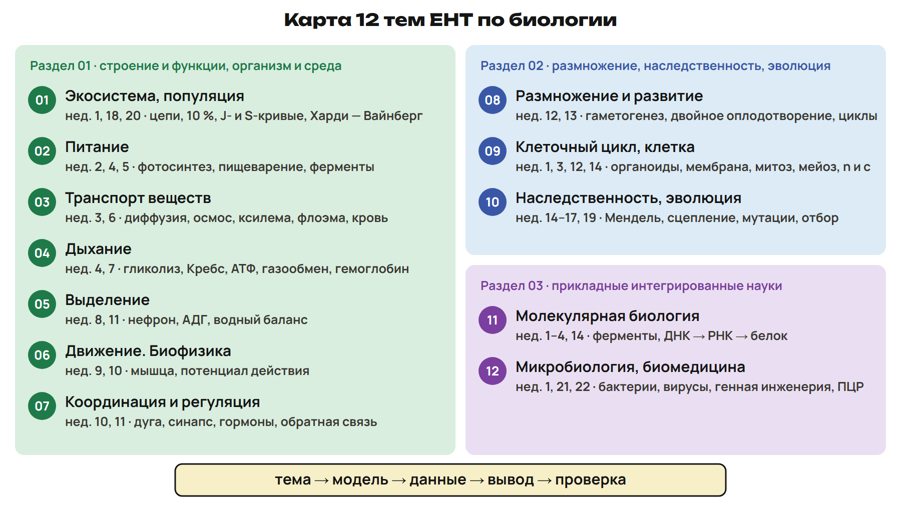
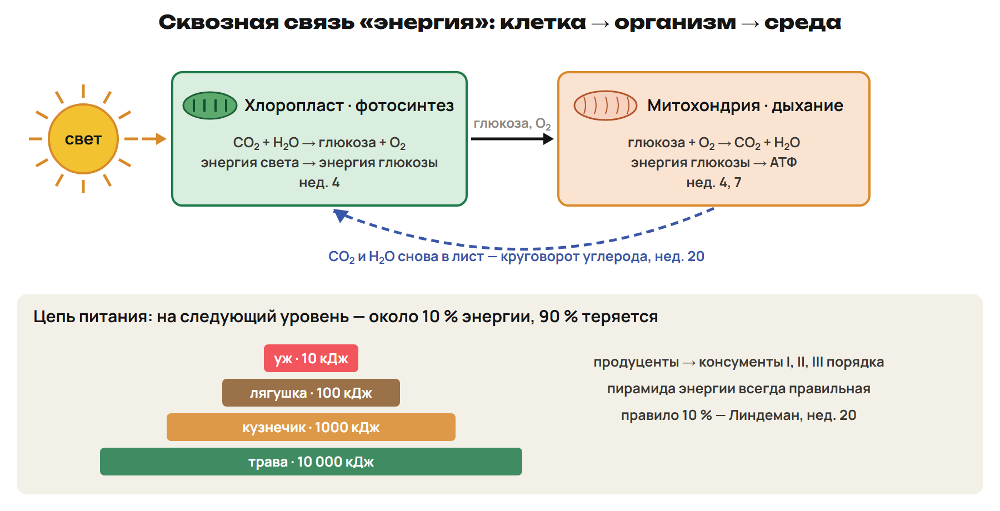
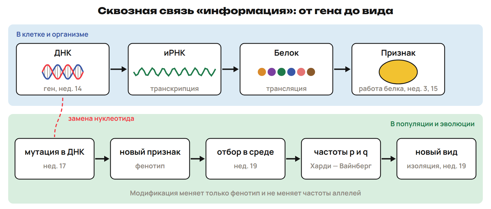
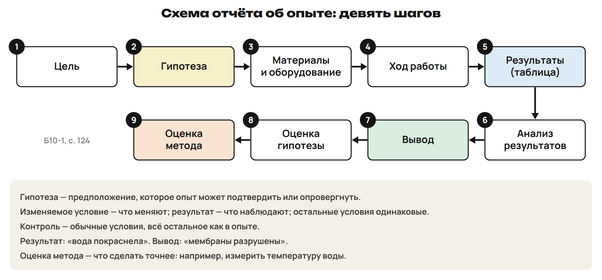
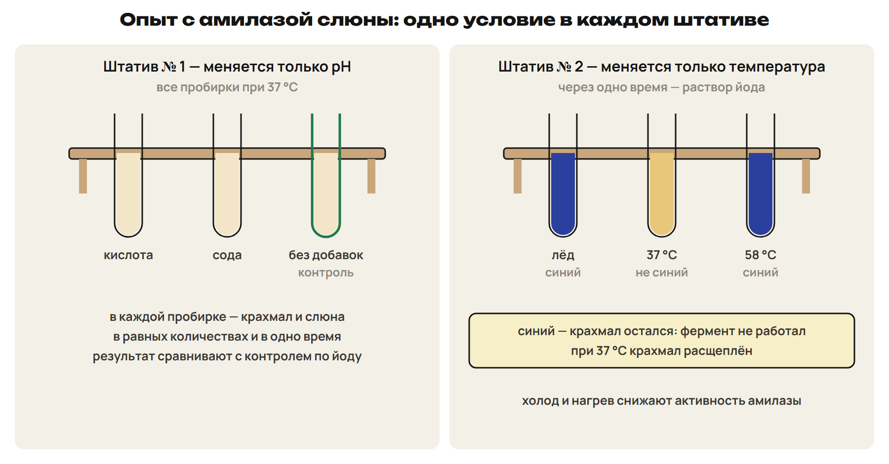
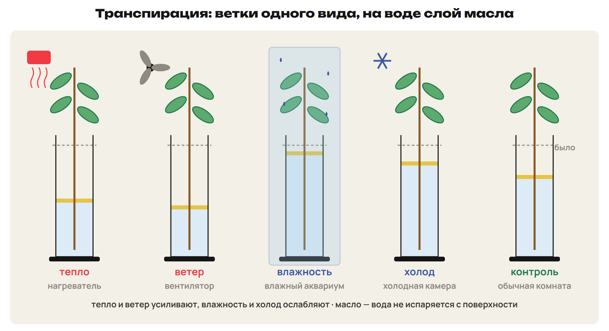
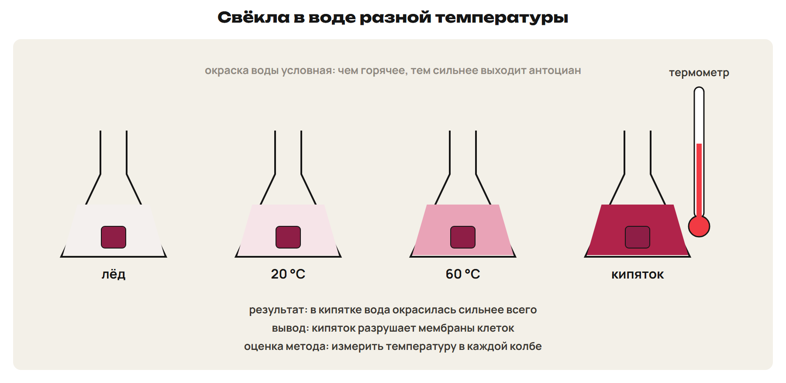
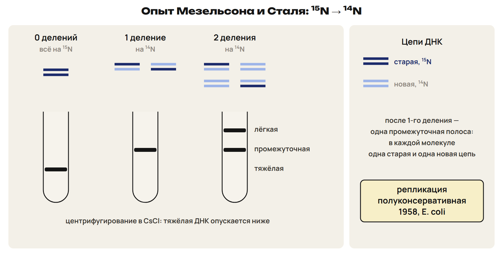
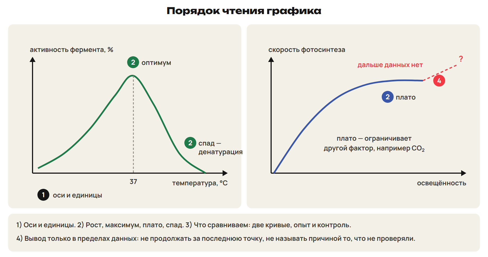
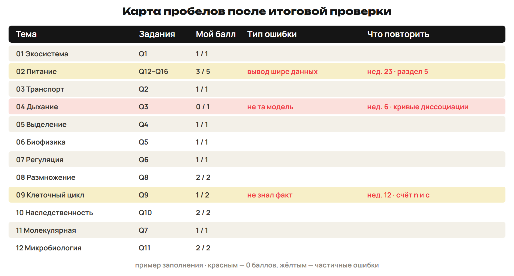

После урока 45 прочитай разделы 1–5, реши P и всю G. После урока 46 повтори разделы 6–8, схему отчёта, порядок чтения графика и факты, заполни карту пробелов и выполни один назначенный вариант A/B/C. Новых тем нет: неделя собирает 12 тем курса. Сначала попытка, затем ключ.

## 1. Карта 12 тем

Почему одно и то же задание кажется то лёгким, то непонятным? Чаще всего не ясно, **из какой темы** ситуация и **какая модель** нужна. Карта — первый шаг любого задания.

| № | Тема | Недели | Главные модели |
|---|---|---|---|
| 01 | Разнообразие, биосфера, экосистема, популяция, влияние человека | 1, 18, 20 | таксоны и ключ; цепи, пирамиды, правило 10 %; J- и S-кривые; Харди — Вайнберг |
| 02 | Питание | 2, 4, 5 | биомолекулы; фотосинтез: световая и темновая фазы; отделы пищеварения и ферменты |
| 03 | Транспорт веществ | 3, 6 | диффузия, осмос, активный транспорт; ксилема и флоэма; кровь, сердце, круги |
| 04 | Дыхание | 4, 7 | гликолиз, цикл Кребса, АТФ; газообмен, гемоглобин, кривые диссоциации |
| 05 | Выделение | 8, 11 | нефрон: фильтрация, реабсорбция, секреция; АДГ и водный баланс |
| 06 | Движение. Биофизика | 9, 10 | рычаги, мышечное сокращение; потенциал покоя и действия |
| 07 | Координация и регуляция | 10, 11 | рефлекторная дуга, синапс; гормоны и обратная связь; фитогормоны |
| 08 | Размножение, рост и развитие | 12, 13 | гаметогенез; двойное оплодотворение; жизненные циклы; онтогенез |
| 09 | Клеточный цикл, клеточная биология | 1, 3, 12, 14 | органоиды; мембрана; митоз и мейоз, n и c |
| 10 | Наследственность и изменчивость, селекция, эволюция | 14–17, 19 | законы Менделя; пол и сцепление; мутации; отбор, видообразование |
| 11 | Молекулярная биология и биохимия | 1–4, 14 | вода, биомолекулы, ферменты; ДНК → РНК → белок |
| 12 | Микробиология, биотехнология, биомедицина, биоинформатика | 1, 21, 22 | бактерии и вирусы; генная инженерия; ПЦР, микроскопы, моноклональные антитела |

## 2. Сквозные связи: клетка → организм → среда

Одна и та же модель работает на разных уровнях. Если вопрос о среде, ответ часто лежит в клетке — и наоборот.

1. **Энергия.** Свет → хлоропласт, фотосинтез, глюкоза и O₂ (нед. 4) → митохондрия, дыхание, АТФ, CO₂ и H₂O (нед. 4) → газообмен в лёгких и листе (нед. 7) → цепи питания, правило 10 % (нед. 20) → круговорот углерода (нед. 20).
2. **Мембрана и перенос.** Диффузия, осмос, активный транспорт (нед. 3) → всасывание в кишечнике (нед. 5) → обмен в капиллярах (нед. 6) → фильтрация и реабсорбция в нефроне (нед. 8) → диализ (нед. 22).
3. **Информация.** ДНК → иРНК → белок (нед. 14) → фермент и признак (нед. 3, 15) → мутация (нед. 17) → отбор (нед. 19) → частоты аллелей в популяции (нед. 20) → новый вид (нед. 19).
4. **Деление и наследование.** Митоз — рост и бесполое размножение; мейоз → гаметы → комбинативная изменчивость → расщепление по Менделю (нед. 12, 13, 15, 17).
5. **Регуляция.** Раздражитель → рецептор → нерв → центр → эффектор (нед. 10); гормон → орган-мишень → **обратная связь** (нед. 11): глюкоза крови, водный баланс (нед. 8, 11).
6. **Защита.** Иммунитет, антитела, вакцины (нед. 6) → антибиотики и антисептики (нед. 21) → моноклональные антитела, ИФА (нед. 22).
7. **Организм и среда.** Факторы среды (нед. 20) → норма реакции и модификации (нед. 17) → приспособленность и её относительность (нед. 19).

**Пример — путь атома.** Углерод CO₂, выдохнутого человеком, может оказаться в глюкозе листа: митохондрия мышцы → кровь → лёгкие → воздух → устьице → **хлоропласт** (нед. 4, 6, 7).

> [!trap] Сквозные пары
> Фотосинтез и дыхание; митоз и мейоз; диффузия и осмос; фермент и гормон; модификация и мутация; ген и признак. В паре сначала назови, **чем** они различаются: место, вещества, результат.

## 3. Опыт: схема отчёта и контроль

Как понять, что опыт что-то доказал? Его проверяют по схеме отчёта из учебника.

> [!rule] Схема отчёта об опыте
> **Цель → гипотеза → материалы и оборудование → ход работы → результаты (таблица) → анализ результатов → вывод → оценка гипотезы → оценка метода.**
> **Гипотеза** — предположение, которое опыт может подтвердить или опровергнуть: «если опустить свёклу в ледяную воду — мембрана не нарушится, если в кипяток — пигмент антоциан выйдет наружу».
> **Оценка метода** — что сделать точнее в следующий раз, например измерить температуру воды.

- **Изменяемое условие** — то, что опыт меняет нарочно (pH, температура, свет).
- **Что измеряем или наблюдаем** — результат: цвет с йодом, уровень воды, окраска раствора.
- **Одинаковые условия** — всё остальное: ветки одного вида с одинаковыми листьями, крахмал и слюна в равных количествах и в одно время, растения одного возраста и размера.
- **Одно изменяемое условие в серии.** В опыте с амилазой штатив № 1 меняет только pH (кислота, сода, контроль), штатив № 2 — только температуру (лёд, 37 °C, 55–60 °C).

> [!rule] Контроль
> **Контроль** — пробирка или растение **в обычных условиях**, всё остальное — **так же, как в опыте**. Контроль отличается от опыта **только изучаемым условием**.

> [!trap] Опыт и его части
> Контроль — не «опыт без всего», а опыт в обычных условиях. Изменяемое условие и результат — разное: pH — условие, синий цвет — результат. Результат и вывод — разное: «вода покраснела» — результат, «мембраны разрушены» — вывод. Гипотеза подтвердилась в этом опыте — не значит «доказана для всех случаев».

## 4. Опыты учебников как данные

Ход опытов не заучиваем — читаем их как данные: что меняли, что наблюдали, где контроль, какой вывод допустим.

| Опыт | Изменяемое условие | Что наблюдают | Вывод |
|---|---|---|---|
| Амилаза слюны | pH; температура | йод: синий цвет — крахмал остался | фермент работает при 37 °C; холод, нагрев до 55–60 °C и сдвиг pH снижают активность |
| Транспирация | тепло, ветер, влажность, холод | уровень воды под слоем масла; безводный CuSO₄ голубеет | тепло и ветер усиливают, влажность и холод ослабляют |
| Фотосинтез | свет, полив, температура | лист обесцвечен спиртом, затем йод: синий — есть крахмал | без света крахмал не образуется |
| Свёкла | температура воды | окраска воды антоцианом | кипяток разрушает мембраны |
| Белок | нагревание; подкисление | осадок белка | денатурация; в подкисленном растворе быстрее |
| Ауксин | препарат, концентрация | длина и число побегов и корней | ростовые вещества влияют на рост |
| Мезельсон и Сталь | число делений на ¹⁴N | полосы ДНК при центрифугировании | репликация полуконсервативная |
| Вариационный ряд | — (измерение) | длина семян или листьев | средние значения чаще |

**Пример.** Серия по температуре: лёд, 37 °C, 58 °C. Синее окрашивание — **во льду и при 58 °C** (крахмал остался); при 37 °C крахмал расщеплён.

**Пример.** Ветки под вентилятором, во влажном аквариуме, в холодной камере и контроль: сильнее всего уровень воды снизится **под вентилятором**. Масло на поверхности — чтобы **вода не испарялась с поверхности** и убыль шла только через лист.

**Пример.** Кусочки свёклы в ледяной воде, 20 °C, 60 °C и кипятке: сильнее всего вода окрасится **в кипятке** → мембраны разрушены. Оценка метода: **измерить температуру** в каждой колбе.

> [!trap] Йод
> Синий цвет с йодом — крахмал **есть**. В опыте с амилазой это значит, что фермент **не** работал; в опыте с листом — что крахмал **образовался** на свету.

## 5. Чтение графиков и таблиц

| Неделя | График | Что читать |
|---|---|---|
| 3 | активность фермента — температура, pH | оптимум; спад при нагреве — денатурация |
| 4 | фотосинтез — свет, CO₂ | рост, затем плато — ограничивает другой фактор |
| 6 | кривые диссоциации гемоглобина и миоглобина | насыщение O₂ при разном давлении; эффект Бора |
| 17 | вариационная кривая | средние значения чаще, крайние редко |
| 19 | формы отбора | какая часть кривой сохраняется |
| 20 | J- и S-кривая; «хищник — жертва» | плато — ёмкость среды; колебания со сдвигом |
| 22 | число копий ПЦР | 2ⁿ |

> [!rule] Порядок чтения графика
> 1) Что по осям и в каких единицах. 2) Где рост, максимум, плато, спад. 3) Что сравниваем: две кривые, опыт и контроль. 4) **Вывод только в пределах данных** — не продолжать график за последнюю точку и не называть причиной то, что опыт не проверял.

**Пример.** Численность растёт, затем выходит на плато → **S-кривая**, плато — ёмкость среды (нед. 20).

**Пример чрезмерного вывода.** «На свету лист накопил крахмал — значит, всё растение растёт быстрее» — вывод **не поддержан**: измеряли только крахмал в листе.

> [!trap] Плато
> Плато — не «процесс прекратился». На графике фотосинтеза его ограничивает другой фактор, на кривой численности — ёмкость среды.

## 6. Задания в контексте

В ЕНТ есть блок из нескольких вопросов к одному тексту с данными. Каждый вопрос решают по одному алгоритму.

> [!rule] Алгоритм контекста
> 1) **Из какой темы** ситуация — по карте раздела 1.
> 2) **Какая модель** нужна: связь раздела 2, опыт раздела 3, график раздела 5 или расчёт раздела 7.
> 3) **Данные → вывод:** что именно показывают числа или наблюдения.
> 4) **Проверка:** вывод поддержан данными? Это факт или предположение?

**Пример.** Почему нефрон и аппарат диализа похожи? 1) Темы 05 и 12. 2) Модель — мембрана и перенос. 3) В обоих случаях вещества разделяются **через мембрану по размеру частиц**. 4) Белки и клетки крови не проходят — это следует из строения мембраны, а не из догадки (нед. 8, 22).

## 7. Расчёты курса

| Модель | Как считать | Пример |
|---|---|---|
| Харди — Вайнберг (нед. 20) | q² → q; p = 1 − q; гетерозиготы 2pq | aa = 0,16 → q = 0,4, p = 0,6, 2pq = 0,48 |
| Правило 10 % (нед. 20) | на каждый следующий уровень — 10 % | 10 000 кДж → 1000 → 100 → 10 кДж у консумента III порядка |
| Размер по увеличению (нед. 1, 22) | изображение : увеличение; мм → мкм | 30 мм = 30 000 мкм; 30 000 : 1500 = 20 мкм |
| ПЦР (нед. 22) | исходные копии × 2ⁿ | 3 · 2⁵ = 96 копий |
| Вариационный ряд (нед. 17) | M = Σ(V · p) / n | 5 см — 1, 6 — 3, 7 — 5, 8 — 3, 9 — 1: 91 : 13 = 7 см |
| Менделевское расщепление (нед. 15) | гаметы → решётка → доли | Aa × Aa → 3 : 1 по фенотипу, 1 : 2 : 1 по генотипу |

> [!trap] Ловушки расчётов
> 2pq — не pq. Консумент III порядка — четвёртый уровень, а не третий. Перед делением переведи миллиметры в микрометры. 2ⁿ умножают на число исходных копий, а не прибавляют.

## 8. Итоговая проверка и карта пробелов

Итоговая проверка — 20 минут, 20 баллов, задания по всем 12 темам во всех форматах ЕНТ. После неё по ключу заполни карту: какая тема, какой тип задания, в чём ошибка, что повторить. Карта нужна для пробников недель 24–25.

| Тема | Задания проверки | Мой балл | Что повторить (неделя, раздел) |
|---|---|---|---|
| 01 Экосистема, популяция | Q1 | __ / 1 | нед. 20, разделы 2–5, 10 |
| 02 Питание | Q12–Q16 | __ / 5 | нед. 4: «Фотосинтез», «Сравнение двух процессов»; нед. 5, разделы 3–4 |
| 03 Транспорт веществ | Q2 | __ / 1 | нед. 3: «Пассивный транспорт», «Осмос»; нед. 6, разделы 1, 6 |
| 04 Дыхание | Q3 | __ / 1 | нед. 4: «Три этапа энергетического обмена»; нед. 6 — кривые диссоциации; нед. 7, раздел 4 |
| 05 Выделение | Q4 | __ / 1 | нед. 8, разделы 2–3 |
| 06 Движение. Биофизика | Q5 | __ / 1 | нед. 10, раздел 2; нед. 9, раздел 5 |
| 07 Координация и регуляция | Q6 | __ / 1 | нед. 11, разделы 2, 4; нед. 10, раздел 5 |
| 08 Размножение и развитие | Q8 | __ / 2 | нед. 12, раздел 5; нед. 13, разделы 3–5 |
| 09 Клеточный цикл | Q9 | __ / 2 | нед. 12, разделы 2–4, 6 |
| 10 Наследственность, эволюция | Q10 | __ / 2 | нед. 15, разделы 2–4; нед. 16–17, 19 |
| 11 Молекулярная биология | Q7 | __ / 1 | нед. 14, разделы 4, 6; нед. 3: «Фермент и субстрат» |
| 12 Микробиология, биомедицина | Q11 | __ / 2 | нед. 21, раздел 8; нед. 22, разделы 3, 7 |

Тип ошибки записывай словами: «не узнал тему», «не та модель», «перепутал условие и результат», «вывод шире данных», «ошибка в расчёте», «не знал факт».

## 9. Только для варианта A

- **Мезельсон и Сталь по трём гипотезам.** Бактерии с ДНК на ¹⁵N переносят на ¹⁴N. Консервативная гипотеза: после 1-го деления — тяжёлая и лёгкая полосы поровну. Полуконсервативная: после 1-го — одна промежуточная, после 2-го — промежуточная и лёгкая поровну. Дисперсная: после 1-го — одна промежуточная, после 2-го — одна полоса между промежуточной и лёгкой. Наблюдали одну промежуточную полосу после 1-го деления → отвергнута **консервативная**; промежуточную и лёгкую поровну после 2-го → отвергнута **дисперсная**.
- **Спланировать опыт** по образцу учебника: изменяемое условие, что наблюдать, одинаковые условия, контроль. Частая ошибка в чужом плане — контроль отличается от опыта **двумя** условиями.
- **Оценка метода.** Чем точнее измерение (термометр, мерный цилиндр) и чем больше вариант — «для надёжного вывода нужно много вариант», — тем надёжнее вывод.
- **Межтемные задачи в 3 шага:** связь раздела 2 + график + расчёт.

> [!try] Проверь себя
> 1) Пробирки с крахмалом и слюной: № 1 — кислота, № 2 — сода, № 3 — без добавок, все при 37 °C. Какая контрольная и какое изменяемое условие? 2) aa = 0,16. Доля гетерозигот? 3) Почему вывод «на свету всё растение растёт быстрее» не следует из опыта с йодом?

> [!rule] Факты ЕНТ недели
> - Схема отчёта: цель, гипотеза, материалы и оборудование, ход работы, результаты, анализ, вывод, оценка гипотезы, оценка метода.
> - Контроль — в обычных условиях, всё остальное как в опыте; в серии меняют одно условие.
> - Йод с крахмалом даёт синий цвет: в опыте с амилазой крахмал не расщеплён, в опыте с листом — образовался на свету.
> - Тепло и ветер усиливают транспирацию, влажность и холод ослабляют; масло не даёт воде испаряться с поверхности.
> - Кипяток разрушает мембраны клеток свёклы — антоциан выходит в воду.
> - Мезельсон и Сталь (1958): ¹⁵N/¹⁴N, центрифугирование в CsCl — репликация полуконсервативная.
> - Вариационный ряд: M = Σ(V · p) / n; средние значения встречаются чаще.
> - Вывод — только в пределах данных; подтверждённая гипотеза не доказана для всех случаев.
