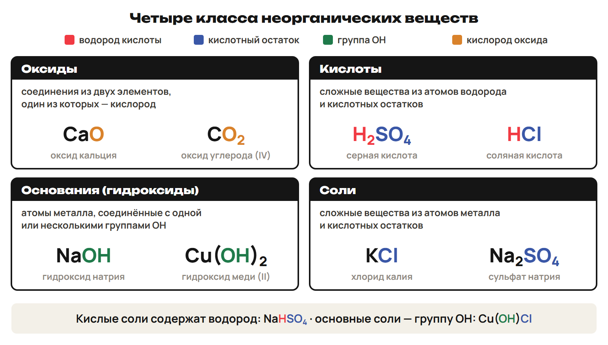
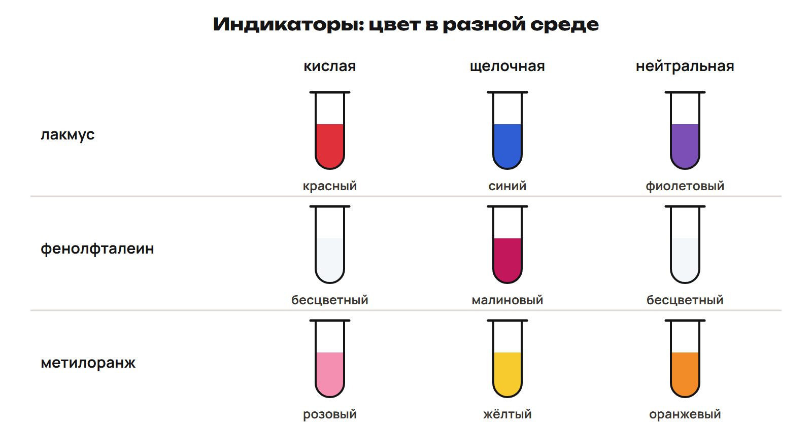
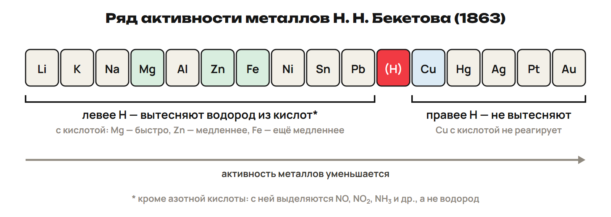
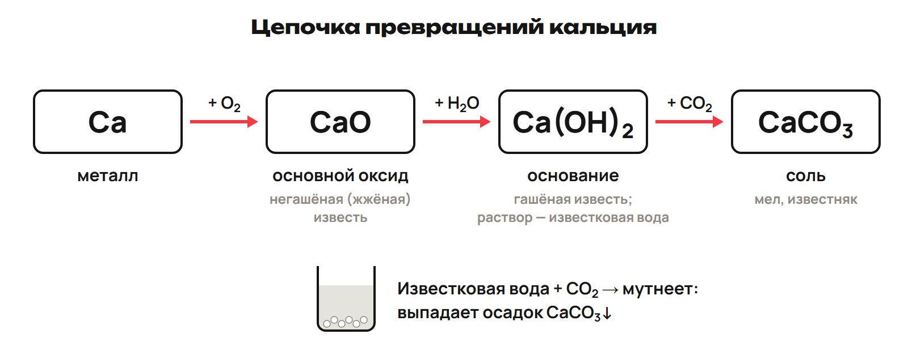

# Четыре класса веществ
? Почему CaO и Ca(OH)₂ относятся к разным классам?
↳ Уже читаем формулы и уравниваем реакции. Теперь свяжем состав вещества с его классом.
> 0–18 минут. 3 минуты на цель и опору, 9 на четыре определения и примеры, 3 на L1, 3 на разбор. Новую тему объяснять с нуля.

## Понятие: Оксиды и кислоты
- **Оксиды — соединения из двух элементов, один из которых кислород.**
- Примеры: CaO, CO₂.
- **Кислоты — сложные вещества из атомов водорода и кислотных остатков.**
- Примеры: HCl, H₂SO₄.
> В CaO два элемента; в H₂SO₄ три. Кислотный остаток — атом или группа атомов, кроме водорода, в составе кислоты.

## Понятие: Основания и соли
- **Основания — сложные вещества из атомов металлов, соединённых с одной или несколькими группами OH.**
- Второе название оснований — гидроксиды; пример NaOH.
- **Соли — сложные вещества из атомов металла и кислотных остатков.**
- Пример KCl: металл K и остаток Cl.
> Уточнить, что OH — одна группа. Индекс после скобок относится ко всей группе.

## Схема: Смотрим на состав
Состав
Оксид — два элемента, один из них O
Кислота — H и кислотный остаток
Основание — металл и одна или несколько групп OH
Соль — металл и кислотный остаток

## Понятие: Карта классов

> Прочитать формулу целиком. Наличие H или OH само по себе ещё не выбирает класс.

## Пример: Класс по формуле
1. CaO содержит Ca и O: это оксид.
2. H₂SO₄ содержит водород и кислотный остаток SO₄: это кислота.
3. NaOH содержит металл Na и группу OH: это основание.
4. KCl содержит металл K и кислотный остаток Cl: это соль.
> В каждом шаге просить назвать признак состава. Классификацию кислых и основных солей разобрать в пятой части.

## Ловушка: Один символ не определяет класс
- NaHSO₄ содержит H, но это кислая соль.
- Cu(OH)Cl содержит OH, но это основная соль.
- Для класса нужен весь состав, а не один знак.

## Практика: L1 · 3 минуты
L1. Назови класс CaO, H₂SO₄, NaOH, KCl. Для каждого укажи признак состава.
Ответы:
CaO — оксид: два элемента, один из них кислород.
H₂SO₄ — кислота: атомы водорода и кислотный остаток.
NaOH — основание: атом металла и группа OH.
KCl — соль: атом металла и кислотный остаток.
> Показать ключ после попытки. При ответе только названием попросить доказательство по составу.

# Оксиды: тип и свойства
? Почему SiO₂ остаётся кислотным оксидом, хотя с водой не реагирует?
↳ Узнали оксиды по составу. Внутри класса различим свойства и названия.
> 18–32 минуты. 3 минуты на классификацию, 2 на названия, 4 на примеры свойств, 2 на L2, 3 на разбор. С водой реагируют не все оксиды.

## Понятие: Четыре типа оксидов
- Основные: Na₂O, MgO, CaO.
- Кислотные: SO₃, P₂O₅, SiO₂.
- Амфотерные: Al₂O₃, BeO, ZnO.
- Несолеобразующие: CO, NO.
- Основные, кислотные и амфотерные — солеобразующие.

## Понятие: Как читать название
- CaO — **оксид кальция**.
- CO — **оксид углерода (II)**.
- CO₂ — **оксид углерода (IV)**.
- SO₂ — **диоксид серы**.
- Римская цифра в названии показывает валентность, а не индекс.
> Валентность в этой теме использовать для чтения названия. Степень окисления не вводить.

## Схема: Какой партнёр реагирует
Оксид
Основной — с кислотой образует соль и воду
Кислотный — со щёлочью образует соль и воду
Амфотерный — реагирует и с кислотой, и со щёлочью
Несолеобразующий — CO, NO

## Пример: Основной и кислотный оксид
1. Na₂O + H₂O → 2NaOH: основной оксид даёт щёлочь.
2. CuO + H₂SO₄ → CuSO₄ + H₂O: основной оксид реагирует с кислотой.
3. SO₃ + H₂O → H₂SO₄: кислотный оксид даёт кислоту.
4. 2NaOH + SO₃ → Na₂SO₄ + H₂O: кислотный оксид реагирует со щёлочью.
5. P₂O₅ + 3H₂O → 2H₃PO₄: ещё один пример получения кислоты.
> Назвать класс исходного оксида и продуктов в каждом примере. Формулы записать до самостоятельной работы.

## Понятие: Амфотерность на примере BeO
- BeO + 2HCl → BeCl₂ + H₂O.
- BeO + 2NaOH → Na₂BeO₂ + H₂O.
- BeO реагирует и с кислотой, и со щёлочью.
> Использовать данные схемы для объяснения свойства. Состав произвольного водного раствора из второй схемы не выводить.

## Ловушка: С водой не всегда есть реакция
- Na₂O, CaO и BaO реагируют с водой.
- CuO и FeO с водой не реагируют.
- SiO₂ с водой не реагирует.
- Кислотный оксид нельзя определять только по реакции с водой.
- CO и NO — несолеобразующие оксиды.

## Практика: L2 · 2 минуты
L2. Соотнеси А — Na₂O, Б — Al₂O₃ с типом оксида.
1 — кислотный; 2 — основной; 3 — амфотерный; 4 — несолеобразующий.
Отдельно ответь: реагирует ли SiO₂ с водой?
Ответы:
А2 Б3. SiO₂ с водой не реагирует.
> Проверить обе пары и вопрос о воде. При ошибке Al₂O₃ попросить назвать двух партнёров амфотерного оксида.

# Кислоты, индикаторы и металлы
? Почему Zn выделяет водород с HCl, а Cu — нет?
↳ Свойства оксидов связали с кислотой. Теперь читаем кислоту и проверяем её реакции.
> 32–49 минут. 3 минуты на состав и названия кислот, 3 на индикаторы, 4 на ряд и реакции, 4 на L3, 3 на разбор. Правило выделения H₂ применять здесь к HCl.

## Понятие: Кислотный остаток и основность
- Кислотный остаток — атом или группа атомов, кроме водорода, в составе кислоты.
- HCl — соляная кислота; остаток Cl, соли — хлориды.
- H₂SO₄ — серная кислота; остаток SO₄, соли — сульфаты.
- H₃PO₄ — ортофосфорная кислота; соли — ортофосфаты, или фосфаты.
- HCl, H₂SO₄ и H₃PO₄ — одно-, двух- и трёхосновная кислоты соответственно.
> Число атомов H в выбранных примерах связывает основность и валентность остатка. HCl бескислородная; H₂SO₄ и H₃PO₄ кислородсодержащие.

## Понятие: Ещё три знакомых остатка
- HNO₃ — азотная кислота; соли — нитраты.
- H₂CO₃ — угольная кислота; соли — карбонаты.
- H₂SiO₃ — кремниевая кислота; соли — силикаты.
> Эти названия нужны для чтения реакций солей. Угольная кислота сразу разлагается; вернуться к этому в пятой части.

## Схема: Цвет зависит от среды
Индикатор
Порядок цветов — кислая / щелочная / нейтральная среда
Лакмус — красный / синий / фиолетовый
Фенолфталеин — бесцветный / малиновый / бесцветный
Метилоранж — розовый / жёлтый / оранжевый

## Понятие: Сравним три среды

> Порядок колонок сохранить. У бесцветного фенолфталеина без других данных среду однозначно не определять.

## Понятие: Ряд активности Н. Н. Бекетова
- Li, K, Na, Mg, Al, Zn, Fe, Ni,
- Sn, Pb, (H), Cu, Hg, Ag, Pt, Au.
- Читай две строки подряд, слева направо.
- Н. Н. Бекетов составил вытеснительный ряд металлов в **1863 году**.

## Понятие: Найдём границу водорода

> Водород служит границей для данного правила. Ca и Ba в этот записанный ряд не добавлять.

## Пример: Металлы с HCl
1. Mg, Zn и Fe стоят левее H и вытесняют H₂ из HCl.
2. Mg + 2HCl → MgCl₂ + H₂↑.
3. Zn + 2HCl → ZnCl₂ + H₂↑.
4. Fe + 2HCl → FeCl₂ + H₂↑.
5. Cu стоит правее H и с HCl не реагирует.
> Показать формулы хлоридов и коэффициенты до L3. Стрелка ↑ обозначает выделение газа.

## Ловушка: Не переносим правило на HNO₃
- Металлы правее H не вытесняют H₂ из HCl.
- Азотная кислота HNO₃ — исключение из правила выделения H₂.
- Метилоранж в кислой среде **розовый**, лакмус — **красный**.

## Практика: L3 · 4 минуты
L3. Назови цвета лакмуса и метилоранжа в растворе HCl.
Какие из металлов Zn и Cu выделяют H₂ при взаимодействии с HCl?
Запиши изученное уравнение для Zn.
Ответы:
Лакмус — красный; метилоранж — розовый.
Zn выделяет H₂; Cu с HCl не реагирует.
Zn + 2HCl → ZnCl₂ + H₂↑.
> Ключ открыть после всех трёх ответов. Попросить указать Zn и Cu относительно H и проверить H/Cl в уравнении.

# Основания и нейтрализация
? Как кислота реагирует с растворимым и нерастворимым основанием?
↳ Кислоты знакомы. Сравним основания и свяжем две группы веществ реакцией.
> 49–64 минуты. 3 минуты на классификацию, 4 на нейтрализацию и свойства, 2 на амфотерность, 3 на L4, 3 на разбор. При нагревании важно сохранить все формулы и условия.

## Понятие: Растворимые основания — щёлочи
- Щёлочи: LiOH, KOH, NaOH, Ba(OH)₂.
- Нерастворимые основания: Cu(OH)₂, Fe(OH)₂, Mg(OH)₂.
- Амфотерные гидроксиды: Zn(OH)₂, Be(OH)₂, Al(OH)₃.
- Fe(OH)₂ — зелёный осадок; Cu(OH)₂ — голубой.
> Связать слово «щёлочь» с растворимостью. Не называть амфотерные гидроксиды просто щёлочами.

## Схема: Кислота и основание
Нейтрализация
Исходные вещества — кислота и основание
Продукты — соль и вода
Пример — Mg(OH)₂ + 2HCl → MgCl₂ + 2H₂O

## Пример: Проверим Mg(OH)₂ + 2HCl
1. Mg(OH)₂ + 2HCl → MgCl₂ + 2H₂O.
2. Mg: 1 = 1; Cl: 2 = 2.
3. H: 2 + 2 = 4; справа 2 × 2 = 4.
4. O: 2 = 2; перед H₂O нужен коэффициент 2.
> Нейтрализация идёт и с нерастворимым основанием. Не терять вторую молекулу воды при проверке атомов.

## Понятие: Два свойства оснований
- Cu(OH)₂ → CuO + H₂O **при нагревании**.
- Голубой Cu(OH)₂ превращается в чёрный CuO.
- FeSO₄ + 2NaOH → Fe(OH)₂↓ + Na₂SO₄.
- Зелёный осадок Fe(OH)₂ образуется при реакции соли со щёлочью.
> Стрелка ↓ обозначает осадок. Задания решать по описаниям и уравнениям, без домашних опытов.

## Понятие: Амфотерный гидроксид
- Be(OH)₂ + 2HCl → BeCl₂ + 2H₂O.
- Zn(OH)₂, Be(OH)₂ и Al(OH)₃ реагируют и с кислотами, и со щёлочами.
- Амфотерность — два направления свойств.

## Ловушка: Все OH не означают щёлочь
- Cu(OH)₂ — нерастворимое основание.
- Be(OH)₂ — амфотерный гидроксид.
- Щёлочи — растворимые основания.
- Уравнение нейтрализации проверяй по H и O, а не только по металлу.

## Практика: L4 · 3 минуты
L4. Уравняй Be(OH)₂ + HCl → BeCl₂ + H₂O. Формулы не меняй.
Назови реакцию кислоты с основанием и её продукты.
Ответы:
Be(OH)₂ + 2HCl → BeCl₂ + 2H₂O; коэффициенты 1 : 2 : 1 : 2.
Нейтрализация; образуются соль и вода.
> Открыть ответ после попытки. При одной H₂O попросить отдельно посчитать H и O с обеих сторон.

# Соли и связь классов
? Как из кальция получить вещество, которое входит в мел и известняк?
↳ Уже умеем получать соль из кислоты и основания. Добавим свойства солей и цепочку превращений.
> 64–82 минуты. 3 минуты на состав и названия солей, 4 на осадки/газ/вытеснение, 4 на цепь и факты, 4 на L5, 3 на разбор. Все реакции показать до самостоятельного ответа.

## Понятие: Средние, кислые и основные соли
- Средние соли: весь H кислоты замещён металлом; Na₂SO₄, K₃PO₄.
- Кислые соли: H замещён не полностью; NaHSO₄, KH₂PO₄.
- Основные соли: OH замещён не полностью; Cu(OH)Cl, Al(OH)₂NO₃.
- Кислые соли образуют двух- и трёхосновные кислоты.
- Основные соли образуют гидроксиды двух- и трёхвалентных металлов.

## Понятие: Название соли
- KCl — хлорид калия.
- FeSO₄ — сульфат железа (II).
- NaHSO₄ — гидросульфат натрия.
> В названии сначала остаток, затем металл. «Гидро-» в этом примере относится к кислой соли.

## Схема: Условие для реакции солей
Продукт
Осадок — нерастворимое вещество, стрелка ↓
Газ — выделяется из смеси, стрелка ↑
Вода — один из продуктов реакции соли с кислотой
Металл — более активный вытесняет менее активный из раствора соли

## Пример: Два осадка
1. NaCl + AgNO₃ → AgCl↓ + NaNO₃.
2. AgCl — нерастворимая соль, образуется осадок.
3. BaCl₂ + H₂SO₄ → BaSO₄↓ + 2HCl.
4. BaSO₄ практически нерастворим, образуется осадок.
> Здесь даны конкретные сведения о растворимости. Не подменять их предположением, что любая соль растворяется.

## Пример: Откуда берётся CO₂
1. Na₂CO₃ + 2HCl → 2NaCl + H₂CO₃.
2. H₂CO₃ сразу разлагается: H₂CO₃ → CO₂↑ + H₂O.
3. Итог: Na₂CO₃ + 2HCl → 2NaCl + CO₂↑ + H₂O.
> Объяснить, почему в итоговом уравнении газ и вода вместо H₂CO₃. Разложение идёт уже при комнатной температуре.

## Понятие: Вытеснение и разложение соли
- Zn + CuSO₄ → ZnSO₄ + Cu.
- Zn активнее Cu и вытесняет его из раствора соли.
- Для этого правила в растворе не берут Li, Na, K, Ca, Ba: они реагируют с водой.
- CaCO₃ → CaO + CO₂↑ **при нагревании**.
> Не переносить правило вытеснения на натрий в водном растворе. Для разложения CaCO₃ назвать условие нагревания.

## Пример: Кальций → мел
1. 2Ca + O₂ → 2CaO.
2. CaO + H₂O → Ca(OH)₂.
3. Ca(OH)₂ + CO₂ → CaCO₃↓ + H₂O.
4. Металл → оксид → основание → соль: генетическая связь классов.
> Первый шаг — образование оксида того же типа, что уже изученное 2Mg + O₂ → 2MgO. Речь о записях превращений.

## Понятие: Цепочка извести

## Понятие: Факты недели — известь
- CaO — негашёная, или жжёная, известь.
- Ca(OH)₂ — гашёная известь.
- Известковая вода — раствор Ca(OH)₂.
- Известковая вода мутнеет от CO₂: выпадает CaCO₃.
- CaCO₃ — мел, известняк.

## Понятие: Факты недели — названия
- NaCl — поваренная соль.
- NaHCO₃ — пищевая, или питьевая, сода.
- KMnO₄ — перманганат калия, марганцовка.
- Н. Н. Бекетов — вытеснительный ряд металлов, 1863 год.

## Ловушка: Соль может содержать H или OH
- NaHSO₄ — кислая соль, а не кислота.
- Cu(OH)Cl — основная соль, а не основание.
- AgCl и BaSO₄ — осадки.
- При реакции известковой воды с CO₂ образуется CaCO₃, а Ca(OH)₂ расходуется.

## Практика: L5 · 4 минуты
L5. Дана цепочка Ca → CaO → Ca(OH)₂ → CaCO₃.
Используя O₂, H₂O и CO₂ в этом порядке, запиши три изученных уравнения.
Назови CaO, Ca(OH)₂ и CaCO₃ бытовыми названиями из урока.
Ответы:
2Ca + O₂ → 2CaO.
CaO + H₂O → Ca(OH)₂.
Ca(OH)₂ + CO₂ → CaCO₃↓ + H₂O.
CaO — негашёная известь; Ca(OH)₂ — гашёная известь; CaCO₃ — мел, известняк.
> Показать все ответы после 4 минут. Проверить коэффициенты первого шага и осадок третьего; назвать класс промежуточных веществ.

# Проверка и домашняя работа
? Что ты теперь можешь узнать по формуле и предсказать в изученной реакции?
↳ Собрали карту классов и примеров. Проверим главные опоры без подсказки.
> 82–90 минут. 4 минуты на L6, 2 на ключ, 2 на итог и ДЗ. Это короткая проверка опор урока.

## Практика: L6 · 4 минуты
L6. 1) Какой осадок образуется при NaCl + AgNO₃?
2) Какой цвет принимает метилоранж в растворе NaOH?
3) На какие вещества сразу разлагается H₂CO₃?
4) Реагирует ли CuO с водой?
Ответы:
1) AgCl. 2) Жёлтый. 3) CO₂ и H₂O. 4) Нет.
> Ответы открыть после всех четырёх пунктов. Отметить одну ошибку для ближайшего закрепления.

## Итог: Главные опоры урока
- Класс определяем по составу; название читаем отдельно.
- Различаем основные, кислотные, амфотерные и несолеобразующие оксиды.
- Знаем цвета индикаторов и правило ряда для HCl.
- Нейтрализация даёт соль и воду; коэффициенты сохраняют атомы.
- Осадок и газ помогают узнать изученные реакции солей.
- Цепь Ca → CaO → Ca(OH)₂ → CaCO₃ связывает классы.

## Дома: После урока 5
- Конспект · 25 минут.
- Закрепление P1–P6 · 20 минут.
- Вся общая часть G1–G11 · 35 минут.
- G1–G8 — строкой в Telegram; G9–G10 — фото; G11 — текстом или голосовым.
- Запиши два вопроса для урока 6, 19 ноября.
> До следующей встречи 80 минут самостоятельной работы. Один вариант A/B/C назначить после урока 6.
