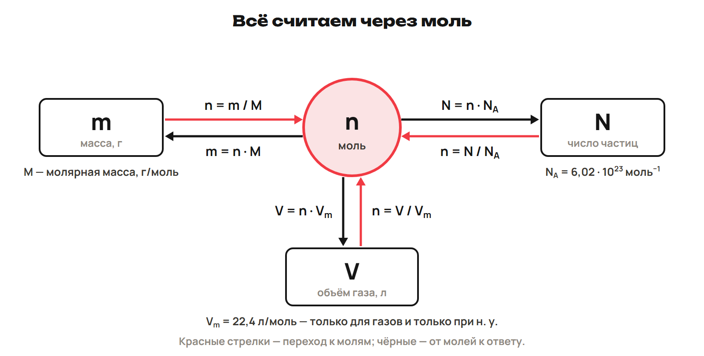
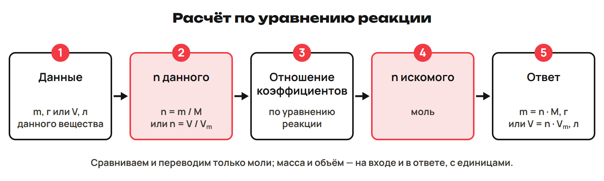
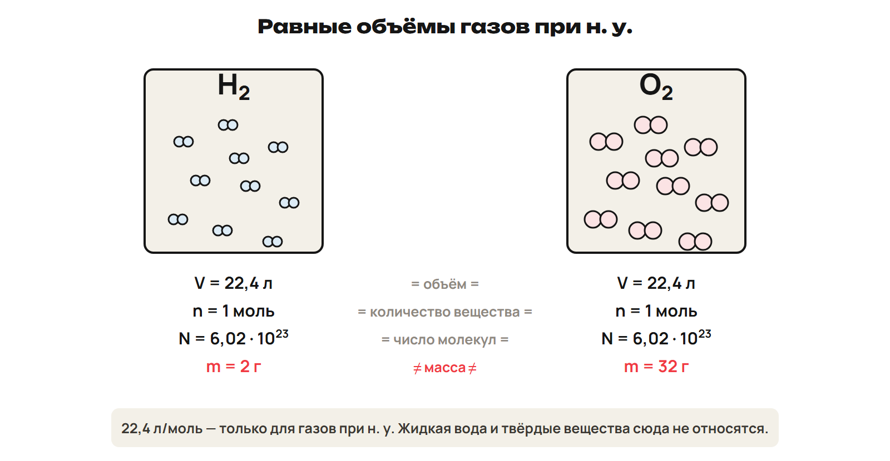

Зачем нужен моль? Вещества реагируют частицами. Масса одинаковых порций разных веществ различается. Моль позволяет сравнить число частиц и прочитать отношение коэффициентов.

## Количество вещества

Количество вещества — физическая величина, характеризующая число однотипных структурных единиц в веществе: атомов, молекул, ионов, электронов. Обозначение n, единица — моль. Всегда называй, какие частицы считаешь.

> [!rule] Моль
> Моль — такое количество вещества (порция вещества), в котором число частиц (атомов или молекул) равно числу атомов углерода в 12 г (0,012 кг) углерода-12.
> Nₐ =6,02 · 10²³ моль⁻¹. n=N/Nₐ; N=nNₐ.

В 1 моль —6,02 · 10²³ частиц. Например, в 0,5 моль молекул воды N=0,5 моль ×6,02 · 10²³ моль⁻¹ =3,01 · 10²³ молекул. В 0,5 моль молекул H₂O содержится 1 моль атомов H и 0,5 моль атомов O: индекс умножает количество атомов.

Число Авогадро можно оценить по углероду: 0,012 кг ÷ (19,94 · 10⁻²⁷ кг на атом) ≈6,02 · 10²³ атомов.

> [!trap] Молекулы и атомы
> 1 моль H₂O —1 моль молекул,2 моль атомов H и 1 моль атомов O. Это разные объекты счёта.

## Масса через моль

> [!rule] Молярная масса
> Молярная масса M — масса 1 моль вещества; по величине равна относительной молекулярной массе Mr (для веществ атомного строения — Ar). Единица — г/моль.
> n=m/M; m=nM; M=m/n.

Mr(H₂O)=18 без единицы: молекула в 18 раз тяжелее атомной единицы массы. M(H₂O)=18 г/моль — масса одного моля. Совпадает число, различаются величины и единицы. Для ионной формулы массу считают по её составу; частицы называй формульными единицами, а не молекулами соли.

Для школьных расчётов: Ar(H)=1, C 12, N 14, O 16, Na 23, Mg 24, Al 27, S 32, Cl 35,5, Ca 40, Fe 56. M(CH₄)=12+4×1=16 г/моль; 16 г содержат 6,02 · 10²³ молекул. Порции 1 моль атомов углерода в графите, серы, железа и меди имеют массу 12,32,56,64 г соответственно. 1 кмоль=1000 моль; 1 моль=1000 ммоль.

> [!example] Из массы в число молекул
> m(CH₄)=8 г, M=16 г/моль.
> n=8 г ÷16 г/моль =0,5 моль.
> N=0,5 моль ×6,02 · 10²³ моль⁻¹ =3,01 · 10²³ молекул.

Масса одной частицы m₁=M/Nₐ: г/моль делятся на моль⁻¹, получаются граммы. Для атома¹³¹I по заданному M=131 г/моль: m₁=131/(6,02 · 10²³) ≈2,18 · 10⁻²² г. Не путай m₁ с массой всей порции.

## Пять шагов задачи по уравнению

Коэффициенты задают отношение молекул и моль. В 2H₂ + O₂ →2H₂O: 2 моль : 1 моль : 2 моль, но массы 4 г : 32 г : 36 г. Реакции подчиняются закону сохранения массы: масса веществ, вступивших в реакцию, равна массе веществ, получившихся в результате.

1. Запиши уравнение, подчеркни вещества из условия.
2. Под формулами укажи количества по уравнению.
3. Над формулами укажи данные условия.
4. Составь и реши пропорцию.
5. Найди массу или объём.

> [!example] Железо и хлор
> 2Fe +3Cl₂ →2FeCl₃. Дано 224 г полностью прореагировавшего Fe.
> n(Fe)=224/56 =4 моль.
> n(FeCl₃)=4 ×2/2 =4 моль.
> M(FeCl₃)=56+3×35,5 =162,5 г/моль.
> m(FeCl₃)=4 ×162,5 =650 г.

Другой пример: 4P +5O₂ →2P₂O₅. Из 93 г P получается 3 моль P; для этого требуется 3×5/4=3,75 моль O₂. Для образования 3,5 моль Al₂O₃ по 4Al +3O₂ →2Al₂O₃ нужно 7 моль Al, то есть 7×27=189 г.

> [!trap] Коэффициенты — не массы
> Fe + S →FeS: отношение моль 1:1, масс 56:32=7:4. Перед переходом к коэффициентам переведи массу в моль.

## Газ при нормальных условиях

> [!rule] Закон Авогадро
> В равных объёмах различных газов при одинаковых условиях содержится одинаковое число молекул.

Первое следствие: одинаковое число молекул различных газов при одинаковых условиях занимает одинаковый объём. Объём 1 моль газа при данных условиях постоянен.

Н. у.: 0 °C (273 K),101,3 кПа (1 атм,760 мм рт. ст.). Vₘ=22,4 л/моль. V=nVₘ; n=V/Vₘ. Например,2 г H₂ и 32 г O₂ — по 1 моль; оба газа занимают 22,4 л при н. у. Массы различны, число молекул и объёмы одинаковы.

> [!trap] Условие формулы
> 22,4 л/моль — только газ при н. у. Для жидкой воды и газа при других условиях это значение не подставляй. Кельвин пишется K без знака градуса.

> [!example] Из объёма в моль
> V(N₂)=4,48 л при н. у.
> n=4,48 л ÷22,4 л/моль =0,2 моль.

## Плотность газа

Второе следствие закона Авогадро: D_Y(X)=M(X)/M(Y), относительная плотность безразмерна. M(X)=D_Y(X)M(Y). M(воздуха)=29 г/моль. Для CO₂ по H₂: D=44/2=22. Если D по воздуху задана 1,517, M≈1,517×29≈44 г/моль — округлённые данные.

Обычная плотность при н. у.:ρ=M/Vₘ, единица г/л. Для N₂:ρ=28 г/моль ÷22,4 л/моль =1,25 г/л.

> [!trap] Две плотности
> D — отношение, без единицы. ρ — масса объёма, г/л. Укажи газ сравнения для D.

## Объёмные отношения

Закон объёмных отношений Гей-Люссака: объёмы вступающих в реакцию газов относятся друг к другу и к объёмам газообразных продуктов как небольшие целые числа. Сравнивай газы при одинаковых температуре и давлении; в наших задачах — н. у.

H₂ + Cl₂ →2HCl: отношения объёмов 1:1:2. Для 4,48 л H₂ нужно 4,48 л Cl₂, получается 8,96 л HCl при н. у. Объём твёрдого вещества или жидкости из коэффициентов не находят.

Для C₃H₈ +5O₂ →3CO₂ +4H₂O: 2 м³ пропана требуют 10 м³ O₂ при одинаковых условиях; объём воды при н. у. по коэффициентам не считаем. Для 2C₂H₂ +5O₂ →4CO₂ +2H₂O: 50 л ацетилена требуют 125 л O₂. Все сравниваемые газы в этих задачах приведены к н. у.

> [!rule] Факты ЕНТ недели
> - Моль — порция с числом частиц как атомов в 12 г углерода-12.
> - Nₐ=6,02 · 10²³ моль⁻¹; имя — Амедео Авогадро.
> - M — масса 1 моль, г/моль; Mr безразмерна.
> - Авогадро: 1811; равные объёмы газов при одинаковых условиях — равное число молекул.
> - Н. у.: 0 °C (273 K),101,3 кПа.
> - Vₘ газа при н. у. 22,4 л/моль.
> - M(воздуха)=29 г/моль; D=M₁/M₂ без единицы.
> - Гей-Люссак — закон объёмных отношений газов.

## Перед уроком 8

> [!try] Проверь себя
> Назови исходную величину и переход к молям. В коэффициентах сравнивай одинаковые объекты. Выполни P1–P6 и всю G, запиши два вопроса.
