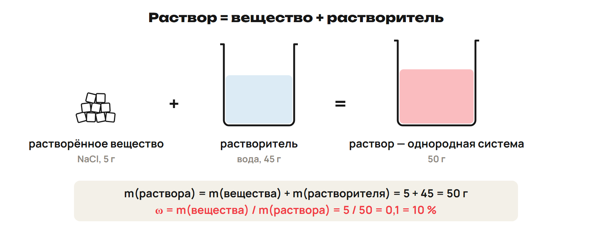
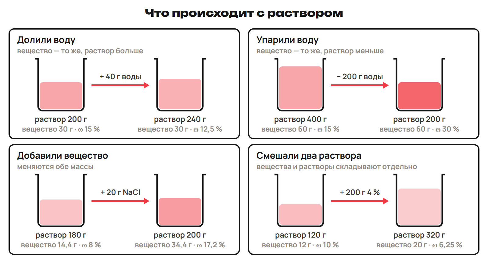
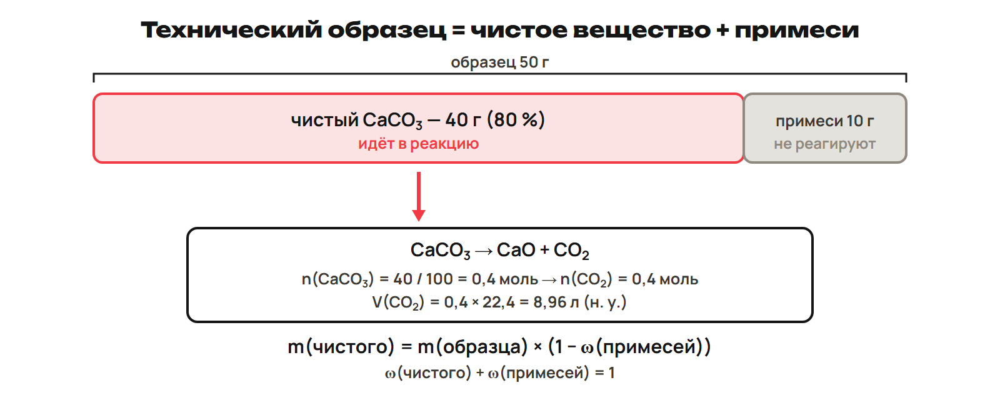
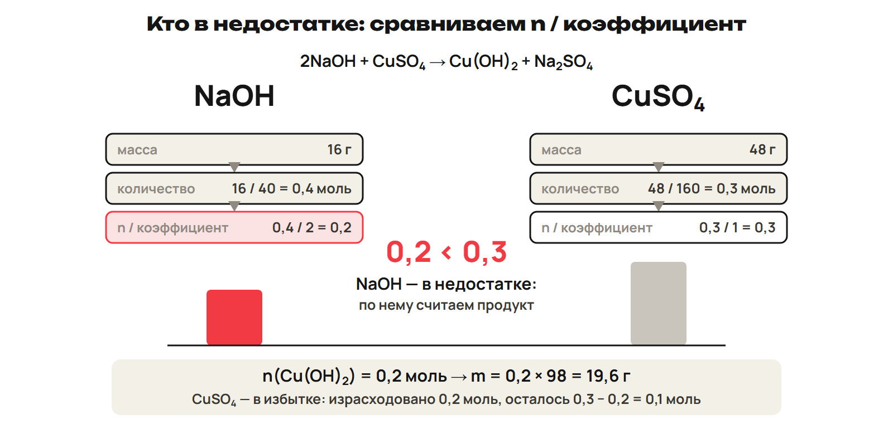
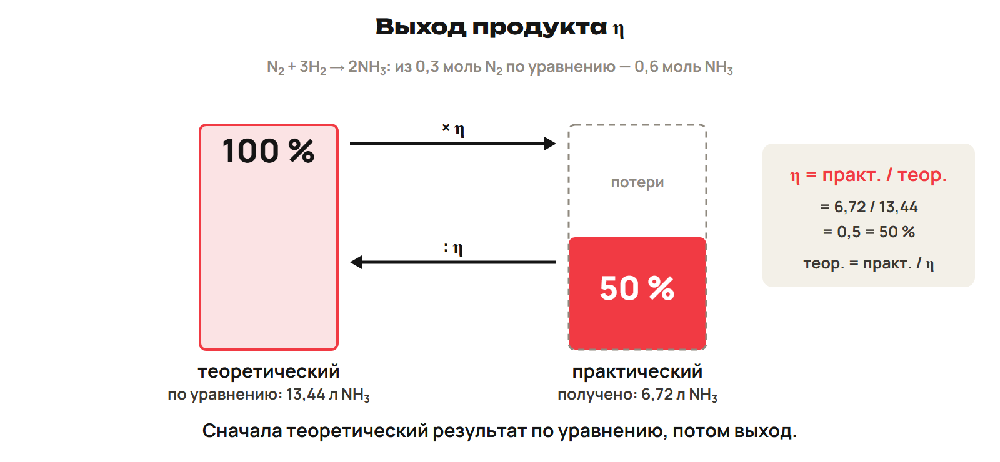

Когда состав изменяется, сначала назови массу чистого вещества или массу раствора. В реакцию переходи через моль; проценты и литры не заменяют моль.

## 1. Раствор и растворимость

Раствор — однородная система из молекул растворителя и частиц растворённого вещества, между которыми идёт физическое и химическое взаимодействие. Жидкие растворы: соль, сахар, спирт в воде; твёрдые — сплавы; газообразные — воздух. Водный раствор имеет растворитель воду; неводные могут использовать спирт, эфир, бензол.

Растворимость — максимальная масса вещества в граммах, которая растворяется в 100 г растворителя при данной температуре. Для KCl при 20 °C дано 34,4 г на 100 г воды. У большинства твёрдых веществ растворимость при нагревании растёт, у газов обычно падает. Это не правило без исключений.

Насыщенный раствор достиг предела при этой температуре; ненасыщенный ещё растворяет вещество; перенасыщенный содержит больше равновесного предела и неустойчив. Концентрированный означает высокое содержание, разбавленный — низкое. Разбавленный раствор малорастворимого вещества может быть насыщенным.

В учебной опоре на 100 г воды при комнатной температуре: хорошо растворимые — больше 10 г, малорастворимые — меньше 1 г, практически нерастворимые — меньше 0,01 г. Используй явно названный порог; в промежутках и на точной границе категорию без дополнительных данных не назначай. Абсолютно нерастворимых веществ нет: даже стекло немного растворяется в воде (опыты К. В. Шееле и А. Лавуазье).

> [!trap] Предел и содержание
> Насыщенный не означает концентрированный. Растворимость считают на 100 г растворителя, ω — по массе раствора.

## 2. Массовая доля

Концентрация — содержание растворённого вещества в единице массы или объёма раствора. Массовая доля ω=m вещества/m раствора; в процентах умножить на 100 %. Масса раствора=масса вещества+масса растворителя.

> [!example] Первое действие — масса раствора
> 5 г NaCl в 45 г воды: раствор 50 г.
> ω=5/50=0,1=10 %.
> Для 200 г 5 % раствора: m вещества=200×0,05=10 г; воды 200−10=190 г.

При доливании воды масса вещества сохраняется, масса раствора растёт. При упаривании только воды масса вещества сохраняется, масса раствора уменьшается. Добавление растворимого вещества меняет обе массы. При смешивании без реакции/осадка складывают массы вещества и раствора отдельно.

> [!example] Разные изменения
> 200 г 15 % + 40 г воды: вещество 30 г, раствор 240 г, ω=30/240=12,5 %.
> 400 г 15 % упарили до 200 г: вещество 60 г, ω=60/200=30 %.
> 180 г 8 % + 20 г NaCl, полностью растворилось: вещество 14,4+20=34,4 г; раствор 200 г; ω=17,2 %.
> 120 г 10 % + 200 г 4 %: вещество 12+8=20 г, раствор 320 г, ω=6,25 %.
> 300 г морской воды 3,5 % выпарили досуха: масса солей 300×0,035=10,5 г.

> [!trap] Не дели на воду
> ω относится ко всему раствору. Слова «довести до 10 %» задают конечную долю; «увеличить на 10 %» требуют уточнения, проценты или процентные пункты.

## 3. Молярная концентрация

Молярная концентрация c — число моль растворённого вещества в 1 л раствора: c=n/V, моль/л. n=cV, m=nM. Миллилитры перед подстановкой переведи в литры. 2М NaOH означает 2 моль (80 г) в 1 л раствора, не в 1 л воды. В мерной колбе устанавливают конечный объём раствора по метке.

> [!example] Сначала моль
> 500 мл 0,1 моль/л CuSO₄: M=160 г/моль.
> V=0,5 л; n=0,1×0,5=0,05 моль; m=0,05×160=8 г.
> 0,98 г H₂SO₄, M=98 г/моль, в 100 мл раствора: n=0,01 моль; c=0,01/0,1=0,1 моль/л.

> [!trap] Литр раствора
> Добавить 1 л воды и получить 1 л раствора — разные условия. c относится к конечному объёму раствора.

## 4. Примеси — после урока 10

Технический образец содержит чистое вещество и примеси иного состава. В задаче сначала уточни, реагирует ли примесь; здесь она инертна в указанной реакции. m технического=m чистого+m примеси; ω чистого+ω примеси=1.

Формулы: m чистого=m технического×(1−ω примеси); m технического=m чистого/(1−ω примеси). ω примеси=m примеси/m смеси; для заданной газовой смеси объёмная доля φ=V примеси/V смеси.

> [!example] В реакцию только чистое
> 50 г CaCO₃ с 20 % инертных примесей: чистое 50×0,8=40 г.
> CaCO₃ → CaO + CO₂; M(CaCO₃)=100 г/моль.
> n(CaCO₃)=40/100=0,4 моль; n(CO₂)=0,4 моль.
> При н. у. Vₘ=22,4 л/моль: V(CO₂)=0,4×22,4=8,96 л.

> [!trap] Примесь не реагент
> Не подставляй всю техническую массу в m/M реагирующего вещества.

## 5. Избыток и недостаток — после урока 10

При двух реагентах найди n каждого и сравни n/коэффициент. Меньшая дробь — вещество в недостатке; расчёт продукта по нему. Избыток не ограничивает продукт; остаток считают как исходное количество минус израсходованное.

Порядок: записать/уравнять реакцию; отметить данные; найти моль; сопоставить с коэффициентами; выбрать недостаток; найти моль продукта; перейти к нужной массе/объёму. Для остатка отдельно найти расход избыточного реагента.

> [!example] Массы не сравниваем напрямую
> 2NaOH + CuSO₄ → Cu(OH)₂ + Na₂SO₄.
> 16 г NaOH, M=40 г/моль: 0,4 моль; 48 г CuSO₄, M=160 г/моль: 0,3 моль.
> n/ν: 0,4/2=0,2; 0,3/1=0,3. Недостаток NaOH.
> n(Cu(OH)₂)=0,2 моль, M=98 г/моль:m=19,6 г.
> CuSO₄ расход 0,2 моль, остаток 0,3−0,2=0,1 моль=16 г.

> [!trap] Меньшая масса не правило
> Сравнивают количества с коэффициентами. Для равных дробей реагенты в стехиометрическом отношении, избытка нет.

## 6. Выход — после урока 10

Выход η=m практического/m теоретического; в процентах×100 %. Аналогично для объёма или количества одного продукта при одинаковых условиях. Обычно реальный результат ниже теоретического из-за потерь/неполного превращения. Идеальный расчёт 100 % — теоретический ориентир.

Порядок: уравнение → моль исходного → моль теоретического продукта по коэффициентам → теоретическая масса/объём → отношение практического к теоретическому. m практического=ηm теоретического; обратная задача: m теоретического=m практического/η.

> [!example] Теория и практика
> N₂ + 3H₂ → 2NH₃. 6,72 л N₂ при н. у., H₂ в избытке, Vₘ=22,4 л/моль.
> n(N₂)=0,3 моль; n(NH₃)теор=0,6 моль; V теор=13,44 л.
> Получено 6,72 л NH₃: η=6,72/13,44=0,5=50 %.
> Практический CO₂ 8,96 л при η 80 %: V теор=8,96/0,8=11,2 л.

> [!trap] Выход относится к продукту
> Сначала теоретический результат реакции, потом выход. Для обратной задачи дели на η, не умножай. Примеси, недостаток и выход — разные шаги.

> [!rule] Факты ЕНТ недели
> - Раствор — однородная система растворителя и вещества.
> - Растворимость — масса на 100 г растворителя при данной t.
> - Твёрдые обычно лучше растворяются при нагревании, газы хуже.
> - Насыщенный достиг предела; ненасыщенный нет; перенасыщенный неустойчив.
> - Учебные пороги на 100 г воды: >10 г; <1 г; <0,01 г соответственно для названных классов.
> - ω=m вещества/m раствора; c=n/V раствора, моль/л.
> - Технический образец=чистое+примеси; расчёт по недостатку.
> - η=практический/теоретический продукт.

После урока 9 прочитай разделы 1–3 за 25 минут, выполни P20 и G35. После урока 10 повтори разделы 4–6 в пределах 15 минут повторения; один вариант 30 и исправления 25 минут. Всего 150 минут за неделю.
