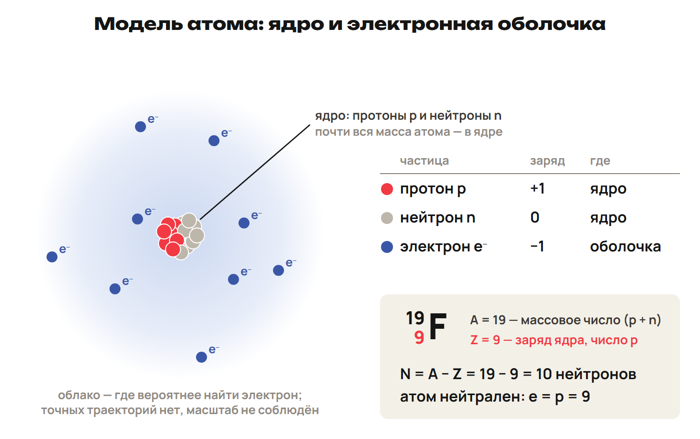
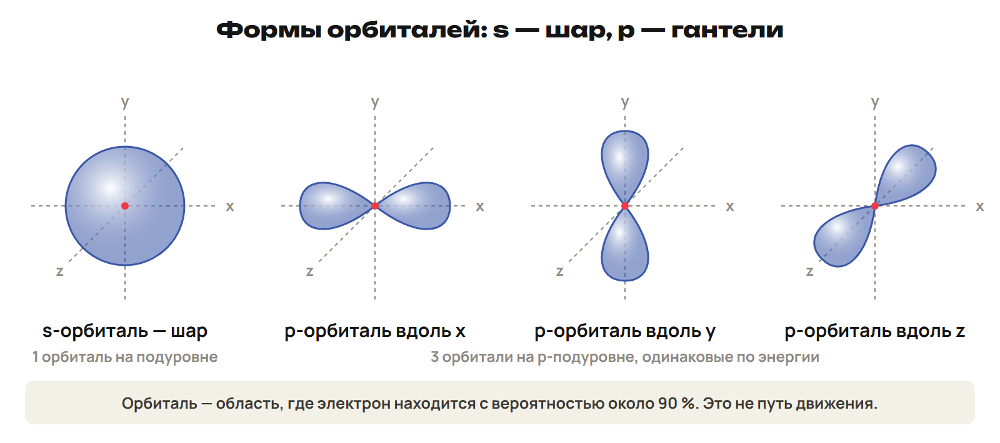

# Состав атома
? Что меняется, когда атом становится ионом?
↳ Заряд частицы уже знаком; теперь посчитаем частицы внутри атома.
> 0–8 минут — объяснение и пример; 8–10 — L1; 10–12 — ключ.

## Понятие: Ядро и оболочка
Ядро: протоны p (+1) и нейтроны n (0); вместе — нуклоны.
Ядерные силы удерживают нуклоны в ядре.
Оболочка: электроны e⁻ (−1), масса каждого ≈ 1/1836 массы протона.
Размер атома около 10⁻⁸ см; ядро примерно в 100 000 раз меньше.
Почти вся масса атома сосредоточена в ядре.

> Рисунок условный: масштабы ядра и оболочки не совпадают. Оболочка показывает область расположения электронов.

## Понятие: Открытия
Томсон — электрон, 1897; Беккерель — радиоактивность.
Резерфорд — ядерная модель, 1911; протон, 1919.
Чедвик — нейтрон.
Мозли связал заряд ядра с порядковым номером.
Бор описывал расположение электронов слоями.
> Назвать вклад каждого учёного. Год открытия нейтрона здесь не спрашивать.

## Понятие: Как прочитать ²³₁₁Na
Z = 11 — порядковый номер, число протонов и заряд ядра +11.
A = 23 — массовое число: число протонов и нейтронов.
N = A − Z = 23 − 11 = 12 нейтронов.
Нейтральный атом: p = e = Z, поэтому e = 11.
> Обозначение N здесь — нейтроны. В задачах на моль N означает число частиц; смысл всегда назвать словами.

## Понятие: Атом становится ионом
Катион (+) образуется при отдаче электронов; анион (−) — при принятии.
В этих превращениях меняется число e, ядро сохраняется.
Металлы обычно отдают электроны, неметаллы — принимают.
Na → Na⁺ + e⁻: у Na⁺ 11p, 12n и 10e; заряд 11 − 10 = +1.
> Связать с зарядом иона из первых недель. Не подменять отдачу электрона изменением Z.

## Ловушка: Z, A и Ar
Z считает протоны; A считает нуклоны отдельного атома.
Число нейтронов находят по A − Z.
Ar элемента — средняя масса смеси; точное число нейтронов она не задаёт.
> Различить верхний индекс нуклида и дробное число в периодической таблице.

## Практика: L1 · 2 минуты
Для нейтрального ¹⁹₉F найди p, n и e.
Атом принял один электрон и стал F⁻. Что изменилось?
Ответы:
¹⁹₉F: p = 9, n = 19 − 9 = 10, e = 9.
F⁻: p = 9, n = 10, e = 10; заряд 9 − 10 = −1.
При присоединении электрона ядро сохраняется.
> Показать ключ на 10-й минуте, после попытки. Проверить заряд по разности p − e.

# Нуклиды и средняя масса
? Почему Ar элемента может быть дробной?
↳ Z определяет элемент, а число нейтронов у его атомов может различаться.
> 12–20 минут — объяснение и пример; 20–23 — L2; 23–25 — ключ.

## Понятие: Три похожих названия
Нуклид — вид атомов с определёнными Z и A.
Элемент объединяет атомы с одинаковым Z.
Изотопы: одинаковый Z, разные A; например, ¹²₆C и ¹³₆C.
Изобары: одинаковый A, разные Z; например, ⁴⁰₁₈Ar и ⁴⁰₂₀Ca.
Изотоны: одинаковый N = A − Z; у ¹³₆C и ¹⁴₇N по 7 нейтронов.
> Сначала назвать сравниваемое число, затем термин.

## Понятие: Изотопы водорода
Протий ¹H: 1p, 0n; дейтерий ²H (D): 1p, 1n.
Тритий ³H (T): 1p, 2n.
У олова 10 стабильных изотопов.
> Различить число стабильных изотопов и число всех известных. Для водорода Z = 1.

## Понятие: Масса атома и масса смеси
1 а. е. м. (дальтон) = 1/12 массы атома ¹²C ≈ 1,66 · 10⁻²⁷ кг.
Ar — средняя масса атомов смеси изотопов относительно а. е. м.
Ar = сумма произведений «доля изотопа × его относительная масса».
Долю в процентах раздели на 100; сумма долей равна 1.
> Ar — безразмерная величина. Массовое число можно использовать как расчётную массу только по условию задачи.

## Понятие: Разберём смесь хлора
Условная смесь: ³⁵Cl — 75,5 %, ³⁷Cl — 24,5 %.
Расчётные массы принять равными 35 и 37 а. е. м.
Ar = 35 × 0,755 + 37 × 0,245 = 35,49 ≈ 35,5.
Средняя масса ближе к 35: этого изотопа больше.
> Не называть 35,5 точным результатом данных долей; это округление. Нейтроны отдельных изотопов: 18 и 20.

## Практика: L2 · 3 минуты
Назови типы пар: ¹³₆C/¹⁴₆C; ⁴⁰₁₈Ar/⁴⁰₂₀Ca; ¹⁵₇N/¹⁶₈O.
Условная смесь: ¹²C — 75 %, ¹³C — 25 %.
Расчётные массы равны 12 и 13 а. е. м. Найди Ar.
Ответы:
Изотопы: Z = 6; изобары: A = 40; изотоны: N = 8 у обоих.
Ar = 12 × 0,75 + 13 × 0,25 = 12,25.
Проверка: 12 < 12,25 < 13; результат ближе к 12.
> Показать ключ на 23-й минуте, после попытки. Проверить, какой признак сравнивал ученик.

# Радиоактивность и баланс
? Какие два числа сохраняются в записи ядерной реакции?
↳ Теперь ядро может измениться; отдельно проследим A и Z.
> 25–33 минуты — объяснение и пример; 33–36 — L3; 36–38 — ключ.

## Понятие: Радиоактивность
Радиоактивность — самопроизвольные превращения неустойчивых ядер с испусканием излучения.
Открыл Беккерель; термин ввела М. Склодовская-Кюри.
М. и П. Кюри открыли полоний и радий.
При γ-излучении элемент сохраняется.
> Дать научно точную формулировку: испускание γ не обязательно сопровождается изменением Z.

## Понятие: α, β⁻ и γ
α — ядро ⁴₂He: 2p + 2n, заряд +2; задерживается бумагой.
β⁻ — поток электронов, возникающих при превращении нейтрона в протон.
β⁻ задерживается слоем меди около 1 мм.
γ — электромагнитное излучение без заряда и массы покоя.
γ обладает самой высокой проникающей способностью из этих трёх видов.
> На этом уроке β означает β⁻. Испущенный электрон возникает в ядерном превращении.

## Понятие: Правило смещения
Фаянс и Содди, 1913.
α: A уменьшается на 4, Z — на 2.
β⁻: A сохраняется, Z увеличивается на 1; испускается ⁰₋₁e.
γ: A и Z сохраняются.
> У β⁻ нижний индекс электрона −1. Это позволяет проверить увеличение Z дочернего ядра.

## Понятие: Два баланса
Ядерная реакция — превращение ядер при взаимодействии с ядрами и частицами.
Первая ядерная реакция: Резерфорд, 1919; азот и α-частицы.
В уравнении равны суммы A слева и справа; отдельно равны суммы Z.
²²⁶₈₈Ra → ²²²₈₆Rn + ⁴₂He.
Проверка: 226 = 222 + 4; 88 = 86 + 2.
> Алгоритм: записать испущенную частицу → найти A и Z ядра → проверить обе суммы.

## Понятие: Период полураспада
Период полураспада — время, за которое распадается половина исходных атомов.
Все элементы с Z > 84 нестабильны.
Казахстан занимает первое место в мире по добыче урана.
> Факт о добыче — из раздела учебника об уране; не добавлять произвольные объёмы или годы. Численные задачи на полураспад идут в углублении.

## Практика: L3 · 3 минуты
Допиши α-распад ²²²₈₆Rn → Po, Z(Po) = 84.
Допиши β⁻-распад ²¹⁸₈₄Po → At, Z(At) = 85; проверь A и Z.
Как изменяются A и Z при γ-излучении?
Ответы:
²²²₈₆Rn → ²¹⁸₈₄Po + ⁴₂He: 222 = 218 + 4; 86 = 84 + 2.
²¹⁸₈₄Po → ²¹⁸₈₅At + ⁰₋₁e: 218 = 218 + 0; 84 = 85 − 1.
При γ-излучении A и Z сохраняются.
> Показать ключ на 36-й минуте, после попытки. Проверить знак нижнего индекса у электрона.

# Уровни и орбитали
? Чем орбиталь отличается от траектории?
↳ Состав ядра посчитан; перейдём к расположению электронов.
> 38–47 минут — объяснение; 47–49 — L4; 49–51 — ключ.

## Понятие: Энергетический уровень
Уровень объединяет электроны с близкой энергией.
Ближе к ядру — меньше энергия и прочнее связь с ядром.
Уровни: 1, 2, 3, 4…; обозначения K, L, M, N…
На уровне n имеется n подуровней и n² орбиталей.
Максимум электронов: e_max = 2n² → 2, 8, 18, 32 для n = 1–4.
> e_max обозначает ёмкость, а не число электронов в любом атоме. Буква N в названии уровня — условное обозначение четвёртого уровня.

## Понятие: Орбиталь — вероятностная область
Орбиталь описывает область вероятного обнаружения электрона.
Изображаемая область охватывает примерно 90 % вероятности.
s-орбиталь — шар; p-орбиталь — гантель; d и f имеют более сложные формы.
Это область пространства, а не точная траектория движения.

> Показать три ориентации p. Цвет и границы рисунка служат для изображения вероятности, а не пути электрона.

## Понятие: Орбитали и ёмкость подуровней
| Подуровень | Орбиталей | Максимум электронов |
|---|---|---|
| s | 1 | 2 |
| p | 3 | 6 |
| d | 5 | 10 |
| f | 7 | 14 |
> Каждая орбиталь в графической записи — отдельная клетка. Объяснение предела 2 e даст принцип Паули.

## Понятие: Что показывает внешняя оболочка
Номер периода равен числу занятых энергетических уровней.
В главных подгруппах IA–VIIIA номер группы равен числу внешних электронов.
Внешний уровень с 8 e завершён; у He завершённый уровень содержит 2 e.
He относится к VIIIA: это исключение из равенства «номер группы = внешние e».
> Пользоваться короткими группами с A/B. На следующем уроке связать положение с конфигурацией и свойствами.

## Практика: L4 · 2 минуты
Для s и p назови форму орбитали, число орбиталей и максимум электронов.
Сколько подуровней, орбиталей и максимум электронов на третьем уровне?
Ответы:
s: шар, 1 орбиталь, 2 e; p: гантель, 3 орбитали, 6 e.
При n = 3: 3 подуровня; n² = 9 орбиталей; e_max = 2 × 3² = 18 e.
18 e — ёмкость, а не обязательное заполнение уровня.
> Показать ключ на 49-й минуте, после попытки. Попросить отличить уровень, подуровень и орбиталь.

# Четыре квантовых числа
? Какие наборы квантовых чисел допустимы?
↳ Уровень, форма, ориентация и спин получают отдельные обозначения.
> 51–59 минут — объяснение; 59–62 — L5; 62–64 — ключ.

## Понятие: Четыре характеристики электрона
n — главное: уровень и размер орбитали; 1, 2, 3…
l — орбитальное: подуровень и форма; 0…n − 1.
m_l — магнитное: ориентация орбитали; −l…0…+l.
m_s — спиновое: +½ (↑) или −½ (↓).
> Проверять набор в том же порядке. Спин обозначается стрелкой, без модели электрона как вращающегося шарика.

## Понятие: Подуровень и ориентация
l = 0 → s; 1 → p; 2 → d; 3 → f.
При n = 2 возможны l = 0 и 1: подуровни 2s и 2p.
Число ориентаций: 2l + 1.
Для p: l = 1, поэтому m_l = −1, 0, +1 — три орбитали.
> Показать, почему l = 2 не подходит второму уровню. У s только m_l = 0.

## Понятие: Как подписать клетки
Клетка [ ] обозначает орбиталь; [↑] — один электрон; [↑↓] — два.
Для p договоримся: слева направо m_l = −1, 0, +1.
При заполнении сначала ставим ↑, затем ↓ в том же порядке клеток.
Это условная нумерация равных по энергии орбиталей.
> При вопросе о m_l конкретного электрона использовать объявленную конвенцию. Без неё возможны разные равноценные наборы.

## Практика: L5 · 3 минуты
Проверь (n, l, m_l, m_s): (2, 1, +1, −½) и (3, 3, 0, +½).
Какое число задаёт ориентацию орбитали? Какое различает спины?
Ответы:
(2, 1, +1, −½) допустим: l ≤ n − 1, m_l входит в −l…+l.
(3, 3, 0, +½) недопустим: при n = 3 разрешено l = 0, 1, 2.
Ориентация — m_l; спин — m_s.
> Показать ключ на 62-й минуте, после попытки. Попросить последовательно проверить все четыре ограничения.

# Заполнение и итог
? Как проверить электронную формулу и клетки со стрелками?
↳ Допустимые состояния известны; заполним их нужным числом электронов.
> 64–74 минуты — правила и O; 74–80 — L6; 80–84 — ключ; 84–88 — итоговая проверка; 88–90 — ДЗ.

## Понятие: Принцип Паули
Нет двух электронов атома с одинаковыми четырьмя квантовыми числами.
На орбитали максимум два электрона с противоположными спинами: [↑↓].
[↑↑] в одной клетке недопустимо.
Один электрон [↑] — неспаренный; два [↑↓] — спаренные.
> Связать предел 2 e с противоположными значениями m_s. Паули проверяется внутри одной клетки.

## Понятие: Правило Хунда
Равные по энергии орбитали одного подуровня сначала занимают по одному.
Спины этих электронов параллельны: p³ → [↑][↑][↑].
Затем образуются пары: p⁴ → [↑↓][↑][↑].
> Для p³ не ставить пару при свободной клетке. Параллельность спинов обязательна.

## Понятие: Правило Клечковского
Заполнение идёт по возрастанию n + l.
При равном n + l раньше заполняется подуровень с меньшим n.
3p: n + l = 3 + 1 = 4; 4s: 4 + 0 = 4 → сначала 3p.
4s: n + l = 4; 3d: 3 + 2 = 5 → сначала 4s.
> Сравнить сумму, затем n. По одной цифре перед буквой энергетический порядок не определяют.

## Понятие: Порядок подуровней
1s → 2s → 2p → 3s → 3p → 4s → 3d → 4p.
Далее: 5s → 4d → 5p → 6s → 4f → 5d → 6p.
Число электронов в нейтральном атоме равно Z.
Заполняй подуровни по порядку и проверяй сумму показателей.
![Порядок заполнения 1s, 2s, 2p, 3s, 3p, 4s, 3d, 4p; рядом Паули [↑↓], Хунд для O: 2p [↑↓][↑][↑], Клечковский и выделение 4s перед 3d](pics/filling-order.png)
> Рисунок общий для недели. Разобрать O, затем предложить F и Na без ключей домашней работы.

## Понятие: Разберём кислород, Z = 8
O: 1s²2s²2p⁴; сумма 2 + 2 + 4 = 8 e.
По уровням: 2, 6; внешний уровень — второй.
Полная графическая запись: 1s [↑↓], 2s [↑↓], 2p [↑↓][↑][↑].
Два неспаренных электрона находятся на 2p.
> Пройти алгоритм: число e → энергетический порядок → клетки → сумма e. Обосновать каждое правило на записи O.

## Понятие: s-, p-, d-, f-элементы
Тип элемента определяет заполняемый подуровень.
O и F — p-элементы; Na — s-элемент.
s- и p-элементы относятся к главным подгруппам.
d-элементы Sc–Zn относятся к побочным подгруппам.
Sc — пример переходного элемента.
У лантаноидов Ce–Lu заполняется 4f-подуровень.
> Формулы Cr/Cu разбирать на следующем уроке. Тип d-элемента не определяют по последнему напечатанному фрагменту 4s.

## Практика: L6 · 6 минут
Нейтральные F (Z = 9) и Na (Z = 11), основное состояние.
Запиши электронные формулы, распределение по уровням и клетки внешнего уровня.
Найди число неспаренных электронов.
Клетки p слева: m_l = −1, 0, +1; сначала ↑, затем ↓ в том же порядке.
Ответы:
F: 1s²2s²2p⁵; уровни 2, 7; 2s [↑↓], 2p [↑↓][↑↓][↑].
Na: 1s²2s²2p⁶3s¹; уровни 2, 8, 1; 3s [↑].
У каждого атома один неспаренный электрон.
Проверка сумм: F — 9e; Na — 11e.
> Показать ключ на 80-й минуте, после попытки. До 84-й минуты разобрать ошибки по Паули, Хунду и энергетическому порядку.

## Итог: Проверь себя без подсказки
Как найти нейтроны? Почему дробная Ar не даёт точного числа нейтронов?
Что сохраняется в ядерном уравнении?
Что изображает орбиталь?
Какое правило исправляет p³ [↑↓][↑][ ]? Почему 4s раньше 3d?
Кто открыл электрон? Кто открыл нейтрон?
> 84–88 минут. Спросить короткое объяснение каждого выбора; при ошибке вернуться к правилу и повторить вопрос без ключа.

## Дома: После урока 11
Прочитай разделы 1–5 конспекта — 25 минут.
Выполни P1–P6 — 20 минут и всю общую часть G — 35 минут.
Запиши вопросы к уроку 12.
На уроке 12: Cr/Cu, периодический закон, свойства и характеристика элемента.
> 88–90 минут. После урока 12 один вариант A/B/C — 30 минут, исправления — 25, повторение — 15. Всего за неделю 150 минут.
