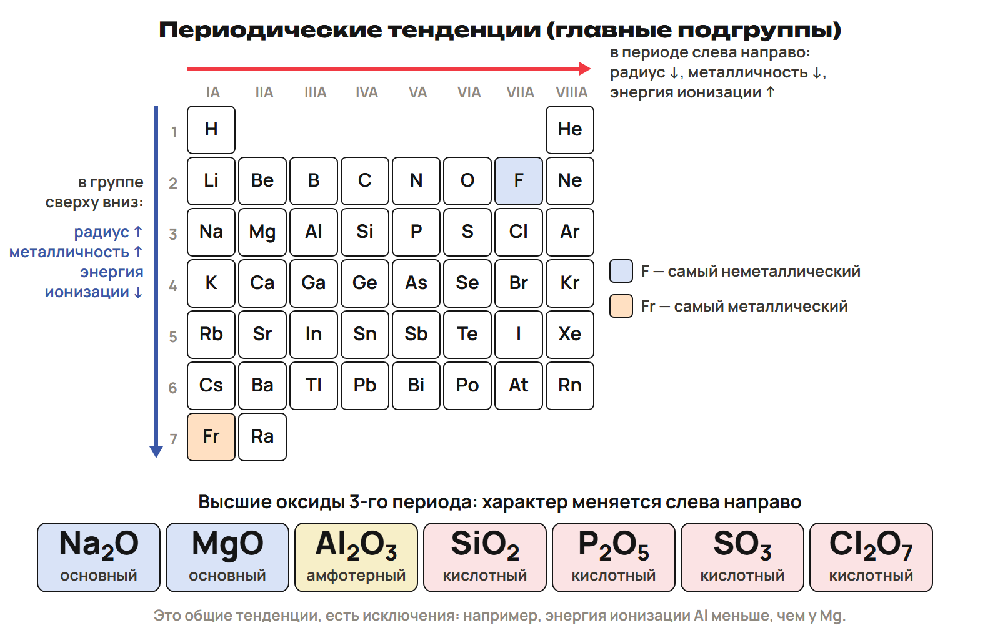

# Вопросы и повторение
? На каком шаге возникла ошибка?
↳ Вернём формулы, ионы и расчёты, затем разберём атом.
> 0–20 минут. Собрать вопросы; дать попытку до ключа.

## Практика: L7 · 3 минуты
Из ионов Mg²⁺ и Cl⁻ составь формулу соли.
Назови характер MgO, Al₂O₃ и CO₂.
Ответы:
MgCl₂: +2 + 2 × (−1) = 0.
MgO — основный; Al₂O₃ — амфотерный; CO₂ — кислотный.
> Проверить заряд и известные примеры; не обобщать все оксиды металлов.

## Практика: L8 · 3 минуты
Найди M(CO₂) и количество вещества в 8,8 г CO₂.
Ar(C) = 12, Ar(O) = 16.
Ответы:
M = 12 + 2 × 16 = 44 г/моль.
n = m/M = 8,8/44 = 0,2 моль.
> Назвать величину и единицу; затем вернуть e = Z и правила заполнения.

# Разбор общей части
? Как отделить среднее от конкретного ядра?
↳ Вспомнили расчёты. Исправим два домашних хода.
> 20–40 минут. Сопоставить фото с повторной попыткой; ключ после объяснения.

## Практика: G9 · условная смесь
Учебная смесь: 90 % атомов ²⁰₁₀Ne, 10 % атомов ²²₁₀Ne.
Это модель состава; массы изотопов прими равными A.
Найди Ar смеси и число нейтронов в каждом нуклиде.
Ответы:
Ar = 20 × 0,90 + 22 × 0,10 = 20,2.
N(²⁰Ne) = 20 − 10 = 10; N(²²Ne) = 22 − 10 = 12.
> Смесь условная, не природный неон. Из среднего Ar число нейтронов не получают.

## Практика: G10 · цепочка распадов
²³⁸₉₂U: α-распад, затем β⁻-распад полученного ядра.
Запиши оба уравнения и проверь суммы A и Z.
Даны U: Z = 92; Th: Z = 90; Pa: Z = 91.
Ответы:
²³⁸₉₂U → ²³⁴₉₀Th + ⁴₂He; A: 238 = 234 + 4; Z: 92 = 90 + 2.
²³⁴₉₀Th → ²³⁴₉₁Pa + ⁰₋₁e; A: 234 = 234 + 0; Z: 90 = 91 − 1.
> Для второго шага взять Th. В 37–40 минут вернуть 4s перед 3d, Паули и Хунда.

# Конфигурация и положение
? Что можно прочитать по электронной формуле?
↳ Ядро проверили. Теперь распределим электроны 1–4 периодов.
> 40–55 минут. Сначала объяснение и примеры, затем L9 и L10.

## Понятие: Почему конфигурация связана со свойствами
В нейтральном атоме e = Z.
При росте Z заполняются уровни и подуровни.
Строение внешнего уровня периодически повторяется.
Поэтому периодически повторяются свойства элементов.
> Связать новую часть с оболочкой из урока 11.

## Понятие: Алгоритм записи
1. Возьми число электронов нейтрального атома: e = Z.
2. Заполняй 1s, 2s, 2p, 3s, 3p, 4s, 3d, 4p.
3. Ёмкость: s — 2, p — 6, d — 10 электронов.
4. Проверь: сумма верхних показателей равна Z.
5. В клетках — Паули и Хунд: сначала одиночные параллельные стрелки.
> При равном n + l раньше подуровень с меньшим n. Cr и Cu разобрать отдельно.

## Понятие: Первые три периода
1-й: H 1s¹ → He 1s².
2-й: Li [He]2s¹ → Ne [He]2s²2p⁶.
3-й: Na [Ne]3s¹ → Ar [Ne]3s²3p⁶.
[He], [Ne], [Ar] — конфигурации этих благородных газов.
Каждый следующий электрон записывай по порядку заполнения.
> Развернуть [He] и [Ne]; показать Mg: [Ne]3s² и Al: [Ne]3s²3p¹.

## Понятие: Четвёртый период
K: [Ar]4s¹; Ca: [Ar]4s².
Sc–Zn: заполняется 3d; это d-блок.
Fe: [Ar]3d⁶4s²; всего 18 + 6 + 2 = 26 электронов.
Ga–Kr: заполняется 4p; Kr: [Ar]3d¹⁰4s²4p⁶.
Ловушка: тип определяют по заполняемому подуровню, а не последней напечатанной записи.
> Назвать Fe d-элементом; ионные конфигурации d-металлов не вводить.

## Практика: L9 · 2 минуты
Cl, Z = 17: полная конфигурация, клетки внешнего уровня, период, подгруппа A, тип.
K, Z = 19: сокращённая конфигурация нейтрального атома.
Ответы:
Cl: 1s²2s²2p⁶3s²3p⁵; 3s [↑↓], 3p [↑↓][↑↓][↑].
Cl: период 3, VIIA, p-тип; сумма показателей 17.
K: [Ar]4s¹; 18 + 1 = 19.
> 44–46 попытка, 46–48 разбор. Равнозначные положения одиночной p-стрелки допустимы.

## Понятие: Исключения Cr и Cu
Cr: [Ar]3d⁵4s¹; Cu: [Ar]3d¹⁰4s¹.
Устойчивее наполовину или полностью заполненный d-подуровень.
Cr: 3d [↑][↑][↑][↑][↑]; 4s [↑].
Cu: 3d [↑↓][↑↓][↑↓][↑↓][↑↓]; 4s [↑].
Оба элемента относятся к d-блоку.
> Показать, почему обычные 3d⁴4s² и 3d⁹4s² здесь заменяются исключениями.

## Понятие: Период, главная подгруппа, тип
Период — наибольшее n в конфигурации атома.
IA, IIA: ns¹, ns²; IIIA–VIIIA: ns²np¹ … ns²np⁶.
В главных подгруппах номер группы равен числу внешних электронов.
He: 1s², VIIIA, два внешних электрона, s-тип.
У d-элементов номер группы так по внешним электронам не определяют.
> Для He внешняя оболочка завершена. Объяснение до самостоятельного L10.

## Практика: L10 · 2 минуты
Cr, Z = 24, и Cu, Z = 29: сокращённые конфигурации, тип, неспаренные электроны.
He, Z = 2: главная подгруппа и число внешних электронов.
Ответы:
Cr: [Ar]3d⁵4s¹, d-тип, 6 неспаренных; 18 + 5 + 1 = 24.
Cu: [Ar]3d¹⁰4s¹, d-тип, 1 неспаренный; 18 + 10 + 1 = 29.
He: VIIIA, 2 внешних электрона.
> 51–53 попытка, 53–55 разбор. Считать одиночные стрелки на обоих подуровнях.

# Периодический закон и свойства
? Почему направление в таблице меняет свойства?
↳ Прочитали внешнюю оболочку. Объясним общие тенденции.
> 55–69 минут. Сначала закон и примеры; L11 на 64–66 минуте.

## Понятие: Периодический закон
Д. И. Менделеев, 1869: периодическая зависимость от атомного веса.
Современный закон: свойства элементов и их соединений находятся
в периодической зависимости от заряда ядер атомов.
Причина — периодическое повторение строения внешнего уровня.
Ловушка: порядок элементов определяет заряд ядра, а не атомная масса.
> Отделить историческую формулировку от современной.

## Понятие: Периоды и группы
Период: элементы по возрастанию заряда ядра; номер — число занятых уровней.
Малые периоды 1–3, большие 4–7; числа элементов: 2, 8, 8, 18, 18, 32, 32.
Кроме первого: начало — щелочной металл, конец — благородный газ.
Главная подгруппа A — малые и большие периоды; побочная B — только большие.
Короткая таблица: 8 групп; длинная: 18; лантаноиды и актиноиды вынесены вниз.
> Первым элементом является H; не применять начало ns¹ → конец ns²np⁶ к He буквально.

## Понятие: Естественные семейства
IA: Li, Na, K, Rb, Cs, Fr; ns¹ — щелочные металлы.
С водой дают щёлочь и водород; это активные металлы.
VIIA: F, Cl, Br, I, At; ns²np⁵ — галогены, «рождающие соли».
Двухатомные молекулы; активность снижается от F к I.
VIIIA: He, Ne, Ar, Kr, Xe, Rn — благородные газы, одноатомные, малоактивные.
Завершённый уровень: ns²np⁶; у He — 1s².
> Фтор — самый активный неметалл. Состав семейств прочитать по таблице.

## Понятие: Металлы и неметаллы
Металлы — слева и ниже диагонали B–At; неметаллы — справа и выше.
Между ними — металлоиды; кремний — полупроводник.
Франций — самый металлический; фтор — самый неметаллический элемент.
Литий — самый лёгкий металл; водород — самый лёгкий неметалл.
Алмаз — самый твёрдый в школьном ряду веществ; хром отличается высокой твёрдостью; вольфрам — самый тугоплавкий металл.
Серебро, медь и алюминий обладают высокой теплопроводностью.
> Показать области таблицы; «металлические свойства» не приравнивать к твёрдости.

## Понятие: Радиус и свойства
В периоде слева направо: радиус обычно уменьшается; металличность ослабевает.
В главной подгруппе вниз: добавляются уровни, радиус растёт; металличность усиливается.
Неметаллические свойства меняются в обратном направлении.
Катион меньше исходного атома; анион больше.
Сначала определи направление, затем сравни свойство.
> В периоде растёт притяжение электронов к ядру; отдельно назвать число уровней в подгруппе.

## Понятие: Энергия ионизации и сродство к электрону
Энергия ионизации показывает, насколько трудно отдать электрон.
В целом в периоде она растёт, в главной подгруппе вниз уменьшается.
Сродство к электрону характеризует присоединение электрона.
Общая тенденция: рост в периоде, уменьшение вниз по главной подгруппе.
Ловушка: это тенденции с исключениями; строгий ряд по сродству для F/Cl не строим.
> Не делать благородный газ «лучшим принимающим электрон». Исключение Mg/Al — опора A.

## Понятие: Карта направлений

> Попросить прочитать одну стрелку словами; затем показать знакомые оксиды.

## Понятие: Характер оксидов и гидроксидов
MgO → Al₂O₃ → SiO₂: основной → амфотерный → кислотный.
В периоде обычно усиливается кислотный характер, вниз по подгруппе — основной.
BeO, ZnO, Al₂O₃ — амфотерные; B₂O₃ и SiO₂ — кислотные.
CO и NO — несолеобразующие оксиды.
CrO — основной; Cr₂O₃ — амфотерный; CrO₃ — кислотный.
Ловушка: характер нельзя определить только по +3 или +4.
> Гидроксиды: Mg(OH)₂ — основание, Al(OH)₃ — амфотерный, H₂SiO₃ — кислота.

## Понятие: Формулы соединений по группе A
Высшие оксиды IA–VIIA: R₂O, RO, R₂O₃, RO₂, R₂O₅, RO₃, R₂O₇.
Примеры: Na₂O, MgO, Al₂O₃, SiO₂, P₂O₅, SO₃, Cl₂O₇.
Правило имеет исключения; всем благородным газам RO₄ не приписывают.
Летучие водородные соединения неметаллов IVA–VIIA: RH₄, RH₃, H₂R, HR.
Примеры: CH₄, NH₃, H₂S, HCl; валентность по водороду = 8 − номер группы.
> Формулы сопоставить с известными соединениями; степени окисления подробно — позже.

## Понятие: Один факт к следующей теме
Л. Полинг ввёл понятие электроотрицательности.
Это способность атома в молекуле притягивать общие электронные пары.
Высокая электроотрицательность у F, O, N, Cl; наибольшая — у F.
Низкая — у щелочных металлов.
> К понятию вернуться при химической связи на следующей неделе.

## Практика: L11 · 2 минуты
Упорядочь Li, Na, K по увеличению радиуса атома.
Сравни металлические свойства Mg и S; назови характер BeO, ZnO, SiO₂.
Ответы:
Li < Na < K: вниз по IA добавляются уровни.
Mg более металлический, чем S: в периоде слева направо металличность ослабевает.
BeO, ZnO — амфотерные; SiO₂ — кислотный.
> 64–66 попытка, 66–69 разбор. Ответ сопровождать направлением в таблице.

# Характеристика элемента
? Как связать положение, атом и соединения?
↳ Направления объяснили. Соберём сведения об одном элементе.
> 69–78 минут. Алгоритм и пример до L12.

## Понятие: План характеристики
1. Z, период, группа, подгруппа.
2. p, N = A − Z, e; конфигурация и s/p/d-тип.
3. Металл или неметалл.
4. Высший оксид и соответствующий гидроксид, их характер.
5. Летучее водородное соединение неметалла.
6. Сравнение с соседями по периоду и подгруппе.
> Число нейтронов определять при заданном A; для нейтрального атома e = Z.

## Понятие: Разобранный пример — сера
Нейтральный ³²₁₆S: Z = 16; период 3, VIA; p = e = 16, N = 16.
1s²2s²2p⁶3s²3p⁴; p-элемент, неметалл.
SO₃ — кислотный оксид; H₂SO₄ — соответствующая кислота.
Летучее водородное соединение — H₂S.
В третьем периоде S менее металлический, чем Mg.
> Выделить пять связей; A = 32 задано для этого нуклида, это не вывод из Ar.

## Практика: L12 · 3 минуты
Нейтральный ³¹₁₅P: составь характеристику по шести шагам.
Сравни радиус P и Na в третьем периоде.
Ответы:
Z = 15; период 3, VA; p = e = 15, N = 16; 1s²2s²2p⁶3s²3p³.
p-тип, неметалл; P₂O₅ — кислотный, H₃PO₄ — кислота; PH₃.
Радиус P меньше, чем Na: в периоде слева направо он обычно уменьшается.
> 73–76 попытка, 76–78 разбор. P₂O₅ — школьная запись формулы высшего оксида.

# Контроль и маршрут
? Какие шаги ты выполняешь самостоятельно?
↳ Объясняли и решали вместе. Теперь проверь себя без подсказок.
> 78–90 минут. Контроль 10 минут; затем назначить один маршрут.

## Практика: Контроль Q1–Q6 · 10 минут
Работай по ученическому листу без подсказок.
Q1–Q3 — одна буква; Q4 — все верные; Q5 — две пары; Q6 — решение.
Максимум 10 баллов; ответы передай преподавателю.
> 78–88 минут. Ключ открыть после сдачи; на слайде ответов нет.

## Дома: Один вариант
A — углубление; B — закрепление; C — поддержка.
Один вариант — 30 минут; исправления — 25; повторение — 15.
В повторение входят раздел 6 конспекта и факты недели.
Четыре блока ниже читай только для A внутри его 30 минут.
За неделю: 25 + 20 + 35 + 30 + 25 + 15 + 15 (расчётный трек) = 165 минут.
> 88–90 минут. Выбрать маршрут по диагностике, G, Q и объяснению; приложение в урок не включать.

## Понятие: Углубление A — доля изотопа
Для учебной смеси двух изотопов задай долю первого x, второго 1 − x.
Если по условию массы равны a и b, то Ar = ax + b(1 − x).
Отсюда x = (b − Ar)/(b − a); проверь 0 ≤ x ≤ 1.
В конце проверь среднее и сумму долей; проценты = доля × 100 %.
Показатели смеси не заменяют A отдельного нуклида.
> Опора для A внутри 30 минут. Массовые числа как расчётные массы — только по условию.

## Понятие: Углубление A — ядро и время
β⁺: испускается ⁰₊₁e; A сохраняется, Z уменьшается на 1.
K-захват: ядро поглощает электрон; A сохраняется, Z уменьшается на 1.
После каждого периода полураспада остаётся половина нераспавшихся ядер.
¹³¹I — 8 суток; ¹⁴C — 5730 лет; ²³⁸U — 4,5 млрд лет.
Чётные числа p и N повышают устойчивость; важно отношение N к p.
В звёздах элементы образуются в термоядерных реакциях.
> Для β⁺ и захвата проверить суммы A/Z. Опора для A, не содержание общего контроля.

## Понятие: Углубление A — квантовые числа
n = 1, 2, 3…; l = 0 … n − 1; m_l = −l … +l; m_s = ±½.
Для конкретного электрона укажи порядок клеток и выбранную стрелку.
Пример конвенции p-клеток слева направо: m_l = −1, 0, +1.
n + l = 4: 3p (3 + 1) и 4s (4 + 0).
3p — p-элементы третьего периода; 4s — s-элементы четвёртого.
При равном n + l раньше меньший n: 3p перед 4s.
> Один возможный набор не считать единственным без конвенции клеток. Чтение внутри A.

## Понятие: Углубление A — обратная характеристика
У Al энергия ионизации ниже, чем у Mg: начинается заполнение 3p.
Это исключение из общей тенденции третьего периода.
XH₄ указывает на IVA; для XO₂: ω(O) = 32/(Ar(X) + 32).
Из заданной доли кислорода найди Ar(X), затем элемент и его положение.
Менделевий: № 101; Г. Сиборг, 1955; назван в честь Д. И. Менделеева.
> Опора для A внутри его 30 минут; новые числовые данные брать из своего варианта.
